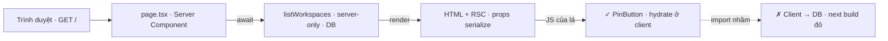
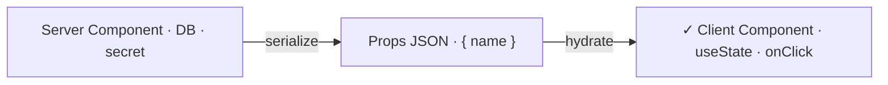
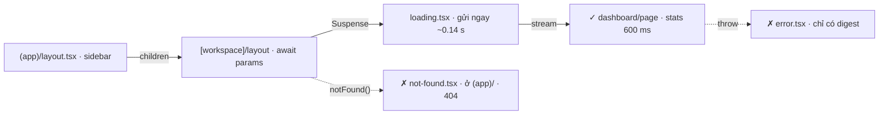
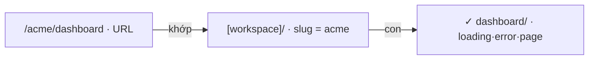
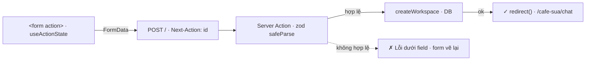
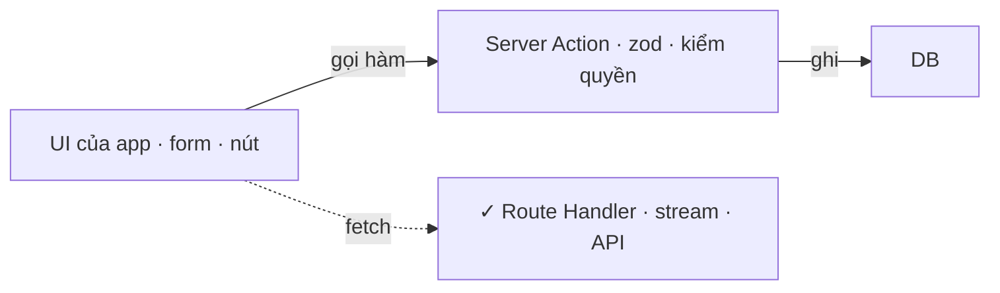
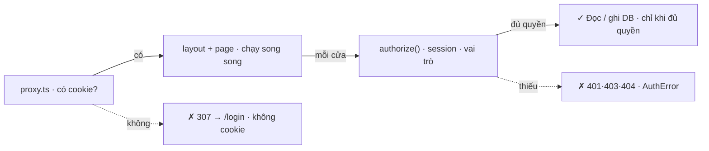
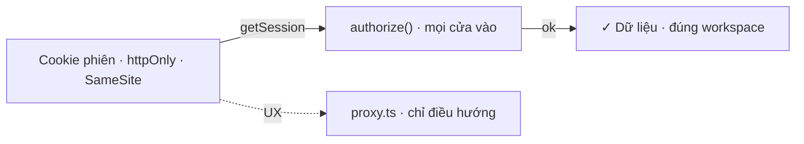
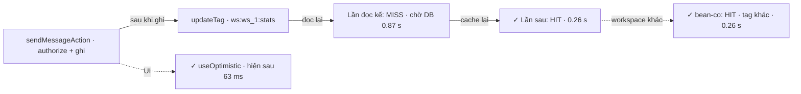
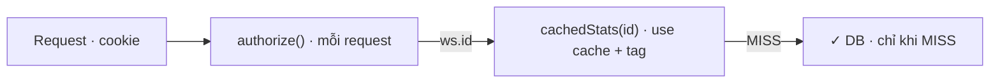

# Module 9 — Next.js chuyên sâu & Auth

> Roadmap MCP × Full-Stack AI · 5 bài · Next.js 16 App Router · Server/Client Components, routing, Server Actions, Better Auth, Cache Components

## Các bài

- **9.1** — Server vs Client Components
- **9.2** — Routing & UI trạng thái
- **9.3** — Server Actions & Route Handlers
- **9.4** — Authentication & authorization
- **9.5** — Caching, revalidation & optimistic UI

---

# 9.1 — Server vs Client Components

*Đã chạy với: Node 22.22.0 · pnpm 10.28.0 · TypeScript 6.0.3 (strict) · Next.js 16.4.1 (Turbopack) · React 19.3.1 · Better Auth 1.7.10 · Zod 4.6.7 · Chromium (Playwright 1.56). MongoDB: store RAM cùng hợp đồng async — chưa chạy Mongo thật ở sandbox.*

## 1. Một câu & nằm ở đâu

**Trong App Router mọi component mặc định chạy trên server; `"use client"` không có nghĩa "component này chạy ở client" mà đánh dấu *cửa vào* — từ file đó trở xuống mới bị đóng gói JS gửi xuống trình duyệt.**

Bức tranh lớn: **[Máy bạn]** → Commit → **[PR/CI]** → E2E → Staging → Prod

Bài này đụng 2 ô: máy bạn (đặt ranh giới) và PR/CI — `next build` là chỗ bắt lỗi kéo nhầm code server xuống client, trước khi có gì lên staging.

## 2. Concept

| | Server Component | Client Component (`"use client"`) | Bên C# |
|---|---|---|---|
| Chạy ở đâu | Server, lúc request (hoặc lúc build nếu không có gì động) | Server render HTML lần đầu, rồi **hydrate** (gắn sự kiện vào HTML có sẵn) ở trình duyệt | Razor view vs component Blazor WASM |
| Được làm | `async`, gọi DB, đọc biến môi trường bí mật | `useState`, `onClick`, API trình duyệt | — |
| Không được | Hook, event handler | Import module có `"server-only"` | `internal` qua ranh giới assembly |
| Gửi xuống trình duyệt | HTML + **RSC payload** (cây UI dạng JSON, không JS) | HTML + JS của file và mọi thứ nó import | — |
| Props qua ranh giới | Phải serialize được: string, number, Date, object thường. **Hàm thì không** | — | DTO qua API, không truyền delegate |

`server-only` là package rỗng: import nó từ đồ thị client thì build lỗi. Đặt dòng đó ở đầu mọi module chạm DB hay secret.

## 3. Flow

**Mở / — code nào chạy ở đâu, theo thứ tự nào?**



**Đọc sơ đồ:** Trái sang phải là thứ tự trong 1 request. Mọi ô trừ ô cuối chạy trên server; trình duyệt chỉ nhận HTML, 1 gói JSON (RSC payload) chứa props đã serialize, và JS của đúng component có "use client". *Màu: cam đất = phần bài này dạy · ô-liu + ✓ = kết quả đúng · gạch + ✗ + viền đứt = lỗi / bị chặn.*


## 4. Ví dụ thực tế

Trang chủ Nexus: danh sách workspace đọc thẳng từ DB, mỗi dòng có nút Ghim cần state. Page là Server Component — `async`, không `useEffect`, không API trung gian:

`apps/web/app/page.tsx`

```tsx
import { listWorkspaces } from "@/lib/db/workspaces";
import { PinButton } from "@/components/pin-button";

// Server Component (mặc định): async, gọi thẳng DB, không có API nào ở giữa.
export default async function Home() {
  const workspaces = await listWorkspaces();
  return (
    <main>
      <h1>Workspace của bạn</h1>
      <ul>
        {workspaces.map((w) => (
          <li key={w.id}>
            <a href={`/${w.slug}/chat`}>{w.name}</a>{" "}
            <small>tạo {w.createdAt.toLocaleDateString("vi-VN")}</small>{" "}
            <PinButton name={w.name} />
          </li>
        ))}
      </ul>
    </main>
  );
}
```

```console
$ npx tsc --noEmit -p tsconfig.json && echo "tsc strict: 0 lỗi"
tsc strict: 0 lỗi
$ npx next build 2>&1 | grep -A3 "Route (app)"
Route (app)
┌ ƒ /
└ ○ /_not-found
```

```console
$ curl -s localhost:3009/ | grep -o '<li><a href="[^"]*">[^<]*'
<li><a href="/acme/chat">Acme Coffee
<li><a href="/bean-co/chat">Bean &amp; Co
```

`ƒ /` là dynamic: render mỗi request. Tên workspace có sẵn trong HTML — không có vòng “tải trang trống rồi gọi API” như SPA.

Chỉ lá cần tương tác mới là Client Component, nhận props đã serialize:

`apps/web/components/pin-button.tsx`

```tsx
"use client";
import { useState } from "react";

// Client Component: chỉ phần cần tương tác. Nhận props đã serialize từ server.
export function PinButton({ name }: { name: string }) {
  const [pinned, setPinned] = useState(false);
  return (
    <button type="button" aria-pressed={pinned} onClick={() => setPinned((p) => !p)}>
      {pinned ? `★ Đã ghim ${name}` : "☆ Ghim"}
    </button>
  );
}
```

```console
$ curl -s localhost:3009/ | grep -o 'null,{\\"name\\":\\"[A-Z][^}]*}'
null,{\"name\":\"Next.MetadataOutlet\",\"children\":\"$@9\"}
null,{\"name\":\"Next.Metadata\",\"children\":\"$Lf\"}
null,{\"name\":\"Acme Coffee\"}
null,{\"name\":\"Bean \u0026 Co\"}
$ grep -rl "aria-pressed" .next/static/chunks
.next/static/chunks/0w8f10_5r2h1e.js
```

Thứ đi qua ranh giới chỉ là `{"name":"Acme Coffee"}` (2 dòng đầu là metadata của Next). Code `PinButton` (có `aria-pressed`) nằm trong 1 chunk của `.next/static` — thứ trình duyệt tải.

Module chạm DB tự khóa mình ở server:

`apps/web/lib/db/store.ts`

```ts
import "server-only";
import { connection } from "next/server";
import type { Role } from "@nexus/shared";

// Thay MongoDB trong sandbox (không kéo được image): cùng hợp đồng async, có độ trễ như gọi mạng.
export type Workspace = { id: string; slug: string; name: string; createdAt: Date };
export type Member = { workspaceId: string; email: string; role: Role };
export type Message = { id: string; workspaceId: string; author: string; text: string; at: Date };

const DB_URL = process.env.NEXUS_DB_URL ?? "mongodb://nexus:s3cret-only-on-server@db:27017/nexus";
const LATENCY_MS = Number(process.env.NEXUS_DB_LATENCY_MS ?? 120);
```

```console
$ grep -rl "s3cret-only-on-server" .next/static | wc -l
0
$ grep -rl "s3cret-only-on-server" .next/server | grep -v "\.map$"
.next/server/chunks/ssr/_0dsi0r7q_whyc._.js
```

Chuỗi kết nối có trong bundle server, 0 file trong `.next/static` (thứ trình duyệt tải). `connection()` (dòng 2, dùng ở hàm `query`) nói với Next: đọc DB thì phải chờ request — xem Bẫy 3.

## 5. Thử thật: bẫy

### Bẫy 1 — import DB vào client “cho tiện”

`apps/web/components/pin-button.tsx`

```tsx
"use client";
import { useState } from "react";
import { listWorkspaces } from "@/lib/db/workspaces";
```

```console
$ npx next build 2>&1 | grep -E "^Error|^\./apps|^It should"
Error: Turbopack build failed with 4 errors:
./apps/web/lib/db/store.ts:1:1
./apps/web/lib/db/workspaces.ts:1:1
./apps/web/lib/db/store.ts:1:1
It should only be used from a Server Component.
./apps/web/lib/db/workspaces.ts:1:1
It should only be used from a Server Component.
```

Build chặn ngay, chỉ đúng 2 file có `"server-only"` và đường import. Không có dòng này, chuỗi kết nối DB sẽ lặng lẽ nằm trong JS công khai.

### Bẫy 2 — truyền callback xuống như React/Blazor

`apps/web/components/pin-button.tsx`

```tsx
// Thói quen React/Blazor: cha truyền callback xuống con.
export function PinButton({ name, onPin }: { name: string; onPin: (pinned: boolean) => void }) {
```

```console
$ npx tsc --noEmit -p tsconfig.json && echo "tsc: 0 lỗi"
tsc: 0 lỗi
$ curl -s -o /dev/null -w "HTTP %{http_code}\n" localhost:3009/
HTTP 500
$ grep -m1 -A4 "Event handlers" server.log
⨯ Error: Event handlers cannot be passed to Client Component props.
  {name: ..., onPin: function onPin}
                     ^^^^^^^^^^^^^^
If you need interactivity, consider converting part of this to a Client Component.
    at ignore-listed frames {
```

`tsc` xanh, build xanh, request đầu tiên 500: hàm không serialize được để gửi xuống trình duyệt. Hành vi thuộc về Client Component; muốn server làm gì thì gọi Server Action (9.3).

### Bẫy 3 — trang “đóng băng” lúc build

```console
$ npx next build 2>&1 | grep -A3 "Route (app)"
Route (app)
┌ ○ /
└ ○ /_not-found

$ curl -sI localhost:3009/ | grep -i -E "^HTTP|x-nextjs"
HTTP/1.1 200 OK
x-nextjs-cache: HIT
x-nextjs-prerender: 1
x-nextjs-prerender: 1
x-nextjs-stale-time: 300
```

Store RAM không dùng `fetch`/`cookies`, nên Next coi trang là tĩnh và render **1 lần lúc build** (`○`, `x-nextjs-cache: HIT`): workspace tạo sau đó không bao giờ hiện. Driver Mongo cũng vậy — Next không biết đó là I/O. 9.5 thay cơ chế này bằng Cache Components.

## 6. Tóm tắt bằng hình

*apps/web sau 9.1* — (mới) = file mới, (đổi) = file sửa

```text
apps/web/
├─ app/page.tsx  (đổi)  ← Server Component: await DB, render danh sách
├─ components/pin-button.tsx  (mới)  ← "use client": lá duy nhất có state
└─ lib/db/
   ├─ store.ts  (mới)  ← "server-only" + connection(): DB giả, trễ 120 ms
   └─ workspaces.ts  (mới)  ← listWorkspaces() — chỉ server gọi được
```

**Ranh giới server/client trong 10 giây**



**Đọc sơ đồ:** Dữ liệu chảy 1 chiều: server đọc DB, chỉ gửi props JSON xuống lá client. Không có đường ngược từ client về DB. *Màu: cam đất = phần bài này dạy · ô-liu + ✓ = kết quả đúng · gạch + ✗ + viền đứt = lỗi / bị chặn.*


## 7. Làm ngay (≤ 10 phút)

**Mục tiêu:** thêm nút “Copy slug” cạnh mỗi workspace mà không kéo dòng code DB nào xuống trình duyệt.

- [ ] `components/copy-slug.tsx` có `"use client"`, nhận đúng 1 prop `slug: string`, gọi `navigator.clipboard.writeText`.
- [ ] `app/page.tsx` vẫn không có `"use client"` và vẫn `await listWorkspaces()`.
- [ ] Bảng route vẫn `ƒ /`; `.next/static` vẫn 0 file chứa chuỗi kết nối.

```console
$ npx tsc --noEmit -p tsconfig.json && npx next build 2>&1 | grep -A3 "Route (app)"
$ grep -rl "s3cret-only-on-server" .next/static | wc -l
```

<details>
<summary>Gợi ý nếu bị đỏ</summary>

| Triệu chứng | Nguyên nhân | Sửa |
|---|---|---|
| `'server-only' cannot be imported from a Client Component module` | Nút import `lib/db/*` hoặc type kéo theo giá trị | Chỉ nhận `slug` qua props; import type bằng `import type` |
| `Event handlers cannot be passed to Client Component props` | Page truyền `onCopy={…}` xuống | Logic copy nằm trong nút |
| `useState only works in Client Components` | Quên `"use client"` ở dòng 1 | Thêm directive, đúng dòng đầu file |
| Bảng route thành `○ /` | Ai đó bỏ `connection()` | Đọc DB phải đi qua `query()` |

</details>

## 8. 3 câu hỏi nhanh

1. `"use client"` ở đầu `pin-button.tsx` nghĩa là gì?
   - A. Component chỉ render ở trình duyệt, server bỏ qua
   - B. File này và mọi thứ nó import thuộc đồ thị client: có JS gửi xuống, vẫn được render HTML trên server lần đầu
   - C. Tắt SSR cho cả trang

   <details><summary>Đáp án</summary>

   **B.** Client Component vẫn có HTML từ server; khác ở chỗ có JS để hydrate. Muốn tắt SSR là chuyện khác (`dynamic(…, { ssr: false })`).

   </details>

2. Page truyền `onPin={() => …}` xuống Client Component. Lỗi xuất hiện lúc nào?
   - A. Lúc `tsc`
   - B. Lúc `next build`
   - C. Lúc request: 500 `Event handlers cannot be passed to Client Component props`

   <details><summary>Đáp án</summary>

   **C.** Output thật: tsc 0 lỗi, build xanh, `curl` → HTTP 500.

   </details>

3. Vì sao store giả gọi `await connection()`?
   - A. Để mở kết nối DB
   - B. Để Next không prerender trang lúc build — đọc DB phải chờ request thật
   - C. Để bật cache

   <details><summary>Đáp án</summary>

   **B.** Thiếu nó: `○ /` và `x-nextjs-cache: HIT` — dữ liệu chụp lúc build.

   </details>

---

# 9.2 — Routing & UI trạng thái

*Đã chạy với: Node 22.22.0 · pnpm 10.28.0 · TypeScript 6.0.3 (strict) · Next.js 16.4.1 (Turbopack) · React 19.3.1 · Better Auth 1.7.10 · Zod 4.6.7 · Chromium (Playwright 1.56). MongoDB: store RAM cùng hợp đồng async — chưa chạy Mongo thật ở sandbox.*

## 1. Một câu & nằm ở đâu

**URL là cây thư mục; trong mỗi thư mục, vài file có tên đặc biệt (`layout`, `loading`, `error`, `not-found`) quyết định người dùng thấy gì lúc chờ, lúc lỗi và lúc không có gì — không cần viết state `isLoading` nào.**

Bức tranh lớn: **[Máy bạn]** → Commit → PR/CI → E2E → Staging → **[Prod]**

Ô Prod vì 2 thứ chỉ lộ ra ở production: trang lỗi **không** hiện message thật (chỉ có mã `digest`), và mã 404 thật cho workspace không tồn tại.

## 2. Concept

| File / thư mục | Làm gì | Bên C# |
|---|---|---|
| `(app)/`, `(auth)/` — **route group** | Gom route dùng chung layout; tên trong ngoặc không vào URL | Area không có tiền tố URL |
| `[workspace]/` — **dynamic segment** | Tham số URL, nhận qua `params` — **là Promise** từ Next 15 | `{workspace}` trong `[Route]` |
| `layout.tsx` | Khung bọc con; giữ nguyên khi chuyển trang con | `_Layout.cshtml` |
| `loading.tsx` | Ranh giới **Suspense** (chỗ React cho phép gửi HTML trước, phần chậm đến sau) quanh page | — (Razor chờ hết rồi mới gửi) |
| `error.tsx` / `not-found.tsx` | Bắt lỗi ném ra / `notFound()` của segment **con** | `UseExceptionHandler` / `UseStatusCodePages` |

## 3. Flow

**GET /acme/dashboard — segment nào render, lỗi rơi vào file nào?**



**Đọc sơ đồ:** Trái sang phải là thứ tự lồng nhau của segment. loading.tsx là ranh giới Suspense của page: HTML có skeleton gửi ngay (TTFB 0.14 s), số liệu đến sau (0.74 s). notFound() ở layout rơi xuống not-found.tsx ở segment CHA; page ném lỗi rơi vào error.tsx cùng segment. *Màu: cam đất = phần bài này dạy · ô-liu + ✓ = kết quả đúng · gạch + ✗ + viền đứt = lỗi / bị chặn.*


## 4. Ví dụ thực tế

Layout của workspace: lấy slug từ `params`, không có thì `notFound()`:

`apps/web/app/(app)/[workspace]/layout.tsx`

```tsx
import { notFound } from "next/navigation";
import { getWorkspace } from "@/lib/db/workspaces";

export default async function WorkspaceLayout({ children, params }: LayoutProps<"/[workspace]">) {
  const { workspace: slug } = await params; // params là Promise từ Next 15
  const ws = await getWorkspace(slug);
  if (!ws) notFound(); // ném → not-found.tsx gần nhất phía trên

  return (
    <section>
      <h1>{ws.name}</h1>
      <nav>
        <a href={`/${slug}/chat`}>Chat</a> · <a href={`/${slug}/dashboard`}>Dashboard</a>
      </nav>
      {children}
    </section>
  );
}
```

```console
$ npx next build 2>&1 | grep -A6 "Route (app)"
Route (app)
┌ ƒ /
├ ○ /_not-found
├ ƒ /[workspace]/chat
├ ƒ /[workspace]/dashboard
└ ○ /login
```

Dashboard cố ý chậm (truy vấn aggregate 600 ms) và có nút gây lỗi `?fail=db`. File `loading.tsx` cạnh nó chỉ 3 dòng:

`apps/web/app/(app)/[workspace]/dashboard/page.tsx`

```tsx
import { getStats, getWorkspace } from "@/lib/db/workspaces";

export default async function DashboardPage({ params, searchParams }: PageProps<"/[workspace]/dashboard">) {
  const [{ workspace }, sp] = await Promise.all([params, searchParams]);
  if (sp.fail === "db") throw new Error("Mongo timeout sau 5000ms (host db:27017)");
  const ws = await getWorkspace(workspace);
  const s = ws ? await getStats(ws.id) : null;
  return (
    <dl>
      <dt>Tin nhắn</dt><dd>{s?.messages}</dd>
      <dt>Thành viên</dt><dd>{s?.members}</dd>
      <dt>Gần nhất</dt><dd>{s?.lastAt?.toISOString() ?? "—"}</dd>
    </dl>
  );
}
```
`apps/web/app/(app)/[workspace]/dashboard/loading.tsx`

```tsx
export default function Loading() {
  return <div aria-busy="true"><div className="skeleton" /><div className="skeleton" />Đang tính số liệu…</div>;
}
```

```console
$ for u in /acme/chat /nope/chat /acme/dashboard; do curl -s -o /dev/null -w "$u  %{http_code}  ttfb=%{time_starttransfer}s  total=%{time_total}s\n" localhost:3009$u; done
/acme/chat  200  ttfb=0.184209s  total=0.294269s
/nope/chat  404  ttfb=0.145970s  total=0.146355s
/acme/dashboard  200  ttfb=0.139902s  total=0.740124s
$ curl -sN localhost:3009/acme/dashboard | grep -o 'Đang tính số liệu…\|<dd>[^<]*'
Đang tính số liệu…
Đang tính số liệu…
<dd>1
<dd>2
<dd>2026-10-14T09:00:00.000Z
```

`ttfb=0.14s` nhưng `total=0.74s`: byte đầu (có skeleton “Đang tính số liệu…”) đi ngay, số liệu stream vào sau trong **cùng 1 response**. `/nope/chat` trả 404 thật, không phải 200 kèm chữ “không tìm thấy”.

Lỗi nhìn từ trình duyệt và từ log server:

`apps/web/app/(app)/[workspace]/dashboard/error.tsx`

```tsx
"use client"; // error boundary phải là Client Component

export default function DashboardError({ error, retry }: { error: Error & { digest?: string }; retry: () => void }) {
  return (
    <div role="alert">
      <p>Không tải được dashboard. Mã lỗi: {error.digest ?? "—"}</p>
      <p className="err">{error.message}</p>
      <button type="button" onClick={() => retry()}>Thử lại</button>
    </div>
  );
}
```

```console
$ python3 scripts/see.py /acme/chat /nope/chat "/acme/dashboard?fail=db"
/acme/chat → HTTP 200
  h1   : Acme Coffee
/nope/chat → HTTP 404
  h1   : Không có workspace này
/acme/dashboard?fail=db → HTTP 200
  h1   : Acme Coffee
  alert: Không tải được dashboard. Mã lỗi: 4106609883 |  | Minified React error #441; visit https://react.dev/errors/441 for the full message or use the non-minified dev environment for full errors and additional helpful warnings. |  | Thử lại
$ grep -A2 "Mongo timeout" server.log
⨯ Error: Mongo timeout sau 5000ms (host db:27017)
    at d (.next/server/chunks/ssr/[root-of-the-server]__11pl7t2bepxtp._.js:1:370) {
  digest: '4106609883'
```

Production không gửi message lỗi của Server Component xuống trình duyệt (người dùng chỉ thấy `Minified React error #441`). Mã `4106609883` khớp `digest` trong log server — đó là cách support tìm lại lỗi.

## 5. Thử thật: bẫy

### Bẫy 1 — đọc `params` như Next 14 / route value của ASP.NET

`apps/web/app/(app)/[workspace]/chat/page.tsx`

```tsx
export default async function ChatPage({ params }: PageProps<"/[workspace]/chat">) {
  const ws = await getWorkspace(params.workspace); // quen tay từ Next 14 / ASP.NET route value
```

```console
$ npx tsc --noEmit -p tsconfig.json
app/(app)/[workspace]/chat/page.tsx:4:40 - error TS2339: Property 'workspace' does not exist on type 'Promise<{ workspace: string; }>'.

4   const ws = await getWorkspace(params.workspace); // quen tay từ Next 14 / ASP.NET route value
                                         ~~~~~~~~~

  app/(app)/[workspace]/chat/page.tsx:4:40
    4   const ws = await getWorkspace(params.workspace); // quen tay từ Next 14 / ASP.NET route value
                                             ~~~~~~~~~
    Did you forget to use 'await'?


Found 1 error in app/(app)/[workspace]/chat/page.tsx:4
```

`params` là Promise. `PageProps<"/[workspace]/chat">` (Next tự sinh kiểu theo route) giúp tsc bắt ngay, kèm gợi ý “quên await?”.

### Bẫy 2 — `error.tsx` thiếu `"use client"`

```console
$ npx next build 2>&1 | grep -B2 -A1 "must be a Client Component"
Error: Turbopack build failed with 1 error:
./apps/web/app/(app)/[workspace]/dashboard/error.tsx:2:1
Error: apps/web/app/(app)/[workspace]/dashboard/error.tsx must be a Client Component. Add the "use client" directive the top of the file to resolve this issue.
    Learn more: https://nextjs.org/docs/app/api-reference/directives/use-client
```

Error boundary của React chỉ chạy ở client (nó bắt lỗi lúc render và cho nút “Thử lại”). Build đỏ — may là đỏ sớm.

### Bẫy 3 — đặt `not-found.tsx` cạnh layout gọi `notFound()`

```console
$ ls "app/(app)" "app/(app)/[workspace]"
app/(app):
[workspace]
layout.tsx
page.tsx

app/(app)/[workspace]:
chat
dashboard
layout.tsx
not-found.tsx
$ python3 scripts/see.py /nope/chat
/nope/chat → HTTP 404
  h1   : 404
```

Vẫn 404, nhưng là trang mặc định (`h1: 404`, “This page could not be found”). Ranh giới của 1 segment bọc page và segment con, **không** bọc layout của chính nó — nên `notFound()` từ `[workspace]/layout.tsx` rơi lên `(app)/not-found.tsx`.

## 6. Tóm tắt bằng hình

*apps/web/app sau 9.2* — (mới) = file mới, (đổi) = file sửa

```text
app/
├─ (auth)/login/page.tsx  (mới)  ← chỗ cho 9.4
└─ (app)/
   ├─ layout.tsx  (mới)  ← sidebar, giữ nguyên khi đổi trang
   ├─ page.tsx  (đổi)  ← chuyển từ app/page.tsx (URL vẫn là /)
   ├─ not-found.tsx  (mới)  ← bắt notFound() của [workspace]/layout
   └─ [workspace]/
      ├─ layout.tsx  (mới)  ← await params, notFound()
      ├─ chat/{page,loading,error}.tsx  (mới)  ← tin nhắn
      └─ dashboard/{page,loading,error}.tsx  (mới)  ← số liệu 600 ms, ?fail=db
```

**URL → thư mục → file đặc biệt**



**Đọc sơ đồ:** Mỗi đoạn URL là 1 thư mục; (nhóm) không vào URL; [x] là tham số. Trong mỗi thư mục, file đặc biệt quyết định UI lúc chờ, lúc lỗi, lúc không có. *Màu: cam đất = phần bài này dạy · ô-liu + ✓ = kết quả đúng · gạch + ✗ + viền đứt = lỗi / bị chặn.*


## 7. Làm ngay (≤ 10 phút)

**Mục tiêu:** thêm trang `/[workspace]/members` có trạng thái chờ và lỗi riêng.

- [ ] `members/page.tsx` dùng `PageProps<"/[workspace]/members">`, `await params`.
- [ ] `members/loading.tsx` hiện “Đang tải thành viên…”; `members/error.tsx` có `"use client"` và nút `retry()`.
- [ ] `/nope/members` → 404 với trang “Không có workspace này” (không viết thêm `not-found.tsx` nào).

```console
$ npx next build 2>&1 | grep members
$ python3 scripts/see.py /acme/members /nope/members
```

<details>
<summary>Gợi ý nếu bị đỏ</summary>

| Triệu chứng | Nguyên nhân | Sửa |
|---|---|---|
| `TS2339 … does not exist on type 'Promise<…>'` | Đọc `params.workspace` không `await` | `const { workspace } = await params` |
| `error.tsx must be a Client Component` | Thiếu `"use client"` | Thêm ở dòng 1 |
| `/nope/members` ra “This page could not be found” | Có `not-found.tsx` sai chỗ, hoặc gọi `notFound()` ở page thay vì layout | Để layout của `[workspace]` xử lý |
| Không thấy skeleton, trang trắng 600 ms | `await` chậm nằm ở layout (trên `loading.tsx`) | Đẩy truy vấn chậm xuống page |

</details>

## 8. 3 câu hỏi nhanh

1. Vì sao `/acme/dashboard` có `ttfb=0.14s` mà `total=0.74s`?
   - A. Trình duyệt tải 2 request
   - B. `loading.tsx` là ranh giới Suspense: HTML có skeleton gửi ngay, phần page stream vào sau trong cùng response
   - C. Next cache trang

   <details><summary>Đáp án</summary>

   **B.** Output thật bằng `curl -w`; `grep` thấy “Đang tính số liệu…” trước các `<dd>`.

   </details>

2. `[workspace]/layout.tsx` gọi `notFound()`. File nào hiện?
   - A. `[workspace]/not-found.tsx`
   - B. `(app)/not-found.tsx` — ranh giới của segment cha
   - C. `app/not-found.tsx` luôn luôn

   <details><summary>Đáp án</summary>

   **B.** Bẫy 3: đặt cạnh layout thì ra trang 404 mặc định.

   </details>

3. Ở production, `error.tsx` nhận `error.message` của lỗi ném từ Server Component là gì?
   - A. Message gốc “Mongo timeout…”
   - B. Thông báo chung đã rút gọn; message gốc chỉ có trong log server, nối bằng `digest`
   - C. Rỗng

   <details><summary>Đáp án</summary>

   **B.** Output thật: alert hiện `Minified React error #441`, log có `digest: '4106609883'`.

   </details>

---

# 9.3 — Server Actions & Route Handlers

*Đã chạy với: Node 22.22.0 · pnpm 10.28.0 · TypeScript 6.0.3 (strict) · Next.js 16.4.1 (Turbopack) · React 19.3.1 · Better Auth 1.7.10 · Zod 4.6.7 · Chromium (Playwright 1.56). MongoDB: store RAM cùng hợp đồng async — chưa chạy Mongo thật ở sandbox.*

## 1. Một câu & nằm ở đâu

**Server Action là 1 hàm `async` trên server mà form/nút gọi như gọi hàm — bên dưới là 1 endpoint POST công khai, nên mọi input phải validate lại; Route Handler là endpoint HTTP thật, dành cho thứ không phải UI của chính app (stream, webhook, mobile, CLI).**

Bức tranh lớn: **[Máy bạn]** → Commit → PR/CI → **[E2E]** → Staging → **[Prod]**

Ô E2E vì luồng form chỉ kiểm được bằng trình duyệt thật (bài dùng Chromium qua Playwright); ô Prod vì Server Action nhận request từ bất kỳ ai biết id của nó.

## 2. Concept

| | Server Action | Route Handler | Bên C# |
|---|---|---|---|
| Khai báo | File có `"use server"`, export `async function` | `app/api/…/route.ts`, export `GET`/`POST`… | Action method / Minimal API |
| Gọi từ | `<form action>`, `useActionState`, onClick | `fetch`, `curl`, client ngoài | Razor form vs HttpClient |
| Trên dây | `POST <trang hiện tại>` + header `Next-Action: <id>` | URL + method bạn đặt | — |
| Trả về | Giá trị serialize được, `redirect()` | `Response` bất kỳ — kể cả stream | `IActionResult` / `IResult` |
| Validate | zod trên `FormData` — **không có model binding** | zod trên body | `[FromForm]` + DataAnnotations |

`useActionState` (React 19) = state của form + hàm gửi + cờ `pending`, không cần `useState` hay `fetch` tay.

## 3. Flow

**Bấm “Tạo workspace” — request đi đâu, trả về gì?**



**Đọc sơ đồ:** Trái sang phải: form gửi POST tới chính trang hiện tại, header Next-Action chọn hàm. Hàm validate bằng zod trước khi đụng DB; lỗi trả về thành state để form vẽ lại, thành công thì redirect(). *Màu: cam đất = phần bài này dạy · ô-liu + ✓ = kết quả đúng · gạch + ✗ + viền đứt = lỗi / bị chặn.*


## 4. Ví dụ thực tế

Action tạo workspace, dùng đúng schema của `packages/shared`:

`apps/web/lib/actions/workspaces.ts`

```ts
// Server Action = 1 endpoint POST công khai. Không tin gì từ client, kể cả kiểu dữ liệu.
export async function createWorkspaceAction(_prev: FormState, formData: FormData): Promise<FormState> {
  const raw = { name: String(formData.get("name") ?? ""), slug: String(formData.get("slug") ?? "") };
  const parsed = CreateWorkspaceSchema.safeParse(raw);
  if (!parsed.success) return { errors: z.flattenError(parsed.error).fieldErrors, values: raw };

  try {
    await createWorkspace(parsed.data, "lan@nexus.dev"); // S9.4: lấy từ session
  } catch (e) {
    if (e instanceof SlugTakenError) return { errors: { slug: [`"${e.message}" đã có người dùng`] }, values: raw };
    throw e; // lỗi lạ → error.tsx
  }
  redirect(`/${parsed.data.slug}/chat`); // ném NEXT_REDIRECT — để NGOÀI try/catch
}
```

Form chỉ là `<form action>` + `useActionState` — lỗi hiện dưới đúng field, nút khóa khi đang gửi:

`apps/web/components/create-workspace-form.tsx`

```tsx
export function CreateWorkspaceForm() {
  const [state, action, pending] = useActionState<FormState, FormData>(createWorkspaceAction, {});
  return (
    <form action={action} aria-label="Tạo workspace">
      <label>Tên <input name="name" defaultValue={state.values?.name} /></label>
      {state.errors?.name && <p className="err" id="name-err">{state.errors.name[0]}</p>}
      <label>Slug <input name="slug" defaultValue={state.values?.slug} /></label>
      {state.errors?.slug && <p className="err" id="slug-err">{state.errors.slug[0]}</p>}
      {state.errors?.form && <p className="err" role="status">{state.errors.form[0]}</p>}
      <button disabled={pending}>{pending ? "Đang tạo…" : "Tạo workspace"}</button>
    </form>
  );
}
```

```console
$ python3 scripts/form.py "A|Bad Slug!" "Acme 2|acme" "Cà phê Sữa|cafe-sua"
gửi name='A' slug='Bad Slug!' → nút: 'Đang tạo…' disabled=True
   lỗi dưới field: Tên tối thiểu 2 ký tự · Chỉ chữ thường, số và dấu gạch ngang, ví dụ acme-coffee
gửi name='Acme 2' slug='acme' → nút: 'Đang tạo…' disabled=True
   lỗi dưới field: "acme" đã có người dùng
gửi name='Cà phê Sữa' slug='cafe-sua' → nút: 'Đang tạo…' disabled=True
   chuyển tới: /cafe-sua/chat · h1: Cà phê Sữa
```

3 lần gửi: lỗi hình thức do zod chặn trước DB; lỗi nghiệp vụ (slug trùng) do DB báo, action dịch thành lỗi field; lần cuối redirect sang workspace mới. Nút ở cả 3 lần đều `disabled=True` ngay sau khi bấm.

Chat cần stream từng token → Route Handler trả `ReadableStream` (LLM là provider giả cùng hợp đồng async iterable — sandbox không có API key):

`apps/web/app/api/chat/route.ts`

```ts
import { ChatRequestSchema } from "@nexus/shared";
import { addMessage, getWorkspace } from "@/lib/db/workspaces";
import { fakeLlm } from "@/lib/llm/fake";

// Route Handler: dùng khi cần HTTP thật — stream, webhook, client không phải React.
export async function POST(req: Request): Promise<Response> {
  const parsed = ChatRequestSchema.safeParse(await req.json().catch(() => null));
  if (!parsed.success) return Response.json({ error: parsed.error.issues }, { status: 400 });

  const ws = await getWorkspace(parsed.data.workspace);
  if (!ws) return Response.json({ error: "workspace không tồn tại" }, { status: 404 });
  await addMessage(ws.id, "lan@nexus.dev", parsed.data.text); // S9.4: lấy từ session

  const enc = new TextEncoder();
  const stream = new ReadableStream<Uint8Array>({
    async start(ctrl) {
      for await (const token of fakeLlm(parsed.data.text, req.signal)) ctrl.enqueue(enc.encode(token));
      ctrl.close();
    },
  });
  return new Response(stream, { headers: { "content-type": "text/plain; charset=utf-8", "cache-control": "no-store" } });
}
```

```console
$ curl -sN -X POST localhost:3009/api/chat -H "content-type: application/json" -d '{"workspace":"acme","text":"Doanh thu tuần này?"}' | node scripts/stamp.mjs
+ 321 ms  "Bạn "
+ 382 ms  "hỏi: "
+ 443 ms  "\"Doanh "
+ 504 ms  "thu "
+ 565 ms  "tuần "
+ 625 ms  "này?\". "
+ 685 ms  "Tuần "
+ 747 ms  "này "
+ 808 ms  "Acme "
+ 868 ms  "có "
+ 929 ms  "42 "
+ 989 ms  "đơn, "
+1051 ms  "doanh "
+1111 ms  "thu "
+1171 ms  "18,6 "
+1233 ms  "triệu."
$ curl -s -X POST localhost:3009/api/chat -H "content-type: application/json" -d '{"workspace":"ACME!","text":""}' -w "\nHTTP %{http_code}\n"
{"error":[{"origin":"string","code":"invalid_format","format":"regex","pattern":"/^[a-z0-9]+(?:-[a-z0-9]+)*$/","path":["workspace"],"message":"Chỉ chữ thường, số và dấu gạch ngang, ví dụ acme-coffee"},{"origin":"string","code":"too_small","minimum":1,"inclusive":true,"path":["text"],"message":"Too small: expected string to have >=1 characters"}]}
HTTP 400
```

Token đến đều mỗi ~60 ms, không đổ 1 cục. Body sai kiểu nhận 400 kèm lỗi của zod — cùng schema mà form dùng.

## 5. Thử thật: bẫy

### Bẫy 1 — tin `FormData` như `[FromForm] Dto`

`apps/web/lib/actions/workspaces.ts`

```ts
  // Dịch thẳng từ [FromForm] CreateWorkspaceDto dto: tin là form đã đúng kiểu
  const dto = { name: formData.get("name"), slug: formData.get("slug") };
  const raw = { name: String(dto.name), slug: String(dto.slug) };
```

```console
$ npx tsc --noEmit -p tsconfig.json
lib/actions/workspaces.ts:20:27 - error TS2345: Argument of type '{ name: FormDataEntryValue | null; slug: FormDataEntryValue | null; }' is not assignable to parameter of type '{ name: string; slug: string; }'.
  Types of property 'name' are incompatible.
    Type 'FormDataEntryValue | null' is not assignable to type 'string'.
      Type 'null' is not assignable to type 'string'.

20     await createWorkspace(parsed.data, "lan@nexus.dev"); // S9.4: lấy từ session
                             ~~~~~~~~~~~


Found 1 error in lib/actions/workspaces.ts:20
```

Không có model binding: mỗi field là `File | string | null`. tsc bắt được kiểu; còn nội dung (slug có dấu cách, tên 1 ký tự) thì chỉ zod bắt.

### Bẫy 2 — export hằng từ file `"use server"`

```console
$ npx next build 2>&1 | grep -A3 "^Error: Only\|^Error: Turbopack"
Error: Turbopack build failed with 3 errors:
./apps/web/lib/actions/workspaces.ts:7:1
Error: Only async functions are allowed to be exported in a "use server" file.
   5 | import { createWorkspace, SlugTakenError } from "@/lib/db/workspaces";
```

Mọi export của file `"use server"` thành endpoint gọi được từ client, nên chỉ cho phép hàm `async`. Hằng và type dùng chung để ở file khác (ví dụ `packages/shared`).

### Bẫy 3 — `redirect()` trong `try/catch`

`apps/web/lib/actions/workspaces.ts`

```ts
  try {
    await createWorkspace(parsed.data, "lan@nexus.dev");
    redirect(`/${parsed.data.slug}/chat`); // gom hết vào try như try/catch quanh controller C#
  } catch (e) {
    if (e instanceof SlugTakenError) return { errors: { slug: [`"${e.message}" đã có người dùng`] }, values: raw };
    return { errors: { form: [`Có lỗi: ${String(e)}`] }, values: raw };
  }
```

```console
$ python3 scripts/form.py "Trà Đá|tra-da"
gửi name='Trà Đá' slug='tra-da' → nút: 'Đang tạo…' disabled=True
   lỗi dưới field: Có lỗi: Error: NEXT_REDIRECT
$ curl -s localhost:3009/ | grep -o "tra-da/chat\">[^<]*"
tra-da/chat">Trà Đá
tra-da/chat">Trà Đá
```

`redirect()` hoạt động bằng cách **ném** `NEXT_REDIRECT`; `catch` nuốt nó. Kết quả tệ nhất: workspace đã tạo (curl thấy “Trà Đá”) mà người dùng thấy báo lỗi và bấm lại.

## 6. Tóm tắt bằng hình

*apps/web sau 9.3* — (mới) = file mới, (đổi) = file sửa

```text
apps/web/
├─ lib/actions/workspaces.ts  (mới)  ← "use server": createWorkspaceAction (zod → DB → redirect)
├─ components/create-workspace-form.tsx +  ← useActionState: lỗi theo field, pending
├─ app/api/chat/route.ts  (mới)  ← POST, stream token
├─ lib/llm/fake.ts  (mới)  ← provider giả, cùng hợp đồng async iterable
├─ lib/db/workspaces.ts  (đổi)  ← createWorkspace, addMessage, SlugTakenError
└─ scripts/form.py · stamp.mjs  (mới)  ← đo form trong Chromium, đo stream
packages/shared/src/workspace.ts  ← CreateWorkspaceSchema, ChatRequestSchema (có từ baseline)
```

**Ghi dữ liệu: Server Action hay Route Handler?**



**Đọc sơ đồ:** UI của chính app ghi dữ liệu → Server Action. Cần HTTP thật (stream, webhook, mobile/CLI gọi) → Route Handler. *Màu: cam đất = phần bài này dạy · ô-liu + ✓ = kết quả đúng · gạch + ✗ + viền đứt = lỗi / bị chặn.*


## 7. Làm ngay (≤ 10 phút)

**Mục tiêu:** action đổi tên workspace, dùng lại `CreateWorkspaceSchema.pick({ name: true })`.

- [ ] `renameWorkspaceAction(slug, prev, formData)` trong `lib/actions/workspaces.ts`, gắn bằng `.bind(null, slug)`.
- [ ] Tên 1 ký tự → lỗi hiện dưới field; tên hợp lệ → `h1` đổi ngay sau khi gửi.
- [ ] Không có `try/catch` nào bọc `redirect()`.

```console
$ npx tsc --noEmit -p tsconfig.json && npx next build 2>&1 | grep -A8 "Route (app)"
$ grep -n "redirect(" lib/actions/*.ts
```

<details>
<summary>Gợi ý nếu bị đỏ</summary>

| Triệu chứng | Nguyên nhân | Sửa |
|---|---|---|
| `Only async functions are allowed to be exported in a "use server" file` | Export hằng/type giá trị | Chuyển sang file khác |
| Form báo `Error: NEXT_REDIRECT` | `redirect()` nằm trong `try` | Đưa ra sau khối `try/catch` |
| `TS2345`: kiểu `FormDataEntryValue` hoặc `null` không gán được cho `string` | Dùng thẳng `formData.get()` | `String(… ?? "")` rồi `safeParse` |
| `useActionState` báo sai kiểu | Action thiếu tham số `prev` đầu tiên | `(prev, formData)` — hoặc `.bind(null, slug)` thêm tham số ở đầu |

</details>

## 8. 3 câu hỏi nhanh

1. Trình duyệt gọi Server Action bằng request nào?
   - A. `GET /_next/action?id=…`
   - B. `POST` tới URL trang hiện tại, header `Next-Action: <id>`, body là tham số đã encode
   - C. WebSocket

   <details><summary>Đáp án</summary>

   **B.** 9.4 dùng đúng điều này để tự gửi request vào action bằng `curl`.

   </details>

2. Vì sao chat dùng Route Handler mà không dùng Server Action?
   - A. Server Action không có `await`
   - B. Cần trả HTTP stream cho client đọc từng token (và gọi được từ client ngoài) — Route Handler trả `Response` tùy ý
   - C. Route Handler nhanh hơn

   <details><summary>Đáp án</summary>

   **B.** Output thật: 16 chunk cách nhau ~60 ms.

   </details>

3. Action tạo workspace xong gọi `redirect()` bên trong `try`, `catch` trả `{ errors }`. Người dùng thấy gì?
   - A. Chuyển trang bình thường
   - B. Lỗi `Error: NEXT_REDIRECT` dù workspace đã được tạo
   - C. Trang trắng

   <details><summary>Đáp án</summary>

   **B.** `redirect()` ném lỗi đặc biệt; đừng bắt nó.

   </details>

---

# 9.4 — Authentication & authorization

*Đã chạy với: Node 22.22.0 · pnpm 10.28.0 · TypeScript 6.0.3 (strict) · Next.js 16.4.1 (Turbopack) · React 19.3.1 · Better Auth 1.7.10 · Zod 4.6.7 · Chromium (Playwright 1.56). MongoDB: store RAM cùng hợp đồng async — chưa chạy Mongo thật ở sandbox.*

## 1. Một câu & nằm ở đâu

**Better Auth lo xác thực (ai đây — cookie phiên `httpOnly`); phân quyền (được làm gì) nằm ở 1 hàm `authorize()` mà MỌI page, Server Action, Route Handler tự gọi — `proxy.ts` chỉ để chuyển hướng cho mượt, không phải lớp bảo mật.**

Bức tranh lớn: **[Máy bạn]** → Commit → PR/CI → **[E2E]** → Staging → **[Prod]**

Ô Prod: cookie chỉ thêm `Secure` khi chạy HTTPS, và mọi lỗ phân quyền ở đây đều là lỗ thật trên internet (CVE-2025-29927 là ví dụ — app chỉ dựa vào middleware bị vượt bằng 1 header).

## 2. Concept

| Khái niệm | Trong Nexus | Bên C# |
|---|---|---|
| Xác thực | Better Auth: email + mật khẩu (chạy thật), Google/GitHub (cấu hình có, **chưa chạy ở sandbox** — cần OAuth app thật) | ASP.NET Core Identity + `AddGoogle()` |
| Phiên | Cookie `better-auth.session_token`: `HttpOnly`, `SameSite=Lax`, 7 ngày | Cookie auth `HttpOnly`, `SameSite` |
| `proxy.ts` (Next 16, trước là `middleware.ts`) | Chỉ xem có cookie không → chuyển `/login`. Không đọc DB, **không chạy ở `/api`** | Middleware chuyển hướng — không thay `[Authorize]` |
| Data Access Layer | `authorize(slug, need)`: session → thành viên → vai trò; lỗi = `AuthError` 401/403/404 | `IAuthorizationService.AuthorizeAsync` gọi trong handler |
| Vai trò theo workspace | `owner` / `member` trong bảng members | Resource-based authorization |

## 3. Flow

**Request tới /acme/dashboard đi qua những lớp nào, lớp nào thật sự chặn?**



**Đọc sơ đồ:** proxy.ts chỉ nhìn có cookie hay không rồi điều hướng — nó không chạy cho /api và không đọc DB. Layout và page render SONG SONG, nên mỗi cửa vào tự gọi authorize(): session → thành viên → vai trò. Chỉ đủ quyền mới đụng DB. *Màu: cam đất = phần bài này dạy · ô-liu + ✓ = kết quả đúng · gạch + ✗ + viền đứt = lỗi / bị chặn.*


## 4. Ví dụ thực tế

Cấu hình auth (adapter RAM thay Mongo; route `app/api/auth/[...all]/route.ts` chỉ 1 dòng `toNextJsHandler(auth)`):

`apps/web/lib/auth.ts`

```ts
// Sandbox: adapter RAM. M10 đổi sang mongodbAdapter(db) — phần còn lại không đổi.
const g = globalThis as typeof globalThis & { __authDb?: MemoryDB };
const authDb = (g.__authDb ??= { user: [], session: [], account: [], verification: [] });

const social = (id?: string, secret?: string) => (id && secret ? { clientId: id, clientSecret: secret } : undefined);
const google = social(process.env.GOOGLE_CLIENT_ID, process.env.GOOGLE_CLIENT_SECRET);
const github = social(process.env.GITHUB_CLIENT_ID, process.env.GITHUB_CLIENT_SECRET);

export const auth = betterAuth({
  database: memoryAdapter(authDb),
  emailAndPassword: { enabled: true, minPasswordLength: 10 },
  socialProviders: { ...(google && { google }), ...(github && { github }) },
  session: { expiresIn: 60 * 60 * 24 * 7 }, // 7 ngày
  plugins: [nextCookies()], // Server Action set được cookie
});
```

```console
$ for u in lan minh an; do curl -s -o /dev/null -w "đăng ký $u: %{http_code}\n" -X POST localhost:3009/api/auth/sign-up/email -H "content-type: application/json" -d "{\"email\":\"$u@nexus.dev\",\"password\":\"mat-khau-$u-123\",\"name\":\"$u\"}"; done
đăng ký lan: 200
đăng ký minh: 200
đăng ký an: 200
$ curl -s -i -c .cookies/lan -X POST localhost:3009/api/auth/sign-in/email -H "content-type: application/json" -d '{"email":"lan@nexus.dev","password":"mat-khau-lan-123"}' | grep -i -E "^HTTP|^set-cookie"
HTTP/1.1 200 OK
set-cookie: better-auth.session_token=ZoYbpJsAl0p4fPnWg3AQ1ArXZ3U01ay2.7kJFazsLmi86%2Bxcbng80cyGaBiYclwCmLXPm1K4RxLE%3D; Max-Age=604800; Path=/; HttpOnly; SameSite=Lax
$ curl -s -o /dev/null -c .cookies/minh -X POST localhost:3009/api/auth/sign-in/email -H "content-type: application/json" -d '{"email":"minh@nexus.dev","password":"mat-khau-minh-123"}' -w "minh đăng nhập: %{http_code}\n"
minh đăng nhập: 200
```

Cookie có `HttpOnly` (JavaScript trên trang không đọc được) và `SameSite=Lax` (form từ site khác không mang theo). Thiếu `Secure` vì `BETTER_AUTH_URL` là `http://`: mã nguồn Better Auth 1.7.10 chỉ đổi tên thành `__Secure-…` + `Secure` khi URL là `https://` (M14 — chưa chạy HTTPS ở sandbox).

Một hàm cho mọi cửa vào:

`apps/web/lib/dal.ts`

```ts
/** 1 lần/request nhờ cache() của React — gọi ở bao nhiêu component cũng được. */
export const currentUser = cache(async () => {
  const s = await auth.api.getSession({ headers: await headers() });
  return s ? { id: s.user.id, email: s.user.email, name: s.user.name } : null;
});

/** Data Access Layer: MỌI page, Server Action, Route Handler đọc/ghi workspace đều qua đây. */
export async function authorize(slug: string, need: Role = "member") {
  const user = await currentUser();
  if (!user) throw new AuthError(401, "Chưa đăng nhập");
  const ws = await getWorkspace(slug);
  const m = ws && (await getMembership(ws.id, user.email));
  if (!ws || !m) throw new AuthError(404, "Không có workspace này"); // không lộ là có tồn tại
  if (need === "owner" && m.role !== "owner") throw new AuthError(403, "Chỉ owner được làm việc này");
  return { user, ws, role: m.role };
}
```

```console
$ curl -sI localhost:3009/acme/chat | grep -i -E "^HTTP|^location"
HTTP/1.1 307 Temporary Redirect
location: /login
$ curl -s -X DELETE localhost:3009/api/workspaces/acme -w "  ← ẩn danh, HTTP %{http_code}\n"
{"error":"Chưa đăng nhập"}  ← ẩn danh, HTTP 401
$ curl -s -b .cookies/minh -X DELETE localhost:3009/api/workspaces/acme -w "  ← minh (member), HTTP %{http_code}\n"
{"error":"Chỉ owner được làm việc này"}  ← minh (member), HTTP 403
$ curl -s -b .cookies/lan -o /dev/null localhost:3009/bean-co/chat -w "lan mở /bean-co/chat (không phải thành viên): HTTP %{http_code}\n"
lan mở /bean-co/chat (không phải thành viên): HTTP 404
```

Ẩn danh vào trang → proxy chuyển `/login`; vào `/api` (proxy không chạy ở đó) → `authorize()` trả 401. `member` xóa → 403. `lan` mở workspace mình không thuộc → 404, không lộ là nó tồn tại.

Nút Xóa chỉ hiện với owner, nhưng action vẫn tự kiểm — thử bằng cách gửi request như trình duyệt gửi:

`apps/web/lib/actions/workspaces.ts`

```ts
// Nút xóa chỉ hiện với owner — nhưng ai cũng gửi được POST tới action này. Kiểm quyền Ở ĐÂY.
export async function deleteWorkspaceAction(slug: string): Promise<DeleteResult> {
  try {
    const { ws } = await authorize(slug, "owner");
    await deleteWorkspace(ws.id);
    return { ok: true };
  } catch (e) {
    if (e instanceof AuthError) return { ok: false, error: e.message };
    throw e;
  }
}
```

```console
$ node scripts/action-id.mjs deleteWorkspaceAction
40e1f02a46d7cb8abc1a14aa8513edc7a01246626a
$ curl -s -b .cookies/minh -X POST localhost:3009/acme/dashboard -H "Next-Action: $(node scripts/action-id.mjs deleteWorkspaceAction)" -H 'content-type: text/plain;charset=UTF-8' --data '["acme"]'
0:{"a":"$@1","q":"","i":false,"b":"eXlK5vDZecnio7msWWGxV"}
1:{"ok":false,"error":"Chỉ owner được làm việc này"}
```

```console
$ python3 scripts/login.py lan@nexus.dev sai-mat-khau-1
chưa đăng nhập, mở /acme/dashboard → đang ở /login
đăng nhập lan@nexus.dev → /login · lỗi: Sai email hoặc mật khẩu
$ python3 scripts/login.py minh@nexus.dev mat-khau-minh-123 /acme/dashboard /bean-co/chat
chưa đăng nhập, mở /acme/dashboard → đang ở /login
đăng nhập minh@nexus.dev → / 
   sidebar: Acme Coffee
   /acme/dashboard → HTTP 200 · h1: Acme Coffee · nút Xóa: không
   /bean-co/chat → HTTP 404 · h1: Không có workspace này · nút Xóa: không
$ python3 scripts/login.py lan@nexus.dev mat-khau-lan-123 /acme/dashboard
chưa đăng nhập, mở /acme/dashboard → đang ở /login
đăng nhập lan@nexus.dev → / 
   sidebar: Acme Coffee
   /acme/dashboard → HTTP 200 · h1: Acme Coffee · nút Xóa: có
```

## 5. Thử thật: bẫy

### Bẫy 1 — chỉ chặn ở `proxy.ts`

`apps/web/app/api/workspaces/[slug]/route.ts`

```ts
// Thêm sau: "proxy.ts đã chặn người lạ rồi" — nhưng matcher bỏ qua /api.
export async function GET(_req: Request, ctx: RouteContext<"/api/workspaces/[slug]">) {
  const { slug } = await ctx.params;
  const ws = await getWorkspace(slug);
  return ws ? Response.json({ ...ws, members: await listMembers(ws.id) }) : new Response(null, { status: 404 });
}
```

```console
$ curl -s localhost:3009/api/workspaces/acme -w "\n  ← ẩn danh, HTTP %{http_code}\n"
{"id":"ws_1","slug":"acme","name":"Acme Coffee","createdAt":"2026-09-01T00:00:00.000Z","members":[{"workspaceId":"ws_1","email":"lan@nexus.dev","role":"owner"},{"workspaceId":"ws_1","email":"minh@nexus.dev","role":"member"}]}
  ← ẩn danh, HTTP 200
```

Matcher của proxy bỏ `/api` (đúng — API cần trả 401 chứ không redirect), nên handler không tự kiểm là lộ email thành viên cho bất kỳ ai.

### Bẫy 2 — kiểm ở layout là đủ

`apps/web/app/(app)/[workspace]/chat/page.tsx`

```tsx
// "Layout đã authorizePage rồi" → page bỏ kiểm tra cho gọn.
export default async function ChatPage({ params }: PageProps<"/[workspace]/chat">) {
  const { workspace } = await params;
  const ws = await getWorkspace(workspace);
  const messages = ws ? await listMessages(ws.id) : [];
```

```console
$ curl -s -b .cookies/lan localhost:3009/bean-co/chat -o page.html -w "HTTP %{http_code}\n"
HTTP 404
$ grep -o "Khách nào sắp hết hạn?" page.html | head -1
Khách nào sắp hết hạn?
$ grep -o "an@nexus.dev" page.html | head -1
an@nexus.dev
```

Status 404 đúng, nhưng tin nhắn của bean-co **đã nằm trong HTML**: layout và page render song song, layout gọi `notFound()` không chặn được page đã chạy.

### Bẫy 3 — ẩn nút là đủ

`apps/web/lib/actions/workspaces.ts`

```ts
export async function deleteWorkspaceAction(slug: string): Promise<DeleteResult> {
  try {
    await requireUser(); // "nút Xóa chỉ hiện với owner rồi" → chỉ cần đã đăng nhập
    const ws = await getWorkspace(slug);
    if (!ws) return { ok: false, error: "Không có workspace này" };
    await deleteWorkspace(ws.id);
```

```console
$ curl -s -b .cookies/minh -X POST localhost:3009/acme/dashboard -H "Next-Action: $(node scripts/action-id.mjs deleteWorkspaceAction)" -H 'content-type: text/plain;charset=UTF-8' --data '["acme"]'
0:{"a":"$@1","q":"","i":false,"b":"059ver9rBpl_3NXIXNuTg"}
1:{"ok":true}
$ curl -s -b .cookies/lan -o /dev/null localhost:3009/acme/chat -w "lan (owner) mở /acme/chat: HTTP %{http_code}\n"
lan (owner) mở /acme/chat: HTTP 404
```

Id của action nằm trong JS của trang, ai mở trang cũng thấy. `member` xóa luôn workspace; owner mở lại thì 404.

## 6. Tóm tắt bằng hình

*apps/web sau 9.4* — (mới) = file mới, (đổi) = file sửa

```text
apps/web/
├─ lib/auth.ts  (mới)  ← betterAuth: email/mật khẩu, Google/GitHub, nextCookies
├─ lib/dal.ts  (mới)  ← currentUser · authorize · authorizePage · authErrorResponse
├─ proxy.ts  (mới)  ← không cookie → /login (bỏ qua /api, /login)
├─ app/api/auth/[...all]/route.ts  (mới)  ← endpoint của Better Auth
├─ app/api/workspaces/[slug]/route.ts  (mới)  ← DELETE cho client ngoài, tự authorize
├─ app/(auth)/login/page.tsx  (đổi)  ← LoginForm (Server Action signIn)
├─ app/(app)/**/{layout,page}.tsx  (đổi)  ← mỗi cái tự authorizePage()
├─ lib/actions/workspaces.ts  (đổi)  ← + deleteWorkspaceAction (owner)
└─ .env.example  (mới)  ← BETTER_AUTH_SECRET, OAuth id/secret
```

**Auth trong 10 giây: ai xác thực, ai phân quyền**



**Đọc sơ đồ:** Better Auth phát cookie phiên (httpOnly). Mọi page, Server Action, Route Handler gọi authorize() trước khi đụng dữ liệu. proxy.ts chỉ để chuyển hướng cho mượt. *Màu: cam đất = phần bài này dạy · ô-liu + ✓ = kết quả đúng · gạch + ✗ + viền đứt = lỗi / bị chặn.*


## 7. Làm ngay (≤ 10 phút)

**Mục tiêu:** `member` được đổi tên workspace, chỉ `owner` được mời người mới — kiểm ở server, không ở UI.

- [ ] `inviteMemberAction(slug, email)` gọi `authorize(slug, "owner")` trước khi ghi.
- [ ] `minh` tự gửi request vào action → `{"ok":false,"error":"Chỉ owner được làm việc này"}`.
- [ ] `lan` gửi → `{"ok":true}`; ẩn danh gửi tới `/api/...` tương ứng → 401.

```console
$ curl -s -b .cookies/minh -X POST localhost:3009/acme/dashboard -H "Next-Action: $(node scripts/action-id.mjs inviteMemberAction)" -H 'content-type: text/plain;charset=UTF-8' --data '["acme","moi@nexus.dev"]'
$ curl -s -b .cookies/lan -X POST localhost:3009/acme/dashboard -H "Next-Action: $(node scripts/action-id.mjs inviteMemberAction)" -H 'content-type: text/plain;charset=UTF-8' --data '["acme","moi@nexus.dev"]'
```

<details>
<summary>Gợi ý nếu bị đỏ</summary>

| Triệu chứng | Nguyên nhân | Sửa |
|---|---|---|
| `BetterAuthError: … secret` khi build/start | Thiếu `BETTER_AUTH_SECRET` | Tạo `.env.local` từ `.env.example` |
| Đăng nhập xong vẫn bị đưa về `/login` | Server Action đăng nhập không set được cookie | Thêm plugin `nextCookies()` |
| `curl` vào action trả `307 /login` | Thiếu `-b .cookies/<tên>` | Chạy `scripts/signin.sh` trước |
| `không thấy action …` | Chưa `next build` lại sau khi thêm action | Build lại rồi lấy id |
| Member vẫn làm được | Chỉ kiểm `requireUser()` | `authorize(slug, "owner")` |

</details>

## 8. 3 câu hỏi nhanh

1. Vì sao không đặt kiểm tra quyền trong `proxy.ts`?
   - A. Proxy chạy chậm
   - B. Proxy có thể không chạy (matcher bỏ `/api`, bị cấu hình sai, CVE-2025-29927) và không biết vai trò theo workspace — quyền phải kiểm ở chỗ đọc/ghi dữ liệu
   - C. Proxy không đọc được cookie

   <details><summary>Đáp án</summary>

   **B.** Bẫy 1: handler `/api` không tự kiểm → ẩn danh đọc được danh sách thành viên.

   </details>

2. Layout `[workspace]` đã gọi `authorizePage()`. Page con có cần gọi lại?
   - A. Có — layout và page render song song; bỏ ở page thì dữ liệu lọt vào HTML dù status 404
   - B. Không, layout chạy trước
   - C. Chỉ khi page là Client Component

   <details><summary>Đáp án</summary>

   **A.** `currentUser` bọc `cache()` nên gọi lại không tốn thêm 1 lần đọc session.

   </details>

3. `minh` (member) tìm được id của `deleteWorkspaceAction`. Điều gì bảo vệ workspace?
   - A. Id là bí mật
   - B. Nút Xóa bị ẩn
   - C. `authorize(slug, "owner")` ngay trong action → `{"ok":false,"error":"Chỉ owner được làm việc này"}`

   <details><summary>Đáp án</summary>

   **C.** Id nằm trong JS công khai; ẩn nút chỉ là UX.

   </details>

---

# 9.5 — Caching, revalidation & optimistic UI

*Đã chạy với: Node 22.22.0 · pnpm 10.28.0 · TypeScript 6.0.3 (strict) · Next.js 16.4.1 (Turbopack) · React 19.3.1 · Better Auth 1.7.10 · Zod 4.6.7 · Chromium (Playwright 1.56). MongoDB: store RAM cùng hợp đồng async — chưa chạy Mongo thật ở sandbox.*

## 1. Một câu & nằm ở đâu

**Next 16 bật `cacheComponents`: không gì được cache trừ hàm bạn đánh `"use cache"` (khóa theo tham số, gắn `cacheTag`); ghi xong gọi `updateTag` để lần đọc kế tiếp lấy số mới — còn UI thì không chờ server, `useOptimistic` vẽ trước.**

Bức tranh lớn: **[Máy bạn]** → Commit → **[PR/CI]** → E2E → Staging → **[Prod]**

Ô PR/CI vì `next build` giờ kiểm cấu trúc trang: đọc dữ liệu động ngoài `<Suspense>` là build đỏ. Ô Prod vì cache nằm trong RAM của từng instance — nhiều instance thì cần `"use cache: remote"` (để sau).

## 2. Concept

| Khái niệm | Làm gì | Bên C# |
|---|---|---|
| `"use cache"` | Cache kết quả 1 hàm `async`; **tham số là khóa** | `IMemoryCache.GetOrCreateAsync(key, …)` |
| `cacheTag("ws:ws_1:stats")` | Gắn nhãn để xóa đúng nhóm entry | `CancellationChangeToken` / tag của OutputCache |
| `updateTag(tag)` | Trong Server Action: xóa ngay, lần đọc sau **chờ** số mới (đọc lại thứ mình vừa ghi) | `cache.Remove(key)` |
| `revalidateTag(tag, "max")` | Đánh dấu cũ: lần đọc sau vẫn trả bản cũ, làm mới ngầm (stale-while-revalidate) | — |
| `useOptimistic` | Vẽ trạng thái “như đã xong” trong lúc action chạy, tự trả về dữ liệu thật khi xong | Optimistic UI tự viết bằng state |

Cookie/header **không** vào được `"use cache"` — kiểm quyền chạy mỗi request, chỉ phần đọc số liệu được cache.

## 3. Flow

**Gửi 1 tin nhắn ở acme — dashboard cập nhật thế nào, bean-co có bị đụng không?**



**Đọc sơ đồ:** Trái sang phải là đường ghi. updateTag chỉ xóa entry mang tag ws:ws_1:stats; lần đọc kế tiếp chờ DB (0.87 s) rồi cache lại. Cùng lúc, bean-co chưa từng bị xóa entry nên vẫn HIT (0.26 s). UI không chờ: tin nhắn hiện ngay nhờ useOptimistic. *Màu: cam đất = phần bài này dạy · ô-liu + ✓ = kết quả đúng · gạch + ✗ + viền đứt = lỗi / bị chặn.*


## 4. Ví dụ thực tế

Bật Cache Components; phần đọc session của layout chuyển vào `<Suspense>` để khung trang prerender được:

`apps/web/next.config.ts`

```ts
import type { NextConfig } from "next";

const config: NextConfig = {
  transpilePackages: ["@nexus/shared"],
  cacheComponents: true, // Next 16: "use cache" + cacheTag; mọi thứ khác là dynamic và phải nằm trong <Suspense>
  partialPrefetching: true, // đi cùng cacheComponents cho project mới (cảnh báo của 16.4)
};

export default config;
```
`apps/web/app/(app)/layout.tsx`

```tsx
// Khung tĩnh (prerender được) + phần đọc session nằm trong <Suspense> và stream sau.
export default function AppLayout({ children }: { children: ReactNode }) {
  return (
    <div className="shell">
      <aside>
        <strong>Nexus</strong>
        <Suspense fallback={<div className="skeleton" />}>
          <Sidebar />
        </Suspense>
      </aside>
      <main>{children}</main>
    </div>
  );
}
```

```console
$ npx next build 2>&1 | grep -A12 "Route (app)"
Route (app)
┌ ◐ /
├ ○ /_not-found
├   /[workspace]/chat
│ └ ◐ /[workspace]/chat
├   /[workspace]/dashboard
│ └ ◐ /[workspace]/dashboard
├ ƒ /api/auth/[...all]
├ ƒ /api/chat
├ ƒ /api/workspaces/[slug]
└ ○ /login
```

`◐` Partial Prerender: HTML tĩnh của khung có sẵn từ lúc build, phần theo người dùng stream vào sau.

Cache số liệu theo workspace, cửa vào vẫn kiểm quyền; action ghi xong xóa đúng 1 tag:

`apps/web/lib/data/dashboard.ts`

```ts
import "server-only";
import { cacheLife, cacheTag } from "next/cache";
import { authorizePage } from "@/lib/dal";
import { getStats } from "@/lib/db/workspaces";

export const statsTag = (workspaceId: string) => `ws:${workspaceId}:stats`;

/** Cửa vào duy nhất: kiểm quyền theo request, RỒI mới đọc cache. */
export async function getDashboard(slug: string) {
  const { ws, role } = await authorizePage(slug);
  return { ws, role, stats: await cachedStats(ws.id) };
}

// Không export: không ai gọi được với id của workspace khác. workspaceId nằm trong cache key.
async function cachedStats(workspaceId: string) {
  "use cache";
  cacheTag(statsTag(workspaceId));
  cacheLife("hours");
  return getStats(workspaceId);
}
```
`apps/web/lib/actions/messages.ts`

```ts
export async function sendMessageAction(workspace: string, text: string): Promise<SendResult> {
  const parsed = ChatRequestSchema.safeParse({ workspace, text });
  if (!parsed.success) return { ok: false, error: "Tin nhắn trống hoặc quá dài" };
  try {
    const { ws, user } = await authorize(parsed.data.workspace);
    await addMessage(ws.id, user.email, parsed.data.text);
    updateTag(statsTag(ws.id)); // chỉ tag của workspace này; lần đọc kế tiếp chờ số mới
    return { ok: true };
  } catch (e) {
    if (e instanceof AuthError) return { ok: false, error: e.message };
    throw e;
  }
}
```

```console
$ ./scripts/signin.sh lan an
lan: đăng nhập 200
an: đăng nhập 200
$ ./scripts/dash.sh lan /acme/dashboard; ./scripts/dash.sh lan /acme/dashboard; ./scripts/dash.sh an /bean-co/dashboard
lan   /acme/dashboard     1.027s  tin nhắn = 1
lan   /acme/dashboard     0.263s  tin nhắn = 1
an    /bean-co/dashboard  0.874s  tin nhắn = 1
$ curl -s -b .cookies/lan -X POST localhost:3009/acme/chat -H "Next-Action: $(node scripts/action-id.mjs sendMessageAction)" -H 'content-type: text/plain;charset=UTF-8' --data '["acme","Chốt doanh thu tháng 10"]' | grep -o '{"ok":[^}]*}'
{"ok":true}
$ ./scripts/dash.sh lan /acme/dashboard; ./scripts/dash.sh lan /acme/dashboard; ./scripts/dash.sh an /bean-co/dashboard
lan   /acme/dashboard     0.871s  tin nhắn = 2
lan   /acme/dashboard     0.264s  tin nhắn = 2
an    /bean-co/dashboard  0.260s  tin nhắn = 1
```

Lần 1: 1.03 s (MISS: 600 ms aggregate + kiểm quyền). Lần 2: 0.26 s — phần còn lại là `authorize()` đọc session + membership, đúng thứ **không được** cache. Ghi ở acme → acme MISS đúng 1 lần (0.87 s, số 2); bean-co vẫn HIT 0.26 s, số không đổi.

UI không chờ 0.9 s đó:

`apps/web/components/composer.tsx`

```tsx
export function Chat({ workspace, me, messages }: { workspace: string; me: string; messages: Msg[] }) {
  const [shown, addShown] = useOptimistic(messages, (cur: Msg[], m: Msg) => [...cur, m]);
  const [error, setError] = useState<string>();

  async function send(fd: FormData) {
    const text = String(fd.get("text") ?? "");
    addShown({ id: `tmp-${shown.length}`, author: me, text, pending: true }); // hiện NGAY
    const r = await sendMessageAction(workspace, text); // xong → server render lại danh sách thật
    setError(r.ok ? undefined : r.error);
  }
```

```console
$ python3 scripts/optimistic.py lan@nexus.dev mat-khau-lan-123 /acme/chat "Ai trực ca tối?"
trước khi gửi: 2 tin
+    63 ms  thấy tin 'Ai trực ca tối?' (đang gửi: 1)
+   878 ms  server xác nhận, danh sách thật: 3 tin
```

Tin nhắn hiện sau 63 ms với nhãn “đang gửi…”; 878 ms sau server trả danh sách thật và bản tạm tự biến mất — không cần code dọn dẹp.

## 5. Thử thật: bẫy

### Bẫy 1 — bật `cacheComponents` mà không sửa gì

```console
$ npx next build 2>&1 | grep -A8 "^Error: Route"
Error: Route "/": Next.js encountered uncached or runtime data during prerendering.

`fetch(...)`, `cookies()`, `headers()`, `params`, `searchParams`, or `connection()` accessed outside of `<Suspense>` prevents the route from being prerendered, blocking the page load and leading to a slower user experience.

Ways to fix this:
  - [stream] Provide a placeholder with `<Suspense fallback={...}>` around the data access
  - [cache] For uncached data (`fetch`, database calls): cache the access with `"use cache"` (does not apply to `connection()`)
  - [block] Set `export const instant = false` to allow a blocking route
```

Layout cũ `await requireUser()` ở ngoài mọi `<Suspense>`. Next liệt kê 3 cách sửa; bài chọn `[stream]` cho phần theo người dùng và `[cache]` cho số liệu.

### Bẫy 2 — cache luôn cả đoạn kiểm quyền

`apps/web/lib/data/dashboard.ts`

```ts
// "Cache luôn cả đoạn kiểm quyền cho nhanh" — giống [OutputCache] đặt trên action có [Authorize].
export async function getDashboard(slug: string) {
  "use cache";
  cacheLife("hours");
  const { ws, role } = await authorizePage(slug);
  cacheTag(statsTag(ws.id));
  return { ws, role, stats: await getStats(ws.id) };
}
```

```console
$ npx tsc --noEmit -p tsconfig.json && echo "tsc strict: 0 lỗi"
tsc strict: 0 lỗi
$ ./scripts/dash.sh lan /acme/dashboard
lan   /acme/dashboard     0.271s  tin nhắn = ?
$ grep -m1 -A1 "use cache" server.log
⨯ Error: Route "/[workspace]/dashboard": `headers()` can't be read inside `"use cache"`. Read it outside the cached function and pass what you need as an argument.
Learn more: https://nextjs.org/docs/messages/next-request-in-use-cache
```

tsc và build đều xanh; request thật thì lỗi. May là lỗi: nếu cache được, kết quả kiểm quyền của người đầu tiên sẽ phục vụ cho mọi người sau.

### Bẫy 3 — `revalidateTag(tag, "max")` trong action

```console
$ ./scripts/dash.sh lan /acme/dashboard
lan   /acme/dashboard     0.273s  tin nhắn = 1
$ curl -s -b .cookies/lan -X POST localhost:3009/acme/chat -H "Next-Action: $(node scripts/action-id.mjs sendMessageAction)" -H 'content-type: text/plain;charset=UTF-8' --data '["acme","Chốt doanh thu tháng 10"]' | grep -o '{"ok":[^}]*}'
{"ok":true}
$ ./scripts/dash.sh lan /acme/dashboard; sleep 1; ./scripts/dash.sh lan /acme/dashboard
lan   /acme/dashboard     0.267s  tin nhắn = 1
lan   /acme/dashboard     0.270s  tin nhắn = 2
```

“max” = stale-while-revalidate: request ngay sau khi ghi vẫn nhận số cũ (1), 1 giây sau mới là 2. Người vừa gửi tin nhắn thấy dashboard “không đổi” — dùng `updateTag` cho thứ người dùng vừa tự ghi.

## 6. Tóm tắt bằng hình

*apps/web sau 9.5* — (mới) = file mới, (đổi) = file sửa

```text
apps/web/
├─ next.config.ts  (đổi)  ← cacheComponents + partialPrefetching
├─ lib/db/store.ts  (đổi)  ← bỏ connection(): Next tự biết I/O chưa cache là động
├─ lib/data/dashboard.ts  (mới)  ← getDashboard (authorize) → cachedStats ("use cache", tag theo id)
├─ lib/actions/messages.ts  (mới)  ← sendMessageAction: authorize → ghi → updateTag
├─ components/composer.tsx  (mới)  ← useOptimistic: tin hiện ngay
├─ app/(app)/layout.tsx  (đổi)  ← Sidebar đọc session trong <Suspense>
├─ app/(app)/loading.tsx  (mới)  ← Suspense cho page + [workspace]/layout
└─ app/(app)/[workspace]/{chat,dashboard}/page.tsx  (đổi)  ← dùng Chat, getDashboard
```

**Đọc dashboard: phần nào theo request, phần nào cache**



**Đọc sơ đồ:** authorize() chạy MỖI request (cookie không vào được "use cache"). Chỉ phần đọc số liệu được cache, khóa theo workspaceId. *Màu: cam đất = phần bài này dạy · ô-liu + ✓ = kết quả đúng · gạch + ✗ + viền đứt = lỗi / bị chặn.*


## 7. Làm ngay (≤ 10 phút)

**Mục tiêu:** cache danh sách tin nhắn theo workspace, gửi tin xong danh sách cập nhật ngay.

- [ ] `cachedMessages(workspaceId)` không export, `"use cache"` + ``` cacheTag(`ws:${id}:messages`) ``.
- [ ] `sendMessageAction` gọi thêm `updateTag` cho tag đó.
- [ ] Mở `/acme/chat` lần 2 nhanh hơn lần 1 (đo bằng `curl -w "%{time_total}"`); gửi tin ở acme không làm `/bean-co/chat` chậm lại.

```console
$ for i in 1 2; do curl -s -b .cookies/lan -o /dev/null -w "%{time_total}\n" localhost:3009/acme/chat; done
$ python3 scripts/optimistic.py lan@nexus.dev mat-khau-lan-123 /acme/chat "Kiểm tra cache"
```

<details>
<summary>Gợi ý nếu bị đỏ</summary>

| Triệu chứng | Nguyên nhân | Sửa |
|---|---|---|
| `encountered uncached or runtime data during prerendering` | Đọc session/params/DB ngoài `<Suspense>` | Bọc `<Suspense>` hoặc thêm `loading.tsx` |
| `headers() can't be read inside "use cache"` | Gọi `authorize()` trong hàm cache | Kiểm quyền ở hàm ngoài, truyền `ws.id` vào |
| Gửi xong vẫn thấy số cũ 1 lần | `revalidateTag(…, "max")` | `updateTag` trong Server Action |
| `updateTag` báo lỗi trong Route Handler | `updateTag` chỉ dùng trong Server Action | Route Handler dùng `revalidateTag` |
| Tin “đang gửi…” không bao giờ mất | Action lỗi, không trả về | Xem log server; trả `{ ok: false }` thay vì ném |

</details>

## 8. 3 câu hỏi nhanh

1. Vì sao `cachedStats` nhận `workspaceId` làm tham số và không export?
   - A. Cho code gọn
   - B. Tham số là khóa cache nên mỗi workspace 1 entry; không export thì chỉ đi được qua `getDashboard()` đã kiểm quyền
   - C. `"use cache"` bắt buộc 1 tham số

   <details><summary>Đáp án</summary>

   **B.** Output thật: ghi ở acme, bean-co vẫn HIT với số của chính nó.

   </details>

2. Gửi tin xong, dashboard cần hiện số mới ở lần mở kế tiếp. Dùng gì trong Server Action?
   - A. `updateTag(tag)`
   - B. `revalidateTag(tag, "max")`
   - C. `revalidatePath("/")`

   <details><summary>Đáp án</summary>

   **A.** Bẫy 3: “max” trả số cũ thêm 1 lần.

   </details>

3. Lần 2 mở dashboard vẫn mất 0.26 s dù số liệu đã cache. Thời gian đó là gì?
   - A. Cache chậm
   - B. `authorize()` — đọc session và membership mỗi request, cố ý không cache
   - C. Trình duyệt tải JS

   <details><summary>Đáp án</summary>

   **B.** Muốn nhanh hơn thì tối ưu truy vấn membership (M10: index), không cache quyền.

   </details>
