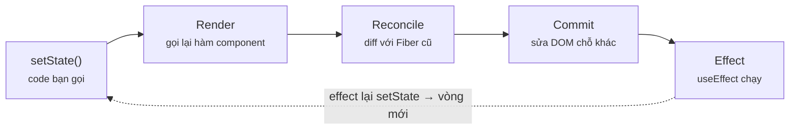
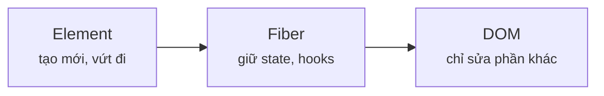
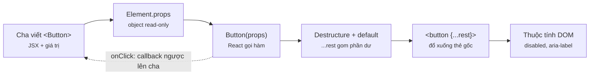
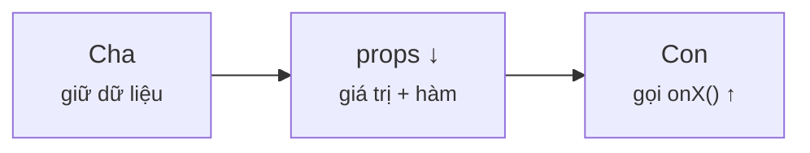
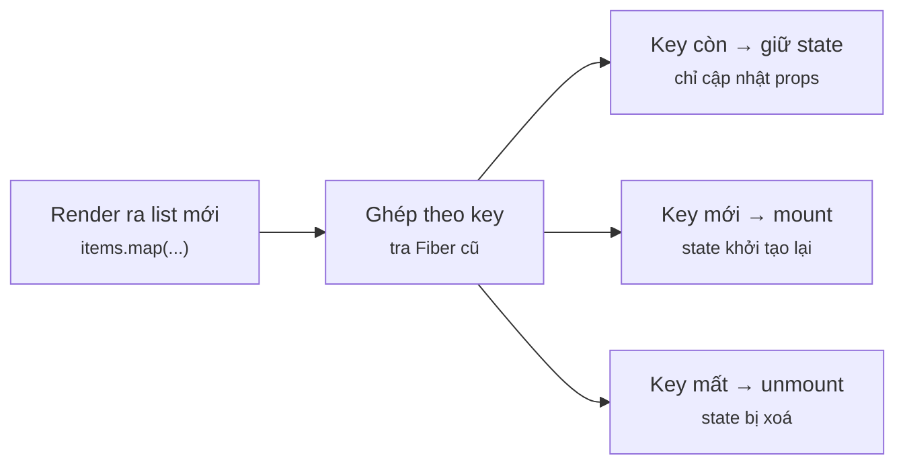
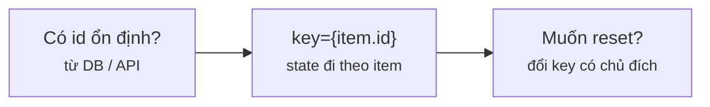
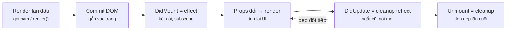
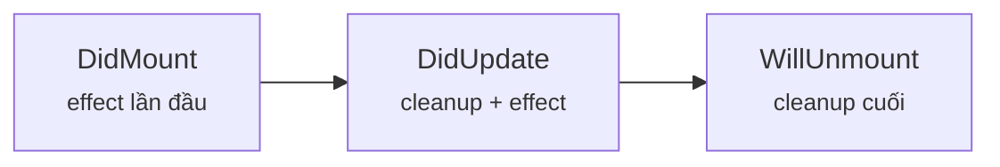

# Module 1 · Component, JSX, Props

_Hiểu tới tận cơ chế render_

**Đã chạy với:** Node 22.22.0 · TypeScript 7.0.2 · React 19.3.1 · react-dom 19.3.1 · jsdom 29.1.1 · tsx 4.23.15

Chạy trong Node + jsdom (DOM giả lập), không mở Chrome — React chạy y như trên trình duyệt. File `m1/dom.ts` dựng DOM giả, mọi ví dụ có `act()` đều import nó.

Vị trí: Đã học Module 0 · JS sâu (closure, prototype, event loop, DOM) · **Đang học Module 1** · Sắp tới Module 2 · Hooks nâng cao (useState, useEffect, useRef, useReducer)

## Bài 1.1 · Component tree, Fiber, Virtual DOM

_Nguồn roadmap: [Academind] It's All About Components → Component Tree · [BigReact] Components, Instances, Elements → Rendering → Virtual DOM → Fiber Tree → Commit Phase_

### 1 · Một câu & nằm ở đâu
Component là hàm trả về **mô tả** UI (Element); React gọi hàm đó (render), so cây mới với cây cũ (reconcile), rồi chỉ sửa phần DOM thực sự khác (commit).

JSX bạn viết → **[Element (object)]** → **[Render (gọi hàm)]** → **[Reconcile (diff)]** → **[Commit (sửa DOM)]** → Effect (sau commit)

<details><summary>m1/dom.ts — DOM giả dùng cho mọi ví dụ</summary>

`m1/dom.ts`

```tsx
// Giả lập trình duyệt trong Node để React render thật (không cần mở Chrome)
import { JSDOM } from "jsdom";

const dom = new JSDOM('<!doctype html><div id="root"></div>');
Object.assign(globalThis, {
  window: dom.window,
  document: dom.window.document,
  MutationObserver: dom.window.MutationObserver,
  IS_REACT_ACT_ENVIRONMENT: true, // cho phép dùng act() ngoài test runner
});

export const root = dom.window.document.getElementById("root")!;
```

</details>

### 2 · Concept
| Khái niệm | Là gì | Bên C# |
|---|---|---|
| **Component** | Hàm `(props) => JSX`, tên viết hoa | Razor/Blazor component, nhưng là hàm thuần |
| **Element** | Object bất biến `{type, props, key}` — "tôi muốn thấy gì". Tạo mới mỗi render, rất rẻ | Một record/DTO mô tả UI |
| **Fiber** (node nội bộ của React) | Node sống lâu, giữ **state, hooks, effect** của 1 component tại 1 vị trí trong cây | Instance object sống qua nhiều request |
| **Render** | React gọi hàm component → ra cây Element mới. **Không đụng DOM** | Build ViewModel |
| **Reconcile** (đối chiếu) | So cây Element mới với Fiber cũ, tìm chỗ khác | Change tracker của EF |
| **Commit** | Áp đúng phần khác vào DOM thật, rồi chạy effect | `SaveChanges()` |

"Virtual DOM" (DOM ảo) chỉ là tên gọi chung cho cây Element/Fiber nằm trong bộ nhớ.

### 3 · Flow / lifecycle
**Khi state đổi, React làm gì theo thứ tự nào?**



Đọc sơ đồ: Đọc từ trái sang phải: bạn gọi setState, React render → diff → commit; effect chạy sau cùng. Mũi tên đứt: effect gọi setState thì bắt đầu vòng mới.

### 4 · Ví dụ thực tế
**Ví dụ 1.** JSX chỉ là cú pháp tạo **object**. Viết `<Greeting />` không hề gọi hàm `Greeting`.

`m1/l11-element.tsx`

```tsx
// JSX chỉ là cú pháp tạo OBJECT — chưa có gì render ra cả
function Greeting({ name }: { name: string }) {
  console.log("Greeting() được gọi"); // xem hàm có chạy không
  return <h1>Xin chào {name}</h1>;
}

const el = <Greeting name="Huy" />; // tạo React Element
console.log(el);                     // in ra object
console.log("type === Greeting?", el.type === Greeting);
```

```console
❯ npx tsx m1/l11-element.tsx
{
  '$$typeof': Symbol(react.transitional.element),
  type: [Function: Greeting],
  key: null,
  props: { name: 'Huy' },
  _owner: null,
  _store: {}
}
type === Greeting? true
```

Không có dòng "Greeting() được gọi": hàm chưa chạy. `type` trỏ tới chính hàm — React giữ nó để gọi lúc render.

**Ví dụ 2.** Đo bằng `MutationObserver` (API trình duyệt đếm số lần DOM thật bị sửa): bấm nút → cả `Cart` lẫn `Price` render lại, nhưng DOM bị sửa bao nhiêu lần?

`m1/l11-render-commit.tsx`

```tsx
import { root } from "./dom";
import { act, useEffect, useState } from "react";
import { createRoot } from "react-dom/client";

let mutations = 0; // đếm số lần DOM THẬT bị sửa
new MutationObserver((list) => (mutations += list.length))
  .observe(root, { subtree: true, childList: true, characterData: true });

function Price({ value }: { value: number }) {
  console.log(`  render <Price value=${value}>`);
  return <b>{value}đ</b>;
}
function Cart() {
  const [qty, setQty] = useState(1);
  console.log(`render <Cart qty=${qty}>`);
  useEffect(() => console.log(`  commit xong, DOM: ${root.innerHTML}`));
  return (<p><button onClick={() => setQty(qty + 1)}>+</button>
    SL {qty} <Price value={50000} /></p>);
}

const app = createRoot(root);
await act(() => app.render(<Cart />));
console.log(`=> mutations: ${mutations}\n--- bấm nút + ---`);
mutations = 0;
await act(() => root.querySelector("button")!.click());
console.log(`=> mutations: ${mutations}`);
```

```console
❯ npx tsx m1/l11-render-commit.tsx
render <Cart qty=1>
  render <Price value=50000>
  commit xong, DOM: <p><button>+</button>SL 1 <b>50000đ</b></p>
=> mutations: 1
--- bấm nút + ---
render <Cart qty=2>
  render <Price value=50000>
  commit xong, DOM: <p><button>+</button>SL 2 <b>50000đ</b></p>
=> mutations: 1
```

`Price` nhận props y hệt vẫn **render lại** (con luôn render theo cha). Nhưng commit chỉ sửa **1** chỗ: text node "1" → "2". Render rẻ; DOM đắt — React tối ưu phần đắt.

### 5 · Thử thật / bẫy
**Bẫy 1.** **Khai báo component bên trong component.** Mỗi lần cha render, `SearchBox` là một **hàm mới** → `type` khác → React coi là component khác → unmount + mount lại, state (chữ đang gõ) mất sạch.

`m1/l11-trap-nested.tsx`

```tsx
import { root } from "./dom";
import { act, useEffect, useState } from "react";
import { createRoot } from "react-dom/client";

function Page() {
  const [tick, setTick] = useState(0);
  // ❌ khai báo component BÊN TRONG component khác
  function SearchBox() {
    useEffect(() => console.log("SearchBox MOUNT (state bị reset)"), []);
    return <input />;
  }
  return <div><button onClick={() => setTick(tick + 1)}>{tick}</button><SearchBox /></div>;
}

await act(() => createRoot(root).render(<Page />));
await act(() => root.querySelector("button")!.click());
await act(() => root.querySelector("button")!.click());
```

```console
❯ npx tsx m1/l11-trap-nested.tsx
SearchBox MOUNT (state bị reset)
SearchBox MOUNT (state bị reset)
SearchBox MOUNT (state bị reset)
```

3 render = 3 lần mount. Sửa: đưa `SearchBox` ra top-level file.

**Bẫy 2.** **Tưởng "re-render" = vẽ lại DOM.** Sai — ví dụ 2 cho thấy 2 component render lại nhưng DOM chỉ sửa 1 chỗ. Đừng vội `memo()` mọi thứ (Module 7) chỉ vì thấy log render.

### 6 · Tóm tắt bằng hình
**(a) Cây thư mục sau bài này**

```text
sandbox/
├─ package.json  [SỬA]  ← "type": "module" → dùng được await top-level
├─ tsconfig.json  [MỚI]  ← strict + jsx: react-jsx
└─ m1/
   ├─ dom.ts  [MỚI]  ← DOM giả (jsdom) cho Node
   ├─ l11-element.tsx  [MỚI]  ← JSX = object
   ├─ l11-render-commit.tsx  [MỚI]  ← render ≠ sửa DOM
   └─ l11-trap-nested.tsx  [MỚI]  ← bẫy component lồng
```

**(b) Đọc trong 10 giây**

**State nằm ở đâu?**



Đọc sơ đồ: Element bị vứt sau mỗi render; Fiber giữ state; DOM chỉ nhận phần khác.

### 7 · Làm ngay (≤ 10 phút)
**Mục tiêu:** Bấm nút tăng số mà `Header` **không** render lại — bằng cách kéo state xuống component nhỏ nhất cần nó (không dùng `memo`).

File khởi đầu:

`m1/ex/ex11-start.tsx`

```tsx
import { root } from "../dom";
import { act, useState } from "react";
import { createRoot } from "react-dom/client";

function Header() { console.log("render Header"); return <h1>Shop</h1>; }
export default function App() {
  const [n, setN] = useState(0);
  console.log("render App");
  return <div><Header /><button onClick={() => setN(n + 1)}>{n}</button></div>;
}
await act(() => createRoot(root).render(<App />));
console.log("--- click ---");
await act(() => root.querySelector("button")!.click());
```

Chạy file khởi đầu (đang đỏ):

```console
❯ npx tsx m1/ex/ex11-start.tsx
render App
render Header
--- click ---
render App
render Header
```

Tiêu chí nghiệm thu:

- [ ] Sau dòng `--- click ---` không còn `render Header`
- [ ] Sau dòng `--- click ---` không còn `render App`
- [ ] `npx tsc -p .` không báo lỗi

Lệnh nghiệm thu:

```bash
npx tsx m1/ex/ex11-start.tsx && npx tsc -p .
```

Lời giải tham chiếu chạy ra (output cần đạt):

```console
❯ npx tsx m1/ex/ex11-solution.tsx
render App
render Header
render Counter
--- click ---
render Counter
```

<details><summary>Gợi ý nếu bị đỏ</summary>

| Triệu chứng | Nguyên nhân | Sửa |
|---|---|---|
| Vẫn thấy `render Header` sau click | `useState` vẫn nằm trong `App` | Tạo `Counter` chứa state + nút, `App` chỉ ghép `<Header/><Counter/>` |
| Số không tăng / log `mount` liên tục | Khai báo `Counter` bên trong `App` | Đưa `Counter` ra top-level file |
| `Cannot find module '../dom'` | Chạy lệnh sai thư mục | `cd sandbox` rồi mới chạy |

</details>

### 8 · 3 câu hỏi nhanh
1. `const el = <Greeting />` — hàm `Greeting` đã chạy chưa?

   <details><summary>Đáp án</summary>

   Chưa. JSX chỉ tạo Element (object). React gọi hàm khi render cây chứa element đó.

   </details>

2. Cha re-render, con nhận props y hệt — con có render lại không?

   <details><summary>Đáp án</summary>

   Có, mặc định con luôn render theo cha. Nhưng DOM chỉ bị sửa nếu kết quả khác. Muốn bỏ qua hẳn thì `memo()` (Module 7).

   </details>

3. State của component được lưu ở đâu?

   <details><summary>Đáp án</summary>

   Trên Fiber gắn với **vị trí + type** trong cây, không nằm trong hàm hay Element. Đổi type (như bẫy component lồng) hoặc đổi vị trí → mất state.

   </details>


---

## Bài 1.2 · Props: mọi cách truyền, mọi pattern

_Nguồn roadmap: [Academind] Props → Alternative Props Syntaxes → children → Forwarding Props → Component Types Dynamically → Default Prop Values · [BigReact] PropTypes → Children → Component Composition → Explicit Component Passing_

### 1 · Một câu & nằm ở đâu
Props là tham số **read-only** cha truyền cho con; children, slot, forward `...rest`, prop `as` đều chỉ là "truyền giá trị vào hàm".

**[JSX bạn viết]** → **[Element (object)]** → Render (gọi hàm) → Reconcile (diff) → Commit (sửa DOM) → Effect (sau commit)

### 2 · Concept
| Pattern | Cú pháp | Bên C# |
|---|---|---|
| Props có type + default | `({ variant = "primary" }: Props)` | Tham số optional có default |
| `children` | Nội dung giữa thẻ mở/đóng | `RenderFragment ChildContent` (Blazor) |
| Slot (truyền component tường minh) | `icon={<Icon />}`, kiểu `ReactNode` | Nhiều `RenderFragment` param |
| Forward `...rest` | Gom prop thừa, đổ xuống thẻ gốc | `@attributes` splatting |
| `as` (type động) | `as: Tag = "section"` rồi `<Tag>` | Generic / factory |
| PropTypes | Kiểm props lúc chạy — React 19 **bỏ hẳn**, dùng TS | — |

### 3 · Flow / lifecycle
**Props đi từ cha tới DOM thế nào?**



Đọc sơ đồ: Dữ liệu chỉ chảy xuống (trái → phải). Con muốn báo cha thì cha truyền hàm xuống (mũi tên đứt).

### 4 · Ví dụ thực tế
**Ví dụ 1.** Button "chuẩn thư viện": props riêng + nhận **mọi** prop của `<button>` nhờ `ComponentPropsWithoutRef<"button">`.

`m1/l12-button.tsx`

```tsx
import type { ComponentPropsWithoutRef, ReactNode } from "react";
import { renderToStaticMarkup } from "react-dom/server";

// Props riêng + MỌI prop gốc của <button> (onClick, disabled, type...)
type ButtonProps = ComponentPropsWithoutRef<"button"> & {
  variant?: "primary" | "ghost"; // optional => có default bên dưới
  icon?: ReactNode;              // "slot": truyền cả JSX vào như 1 prop
};

function Button({ variant = "primary", icon, children, ...rest }: ButtonProps) {
  return (
    <button className={`btn btn-${variant}`} {...rest}>
      {icon}{children}
    </button>
  );
}

console.log(renderToStaticMarkup(<Button>Lưu</Button>));
console.log(renderToStaticMarkup(
  <Button variant="ghost" icon={<i>🗑</i>} disabled aria-label="Xoá">Xoá</Button>,
));
```

```console
❯ npx tsx m1/l12-button.tsx
<button class="btn btn-primary">Lưu</button>
<button class="btn btn-ghost" disabled="" aria-label="Xoá"><i>🗑</i>Xoá</button>
```

`disabled`, `aria-label` không khai báo riêng nhưng vẫn tới DOM nhờ `{...rest}`. `variant` không truyền → default `primary`.

**Ví dụ 2.** Card với 3 slot (`header`, `children`, `footer`) + prop `as` chọn thẻ bọc.

`m1/l12-card.tsx`

```tsx
import type { ElementType, ReactNode } from "react";
import { renderToStaticMarkup } from "react-dom/server";

type CardProps = {
  as?: ElementType;   // chọn thẻ bọc ngoài lúc dùng: section, article, li...
  header: ReactNode;  // slot 1
  footer?: ReactNode; // slot 2 (tuỳ chọn)
  children: ReactNode; // slot mặc định = nội dung giữa thẻ mở/đóng
};

function Card({ as: Tag = "section", header, footer, children }: CardProps) {
  return (
    <Tag className="card">
      <h3>{header}</h3>
      <div>{children}</div>
      {footer && <footer>{footer}</footer>}
    </Tag>
  );
}

console.log(renderToStaticMarkup(
  <Card as="article" header="Đơn #42" footer={<button>Thanh toán</button>}>
    <p>2 x Cà phê sữa</p>
  </Card>,
));
console.log(renderToStaticMarkup(<Card header="Trống">Chưa có món</Card>));
```

```console
❯ npx tsx m1/l12-card.tsx
<article class="card"><h3>Đơn #42</h3><div><p>2 x Cà phê sữa</p></div><footer><button>Thanh toán</button></footer></article>
<section class="card"><h3>Trống</h3><div>Chưa có món</div></section>
```

Biến `Tag` phải viết hoa: JSX coi tên thường (`tag`) là thẻ HTML tên "tag".

### 5 · Thử thật / bẫy
**Bẫy 1.** **Sửa props.** TS không chặn (type không khai báo `readonly`). React dev đóng băng props → ném lỗi; **production không đóng băng** → bug im lặng.

`m1/l12-trap-mutate.tsx`

```tsx
import { renderToStaticMarkup } from "react-dom/server";

function Price(props: { value: number }) {
  props.value = props.value * 2; // ❌ sửa props — TS KHÔNG báo lỗi
  return <b>{props.value}</b>;
}
console.log(renderToStaticMarkup(<Price value={10} />));
```

```console
❯ npx tsx m1/l12-trap-mutate.tsx
TypeError: Cannot assign to read only property 'value' of object '#<Object>'

❯ NODE_ENV=production npx tsx m1/l12-trap-mutate.tsx
<b>20</b>
```

(… còn 16 dòng — đã trích dòng 5–5 / 17 của `npx tsx m1/l12-trap-mutate.tsx`)

Dev: chết ngay. Prod: lặng lẽ in 20. Muốn đổi giá trị thì tạo biến mới (`const doubled = value * 2`).

**Bẫy 2.** **`count && ...` với count = 0.** `0` là số, React in ra chữ "0".

`m1/l12-trap-zero.tsx`

```tsx
import { renderToStaticMarkup } from "react-dom/server";

function CartIcon({ count }: { count: number }) {
  return <span>🛒{count && <sup>{count}</sup>}</span>; // ❌ 0 && ... => in ra 0
}
function CartIconFixed({ count }: { count: number }) {
  return <span>🛒{count > 0 && <sup>{count}</sup>}</span>; // ✅ ép về boolean
}
console.log(renderToStaticMarkup(<CartIcon count={0} />));
console.log(renderToStaticMarkup(<CartIconFixed count={0} />));
```

```console
❯ npx tsx m1/l12-trap-zero.tsx
<span>🛒0</span>
<span>🛒</span>
```

Luôn ép về boolean: `count > 0 && ...`. Code AI hay dính lỗi này.

### 6 · Tóm tắt bằng hình
**(a) Cây thư mục sau bài này**

```text
sandbox/m1/
├─ l12-button.tsx  [MỚI]  ← props + default + ...rest + slot
├─ l12-card.tsx  [MỚI]  ← children, nhiều slot, prop as
├─ l12-trap-mutate.tsx  [MỚI]  ← bẫy sửa props (dev vs prod)
└─ l12-trap-zero.tsx  [MỚI]  ← bẫy 0 &&
```

**(b) Đọc trong 10 giây**

**Dữ liệu chảy chiều nào?**



Đọc sơ đồ: Props đi xuống; muốn đi lên thì truyền hàm xuống rồi con gọi.

### 7 · Làm ngay (≤ 10 phút)
**Mục tiêu:** Viết `m1/ex/ex12.tsx`: component `Badge` — `tone: "ok" | "warn"` (mặc định `ok`), `count` (mặc định 0, chỉ hiện `<sup>` khi > 0), `children`, forward mọi prop của `<span>`. In 3 dòng: `<Badge>Còn hàng</Badge>`, `<Badge tone="warn" count={0} title="kho">Hết hàng</Badge>`, `<Badge count={3}>Mới</Badge>`.

Tiêu chí nghiệm thu:

- [ ] Dòng 2 có `title="kho"` (forward được `...rest`)
- [ ] Dòng 2 **không** có chữ "0" thừa
- [ ] Dòng 3 có `<sup>3</sup>`
- [ ] `npx tsc -p .` không báo lỗi

Lệnh nghiệm thu:

```bash
npx tsx m1/ex/ex12.tsx && npx tsc -p .
```

Lời giải tham chiếu chạy ra (output cần đạt):

```console
❯ npx tsx m1/ex/ex12-solution.tsx
<span class="badge badge-ok">Còn hàng</span>
<span class="badge badge-warn" title="kho">Hết hàng</span>
<span class="badge badge-ok">Mới<sup>3</sup></span>
```

<details><summary>Gợi ý nếu bị đỏ</summary>

| Triệu chứng | Nguyên nhân | Sửa |
|---|---|---|
| Thấy `Hết hàng0` | Dùng `count && ...` | `count > 0 && ...` |
| Thiếu `title="kho"` | Quên `{...rest}` trên `<span>` | Destructure `...rest` rồi spread xuống |
| TS: `Property 'title' does not exist` | Type chỉ có tone/count | `ComponentPropsWithoutRef<"span"> & {...}` |

</details>

### 8 · 3 câu hỏi nhanh
1. Vì sao `props.value = x` TS không báo mà React (dev) lại báo?

   <details><summary>Đáp án</summary>

   TS chỉ chặn khi type khai báo `readonly`. React dev gọi `Object.freeze` trên props; build production thì không → lỗi biến thành bug im lặng.

   </details>

2. `children` khác slot prop (`icon`) ở đâu?

   <details><summary>Đáp án</summary>

   Không khác về bản chất — `children` chỉ là prop có cú pháp đặc biệt (nội dung giữa thẻ). Cần nhiều vùng thì dùng thêm prop kiểu `ReactNode`.

   </details>

3. Vì sao phải đổi `as` thành `Tag` viết hoa?

   <details><summary>Đáp án</summary>

   JSX: tên viết thường = chuỗi thẻ HTML, viết hoa = biến/component. `<as>` sẽ tạo thẻ `<as>` thật.

   </details>


---

## Bài 1.3 · Key prop & vì sao state 'lệch' khi list đổi

_Nguồn roadmap: [Academind] Why Keys Matter When Managing State → More Reasons → Using Keys For Resetting Components · [BigReact] How the Key Prop Works_

### 1 · Một câu & nằm ở đâu
`key` là "CMND" của phần tử trong list: React dùng (type, key) để biết Fiber — tức **state** — nào đi với phần tử nào sau mỗi render.

JSX bạn viết → Element (object) → Render (gọi hàm) → **[Reconcile (diff)]** → Commit (sửa DOM) → Effect (sau commit)

### 2 · Concept
| Quy tắc | Hệ quả | Bên C# |
|---|---|---|
| React ghép con cũ–mới theo **(type, key)** | Khớp → giữ Fiber + state, chỉ cập nhật props | Primary key trong EF change tracker |
| `key={index}` | Thêm/xoá/sắp xếp → state dính theo **vị trí**, không theo dữ liệu | Dùng số thứ tự dòng làm PK |
| `key={item.id}` | State đi theo item | PK thật |
| Đổi key | Unmount cũ, mount mới → **reset state** | `new` một instance |
| Phạm vi | Chỉ cần unique giữa các anh em cùng cha | — |

### 3 · Flow / lifecycle
**React ghép phần tử cũ với mới thế nào?**



Đọc sơ đồ: Mỗi lần render list, React tra key mới trong Fiber cũ rồi rẽ 3 nhánh.

### 4 · Ví dụ thực tế
**Ví dụ 1.** Mỗi `Row` có state `done` riêng. Tick "Mua sữa", rồi **chèn** "Gọi mẹ" lên đầu. So sánh key = index và key = id.

`m1/l13-keys.tsx`

```tsx
import { root } from "./dom";
import { act, useState } from "react";
import { createRoot } from "react-dom/client";

type Todo = { id: number; text: string };
function Row({ text }: { text: string }) {
  const [done, setDone] = useState(false); // state LOCAL, nằm trong Fiber của Row
  return <li onClick={() => setDone(true)}>{done ? "✅" : "⬜"} {text}</li>;
}
function List({ items, byIndex }: { items: Todo[]; byIndex: boolean }) {
  return <ul>{items.map((t, i) => <Row key={byIndex ? i : t.id} text={t.text} />)}</ul>;
}
const show = (label: string) =>
  console.log(label, [...root.querySelectorAll("li")].map((li) => li.textContent).join(" | "));

for (const byIndex of [true, false]) {
  const app = createRoot(root);
  const old: Todo[] = [{ id: 1, text: "Mua sữa" }, { id: 2, text: "Nộp báo cáo" }];
  await act(() => app.render(<List items={old} byIndex={byIndex} />));
  await act(() => root.querySelector("li")!.click()); // tick "Mua sữa"
  show(`key=${byIndex ? "index" : "id   "} trước:`);
  await act(() => app.render(<List items={[{ id: 3, text: "Gọi mẹ" }, ...old]} byIndex={byIndex} />));
  show(`key=${byIndex ? "index" : "id   "} sau  :`);
  await act(() => app.unmount());
}
```

```console
❯ npx tsx m1/l13-keys.tsx
key=index trước: ✅ Mua sữa | ⬜ Nộp báo cáo
key=index sau  : ✅ Gọi mẹ | ⬜ Mua sữa | ⬜ Nộp báo cáo
key=id    trước: ✅ Mua sữa | ⬜ Nộp báo cáo
key=id    sau  : ⬜ Gọi mẹ | ✅ Mua sữa | ⬜ Nộp báo cáo
```

key=index: Fiber ở vị trí 0 (đang `done`) giờ nhận text "Gọi mẹ" → dấu ✅ "nhảy" sai người. key=id: state đi đúng theo "Mua sữa".

**Ví dụ 2.** Dùng key **để reset** có chủ đích: đổi người chat thì ô nháp phải trống lại — không cần `useEffect`.

`m1/l13-reset.tsx`

```tsx
import { root } from "./dom";
import { act, useEffect, useState } from "react";
import { createRoot } from "react-dom/client";

function ChatBox({ to }: { to: string }) {
  // giá trị đầu CHỈ dùng ở lần mount; các lần render sau bị bỏ qua
  const [draft] = useState(`(nháp gửi ${to})`);
  useEffect(() => {
    console.log("  mount ChatBox");
    return () => console.log("  unmount ChatBox");
  }, []); // [] => chỉ chạy lúc mount/unmount thật
  return <p>{draft}</p>;
}

const app = createRoot(root);
for (const useKey of [false, true]) {
  console.log(useKey ? "CÓ key={to}:" : "KHÔNG key:");
  for (const to of ["An", "Bình"]) {
    await act(() => app.render(useKey ? <ChatBox key={to} to={to} /> : <ChatBox to={to} />));
    console.log(`  đang chat ${to} → ô nháp: ${root.textContent}`);
  }
  await act(() => app.render(null));
}
```

```console
❯ npx tsx m1/l13-reset.tsx
KHÔNG key:
  mount ChatBox
  đang chat An → ô nháp: (nháp gửi An)
  đang chat Bình → ô nháp: (nháp gửi An)
  unmount ChatBox
CÓ key={to}:
  mount ChatBox
  đang chat An → ô nháp: (nháp gửi An)
  unmount ChatBox
  mount ChatBox
  đang chat Bình → ô nháp: (nháp gửi Bình)
  unmount ChatBox
```

Không key: cùng type cùng vị trí → React tái dùng Fiber, nháp gửi An lọt sang Bình. Có `key={to}`: key đổi → unmount + mount mới.

### 5 · Thử thật / bẫy
**Bẫy 1.** **Ba cách đặt key sai**, chạy chung 1 file với 3 chế độ:

`m1/l13-trap.tsx`

```tsx
import { root } from "./dom";
import { act, useEffect } from "react";
import { createRoot } from "react-dom/client";

function Row({ text }: { text: string }) {
  useEffect(() => console.log(`mount ${text}`), []);
  return <li>{text}</li>;
}
const items = ["A", "B"];
const app = createRoot(root);
const mode = process.argv[2]; // chạy: npx tsx m1/l13-trap.tsx missing|dup|random

const list = () => items.map((t) =>
  mode === "missing" ? <Row text={t} /> :
  mode === "dup" ? <Row key="x" text={t} /> :
  <Row key={Math.random()} text={t} />);

await act(() => app.render(<ul>{list()}</ul>));
console.log("--- re-render, dữ liệu KHÔNG đổi ---");
await act(() => app.render(<ul>{list()}</ul>));
```

```console
❯ npx tsx m1/l13-trap.tsx missing
Each child in a list should have a unique "key" prop.

Check the top-level render call using <ul>. See https://react.dev/link/warning-keys for more information.
mount A
mount B
--- re-render, dữ liệu KHÔNG đổi ---

❯ npx tsx m1/l13-trap.tsx dup
Encountered two children with the same key, `x`. Keys should be unique so that components maintain their identity across updates. Non-unique keys may cause children to be duplicated and/or omitted — the behavior is unsupported and could change in a future version.
mount A
mount B
--- re-render, dữ liệu KHÔNG đổi ---
Encountered two children with the same key, `x`. Keys should be unique so that components maintain their identity across updates. Non-unique keys may cause children to be duplicated and/or omitted — the behavior is unsupported and could change in a future version.

❯ npx tsx m1/l13-trap.tsx random
mount A
mount B
--- re-render, dữ liệu KHÔNG đổi ---
mount A
mount B
```

Thiếu key → cảnh báo (React tự dùng index). Key trùng → cảnh báo mỗi render, hành vi không xác định. `Math.random()` → **không cảnh báo** nhưng mount lại toàn bộ mỗi render (mất state, tốn DOM) — nguy hiểm nhất vì im lặng.

### 6 · Tóm tắt bằng hình
**(a) Cây thư mục sau bài này**

```text
sandbox/m1/
├─ l13-keys.tsx  [MỚI]  ← index vs id khi chèn đầu list
├─ l13-reset.tsx  [MỚI]  ← key để reset component
└─ l13-trap.tsx  [MỚI]  ← thiếu / trùng / random key
```

**(b) Đọc trong 10 giây**

**Chọn key thế nào?**



Đọc sơ đồ: Có id ổn định thì dùng id; muốn reset thì cố ý đổi key.

### 7 · Làm ngay (≤ 10 phút)
**Mục tiêu:** Sửa `m1/ex/ex13-start.tsx` để khi xoá "Mua sữa", dấu ✅ vẫn nằm ở "Nộp báo cáo".

File khởi đầu:

`m1/ex/ex13-start.tsx`

```tsx
import { root } from "../dom";
import { act, useState } from "react";
import { createRoot } from "react-dom/client";

type Todo = { id: number; text: string };
function Row({ text }: { text: string }) {
  const [done, setDone] = useState(false);
  return <li onClick={() => setDone(true)}>{done ? "✅" : "⬜"} {text}</li>;
}
function List({ items }: { items: Todo[] }) {
  return <ul>{items.map((t, i) => <Row key={i} text={t.text} />)}</ul>; // TODO: sửa key
}
const all: Todo[] = [{ id: 1, text: "Mua sữa" }, { id: 2, text: "Nộp báo cáo" }, { id: 3, text: "Gọi mẹ" }];
const app = createRoot(root);
await act(() => app.render(<List items={all} />));
await act(() => root.querySelectorAll("li")[1].click()); // tick "Nộp báo cáo"
await act(() => app.render(<List items={all.slice(1)} />)); // xoá "Mua sữa"
console.log([...root.querySelectorAll("li")].map((li) => li.textContent).join(" | "));
```

Chạy file khởi đầu (đang đỏ):

```console
❯ npx tsx m1/ex/ex13-start.tsx
⬜ Nộp báo cáo | ✅ Gọi mẹ
```

Tiêu chí nghiệm thu:

- [ ] Output đúng: `✅ Nộp báo cáo | ⬜ Gọi mẹ`
- [ ] Không dùng index làm key
- [ ] `npx tsc -p .` không báo lỗi

Lệnh nghiệm thu:

```bash
npx tsx m1/ex/ex13-start.tsx && npx tsc -p .
```

Lời giải tham chiếu chạy ra (output cần đạt):

```console
❯ npx tsx m1/ex/ex13-solution.tsx
✅ Nộp báo cáo | ⬜ Gọi mẹ
```

<details><summary>Gợi ý nếu bị đỏ</summary>

| Triệu chứng | Nguyên nhân | Sửa |
|---|---|---|
| Vẫn `✅ Gọi mẹ` | Key vẫn là vị trí | Dùng field ổn định của item |
| Cả 2 đều `⬜` | Key đổi mỗi render (random/Date.now) | Key phải giữ nguyên qua các lần render |
| TS: `'i' is declared but never used` | Bật noUnusedParameters | Bỏ tham số `i` khỏi map |

`m1/ex/ex13-start.tsx` (diff)

```diff
 }
 function List({ items }: { items: Todo[] }) {
-  return <ul>{items.map((t, i) => <Row key={i} text={t.text} />)}</ul>; // TODO: sửa key
+  return <ul>{items.map((t) => <Row key={t.id} text={t.text} />)}</ul>;
 }
 const all: Todo[] = [{ id: 1, text: "Mua sữa" }, { id: 2, text: "Nộp báo cáo" }, { id: 3, text: "Gọi mẹ" }];
```

</details>

### 8 · 3 câu hỏi nhanh
1. Key có cần unique toàn app không?

   <details><summary>Đáp án</summary>

   Không, chỉ cần unique giữa các anh em cùng cha.

   </details>

2. Khi nào `key={index}` vẫn chấp nhận được?

   <details><summary>Đáp án</summary>

   List tĩnh: không thêm/xoá/sắp xếp và item không có state riêng (không input, không checkbox).

   </details>

3. Reset form khi `userId` đổi mà không viết `useEffect`?

   <details><summary>Đáp án</summary>

   `<ProfileForm key={userId} />` — key đổi thì React unmount form cũ, mount form mới.

   </details>


---

## Bài 1.4 · Class component & lifecycle ↔ useEffect

_Nguồn roadmap: [Academind] First Class-based Component → Component Lifecycle → Lifecycle Methods In Action → Class vs Functional Summary · [BigReact] Class vs Functional Components → Mount & Unmount_

### 1 · Một câu & nằm ở đâu
Class chia logic theo **thời điểm** (mount / update / unmount); hook chia theo **việc** — 1 effect = setup + cleanup đi cặp. Map được 2 chiều là đọc được code cũ.

JSX bạn viết → Element (object) → Render (gọi hàm) → Reconcile (diff) → **[Commit (sửa DOM)]** → **[Effect (sau commit)]**

### 2 · Concept
| Class | Function + hook | Bên C# (Blazor) |
|---|---|---|
| `state = {...}` (1 object) | `useState` (nhiều state rời) | Field trong component |
| `this.setState(partial)` — **merge** | `setX(full)` — **thay thế** | — |
| `componentDidMount` | `useEffect(fn, [])` | `OnInitialized` |
| `componentDidUpdate(prev)` + `if` tự so | `useEffect(fn, [dep])` — React tự so | `OnParametersSet` |
| `componentWillUnmount` | `return () => ...` trong effect | `Dispose()` |
| `render()` | Thân hàm | Markup `.razor` |

### 3 · Flow / lifecycle
**Vòng đời 1 component chạy theo thứ tự nào?**



Đọc sơ đồ: Đọc trái → phải. Mỗi lần dep đổi, quay lại bước 4 (mũi tên đứt); cleanup cũ luôn chạy trước effect mới.

### 4 · Ví dụ thực tế
**Ví dụ 1.** Phòng chat kiểu class: mount → đổi phòng → render lại với props y hệt → unmount.

`m1/l14-class.tsx`

```tsx
import { root } from "./dom";
import { act, Component } from "react";
import { createRoot } from "react-dom/client";

type P = { roomId: string };
class ChatRoom extends Component<P, { online: number }> {
  state = { online: 0 };
  componentDidMount() { console.log(`DidMount: kết nối ${this.props.roomId}`); }
  componentDidUpdate(prev: P) {
    if (prev.roomId !== this.props.roomId) // tự so sánh bằng tay
      console.log(`DidUpdate: ngắt ${prev.roomId}, nối ${this.props.roomId}`);
  }
  componentWillUnmount() { console.log(`WillUnmount: ngắt ${this.props.roomId}`); }
  render() { console.log(`render(${this.props.roomId})`); return <p>{this.props.roomId}</p>; }
}

const app = createRoot(root);
await act(() => app.render(<ChatRoom roomId="general" />));
await act(() => app.render(<ChatRoom roomId="random" />));
await act(() => app.render(<ChatRoom roomId="random" />)); // props y hệt
await act(() => app.unmount());
```

```console
❯ npx tsx m1/l14-class.tsx
render(general)
DidMount: kết nối general
render(random)
DidUpdate: ngắt general, nối random
render(random)
WillUnmount: ngắt random
```

Render thứ 3 (props y hệt) vẫn gọi `componentDidUpdate` — chỉ cái `if` tự viết chặn lại. Quên `if` là bug kinh điển.

**Ví dụ 2.** Cùng logic bằng `useEffect`: setup và cleanup nằm cạnh nhau.

`m1/l14-hook.tsx`

```tsx
import { root } from "./dom";
import { act, useEffect } from "react";
import { createRoot } from "react-dom/client";

function ChatRoom({ roomId }: { roomId: string }) {
  console.log(`render(${roomId})`);
  useEffect(() => {
    console.log(`effect: kết nối ${roomId}`);       // = DidMount + nửa sau DidUpdate
    return () => console.log(`cleanup: ngắt ${roomId}`); // = WillUnmount + nửa đầu DidUpdate
  }, [roomId]); // React tự so sánh prev/next thay cho if trong DidUpdate
  return <p>{roomId}</p>;
}

const app = createRoot(root);
await act(() => app.render(<ChatRoom roomId="general" />));
await act(() => app.render(<ChatRoom roomId="random" />));
await act(() => app.render(<ChatRoom roomId="random" />)); // props y hệt
await act(() => app.unmount());
```

```console
❯ npx tsx m1/l14-hook.tsx
render(general)
effect: kết nối general
render(random)
cleanup: ngắt general
effect: kết nối random
render(random)
cleanup: ngắt random
```

"DidUpdate" bị tách thành **cleanup cũ + effect mới**. Render thứ 3: dep `roomId` không đổi → effect không chạy, khỏi viết `if`.

### 5 · Thử thật / bẫy
**Bẫy 1.** **Quên bind `this`.** Truyền `this.inc` làm callback là tách method khỏi object → `this` = `undefined`.

`m1/l14-trap-this.tsx`

```tsx
import { root } from "./dom";
import { act, Component } from "react";
import { createRoot } from "react-dom/client";

class Counter extends Component<object, { n: number }> {
  state = { n: 0 };
  inc() { this.setState({ n: this.state.n + 1 }); } // ❌ method thường: mất `this`
  render() { return <button onClick={this.inc}>{this.state.n}</button>; }
}
await act(() => createRoot(root).render(<Counter />));
window.addEventListener("error", (e) => { e.preventDefault(); console.log(e.error.message); });
await act(() => root.querySelector("button")!.click());
```

```console
❯ npx tsx m1/l14-trap-this.tsx
Cannot read properties of undefined (reading 'setState')
```

Sửa: arrow function field `inc = () => {...}`. Function component không có `this` nên hết loại lỗi này.

**Bẫy 2.** **Tưởng `setX` merge như `setState`.** Class merge nông; hook **thay thế toàn bộ** → field khác biến mất.

`m1/l14-trap-merge.tsx`

```tsx
import { root } from "./dom";
import { act, Component, useState } from "react";
import { createRoot } from "react-dom/client";

type Form = { name: string; email: string };
const init: Form = { name: "Huy", email: "huy@x.vn" };

class ClassForm extends Component<object, Form> {
  state = init;
  componentDidMount() { this.setState({ name: "Hưng" }); } // class: MERGE nông
  render() { console.log("class:", JSON.stringify(this.state)); return null; }
}
function HookForm() {
  const [form, setForm] = useState<Form>(init);
  // @ts-expect-error -- thiếu email: TS chặn, nhưng cứ chạy thử xem runtime
  if (form.name === "Huy") setForm({ name: "Hưng" }); // hook: THAY THẾ toàn bộ
  console.log("hook :", JSON.stringify(form));
  return null;
}
await act(() => createRoot(root).render(<><ClassForm /><HookForm /></>));
```

```console
❯ npx tsx m1/l14-trap-merge.tsx
class: {"name":"Huy","email":"huy@x.vn"}
hook : {"name":"Huy","email":"huy@x.vn"}
hook : {"name":"Hưng"}
class: {"name":"Hưng","email":"huy@x.vn"}
```

Email mất ở bản hook. TS đã chặn (dòng `@ts-expect-error`) — nhưng code JS cũ không có TS. Sửa: `setForm(f => ({ ...f, name: "Hưng" }))`.

### 6 · Tóm tắt bằng hình
**(a) Cây thư mục sau bài này**

```text
sandbox/m1/
├─ l14-class.tsx  [MỚI]  ← lifecycle kiểu class
├─ l14-hook.tsx  [MỚI]  ← cùng logic bằng useEffect
├─ l14-trap-this.tsx  [MỚI]  ← bẫy mất this
└─ l14-trap-merge.tsx  [MỚI]  ← merge vs thay thế state
```

**(b) Đọc trong 10 giây**

**useEffect gói những lifecycle nào?**



Đọc sơ đồ: Một effect có deps = cả ba phương thức class cộng lại.

### 7 · Làm ngay (≤ 10 phút)
**Mục tiêu:** Chuyển class `Clock` trong `m1/ex/ex14-start.tsx` sang function + `useEffect`, giữ nguyên phần chạy thử bên dưới.

File khởi đầu:

`m1/ex/ex14-start.tsx`

```tsx
import { root } from "../dom";
import { act, Component } from "react";
import { createRoot } from "react-dom/client";

export let ticks = 0;
class Clock extends Component {
  timer?: ReturnType<typeof setInterval>;
  componentDidMount() { console.log("start"); this.timer = setInterval(() => ticks++, 10); }
  componentWillUnmount() { console.log("stop"); clearInterval(this.timer); }
  render() { return <p>⏰</p>; }
}
// TODO: viết function Clock dùng useEffect, xoá class ở trên
const wait = (ms: number) => new Promise((r) => setTimeout(r, ms));
const app = createRoot(root);
await act(() => app.render(<Clock />));
await wait(50);
await act(() => app.unmount());
const before = ticks;
await wait(50);
console.log("có tick khi mount:", before > 0, "| tick sau unmount:", ticks - before);
```

Tiêu chí nghiệm thu:

- [ ] Output có `start`, `stop`, và `tick sau unmount: 0`
- [ ] File không còn `extends Component`
- [ ] `npx tsc -p .` không báo lỗi

Lệnh nghiệm thu:

```bash
npx tsx m1/ex/ex14-start.tsx && ! grep -q "extends Component" m1/ex/ex14-start.tsx && npx tsc -p .
```

Lời giải tham chiếu chạy ra (output cần đạt):

```console
❯ npx tsx m1/ex/ex14-solution.tsx
start
stop
có tick khi mount: true | tick sau unmount: 0
```

<details><summary>Gợi ý nếu bị đỏ</summary>

| Triệu chứng | Nguyên nhân | Sửa |
|---|---|---|
| `tick sau unmount` > 0 | Không `return` cleanup | `return () => clearInterval(timer)` |
| `start`/`stop` lặp nhiều lần | Thiếu `[]` ở deps | Thêm `[]` — chỉ chạy lúc mount/unmount |
| `timer is not defined` trong cleanup | Khai báo `timer` ngoài effect | Khai báo `const timer` ngay trong effect |

</details>

### 8 · 3 câu hỏi nhanh
1. `useEffect(fn, [roomId])` tương đương tổ hợp lifecycle nào?

   <details><summary>Đáp án</summary>

   DidMount + DidUpdate (chỉ khi `roomId` đổi) + WillUnmount (qua cleanup).

   </details>

2. Vì sao class cần bind `this` còn function component thì không?

   <details><summary>Đáp án</summary>

   Method truyền làm callback bị tách khỏi instance → `this` undefined. Function component dùng closure, không có `this`.

   </details>

3. Năm 2026 còn gặp class component ở đâu?

   <details><summary>Đáp án</summary>

   Error Boundary (chưa có hook tương đương — Module 2.6) và code cũ cần bảo trì.

   </details>

