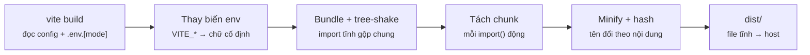
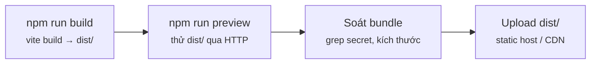
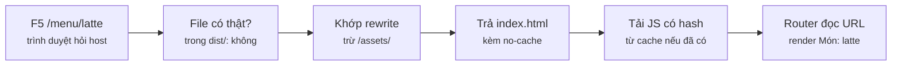
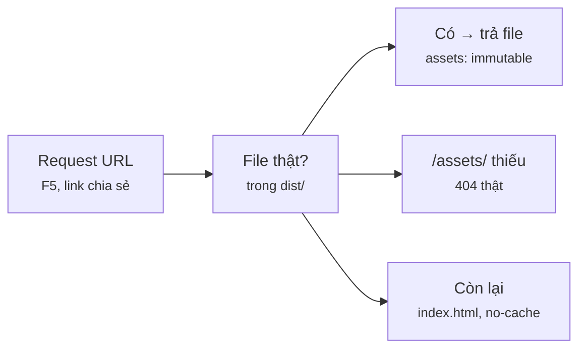

# Module 10 · Deployment & Build

_vite build · dist/ · code splitting · env build-time · base · SPA fallback · cache header · vercel.json · CI_

**Đã chạy với:** Node 22.22.0 · TypeScript 7.0.2 · React 19.3.1 · React Router 8.5.0 · Vite 8.3.4 (bundler Rolldown) · @vitejs/plugin-react 6.1.2 · tsx 4.23.15 · playwright-core 1.64.1 + Chromium

Build bằng `npx vite build`, mọi file TS/TSX kiểm riêng bằng `npx tsc -p .` (strict, không `any`). Các script `m10/*.ts` điều khiển **Chromium thật** (bấm link, F5, đọc console). **Deploy lên Vercel thật không chạy được ở sandbox** (cần tài khoản + token): thay bằng `m10/host.ts` — mini host đọc chính `vercel.json` (file thật trước → rewrites → headers), bản thay thế cùng hợp đồng; bước `vercel deploy` được đánh dấu "chưa chạy ở sandbox". Tên file có hash và kích thước trong log là số thật của lần build này.

Vị trí: Đã học Module 9 · Testing (Vitest, Testing Library, mock) · **Đang học Module 10** · Sắp tới Module 11 · Next.js App Router (Server/Client Components, Route Handlers, Server Actions)

## Bài 10.1 · Build production: vite build, dist/, code splitting, biến môi trường

_Nguồn roadmap: [Academind] Building the Code For Production · [BigReact] npm run build · [Modern] Understanding The Build Process · [NextAI] Build command in react_

### 1 · Một câu & nằm ở đâu
`vite build` là `dotnet publish -c Release` của frontend: TS/JSX → JS thuần, gộp + bỏ code thừa + nén + gắn hash vào tên, ghi ra `dist/` — một thư mục **file tĩnh** (HTML + JS), host nào cũng phục vụ được, server không cần chạy Node. Biến `VITE_*` được **thay thành chữ trong bundle lúc build** (không đọc lúc chạy như `appsettings.json`): đổi môi trường = build lại, và thứ gì nằm trong bundle là **công khai**. `vite preview` để chạy thử `dist/` ở máy trước khi đưa lên host.

**[Máy bạn: vite build / preview]** → Commit → **[PR / CI: npm run ci]** → E2E → Staging → Prod

<details><summary>m10/app/index.html — entry: Vite bắt đầu từ file này, build xong tự chèn thẻ <script> đã băm tên</summary>

`m10/app/index.html`

```html
<!doctype html>
<html lang="vi">
  <head>
    <meta charset="UTF-8" />
    <meta name="viewport" content="width=device-width, initial-scale=1.0" />
    <title>Coffee Shop</title>
  </head>
  <body>
    <div id="root"></div>
    <script type="module" src="/src/main.tsx"></script>
  </body>
</html>
```

</details>

<details><summary>m10/app/src/pages.tsx — Layout + Home + MenuItem, dùng chung cả module</summary>

`m10/app/src/pages.tsx`

```tsx
// Các trang tải cùng bundle chính
import { Link, useParams } from "react-router";
import { API_URL, BUILD_MODE } from "./api";

const MENU = [{ id: "latte", name: "Latte" }, { id: "mocha", name: "Mocha" }];

export function Layout({ children }: { children: React.ReactNode }) {
  return (
    <>
      <nav><Link to="/">Menu</Link> · <Link to="/admin">Quản trị</Link></nav>
      <main>{children}</main>
      <footer>API: {API_URL} · mode: {BUILD_MODE}</footer>
    </>
  );
}
export function Home() {
  return (
    <>
      <h1>Thực đơn</h1>
      <ul>{MENU.map((m) => <li key={m.id}><Link to={`/menu/${m.id}`}>{m.name}</Link></li>)}</ul>
    </>
  );
}
export function MenuItem() {
  const { id } = useParams();
  return <h1>Món: {id}</h1>;
}
```

</details>

<details><summary>m10/app/src/AdminPage.tsx — trang nặng, ít người vào → chunk riêng</summary>

`m10/app/src/AdminPage.tsx`

```tsx
// Trang nặng, ít người vào → tách chunk riêng, chỉ tải khi vào /admin
const REPORT = Array.from({ length: 200 }, (_, i) => ({ day: i + 1, cups: (i * 37) % 120 }));

export default function AdminPage() {
  const total = REPORT.reduce((s, r) => s + r.cups, 0);
  return (
    <section>
      <h1>Quản trị</h1>
      <p>Tổng {total} ly trong {REPORT.length} ngày</p>
      <table><tbody>{REPORT.slice(0, 5).map((r) => <tr key={r.day}><td>{r.day}</td><td>{r.cups}</td></tr>)}</tbody></table>
    </section>
  );
}
```

</details>

<details><summary>m10/app/src/vite-env.d.ts — kiểu cho import.meta.env (strongly-typed như Options<T>)</summary>

`m10/app/src/vite-env.d.ts`

```tsx
/// <reference types="vite/client" />
// Khai báo kiểu cho biến môi trường của app (như strongly-typed Options<T>)
interface ImportMetaEnv {
  readonly VITE_API_URL: string;
}
interface ImportMeta {
  readonly env: ImportMetaEnv;
}
```

</details>

<details><summary>m10/app/.env.production — biến cho mode production — có cả 1 biến KHÔNG tiền tố VITE_</summary>

`m10/app/.env.production`

```dotenv
VITE_API_URL=https://api.coffee.example
API_SECRET=sk_live_DO_NOT_SHIP
```

</details>

<details><summary>m10/app/.env.staging — biến cho --mode staging</summary>

`m10/app/.env.staging`

```dotenv
VITE_API_URL=https://staging-api.coffee.example
```

</details>

<details><summary>m10/browser.ts — mở Chromium thật cho các script kiểm tra</summary>

`m10/browser.ts`

```tsx
// Chromium thật cho các script kiểm tra. Máy bạn: npm i -D playwright && npx playwright install chromium
// (sandbox dùng playwright-core + Chromium có sẵn qua biến CHROME_PATH)
import { chromium } from "playwright-core";

export const launch = () => chromium.launch({ executablePath: process.env.CHROME_PATH || undefined });
```

</details>

<details><summary>m10/chunks.ts — script của ví dụ 2: vite preview + Chromium, ghi lại JS được tải</summary>

`m10/chunks.ts`

```tsx
// Mở bản build bằng `vite preview` + Chromium thật, ghi lại file JS nào được tải ở mỗi bước
import { preview } from "vite";
import { launch } from "./browser";

const server = await preview({ root: "m10/app", preview: { port: 4173 }, logLevel: "silent" });
const browser = await launch();
const page = await browser.newPage();
const js: string[] = [];
page.on("request", (r) => { if (r.url().endsWith(".js")) js.push(new URL(r.url()).pathname); });

async function step(label: string, act: () => Promise<unknown>, heading: string) {
  js.length = 0;
  await act();
  await page.getByRole("heading", { name: heading }).waitFor();   // đợi trang mới hiện ra
  console.log(`${label.padEnd(24)} → ${new URL(page.url()).pathname.padEnd(12)} JS tải: ${js.join(", ") || "(không)"}`);
}
await step("Mở thẳng URL sâu", () => page.goto("http://localhost:4173/menu/latte"), "Món: latte");
await step("Bấm link Menu", () => page.getByRole("link", { name: "Menu" }).click(), "Thực đơn");
await step("Bấm link Quản trị", () => page.getByRole("link", { name: "Quản trị" }).click(), "Quản trị");
await step("Bấm link Menu lần nữa", () => page.getByRole("link", { name: "Menu" }).click(), "Thực đơn");
await step("Quay lại Quản trị", () => page.goBack(), "Quản trị");
await browser.close();
await server.close();
```

</details>

### 2 · Concept
| Khái niệm | Trong Vite / React | Ghi chú | Bên C# |
|---|---|---|---|
| Dev vs build | `vite` (dev): biến đổi từng file khi trình duyệt xin, có HMR · `vite build`: Rolldown gộp cả app → `dist/` | Server production **không** chạy `npm run dev` | `dotnet watch` vs `dotnet publish -c Release` |
| `dist/` | `index.html` + `assets/*-[hash].js` đã minify + tree-shake (bỏ export không ai dùng) | Toàn file tĩnh: upload lên static host / CDN là xong | Thư mục `publish/` |
| Hash trong tên file | `index-[hash].js`: nội dung đổi → tên đổi | Cho phép cache file cả năm mà không sợ cũ (bài 10.2) | `asp-append-version="true"` |
| Code splitting | `lazy(() => import("./AdminPage"))` → chunk riêng, tải khi cần | `import` tĩnh thì gộp vào bundle chính (roadmap Session 4.5) | Nạp assembly khi cần |
| Biến môi trường | `.env.[mode]`; chỉ biến `VITE_*` lộ ra `import.meta.env`, **thay chữ lúc build** | Biến có sẵn trong process (CI) đè file `.env`; đổi giá trị = build lại | `appsettings.{Env}.json`, nhưng chốt lúc build chứ không phải lúc chạy |
| `base` | URL gốc nơi app được host, mặc định `/` | Host dưới `/coffee/` phải đổi, kèm `basename` của router (mục 7) | `UsePathBase("/coffee")` |

### 3 · Flow / lifecycle
**vite build biến src/ thành dist/ qua những bước nào?**



Đọc sơ đồ: Trái → phải: Vite đọc `vite.config.ts` và `.env.production` (mode mặc định của build), thay mọi `import.meta.env.VITE_*` bằng chuỗi cố định, gộp các file nối nhau bằng `import` tĩnh và bỏ code không dùng, cắt chunk riêng tại mỗi `import()` động, rồi nén và gắn hash vào tên. Kết quả `dist/` không còn TS, JSX hay `.env` — chỉ còn file tĩnh.

### 4 · Ví dụ thực tế
**Ví dụ 1.** Cấu hình build nằm ở `vite.config.ts` (entry `index.html` mở được ở mục 1). Chạy build rồi đọc output từng dòng.

`m10/app/vite.config.ts`

```tsx
// Cấu hình build production (≈ PublishProfile của dotnet publish)
import { defineConfig } from "vite";
import react from "@vitejs/plugin-react";

export default defineConfig({
  plugins: [react()],
  base: "/",                    // URL gốc nơi app được host — đổi khi deploy dưới thư mục con
  build: {
    outDir: "dist",             // thư mục kết quả, thứ duy nhất được upload lên host
    sourcemap: false,           // true = có .map để debug lỗi prod (nhớ đừng public nếu code nhạy cảm)
    target: "es2022",           // cú pháp JS đầu ra, theo trình duyệt bạn hỗ trợ
  },
});
```

```console
❯ npx vite build m10/app
vite v8.3.4 building client environment for production...
transforming...
✓ 95 modules transformed.
rendering chunks...
computing gzip size...
m10/app/dist/index.html                      0.32 kB │ gzip:  0.23 kB
m10/app/dist/assets/AdminPage-BFwdGRhL.js    0.51 kB │ gzip:  0.32 kB
m10/app/dist/assets/index-CqBVNByJ.js      316.00 kB │ gzip: 99.82 kB

✓ built in 269ms
```

Mỗi dòng là 1 file trong `dist/`: `index.html` (Vite đã chèn sẵn `<script src="/assets/index-…js">`), chunk chính `index-[hash].js` — to nhất vì chứa React DOM + Router — và `AdminPage-[hash].js` tách riêng (ví dụ 2). Cột **gzip** là số byte user thực sự tải qua mạng. Không có `.ts`, `.tsx`, `.env` nào trong `dist/`: đây là toàn bộ thứ được upload lên host. Thư mục `dist/` là sản phẩm build — cho vào `.gitignore`, không commit.

**Ví dụ 2.** Route Admin dùng `lazy(() => import(…))`. Script `m10/chunks.ts` (mở ở mục 1) chạy `vite preview` trên `dist/` + Chromium thật, bấm như user và ghi lại file JS nào được tải ở mỗi bước.

`m10/app/src/routes.tsx`

```tsx
// Bảng route: trang hay dùng import tĩnh, trang Admin import động → Vite tách chunk
import { lazy, Suspense } from "react";
import { createBrowserRouter, Outlet } from "react-router";
import { Home, Layout, MenuItem } from "./pages";

const AdminPage = lazy(() => import("./AdminPage"));   // import() động = điểm cắt chunk

export const router = createBrowserRouter([
  {
    element: <Layout><Suspense fallback={<p>Đang tải…</p>}><Outlet /></Suspense></Layout>,
    children: [
      { path: "/", element: <Home /> },
      { path: "/menu/:id", element: <MenuItem /> },
      { path: "/admin", element: <AdminPage /> },
    ],
  },
]);
```

```console
❯ npx tsx m10/chunks.ts
Mở thẳng URL sâu         → /menu/latte  JS tải: /assets/index-CqBVNByJ.js
Bấm link Menu            → /            JS tải: (không)
Bấm link Quản trị        → /admin       JS tải: /assets/AdminPage-BFwdGRhL.js
Bấm link Menu lần nữa    → /            JS tải: (không)
Quay lại Quản trị        → /admin       JS tải: (không)
```

Chunk chính tải 1 lần; bấm link chuyển trang **không tải gì** — React Router đổi URL bằng History API và render ngay trong trình duyệt. Chunk Admin chỉ tải ở lần đầu vào `/admin`, những lần sau đã có trong bộ nhớ. Dòng đầu: mở thẳng URL sâu `/menu/latte` vẫn ra trang vì `vite preview` tự trả `index.html` cho URL không có file — host thật **không** tự làm vậy (bài 10.2). Chỉ tách trang nặng hoặc ít người vào: mỗi chunk là thêm 1 lượt request.

**Ví dụ 3.** `api.ts` đọc `import.meta.env.VITE_API_URL`; `.env.production` có cả `VITE_API_URL` lẫn `API_SECRET` (không tiền tố). Tìm trong bundle sau 3 kiểu build: mặc định, `--mode staging`, và có biến môi trường set sẵn như trong CI.

`m10/app/src/api.ts`

```tsx
// URL API được Vite THAY CHỮ vào bundle lúc build — không đọc lúc chạy
export const API_URL = import.meta.env.VITE_API_URL;
export const BUILD_MODE = import.meta.env.MODE;          // "production" | "staging" | …

export async function fetchMenu(): Promise<string[]> {
  const res = await fetch(`${API_URL}/menu`);
  if (!res.ok) throw new Error(`HTTP ${res.status}`);
  return (await res.json()) as string[];
}
```

```console
❯ grep -rhoE "https://[a-z.-]+coffee\.example" m10/app/dist/assets/; grep -rc "sk_live" m10/app/dist/assets/
https://api.coffee.example
m10/app/dist/assets/AdminPage-BFwdGRhL.js:0
m10/app/dist/assets/index-CqBVNByJ.js:0

❯ npx vite build m10/app --mode staging --outDir dist-staging --logLevel warn && grep -rhoE "https://[a-z.-]+coffee\.example" m10/app/dist-staging/assets/
https://staging-api.coffee.example

❯ VITE_API_URL=https://ci-override.coffee.example npx vite build m10/app --outDir dist-ci --logLevel warn && grep -rhoE "https://[a-z.-]+coffee\.example" m10/app/dist-ci/assets/
https://ci-override.coffee.example
```

URL nằm **nguyên văn** trong file JS: Vite đã thay `import.meta.env.VITE_API_URL` bằng chuỗi lúc build. `API_SECRET` không có tiền tố `VITE_` nên không vào bundle (đếm 0 ở mọi file). `--mode staging` đọc `.env.staging`; biến có sẵn trong process (như CI set) **đè** file `.env`. Hệ quả: 1 bản build = 1 môi trường. Muốn 1 bản build chạy nhiều môi trường thì app phải tự `fetch("/config.json")` lúc khởi động — Vite không làm sẵn.

### 5 · Thử thật / bẫy
**Bẫy 1.** **Thêm `VITE_` cho secret "để code đọc được".** AI hay gợi ý đúng câu này khi thấy `import.meta.env.STRIPE_SECRET` ra `undefined`.

`m10/leak/src/pay.ts`

```tsx
// ❌ Gọi thẳng Stripe từ trình duyệt bằng secret key
/// <reference types="vite/client" />
interface ImportMetaEnv { readonly VITE_STRIPE_SECRET: string }

document.getElementById("pay")?.addEventListener("click", () => {
  void fetch("https://api.stripe.com/v1/charges", {
    method: "POST",
    headers: { Authorization: `Bearer ${import.meta.env.VITE_STRIPE_SECRET}` },
    body: new URLSearchParams({ amount: "45000", currency: "vnd" }),
  });
});
```

```console
❯ npx vite build m10/leak --logLevel warn && grep -ro "sk_live_[A-Za-z0-9]*" m10/leak/dist/
m10/leak/dist/assets/index-DTalSJoM.js:sk_live_51Hx9CoffeeShopSecret
```

Không lỗi, không cảnh báo — khoá live nằm trong file JS mà ai mở trang cũng tải về (DevTools → Sources, hoặc 1 lệnh `curl`). Tiền tố `VITE_` nghĩa là **"cho phép công khai"**, không phải "cho phép đọc". Secret chỉ sống ở backend: trình duyệt gọi `POST /api/checkout`, server mới gọi Stripe. Khoá đã lên bundle thì coi như lộ: thu hồi, tạo khoá mới.

**Bẫy 2.** **Double-click `dist/index.html`** để "xem thử bản build".

`m10/open-file.ts`

```tsx
// ❌ Double-click dist/index.html (mở bằng file://) thay vì phục vụ qua HTTP
import { resolve } from "node:path";
import { launch } from "./browser";

const browser = await launch();
const page = await browser.newPage();
page.on("console", (m) => { if (m.type() === "error") console.log("console.error:", m.text()); });
page.on("requestfailed", (r) => console.log("request lỗi:", r.url(), "·", r.failure()?.errorText));

await page.goto("file://" + resolve("m10/app/dist/index.html"));
await page.waitForTimeout(500);
console.log("Nội dung #root:", JSON.stringify(await page.locator("#root").innerHTML()));
await browser.close();
```

```console
❯ npx tsx m10/open-file.ts
console.error: Access to script at 'file:///assets/index-CqBVNByJ.js' from origin 'null' has been blocked by CORS policy: Cross origin requests are only supported for protocol schemes: chrome, chrome-extension, chrome-untrusted, data, http, https, isolated-app.
request lỗi: file:///assets/index-CqBVNByJ.js · net::ERR_FAILED
console.error: Failed to load resource: net::ERR_FAILED
Nội dung #root: ""
```

Trang trắng. Script `type="module"` không chạy qua `file://` (origin `null`, bị CORS chặn), và `/assets/…` trỏ về **gốc ổ đĩa** (`file:///assets/`). `dist/` phải được phục vụ qua HTTP: `npm run preview` ở máy bạn (cổng 4173), host thật khi deploy.

**Bẫy 3.** **Host dưới thư mục con mà vẫn để `base: "/"`.** Cùng `dist/` ở ví dụ 1, nhưng lần này app nằm ở `https://…/coffee/`.

`m10/subpath.ts`

```tsx
// Phục vụ một thư mục dist dưới đường dẫn con /coffee/ (như host dùng chung, reverse proxy công ty)
import { startHost } from "./host";
import { launch } from "./browser";

const dist = process.argv[2] ?? "m10/app/dist";
const spa = { rewrites: [{ source: "/((?!assets/).*)", destination: "/index.html" }] };
const host = await startHost(dist, spa, { prefix: "/coffee/" });
const browser = await launch();
const page = await browser.newPage();

await page.goto(host.origin + "/coffee/");
await page.waitForTimeout(500);
host.log.forEach((h) => console.log(`${h.status} ${h.url}`));
console.log("Màn hình:", JSON.stringify((await page.locator("body").innerText()).trim().slice(0, 80)));
await browser.close();
host.close();
```

```console
❯ npx tsx m10/subpath.ts m10/app/dist
200 /coffee/
404 /assets/index-CqBVNByJ.js
404 /favicon.ico
Màn hình: ""
```

HTML ra 200, nhưng `<script src="/assets/…">` là đường dẫn tuyệt đối từ gốc domain, rơi ra ngoài `/coffee/` → 404 → trang trắng. Sửa: `base: "/coffee/"` trong `vite.config.ts` (hoặc `vite build --base /coffee/`) để Vite viết lại mọi URL tài nguyên và chunk. Đó mới là nửa việc — nửa còn lại ở mục 7.

### 6 · Tóm tắt bằng hình
**(a) Cây thư mục sau bài này**

```text
sandbox/
├─ package.json  [SỬA]  ← scripts: build, preview, ci; "type": "module"
├─ tsconfig.json  [SỬA]  ← include m10, bỏ qua dist/
└─ m10/
   ├─ app/
   │  ├─ index.html  [MỚI]  ← entry của Vite
   │  ├─ vite.config.ts  [MỚI]  ← base, outDir, sourcemap, target
   │  ├─ .env.production · .env.staging  [MỚI]  ← biến build-time theo mode
   │  ├─ src/main.tsx · routes.tsx · pages.tsx  [MỚI]  ← app + router, Admin là lazy
   │  ├─ src/AdminPage.tsx · api.ts · vite-env.d.ts  [MỚI]  ← chunk riêng · đọc env · kiểu env
   │  └─ dist/  [MỚI]  ← SINH RA bởi vite build — upload cái này, không commit
   ├─ leak/  [MỚI]  ← bẫy 1: secret có tiền tố VITE_
   ├─ browser.ts · chunks.ts · open-file.ts · subpath.ts · host.ts  [MỚI]  ← script Chromium + mini host
   └─ ex/app · ex/app-fixed · ex/check-pages.ts  [MỚI]  ← bài Làm ngay
```

**(b) Đọc trong 10 giây**

**Từ code tới thứ được upload, qua mấy bước?**



Đọc sơ đồ: Build ra `dist/`, chạy thử bằng preview (không double-click), kiểm bundle không chứa secret, rồi chỉ upload `dist/`.

### 7 · Làm ngay (≤ 10 phút)
**Mục tiêu:** App `m10/ex/app` sẽ được host dưới `/coffee/`. `vite.config.ts` của nó đã có `base: "/coffee/"` nên script và chunk tải đúng — nhưng mở trang vẫn hỏng. Chỉ sửa `src/routes.tsx` để script nghiệm thu (Chromium thật, host dưới `/coffee/`) đạt 5/5.

File khởi đầu:

`m10/ex/app/src/routes.tsx`

```tsx
// Bảng route của app (giống m10/app) — đang chạy ở gốc "/" thì đúng, dưới /coffee/ thì…?
import { lazy, Suspense } from "react";
import { createBrowserRouter, Outlet } from "react-router";
import { Home, Layout, MenuItem } from "../../../app/src/pages";

const AdminPage = lazy(() => import("../../../app/src/AdminPage"));

export const router = createBrowserRouter([
  {
    element: <Layout><Suspense fallback={<p>Đang tải…</p>}><Outlet /></Suspense></Layout>,
    children: [
      { path: "/", element: <Home /> },
      { path: "/menu/:id", element: <MenuItem /> },
      { path: "/admin", element: <AdminPage /> },
    ],
  },
]);
```

Chạy file khởi đầu (đang đỏ):

```console
❯ npx vite build m10/ex/app --logLevel warn && npx tsx m10/ex/check-pages.ts
✗ Mở /coffee/ thấy 'Thực đơn'  → "Unexpected Application Error!\n404 Not Found"
✗ Bấm Latte → /coffee/menu/latte  → locator.click: Timeout 2000ms exceeded.
✗ Bấm Quản trị → chunk Admin tải từ /coffee/assets/  → locator.click: Timeout 2000ms exceeded.
✗ F5 tại /coffee/menu/latte vẫn ra trang  → "Unexpected Application Error!\n404 Not Found"
✓ Không request nào 404
1/5 đạt
```

Tiêu chí nghiệm thu:

- [ ] Mở `/coffee/` thấy "Thực đơn" — không còn "404 Not Found" của React Router
- [ ] Bấm Latte → URL `/coffee/menu/latte` (không mất `/coffee`); vào Quản trị thì chunk Admin tải từ `/coffee/assets/`
- [ ] Không gõ cứng chuỗi `"/coffee"` trong `routes.tsx` — lấy từ `import.meta.env.BASE_URL` (Vite sinh từ `base`)
- [ ] `npx tsc -p .` không báo lỗi

Lệnh nghiệm thu:

```bash
npx vite build m10/ex/app --logLevel warn && npx tsx m10/ex/check-pages.ts && npx tsc -p .
```

Lời giải tham chiếu chạy ra (output cần đạt):

```console
❯ npx vite build m10/ex/app-fixed --logLevel warn && npx tsx m10/ex/check-pages.ts m10/ex/app-fixed/dist
✓ Mở /coffee/ thấy 'Thực đơn'
✓ Bấm Latte → /coffee/menu/latte
✓ Bấm Quản trị → chunk Admin tải từ /coffee/assets/
✓ F5 tại /coffee/menu/latte vẫn ra trang
✓ Không request nào 404
5/5 đạt
```

<details><summary>Gợi ý nếu bị đỏ</summary>

| Triệu chứng | Nguyên nhân | Sửa |
|---|---|---|
| "Unexpected Application Error! 404 Not Found" | Router so URL `/coffee/` với route `/` — không khớp route nào | Tham số thứ 2 của `createBrowserRouter`: `{ basename: import.meta.env.BASE_URL }` |
| Bấm link ra `/menu/latte`, F5 thì 404 | Link được tạo bằng `<a href>` hoặc thiếu basename | Dùng `<Link>`; basename tự thêm tiền tố cho mọi Link / navigate |
| Request `/assets/…` 404 | Thiếu `base` trong `vite.config.ts` hoặc chưa build lại | `base: "/coffee/"`, chạy lại `vite build` |

`m10/ex/app/src/routes.tsx` (diff)

```diff
     ],
   },
-]);
+], { basename: import.meta.env.BASE_URL });   // "/coffee/" — lấy từ `base` trong vite.config.ts
```

</details>

### 8 · 3 câu hỏi nhanh
1. Phỏng vấn: "`npm run dev` và `npm run build` khác nhau thế nào? Server production chạy cái gì?"

   <details><summary>Đáp án</summary>

   Dev server biến đổi từng file khi trình duyệt xin, có HMR, không tối ưu — chỉ dùng ở máy dev. Build: Rolldown gộp, tree-shake, tách chunk, minify, gắn hash → `dist/` toàn file tĩnh. Với SPA, production không cần Node: static host / CDN (Vercel, Netlify, S3 + CloudFront, nginx) phục vụ `dist/`. `vite preview` chỉ để thử `dist/` ở máy, không phải server production.

   </details>

2. "Đổi URL API giữa staging và prod mà không build lại" — làm được không?

   <details><summary>Đáp án</summary>

   Không, nếu dùng `import.meta.env`: giá trị đã thành chuỗi trong bundle (ví dụ 3). Cách 1: mỗi môi trường 1 bản build (`--mode staging`, hoặc CI set biến). Cách 2: runtime config — app `fetch("/config.json")` lúc khởi động, file đó do pipeline/host thay theo môi trường (1 build, nhiều môi trường, gần `appsettings` hơn). Cách 3: gọi API cùng origin (`/api`) và để host/proxy chuyển tiếp.

   </details>

3. Review code AI: `.env` có `VITE_OPENAI_KEY=…`, component gọi thẳng `api.openai.com`; thêm `console.log(import.meta.env)` để debug. Góp ý?

   <details><summary>Đáp án</summary>

   Khoá lộ cho mọi user (bẫy 1) → chuyển lời gọi OpenAI vào backend / route handler (Module 11), thu hồi khoá cũ. `console.log(import.meta.env)` khiến Vite nhúng **cả object** env (mọi biến `VITE_*`, `MODE`, `BASE_URL`…) vào bundle — chỉ đọc đúng biến cần. File `.env*.local` và mọi file chứa secret phải nằm trong `.gitignore`.

   </details>


---

## Bài 10.2 · Server-side routing & deploy: SPA fallback, cache header, vercel.json, CI

_Nguồn roadmap: [Academind] Deployment Steps → Server-side Routing & Required Configuration · [BigReact] Project Deployment · [Modern] Deploy To Vercel · [NextAI] Take your react application to production_

### 1 · Một câu & nằm ở đâu
SPA chỉ có **1 file HTML**. Bấm `<Link>` thì React Router đổi URL ngay trong trình duyệt, server không hề biết; nhưng F5 hoặc mở link được chia sẻ `/menu/latte` thì trình duyệt **hỏi server** đúng đường dẫn đó — `dist/` không có file ấy → 404. Sửa ở **host**: URL không phải file thật thì trả `index.html` (rewrite, SPA fallback), trừ `/assets/`. Kèm 2 header cache: `index.html` `no-cache`, file có hash `max-age=31536000, immutable`. Trên Vercel, tất cả nằm trong `vercel.json`.

Máy bạn: vite build / preview → Commit → **[PR / CI: npm run ci]** → E2E → **[Staging]** → **[Prod]**

<details><summary>m10/host.ts — mini host đọc vercel.json: file thật → rewrites → headers (bản thay thế cùng hợp đồng)</summary>

`m10/host.ts`

```tsx
// Mini static host — mô phỏng TẬP CON hợp đồng của vercel.json để chạy được trong sandbox:
//   1. file có thật trong dist → trả file   2. không có → thử "rewrites" theo thứ tự   3. vẫn không → 404
//   "headers": mọi rule có source khớp URL GỐC đều được gắn vào response.
// source viết dạng regex của path-to-regexp ("/((?!assets/).*)"), ở đây bọc thành ^…$.
import { createServer, type Server } from "node:http";
import { readFile, stat } from "node:fs/promises";
import { extname, join } from "node:path";

type Rule = { source: string; destination: string };
type HeaderRule = { source: string; headers: { key: string; value: string }[] };
export type HostConfig = { rewrites?: Rule[]; headers?: HeaderRule[] };
export type Hit = { url: string; status: number; type: string };

const MIME: Record<string, string> = { ".html": "text/html", ".js": "text/javascript", ".css": "text/css", ".svg": "image/svg+xml" };
const match = (source: string, path: string) => new RegExp(`^${source}$`).test(path);
const isFile = (p: string) => stat(p).then((s) => s.isFile(), () => false);

export function startHost(dir: string, cfg: HostConfig, opts: { prefix?: string; port?: number } = {}) {
  const log: Hit[] = [];
  const prefix = (opts.prefix ?? "/").replace(/\/$/, "");
  const server: Server = createServer(async (req, res) => {
    const url = (req.url ?? "/").split("?")[0];
    let file: string | null = null;
    if (url.startsWith(prefix + "/")) {
      const path = url.slice(prefix.length) || "/";
      const direct = join(dir, path.endsWith("/") ? path + "index.html" : path);
      if (await isFile(direct)) file = direct;
      else {
        const rule = (cfg.rewrites ?? []).find((r) => match(r.source, path));
        if (rule && (await isFile(join(dir, rule.destination)))) file = join(dir, rule.destination);
      }
      for (const h of cfg.headers ?? []) if (match(h.source, path)) h.headers.forEach((x) => res.setHeader(x.key, x.value));
    }
    const type = file ? MIME[extname(file)] ?? "application/octet-stream" : "text/plain";
    res.writeHead(file ? 200 : 404, { "Content-Type": type });
    res.end(file ? await readFile(file) : "404 Not Found");
    log.push({ url, status: file ? 200 : 404, type });
  });
  const port = opts.port ?? 0;
  return new Promise<{ origin: string; log: Hit[]; close: () => void }>((ok) =>
    server.listen(port, "127.0.0.1", () => {
      const a = server.address();
      const p = typeof a === "object" && a ? a.port : port;
      ok({ origin: `http://127.0.0.1:${p}`, log, close: () => server.close() });
    }));
}
```

</details>

<details><summary>m10/smoke.ts — smoke test sau deploy: status, Content-Type, Cache-Control</summary>

`m10/smoke.ts`

```tsx
// Smoke test sau deploy: gọi host như trình duyệt, kiểm status / Content-Type / Cache-Control
import { readFile } from "node:fs/promises";
import { startHost, type HostConfig } from "./host";

const [cfgPath = "m10/deploy/vercel.json", dist = "m10/app/dist"] = process.argv.slice(2);
const cfg = JSON.parse(await readFile(cfgPath, "utf8")) as HostConfig;
const html = await readFile(`${dist}/index.html`, "utf8");
const mainJs = html.match(/src="(\/assets\/[^"]+\.js)"/)?.[1] ?? "?";
const host = await startHost(dist, cfg);
const IMMUTABLE = /max-age=31536000.*immutable/;

const checks: [string, number, RegExp, RegExp, string][] = [
  // [url, status mong đợi, Content-Type, Cache-Control, vì sao]
  ["/", 200, /text\/html/, /no-cache/, "index.html luôn hỏi lại server"],
  ["/menu/latte", 200, /text\/html/, /no-cache/, "URL sâu (F5) → index.html"],
  [mainJs, 200, /javascript/, IMMUTABLE, "file có hash → cache 1 năm"],
  ["/assets/index-OLD123.js", 404, /text\/plain/, /.*/, "chunk không còn → 404, KHÔNG trả HTML"],
];
let ok = 0;
for (const [url, status, type, cache, why] of checks) {
  const r = await fetch(host.origin + url);
  const t = r.headers.get("content-type") ?? "", c = r.headers.get("cache-control") ?? "(không có)";
  const pass = r.status === status && type.test(t) && cache.test(c);
  if (pass) ok++;
  console.log(`${pass ? "✓" : "✗"} ${url.padEnd(26)} ${r.status} ${t.padEnd(15)} ${c.padEnd(36)} ${why}`);
}
console.log(`${ok}/${checks.length} đạt · config: ${cfgPath}`);
host.close();
process.exit(ok === checks.length ? 0 : 1);
```

</details>

<details><summary>m10/revisit.ts — script của bẫy 2: user quay lại trang, trình duyệt có hỏi server không?</summary>

`m10/revisit.ts`

```tsx
// Hôm qua user đã vào trang. Hôm nay bạn deploy bản mới. User mở lại trang: trình duyệt có hỏi server không?
import { readFile } from "node:fs/promises";
import { startHost, type HostConfig } from "./host";
import { launch } from "./browser";

const cfg = JSON.parse(await readFile(process.argv[2] ?? "m10/deploy/vercel.json", "utf8")) as HostConfig;
const host = await startHost("m10/app/dist", cfg);
const page = await (await launch()).newPage();

for (const visit of ["Lần 1 (hôm qua)", "Lần 2 (sau deploy)"]) {
  const before = host.log.length;
  await page.goto("about:blank");
  await page.goto(host.origin + "/");
  await page.getByRole("heading", { name: "Thực đơn" }).waitFor();
  const hits = host.log.slice(before).filter((h) => !h.url.endsWith(".ico")).map((h) => h.url);
  console.log(`${visit.padEnd(20)} server nhận: ${hits.join(", ") || "(không gì — trình duyệt dùng bản trong cache)"}`);
}
await page.context().browser()?.close();
host.close();
```

</details>

<details><summary>m10/deploy/vercel.empty.json — host chưa cấu hình gì</summary>

`m10/deploy/vercel.empty.json`

```json
{}
```

</details>

### 2 · Concept
| Khái niệm | Làm gì | Ghi chú | Bên C# |
|---|---|---|---|
| Client-side routing | `<Link>` / `navigate()` đổi URL bằng History API, không xin HTML mới | Server chỉ thấy lần tải đầu và mỗi lần F5 | Blazor WASM y hệt |
| SPA fallback (rewrite) | URL không khớp file thật → trả nội dung `/index.html`, **giữ nguyên URL** | Rewrite ≠ redirect (301/302 đổi URL, router mất đường dẫn) | `app.MapFallbackToFile("index.html")` |
| Loại trừ `/assets/` | `"source": "/((?!assets/).*)"` | Chunk không tồn tại phải 404 thật, không được trả HTML | — |
| Cache 2 tầng | `index.html`: `no-cache` (luôn hỏi lại) · `/assets/*-[hash]`: `max-age=31536000, immutable` | Deploy mới = HTML mới trỏ tên hash mới; JS cũ không bao giờ bị sửa tại chỗ | `StaticFileOptions.OnPrepareResponse` |
| Cùng hợp đồng, khác host | Vercel `vercel.json` · Netlify `_redirects`: `/* /index.html 200` · nginx: `try_files $uri /index.html` | Host luôn thử **file thật trước**, rewrite chỉ áp khi không có file | IIS URL Rewrite |

### 3 · Flow / lifecycle
**User F5 ở /menu/latte — host xử lý theo thứ tự nào?**



Đọc sơ đồ: Trái → phải: trình duyệt xin `/menu/latte`. Host tìm file thật trong `dist/` trước — không có. Rule rewrite (trừ `/assets/`) khớp → trả nội dung `index.html` kèm `no-cache`, URL giữ nguyên. HTML trỏ tới `index-[hash].js`: file đó có thật, trình duyệt lấy từ cache nếu đã có. React Router đọc URL hiện tại và render trang Latte.

### 4 · Ví dụ thực tế
**Ví dụ 1.** Host chưa cấu hình gì (`vercel.empty.json` = `{}`). Chromium thật: mở trang chủ, bấm link, rồi F5. Cột "server nhận" là log của host.

`m10/nav.ts`

```tsx
// Bấm link (điều hướng phía client) vs F5 (trình duyệt hỏi server) — xem server nhận gì
import { readFile } from "node:fs/promises";
import { startHost, type HostConfig } from "./host";
import { launch } from "./browser";

const cfg = JSON.parse(await readFile(process.argv[2] ?? "m10/deploy/vercel.empty.json", "utf8")) as HostConfig;
const host = await startHost("m10/app/dist", cfg);
const page = await (await launch()).newPage();

async function step(label: string, act: () => Promise<unknown>) {
  const before = host.log.length;
  await act();
  await page.waitForTimeout(400);
  const hits = host.log.slice(before).filter((h) => !h.url.endsWith(".ico"));
  const h1 = page.locator("h1");
  const body = (await h1.count()) ? await h1.innerText() : (await page.locator("body").innerText()).trim();
  console.log(`${label.padEnd(18)} URL ${new URL(page.url()).pathname.padEnd(12)} server nhận: ${
    hits.map((h) => `${h.url} ${h.status}`).join(", ") || "(không gì)"} · màn hình: "${body}"`);
}
await step("Mở /", () => page.goto(host.origin + "/"));
await step("Bấm Latte", () => page.getByRole("link", { name: "Latte" }).click());
await step("F5 (reload)", () => page.reload());
await page.context().browser()?.close();
host.close();
```

```console
❯ npx tsx m10/nav.ts m10/deploy/vercel.empty.json
Mở /               URL /            server nhận: / 200, /assets/index-CqBVNByJ.js 200 · màn hình: "Thực đơn"
Bấm Latte          URL /menu/latte  server nhận: (không gì) · màn hình: "Món: latte"
F5 (reload)        URL /menu/latte  server nhận: /menu/latte 404 · màn hình: "404 Not Found"
```

Bấm Latte: URL đổi, màn hình đổi, server **không nhận gì** — React Router làm hết trong trình duyệt. F5 ở cùng URL: trình duyệt xin `/menu/latte` từ server, `dist/` không có file đó → 404. Đây là bug kinh điển "local chạy ngon, deploy lên F5 là 404" — ở local không lộ vì dev server và `vite preview` tự fallback (ví dụ 2 bài 10.1).

**Ví dụ 2.** Cấu hình đúng: rewrite mọi URL **trừ** `/assets/` về `index.html`, cộng 2 header cache. Chạy smoke test (mở `m10/smoke.ts` ở mục 1), rồi lặp lại kịch bản ví dụ 1.

`m10/deploy/vercel.json`

```json
{
  "rewrites": [
    { "source": "/((?!assets/).*)", "destination": "/index.html" }
  ],
  "headers": [
    {
      "source": "/assets/(.*)",
      "headers": [{ "key": "Cache-Control", "value": "public, max-age=31536000, immutable" }]
    },
    {
      "source": "/((?!assets/).*)",
      "headers": [{ "key": "Cache-Control", "value": "no-cache" }]
    }
  ]
}
```

```console
❯ npx tsx m10/smoke.ts m10/deploy/vercel.json
✓ /                          200 text/html       no-cache                             index.html luôn hỏi lại server
✓ /menu/latte                200 text/html       no-cache                             URL sâu (F5) → index.html
✓ /assets/index-CqBVNByJ.js  200 text/javascript public, max-age=31536000, immutable  file có hash → cache 1 năm
✓ /assets/index-OLD123.js    404 text/plain      public, max-age=31536000, immutable  chunk không còn → 404, KHÔNG trả HTML
4/4 đạt · config: m10/deploy/vercel.json

❯ npx tsx m10/nav.ts m10/deploy/vercel.json
Mở /               URL /            server nhận: / 200, /assets/index-CqBVNByJ.js 200 · màn hình: "Thực đơn"
Bấm Latte          URL /menu/latte  server nhận: (không gì) · màn hình: "Món: latte"
F5 (reload)        URL /menu/latte  server nhận: /menu/latte 200 · màn hình: "Món: latte"
```

4/4: URL sâu ra HTML (React Router lo phần còn lại), JS có hash được cache 1 năm, chunk không tồn tại vẫn 404 thật. F5 giờ ra "Món: latte" và server chỉ nhận `/menu/latte` — file JS lấy từ cache nhờ `immutable`, không xin lại. Trên project thật, `vercel.json` nằm ở gốc repo, cạnh `package.json`.

**Ví dụ 3.** Đưa vào CI: mỗi PR chạy đúng các bước kiểm, merge vào `main` thì deploy. `npm run ci` là chuỗi `tsc → vite build → smoke` — chạy được ở máy bạn y như trên runner.

`.github/workflows/deploy.yml`

```yaml
# Mỗi PR: kiểm + build + smoke (đỏ là chặn merge). Push lên main: thêm bước deploy.
name: deploy
on:
  pull_request:
  push:
    branches: [main]

jobs:
  build-deploy:
    runs-on: ubuntu-latest
    steps:
      - uses: actions/checkout@v5
      - uses: actions/setup-node@v5
        with: { node-version: 22, cache: npm }
      - run: npm ci                      # cài đúng theo package-lock.json (≈ restore --locked-mode)
      - run: npm run ci                  # tsc → vite build → smoke test trên dist/
        env:
          VITE_API_URL: ${{ vars.VITE_API_URL }}   # biến build-time, đè lên .env.production
      - name: Deploy production
        if: github.ref == 'refs/heads/main'
        run: npx vercel deploy --prod --yes --token=${{ secrets.VERCEL_TOKEN }}
        env:
          VERCEL_ORG_ID: ${{ vars.VERCEL_ORG_ID }}
          VERCEL_PROJECT_ID: ${{ vars.VERCEL_PROJECT_ID }}
```

```console
❯ npm run ci

> sandbox@1.0.0 ci
> npm run typecheck && npm run build && npm run smoke


> sandbox@1.0.0 typecheck
> tsc -p .


> sandbox@1.0.0 build
> vite build m10/app

vite v8.3.4 building client environment for production...
transforming...
✓ 95 modules transformed.
rendering chunks...
computing gzip size...
m10/app/dist/index.html                      0.32 kB │ gzip:  0.23 kB
m10/app/dist/assets/AdminPage-BFwdGRhL.js    0.51 kB │ gzip:  0.32 kB
m10/app/dist/assets/index-CqBVNByJ.js      316.00 kB │ gzip: 99.82 kB

✓ built in 233ms

> sandbox@1.0.0 smoke
> tsx m10/smoke.ts m10/deploy/vercel.json

✓ /                          200 text/html       no-cache                             index.html luôn hỏi lại server
✓ /menu/latte                200 text/html       no-cache                             URL sâu (F5) → index.html
✓ /assets/index-CqBVNByJ.js  200 text/javascript public, max-age=31536000, immutable  file có hash → cache 1 năm
✓ /assets/index-OLD123.js    404 text/plain      public, max-age=31536000, immutable  chunk không còn → 404, KHÔNG trả HTML
4/4 đạt · config: m10/deploy/vercel.json
```

> ⚠ **Chưa chạy ở sandbox.** Workflow GitHub Actions và bước `vercel deploy` cần repo GitHub + `VERCEL_TOKEN`. Output phía trên là `npm run ci` chạy thật — đúng các bước job thực hiện trước khi deploy. Mong đợi khi chạy thật: PR hiện check `deploy / build-deploy` xanh (đỏ thì chặn merge); merge vào `main` thì log bước cuối in URL production dạng `https://<tên-project>.vercel.app`, Vercel áp `vercel.json` ở gốc repo.

Thứ tự trong CI: cài đúng lockfile → typecheck → build → smoke test **trên chính `dist/` sẽ deploy** → deploy. Bước nào đỏ là dừng, không bản lỗi nào lên prod. Biến `VITE_API_URL` lấy từ GitHub Variables, đè lên `.env.production` (ví dụ 3 bài 10.1). Nếu dùng Git integration của Vercel (nối repo, mỗi push tự build, mỗi PR có Preview URL = môi trường staging tạm), bỏ bước deploy, giữ phần kiểm để chặn merge.

### 5 · Thử thật / bẫy
**Bẫy 1.** **Rewrite bắt hết: `"source": "/(.*)"`** — cấu hình hay gặp nhất trên mạng và trong code AI. Kịch bản: trình duyệt còn giữ `index.html` của bản deploy trước, trỏ tới chunk `index-OLD123.js` đã bị xoá.

`m10/stale.ts`

```tsx
// Trình duyệt còn giữ index.html CŨ (bản deploy trước) → xin 1 chunk đã bị xoá khỏi host
import { readFile } from "node:fs/promises";
import { startHost, type HostConfig } from "./host";
import { launch } from "./browser";

const cfg = JSON.parse(await readFile(process.argv[2] ?? "m10/deploy/vercel.json", "utf8")) as HostConfig;
const host = await startHost("m10/app/dist", cfg);
const page = await (await launch()).newPage();
page.on("console", (m) => { if (m.type() === "error") console.log("console.error:", m.text()); });

// giả lập cache: tài liệu HTML trả về trỏ tới index-OLD123.js của bản cũ
await page.route(host.origin + "/", async (route) => {
  const res = await route.fetch();
  await route.fulfill({ response: res, body: (await res.text()).replace(/index-[\w-]+\.js/, "index-OLD123.js") });
});
await page.goto(host.origin + "/");
await page.waitForTimeout(500);
host.log.forEach((h) => console.log(`server: ${h.url} → ${h.status} ${h.type}`));
console.log("#root:", JSON.stringify(await page.locator("#root").innerHTML()));
await page.context().browser()?.close();
host.close();
```

```console
❯ npx tsx m10/stale.ts m10/deploy/vercel.catchall.json
console.error: Failed to load module script: Expected a JavaScript-or-Wasm module script but the server responded with a MIME type of "text/html". Strict MIME type checking is enforced for module scripts per HTML spec.
server: / → 200 text/html
server: /assets/index-OLD123.js → 200 text/html
#root: ""

❯ npx tsx m10/stale.ts m10/deploy/vercel.json
console.error: Failed to load resource: the server responded with a status of 404 (Not Found)
server: / → 200 text/html
server: /assets/index-OLD123.js → 404 text/plain
#root: ""
```

Rewrite bắt hết trả `index.html` kèm **200** cho file JS → trình duyệt báo lỗi MIME khó hiểu, log và monitoring chỉ thấy toàn 200, và vì `/assets/` có header `immutable`, cục HTML đó còn bị cache **như JS suốt 1 năm**. Loại trừ `/assets/` thì lỗi thành 404 trung thực, dễ phát hiện. Cả 2 trường hợp trang vẫn trắng — gốc rễ là `index.html` cũ còn nằm trong trình duyệt, đó là bẫy 2.

**Bẫy 2.** **Cache `index.html` như file có hash** (`"/(.*)"` → `immutable`) "cho nhanh".

`m10/deploy/vercel.cache-bad.json`

```json
{
  "rewrites": [{ "source": "/((?!assets/).*)", "destination": "/index.html" }],
  "headers": [
    { "source": "/(.*)", "headers": [{ "key": "Cache-Control", "value": "public, max-age=31536000, immutable" }] }
  ]
}
```

```console
❯ npx tsx m10/revisit.ts m10/deploy/vercel.cache-bad.json
Lần 1 (hôm qua)      server nhận: /, /assets/index-CqBVNByJ.js
Lần 2 (sau deploy)   server nhận: (không gì — trình duyệt dùng bản trong cache)

❯ npx tsx m10/revisit.ts m10/deploy/vercel.json
Lần 1 (hôm qua)      server nhận: /, /assets/index-CqBVNByJ.js
Lần 2 (sau deploy)   server nhận: /
```

Lần 2 trình duyệt không hỏi server: user kẹt ở bản cũ tới khi tự xoá cache — bản sửa lỗi bạn vừa deploy không tới tay họ, và ngày chunk cũ bị xoá thì họ rơi vào bẫy 1. Với `no-cache`, `index.html` luôn được hỏi lại (rẻ: vài trăm byte), còn JS có hash vẫn lấy từ cache. Quy tắc: tên file đổi theo nội dung → cache vĩnh viễn; tên cố định (`index.html`) → luôn hỏi lại.

### 6 · Tóm tắt bằng hình
**(a) Cây thư mục sau bài này**

```text
sandbox/
├─ package.json  [SỬA]  ← ci = typecheck → build → smoke
├─ .github/workflows/deploy.yml  [MỚI]  ← PR: kiểm · main: kiểm + deploy
└─ m10/
   ├─ deploy/vercel.json  [MỚI]  ← rewrites trừ /assets/ + 2 header cache (gốc repo khi làm thật)
   ├─ deploy/vercel.empty.json · catchall.json · cache-bad.json  [MỚI]  ← 3 config sai cho ví dụ / bẫy
   ├─ host.ts  [MỚI]  ← mini host theo hợp đồng vercel.json
   ├─ smoke.ts  [MỚI]  ← smoke test sau deploy (chạy trong CI)
   ├─ nav.ts · stale.ts · revisit.ts  [MỚI]  ← Chromium: link vs F5, index cũ, quay lại trang
   └─ ex/vercel.start.json · vercel.solution.json  [MỚI]  ← bài Làm ngay
```

**(b) Đọc trong 10 giây**

**Một request tới host SPA đi nhánh nào?**



Đọc sơ đồ: File có thật thì trả file (JS có hash: cache 1 năm). Không có: thuộc `/assets/` thì 404 thật, còn lại rewrite về `index.html` kèm `no-cache` để router phía client xử lý.

### 7 · Làm ngay (≤ 10 phút)
**Mục tiêu:** `m10/ex/vercel.start.json` là config AI sinh ra: deploy xong mở trang chủ vẫn "chạy", F5 cũng ra trang, nhưng smoke test chỉ 0/4. Chỉ sửa file này để smoke test 4/4 và F5 ở URL sâu vẫn ra đúng trang.

File khởi đầu:

`m10/ex/vercel.start.json`

```json
{
  "rewrites": [{ "source": "/(.*)", "destination": "/index.html" }]
}
```

Chạy file khởi đầu (đang đỏ):

```console
❯ npx tsx m10/smoke.ts m10/ex/vercel.start.json
✗ /                          200 text/html       (không có)                           index.html luôn hỏi lại server
✗ /menu/latte                200 text/html       (không có)                           URL sâu (F5) → index.html
✗ /assets/index-CqBVNByJ.js  200 text/javascript (không có)                           file có hash → cache 1 năm
✗ /assets/index-OLD123.js    200 text/html       (không có)                           chunk không còn → 404, KHÔNG trả HTML
0/4 đạt · config: m10/ex/vercel.start.json
```

Tiêu chí nghiệm thu:

- [ ] `/menu/latte` trả 200 `text/html` (rewrite vẫn hoạt động)
- [ ] `/assets/index-OLD123.js` trả **404**, không phải HTML
- [ ] `index.html` có `no-cache`; file trong `/assets/` có `public, max-age=31536000, immutable`
- [ ] `nav.ts` với config của bạn: F5 tại `/menu/latte` ra "Món: latte"

Lệnh nghiệm thu:

```bash
npx tsx m10/smoke.ts m10/ex/vercel.start.json && npx tsx m10/nav.ts m10/ex/vercel.start.json
```

Lời giải tham chiếu chạy ra (output cần đạt):

```console
❯ npx tsx m10/smoke.ts m10/ex/vercel.solution.json && npx tsx m10/nav.ts m10/ex/vercel.solution.json
✓ /                          200 text/html       no-cache                             index.html luôn hỏi lại server
✓ /menu/latte                200 text/html       no-cache                             URL sâu (F5) → index.html
✓ /assets/index-CqBVNByJ.js  200 text/javascript public, max-age=31536000, immutable  file có hash → cache 1 năm
✓ /assets/index-OLD123.js    404 text/plain      public, max-age=31536000, immutable  chunk không còn → 404, KHÔNG trả HTML
4/4 đạt · config: m10/ex/vercel.solution.json
Mở /               URL /            server nhận: / 200, /assets/index-CqBVNByJ.js 200 · màn hình: "Thực đơn"
Bấm Latte          URL /menu/latte  server nhận: (không gì) · màn hình: "Món: latte"
F5 (reload)        URL /menu/latte  server nhận: /menu/latte 200 · màn hình: "Món: latte"
```

<details><summary>Gợi ý nếu bị đỏ</summary>

| Triệu chứng | Nguyên nhân | Sửa |
|---|---|---|
| `/assets/index-OLD123.js 200 text/html` | `"/(.*)"` bắt cả `/assets/` | `"source": "/((?!assets/).*)"` |
| Cache-Control `(không có)` | Thiếu khối `headers` | 2 rule: `/assets/(.*)` → immutable, `/((?!assets/).*)` → no-cache |
| `/` cũng có `immutable` | 1 rule `"/(.*)"` áp cho mọi URL, kể cả HTML (bẫy 2) | Tách thành 2 source như trên |
| `SyntaxError: … JSON` | JSON không cho dấu phẩy cuối hay comment | Bỏ dấu phẩy thừa sau phần tử cuối |

`m10/ex/vercel.start.json` (diff)

```diff
 {
-  "rewrites": [{ "source": "/(.*)", "destination": "/index.html" }]
+  "rewrites": [
+    { "source": "/((?!assets/).*)", "destination": "/index.html" }
+  ],
+  "headers": [
+    {
+      "source": "/assets/(.*)",
+      "headers": [{ "key": "Cache-Control", "value": "public, max-age=31536000, immutable" }]
+    },
+    {
+      "source": "/((?!assets/).*)",
+      "headers": [{ "key": "Cache-Control", "value": "no-cache" }]
+    }
+  ]
 }
```

</details>

### 8 · 3 câu hỏi nhanh
1. Phỏng vấn: "Deploy React SPA xong, trang chủ OK nhưng F5 ở `/products/12` thì 404. Vì sao, sửa ở đâu?"

   <details><summary>Đáp án</summary>

   Điều hướng bằng `<Link>` chạy trong trình duyệt nên trước đó chưa từng có request `/products/12`. F5 thì trình duyệt xin đúng path đó, static host tìm file `products/12` trong `dist/` — không có → 404. Sửa ở **host**, không ở React: SPA fallback = rewrite URL không phải file về `/index.html` (Vercel `rewrites`, Netlify `_redirects`, nginx `try_files`, ASP.NET `MapFallbackToFile`), loại trừ `/assets/`. Hoặc dùng framework có server (Next.js — Module 11).

   </details>

2. Rewrite khác redirect thế nào? Vì sao SPA fallback phải là rewrite?

   <details><summary>Đáp án</summary>

   Redirect (301/302) bảo trình duyệt đi URL khác → thanh địa chỉ thành `/`, router mất `/menu/latte`, user luôn về trang chủ. Rewrite: server trả **nội dung** `index.html` nhưng URL giữ nguyên → router đọc `/menu/latte` và render đúng. Netlify `/* /index.html 200` — số 200 nghĩa là rewrite; ghi `301` là redirect.

   </details>

3. Review PR do AI viết: `vercel.json` có rewrite `"/(.*)"` và 1 rule header `"/(.*)"` → `max-age=31536000`; `vite.config.ts` đổi sang `base: "./"` "để chạy ở đâu cũng được". Góp ý?

   <details><summary>Đáp án</summary>

   3 lỗi. (1) Rewrite bắt cả `/assets/` → chunk thiếu thành HTML 200 (bẫy 1). (2) Header dài hạn cho mọi URL, kể cả `index.html` → user kẹt bản cũ (bẫy 2); tách: `/assets/(.*)` immutable, phần còn lại `no-cache`. (3) `base: "./"` sinh `<script src="./assets/…">` tương đối: ở URL sâu `/menu/latte` trình duyệt xin `/menu/assets/…`, rơi vào rewrite → lỗi MIME, trang trắng. Dùng base tuyệt đối: `/`, hoặc `/coffee/` kèm `basename` (bài 10.1).

   </details>

