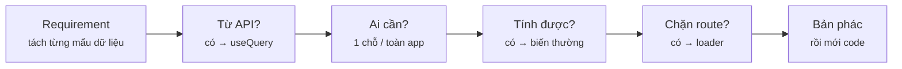
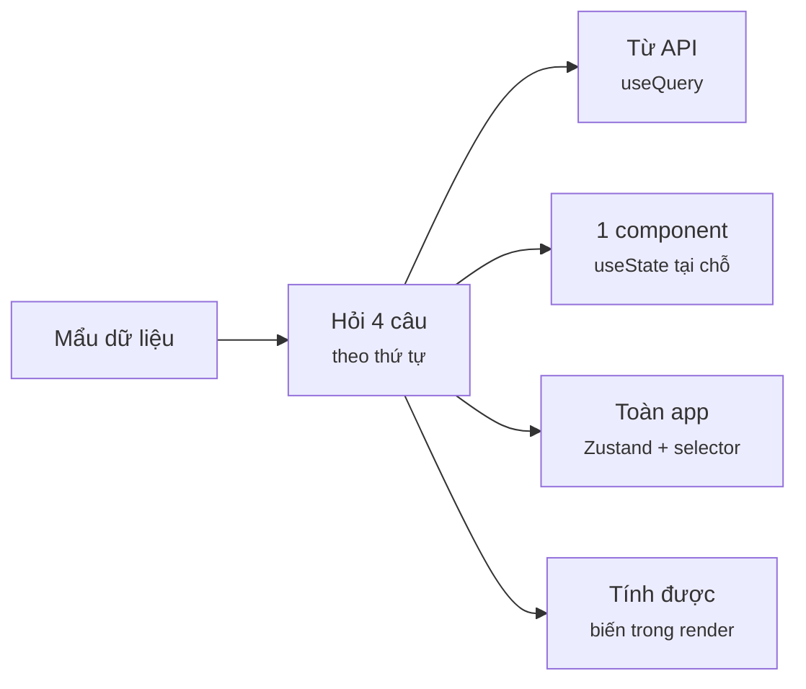
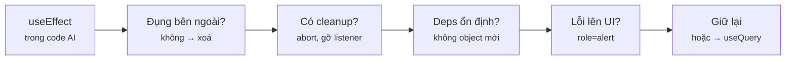
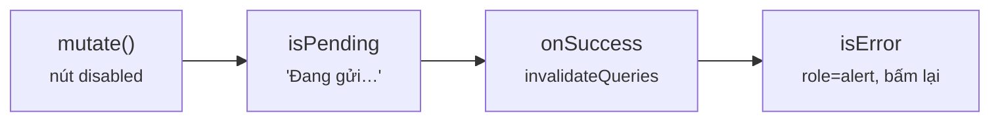
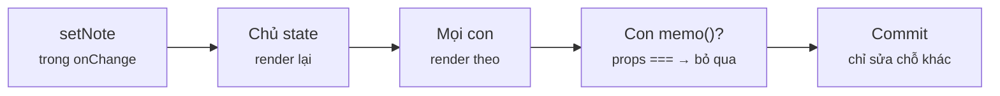
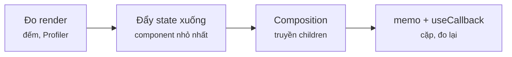
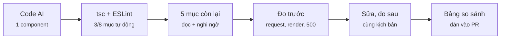
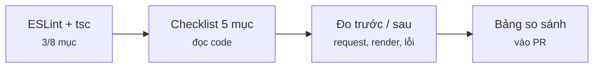

# Module 13 · Kiến trúc & review code AI

_Requirement → kiến trúc trong 60 giây · checklist effect & data · checklist render & cấu trúc · ESLint + đo trước/sau mỗi tuần_

**Đã chạy với:** Node 22.22.0 · TypeScript 6.0.3 · React 19.3.1 · @tanstack/react-query 5.104.5 · zustand 5.0.15 · react-router 8.5.0 · @testing-library/react 16.3.3 · @testing-library/user-event 14.6.8 · jsdom 29.1.1 · ESLint 10.13.0 · eslint-plugin-react-hooks 7.1.1 · @eslint-react/eslint-plugin 5.28.3 · typescript-eslint 8.72.0 · tsx 4.23.15

React chạy thật trong Node + jsdom (không StrictMode). Mỗi script `run.tsx` / `check.tsx` thao tác như user bằng Testing Library + user-event rồi **in số đo**: số request, số lần render (`track()` — 1 dòng đếm, chỉ để đo), từng lần commit ra màn hình (`<Profiler onRender>`). Backend là `m13/lib/api.ts`: `fetch` giả có đếm request, chỉnh độ trễ/lỗi theo URL, tôn trọng `AbortSignal` như thật. Kịch bản phụ thuộc thời gian (race, vòng lặp request) chạy **không bọc `act()`** để React commit theo thời gian thật như trình duyệt. Mọi file kiểm bằng `npx tsc -p .` (strict); ESLint dùng `eslint.config.ts` ở bài 13.4. Dùng TypeScript 6.0.3 thay vì 7 như các module trước vì typescript-eslint 8.72 chỉ nhận `typescript < 6.1`.

Vị trí: Đã học Module 12 · Portfolio projects (AI chat, Stripe, Inngest, Judge0, realtime) · **Đang học Module 13** · Sắp tới Hết roadmap — giữ thói quen: mỗi tuần 1 đoạn code AI, áp checklist, đo trước/sau

## Bài 13.1 · Đọc requirement → phác kiến trúc trong 60 giây

_Nguồn roadmap: Roadmap 13.1 (4 câu hỏi) · ôn Phase 3 (Context/Zustand/Redux), 4 (loader, protected route), 5 (TanStack Query)_

### 1 · Một câu & nằm ở đâu
Requirement: *"Trang Menu: danh sách món từ API, ô tìm theo tên, nút Thêm vào giỏ; header hiện số món trong giỏ; `/orders` chỉ cho người đã đăng nhập."* Trước khi gõ (hoặc trước khi đọc code AI), trả lời **4 câu hỏi** cho từng mẩu dữ liệu: (1) **server hay client** state? (2) chia sẻ **xa tới đâu**? (3) có **tính được lúc render** không? (4) route nào cần **chặn trước khi render**? 4 câu trả lời = bản phác: món → `useQuery`, ô tìm → `useState` tại chỗ, danh sách lọc → biến thường, giỏ → Zustand + selector, `/orders` → `loader`.

**[Requirement]** → **[Phác kiến trúc]** → Code (bạn / AI) → ESLint + tsc → Review + đo → Merge

<details><summary>m13/lib/api.ts — backend giả: fetch đếm request, chỉnh độ trễ / lỗi, tôn trọng AbortSignal</summary>

`m13/lib/api.ts`

```tsx
// API giả của quán (thay backend thật): thay globalThis.fetch, đếm request, chỉnh độ trễ / lỗi theo URL.
// Tôn trọng AbortSignal như fetch thật: bị huỷ → reject AbortError.
export type Drink = { id: number; name: string; price: number };
export type Order = { id: number; drink: string };

export const db = {
  drinks: [
    { id: 1, name: "Latte", price: 45000 },
    { id: 2, name: "Mocha", price: 50000 },
    { id: 3, name: "Cold Brew", price: 40000 },
    { id: 4, name: "Iced Latte", price: 48000 },
    { id: 5, name: "Espresso", price: 30000 },
  ] as Drink[],
  orders: [{ id: 101, drink: "Latte" }] as Order[],
  user: null as string | null,
};

export const calls: string[] = []; // mỗi request 1 dòng "GET /api/drinks?q=la"
export const aborted: string[] = []; // request bị client huỷ giữa chừng
export const callsTo = (prefix: string) => calls.filter((c) => c.startsWith(prefix)).length;

type Opts = { delay?: (url: URL) => number; fail?: (method: string, url: URL) => boolean };

export function installApi(opts: Opts = {}) {
  calls.length = 0;
  aborted.length = 0;
  globalThis.fetch = async (input: RequestInfo | URL, init?: RequestInit) => {
    const url = new URL(String(input), "http://localhost");
    const method = init?.method ?? "GET";
    calls.push(`${method} ${url.pathname}${url.search}`);
    await sleep(opts.delay?.(url) ?? 20, init?.signal ?? undefined).catch((e: Error) => {
      aborted.push(`${method} ${url.pathname}${url.search}`);
      throw e;
    });
    if (opts.fail?.(method, url)) return Response.json({ error: "Máy pha đang bảo trì" }, { status: 500 });
    if (url.pathname === "/api/drinks") {
      const q = (url.searchParams.get("q") ?? "").toLowerCase();
      return Response.json(db.drinks.filter((d) => d.name.toLowerCase().includes(q)));
    }
    if (url.pathname === "/api/orders") {
      if (!db.user) return Response.json({ error: "Chưa đăng nhập" }, { status: 401 });
      if (method === "POST") {
        const o = { id: 100 + db.orders.length + 1, drink: String(JSON.parse(String(init?.body)).drink) };
        db.orders.push(o);
        return Response.json(o, { status: 201 });
      }
      return Response.json(db.orders);
    }
    return Response.json({ error: "not found" }, { status: 404 });
  };
}

function sleep(ms: number, signal?: AbortSignal) {
  return new Promise<void>((ok, fail) => {
    const t = setTimeout(ok, ms);
    signal?.addEventListener("abort", () => { clearTimeout(t); fail(new DOMException("aborted", "AbortError")); });
  });
}

export async function getJson<T>(path: string, signal?: AbortSignal): Promise<T> {
  const res = await fetch(path, { signal });
  if (!res.ok) throw new Error(`${res.status} ${((await res.json()) as { error: string }).error}`);
  return (await res.json()) as T;
}

export async function postJson<T>(path: string, body: unknown): Promise<T> {
  const res = await fetch(path, { method: "POST", body: JSON.stringify(body) });
  if (!res.ok) throw new Error(`${res.status} ${((await res.json()) as { error: string }).error}`);
  return (await res.json()) as T;
}
```

</details>

<details><summary>m13/lib/track.ts — track(): đếm số lần render từng component (chỉ để đo)</summary>

`m13/lib/track.ts`

```tsx
// Đếm số lần render từng component (chỉ để ĐO trong bài — code thật không cần)
const renders = new Map<string, number>();

export const track = (name: string) => void renders.set(name, (renders.get(name) ?? 0) + 1);
export const rendersOf = (name: string) => renders.get(name) ?? 0;
export const resetRenders = () => renders.clear();
```

</details>

<details><summary>m13/menu/queries.ts — useDrinks / useOrders — server state qua TanStack Query</summary>

`m13/menu/queries.ts`

```tsx
// Server state: dữ liệu từ API đi qua TanStack Query (cache, khử trùng request, refetch, lỗi)
import { useQuery } from "@tanstack/react-query";
import { getJson, type Drink, type Order } from "../lib/api";

export const useDrinks = () =>
  useQuery({ queryKey: ["drinks"], queryFn: ({ signal }) => getJson<Drink[]>("/api/drinks", signal) });

export const useOrders = () =>
  useQuery({ queryKey: ["orders"], queryFn: ({ signal }) => getJson<Order[]>("/api/orders", signal) });
```

</details>

<details><summary>m13/menu/Header.tsx — Header + CartBadge đọc giỏ bằng selector</summary>

`m13/menu/Header.tsx`

```tsx
import { useCartCount } from "./cart";
import { track } from "../lib/track";

export function CartBadge() {
  track("CartBadge");
  const count = useCartCount();
  return <span aria-label="giỏ hàng">Giỏ: {count}</span>;
}

export function Header() {
  track("Header");
  return <header><b>Coffee Shop</b> <CartBadge /></header>;
}
```

</details>

<details><summary>m13/menu/run.tsx — script đo cho 3 ví dụ</summary>

`m13/menu/run.tsx`

```tsx
// Đo kiến trúc trang Menu: npx tsx m13/menu/run.tsx menu|cart|routes
import "../lib/dom";
import { screen, waitFor, cleanup } from "@testing-library/react";
import userEvent from "@testing-library/user-event";
import { RouterProvider } from "react-router";
import { installApi, calls, callsTo, db } from "../lib/api";
import { rendersOf, resetRenders } from "../lib/track";
import { withQuery } from "../lib/render";
import { Header } from "./Header";
import { MenuPage } from "./MenuPage";
import { makeRouter } from "./routes";

const user = userEvent.setup();
const names = () => screen.getAllByRole("listitem").map((li) => li.textContent?.replace(/Thêm.*/, "").trim()).join(", ");
installApi();

if (process.argv[2] === "menu") {
  withQuery(<><Header /><MenuPage /></>);
  await screen.findByRole("button", { name: "Thêm Espresso" });
  console.log(`Mở trang: ${calls.join(", ")} · hiện ${screen.getAllByRole("listitem").length} món`);
  resetRenders();
  await user.type(screen.getByLabelText("Tìm món"), "lat");
  console.log(`Gõ "lat" (3 phím) → request thêm: ${calls.length - 1} · MenuPage render: ${rendersOf("MenuPage")} · Header render: ${rendersOf("Header")} · CartBadge render: ${rendersOf("CartBadge")}`);
  console.log(`Danh sách: ${names()}`);
}
if (process.argv[2] === "cart") {
  withQuery(<><Header /><MenuPage /></>);
  await screen.findByRole("button", { name: "Thêm Espresso" });
  resetRenders();
  await user.click(screen.getByRole("button", { name: "Thêm Latte" }));
  await user.click(screen.getByRole("button", { name: "Thêm Mocha" }));
  console.log(`Bấm Thêm 2 lần → "${screen.getByLabelText("giỏ hàng").textContent}" · CartBadge render: ${rendersOf("CartBadge")} · Header render: ${rendersOf("Header")} · MenuPage render: ${rendersOf("MenuPage")}`);
}
if (process.argv[2] === "routes") {
  for (const who of [null, "an@cafe.vn"]) {
    db.user = who;
    calls.length = 0;
    const router = makeRouter("/orders");
    withQuery(<RouterProvider router={router} />);
    await waitFor(() => screen.getByRole("heading"));
    if (who) await screen.findByText(/#101/);
    const where = router.state.location.pathname + router.state.location.search;
    console.log(`${(who ?? "chưa đăng nhập").padEnd(15)} mở /orders → đang ở ${where.padEnd(22)} · "${screen.getByRole("heading").textContent}" · GET /api/orders: ${callsTo("GET /api/orders")} lần`);
    cleanup();
  }
}
process.exit(0); // QueryClient giữ timer dọn cache → thoát thẳng
```

</details>

### 2 · Concept
| Câu hỏi | Requirement này | Chọn | Bên C# |
|---|---|---|---|
| 1. Server hay client state? | Món: từ API · giỏ, ô tìm: chỉ UI | Server → `useQuery` (cache, khử trùng request, lỗi, refetch). **Không** bỏ vào Zustand/Redux | Dữ liệu qua `HttpClient` + `IMemoryCache` vs field của ViewModel |
| 2. Chia sẻ xa tới đâu? | Ô tìm: 1 trang · giỏ: header + menu, đổi liên tục | 1 component → `useState` tại chỗ · toàn app, đổi nhiều → Zustand + **selector** · toàn app, ít đổi → Context | field private vs singleton service |
| 3. Tính được lúc render? | Danh sách sau lọc = món + ô tìm | Biến thường trong thân component. Không state, không effect | computed property / LINQ `Where` |
| 4. Route nào chặn? | `/orders` | `loader` kiểm đăng nhập, `throw redirect()` — chạy **trước** khi component render | `[Authorize]` / middleware |

### 3 · Flow / lifecycle
**Từ 1 dòng requirement tới bản phác: hỏi theo thứ tự nào?**



Đọc sơ đồ: Trái → phải, làm cho TỪNG mẩu dữ liệu: dữ liệu từ đâu tới → ai cần nó → có cần lưu không hay tính được → có route nào phải chặn trước khi render. Câu 1 trả lời "server" thì dừng ở `useQuery`, không hỏi câu 2.

### 4 · Ví dụ thực tế
**Ví dụ 1.** Trang Menu theo bản phác: món từ `useDrinks()` (`useQuery`, mục 1), ô tìm là `useState` **của riêng trang**, danh sách lọc là biến thường. Script mở Header + MenuPage, gõ "lat".

`m13/menu/MenuPage.tsx`

```tsx
import { useState } from "react";
import { useDrinks } from "./queries";
import { useAddToCart } from "./cart";
import { track } from "../lib/track";

export function MenuPage() {
  track("MenuPage");
  const { data: drinks = [], isPending, isError } = useDrinks(); // server state
  const [q, setQ] = useState("");                                 // client state, chỉ trang này dùng
  const add = useAddToCart();                                     // client state toàn app
  const shown = drinks.filter((d) => d.name.toLowerCase().includes(q.toLowerCase())); // derived: tính lúc render

  if (isPending) return <p>Đang tải menu…</p>;
  if (isError) return <p role="alert">Không tải được menu</p>;
  return (
    <main>
      <input aria-label="Tìm món" value={q} onChange={(e) => setQ(e.target.value)} />
      <ul>
        {shown.map((d) => (
          <li key={d.id}>
            {d.name} <button onClick={() => add(d)}>Thêm {d.name}</button>
          </li>
        ))}
      </ul>
    </main>
  );
}
```

```console
❯ npx tsx m13/menu/run.tsx menu
Mở trang: GET /api/drinks · hiện 5 món
Gõ "lat" (3 phím) → request thêm: 0 · MenuPage render: 3 · Header render: 0 · CartBadge render: 0
Danh sách: Latte, Iced Latte
```

3 phím → 3 lần render đúng 1 component (MenuPage), **0 request** thêm (lọc ở client, dữ liệu đã có trong cache), Header và CartBadge đứng yên. Muốn lọc ở server (menu hàng nghìn món) thì đưa `q` vào `queryKey` — bài 13.2 ví dụ 3.

**Ví dụ 2.** Giỏ hàng: Header và Menu cùng cần, đổi mỗi lần bấm → Zustand. Mỗi component đọc **đúng phần nó cần** qua selector.

`m13/menu/cart.ts`

```tsx
// Client state dùng toàn app, đổi liên tục (mỗi lần bấm "Thêm") → Zustand, đọc bằng selector
import { create } from "zustand";
import type { Drink } from "../lib/api";

type Cart = {
  items: Drink[];
  add: (d: Drink) => void;
  clear: () => void;
};

export const useCart = create<Cart>()((set) => ({
  items: [],
  add: (d) => set((s) => ({ items: [...s.items, d] })),
  clear: () => set({ items: [] }),
}));

// Selector: component chỉ render lại khi ĐÚNG giá trị nó đọc thay đổi
export const useCartCount = () => useCart((s) => s.items.length);
export const useAddToCart = () => useCart((s) => s.add); // hàm trong store không đổi → không gây render
```

```console
❯ npx tsx m13/menu/run.tsx cart
Bấm Thêm 2 lần → "Giỏ: 2" · CartBadge render: 2 · Header render: 0 · MenuPage render: 0
```

Chỉ CartBadge render (2 lần cho 2 lần bấm). MenuPage dùng `useAddToCart()` — hàm `add` trong store không bao giờ đổi, nên giỏ đổi bao nhiêu MenuPage cũng không render lại. Đây là lý do roadmap chọn Zustand thay Context cho state đổi liên tục: Context không có selector, đổi value là mọi consumer render.

**Ví dụ 3.** `/orders` chặn ở `loader`: React Router chạy loader **trước** khi render route; `throw redirect()` là component không bao giờ mount.

`m13/menu/routes.tsx`

```tsx
// /orders chỉ cho người đã đăng nhập: chặn ở LOADER — chạy trước khi component nào render
import { createMemoryRouter, redirect } from "react-router";
import { db } from "../lib/api";
import { OrdersPage, LoginPage } from "./pages";

function requireUser() {
  if (!db.user) throw redirect("/login?next=/orders"); // máy thật: đọc session/cookie
  return null;
}

export const makeRouter = (path: string) =>
  createMemoryRouter(
    [
      { path: "/orders", loader: requireUser, element: <OrdersPage />, HydrateFallback: () => <p>Đang kiểm tra…</p> },
      { path: "/login", element: <LoginPage /> },
    ],
    { initialEntries: [path] },
  );
```

```console
❯ npx tsx m13/menu/run.tsx routes
chưa đăng nhập  mở /orders → đang ở /login?next=/orders    · "Đăng nhập" · GET /api/orders: 0 lần
an@cafe.vn      mở /orders → đang ở /orders                · "Đơn của bạn" · GET /api/orders: 1 lần
```

Chưa đăng nhập: về `/login?next=/orders`, **0 request** tới `/api/orders`. Đã đăng nhập: 1 request, hiện đơn. `HydrateFallback` là thứ hiện trong lúc loader chạy (thiếu nó React Router in cảnh báo). Loader chỉ chặn **UI** — API `/api/orders` vẫn phải tự trả 401 (server ở đây đã làm).

### 5 · Thử thật / bẫy
**Bẫy 1.** **AI gom mọi state vào 1 store toàn app** — kể cả ô tìm kiếm chỉ trang Menu dùng — và Header đọc store **không selector**.

`m13/menu/traps/shopStore.tsx`

```tsx
// ❌ AI gom MỌI state vào 1 store toàn app — kể cả ô tìm kiếm chỉ trang Menu dùng
import { create } from "zustand";
import type { Drink } from "../../lib/api";
import { track } from "../../lib/track";

export const useShop = create<{ q: string; setQ: (q: string) => void; items: Drink[] }>()((set) => ({
  q: "",
  setQ: (q) => set({ q }),
  items: [],
}));

export function Header() {
  track("Header");
  const { items } = useShop();                 // không selector → đăng ký CẢ store
  return <header>Coffee Shop · Giỏ: {items.length}</header>;
}

export function SearchBox() {
  const { q, setQ } = useShop();
  return <input aria-label="Tìm món" value={q} onChange={(e) => setQ(e.target.value)} />;
}
```

```console
❯ npx tsx m13/menu/traps/run.tsx store
Gõ "lat" (3 phím) → Header render: 3 (giỏ vẫn 0 món, Header không đổi gì)
```

Mỗi phím gõ đổi `q` trong store → mọi component gọi `useShop()` không selector đều render, Header 3 lần dù giỏ vẫn 0. App thật có 30 component đọc store kiểu này là 30 lần render mỗi phím. Sửa: ô tìm về `useState` trong trang (câu 2), và luôn đọc store bằng selector `useShop((s) => s.items.length)`.

**Bẫy 2.** **Dữ liệu API trong Zustand**, mỗi component tự `load()` trong `useEffect` — cách AI hay viết khi bạn nói "dùng Zustand".

`m13/menu/traps/drinksStore.tsx`

```tsx
// ❌ AI để dữ liệu API trong Zustand, mỗi component tự gọi load() trong useEffect
import { useEffect } from "react";
import { create } from "zustand";
import { getJson, type Drink } from "../../lib/api";

const useDrinkStore = create<{ drinks: Drink[]; load: () => Promise<void> }>()((set) => ({
  drinks: [],
  load: async () => set({ drinks: await getJson<Drink[]>("/api/drinks") }),
}));

export function MenuList() {
  const { drinks, load } = useDrinkStore();
  useEffect(() => { void load(); }, [load]);
  return <ul>{drinks.map((d) => <li key={d.id}>{d.name}</li>)}</ul>;
}

export function PromoBanner() {
  const { drinks, load } = useDrinkStore();
  useEffect(() => { void load(); }, [load]);   // "cho chắc là có dữ liệu"
  return <aside>Hôm nay: {drinks[0]?.name ?? "…"}</aside>;
}
```

```console
❯ npx tsx m13/menu/traps/run.tsx server
2 component cùng cần menu → 2 request: GET /api/drinks · GET /api/drinks
```

2 component cần menu → 2 request giống hệt nhau. Còn thiếu: trạng thái loading/lỗi, refetch khi quay lại tab, huỷ khi unmount, hết hạn cache — tự viết lại hết là đang viết lại TanStack Query. Câu 1 trả lời "server" thì dừng ở `useQuery` (bài Làm ngay).

**Bẫy 3.** **Chặn route bằng `useEffect` trong component**: `if (!user) navigate("/login")`.

`m13/menu/traps/GuardedOrders.tsx`

```tsx
// ❌ AI bảo vệ /orders bằng useEffect TRONG component — chạy SAU khi component đã render
import { useEffect } from "react";
import { useNavigate } from "react-router";
import { db } from "../../lib/api";
import { useOrders } from "../queries";

export function GuardedOrders() {
  const navigate = useNavigate();
  const { error } = useOrders();                     // query bắt đầu ngay ở lần render đầu
  useEffect(() => {
    if (!db.user) void navigate("/login");
  }, [navigate]);
  return <main><h1>Đơn của bạn</h1>{error && <p>{error.message}</p>}</main>;
}
```

```console
❯ npx tsx m13/menu/traps/run.tsx guard
Chưa đăng nhập mở /orders → màn hình lần lượt: "Đơn của bạn" → "Đăng nhập"
GET /api/orders đã gửi: 1 lần (server trả 401) · đang ở /login
```

Effect chạy **sau** commit: trang "Đơn của bạn" kịp gắn vào DOM (người dùng thấy nháy) và query đã bắn request không có quyền (401) rồi mới chuyển trang. So với ví dụ 3: loader chặn trước, 0 request, không nháy.

### 6 · Tóm tắt bằng hình
**(a) Cây thư mục sau bài này**

```text
sandbox/
├─ package.json · tsconfig.json  [MỚI]  ← react 19, @tanstack/react-query, zustand, react-router, jsdom, Testing Library
└─ m13/  [MỚI]  ← toàn bộ code module 13
   ├─ lib/dom.ts · api.ts · track.ts · render.tsx  [MỚI]  ← jsdom · backend giả · đếm render · bọc QueryClient
   ├─ menu/queries.ts · cart.ts  [MỚI]  ← server state (useQuery) · client state (Zustand + selector)
   ├─ menu/MenuPage.tsx · Header.tsx · pages.tsx  [MỚI]  ← UI theo bản phác
   ├─ menu/routes.tsx  [MỚI]  ← loader chặn /orders
   ├─ menu/run.tsx · traps/  [MỚI]  ← script đo · 3 bẫy
   └─ ex1/start · ex1/solution · ex1/check.tsx  [MỚI]  ← bài Làm ngay
```

**(b) Đọc trong 10 giây**

**Mỗi mẩu dữ liệu đi về đâu?**



Đọc sơ đồ: Đọc theo cột: từ API thì vào TanStack Query; còn lại hỏi ai cần nó; tính được từ thứ đã có thì không lưu gì cả.

### 7 · Làm ngay (≤ 10 phút)
**Mục tiêu:** AI viết hook `useDrinks` bằng `useState` + `useEffect`. MenuList và PromoBanner cùng dùng nó. Viết lại theo câu hỏi 1. Chỉ sửa `m13/ex1/start/useDrinks.ts` (component dùng nó ở `components.tsx`, không sửa).

File khởi đầu:

`m13/ex1/start/useDrinks.ts`

```tsx
// ← CHỈ sửa file này. AI viết: tự fetch bằng useState + useEffect
import { useEffect, useState } from "react";
import { getJson, type Drink } from "../../lib/api";

export function useDrinks() {
  const [data, setData] = useState<Drink[]>();
  const [isPending, setPending] = useState(true);
  useEffect(() => {
    void getJson<Drink[]>("/api/drinks").then((d) => {
      setData(d);
      setPending(false);
    });
  }, []);
  return { data, isPending, isError: false };
}
```

Chạy file khởi đầu (đang đỏ):

```console
❯ npx tsx m13/ex1/check.tsx start
✗ MenuList + PromoBanner cùng mở → đúng 1 request  → 2 request
✗ invalidateQueries(["drinks"]) → tải lại, hiện "Bạc Xỉu"  → 0 request mới, không có Bạc Xỉu
  (Uncaught in promise: Error: 500 Máy pha đang bảo trì)
✗ API trả 500 → hiện "Không tải được menu"  → màn hình: "Đang tải menu…"
0/3 đạt
```

Tiêu chí nghiệm thu:

- [ ] MenuList + PromoBanner cùng mở → đúng 1 request
- [ ] `queryClient.invalidateQueries({ queryKey: ["drinks"] })` → tải lại, hiện món mới
- [ ] API trả 500 → MenuList hiện "Không tải được menu" (không treo ở "Đang tải…")
- [ ] `npx tsc -p .` không lỗi

Lệnh nghiệm thu:

```bash
npx tsx m13/ex1/check.tsx start && npx tsc -p .
```

Lời giải tham chiếu chạy ra (output cần đạt):

```console
❯ npx tsx m13/ex1/check.tsx solution
✓ MenuList + PromoBanner cùng mở → đúng 1 request
✓ invalidateQueries(["drinks"]) → tải lại, hiện "Bạc Xỉu"
✓ API trả 500 → hiện "Không tải được menu"
3/3 đạt
```

<details><summary>Gợi ý nếu bị đỏ</summary>

| Triệu chứng | Nguyên nhân | Sửa |
|---|---|---|
| Vẫn 2 request | Mỗi component gọi hook = 1 effect riêng | `useQuery({ queryKey: ["drinks"], queryFn })` — cùng key thì dùng chung 1 request |
| invalidate không làm gì | Không có cache nào để huỷ | Key phải đúng `["drinks"]` |
| Treo "Đang tải…" khi 500 | `.then` không có nhánh lỗi, `isError` luôn `false` | `useQuery` tự có `isError`; `getJson` đã ném lỗi khi `!res.ok` |

`m13/ex1/start/useDrinks.ts` (diff)

```diff
-// ← CHỈ sửa file này. AI viết: tự fetch bằng useState + useEffect
-import { useEffect, useState } from "react";
+// ← CHỈ sửa file này. Server state → TanStack Query: 1 cache dùng chung, có lỗi, có refetch
+import { useQuery } from "@tanstack/react-query";
 import { getJson, type Drink } from "../../lib/api";
 
-export function useDrinks() {
-  const [data, setData] = useState<Drink[]>();
-  const [isPending, setPending] = useState(true);
-  useEffect(() => {
-    void getJson<Drink[]>("/api/drinks").then((d) => {
-      setData(d);
-      setPending(false);
-    });
-  }, []);
-  return { data, isPending, isError: false };
-}
+export const useDrinks = () =>
+  useQuery({ queryKey: ["drinks"], queryFn: ({ signal }) => getJson<Drink[]>("/api/drinks", signal) });
```

</details>

### 8 · 3 câu hỏi nhanh
1. Phỏng vấn: "Sao không bỏ luôn dữ liệu API vào Redux/Zustand cho tập trung?"

   <details><summary>Đáp án</summary>

   Server state có vòng đời riêng: cũ đi theo thời gian, nhiều nơi cùng cần, cần khử trùng request, loading/lỗi, refetch, huỷ, invalidate sau mutation. Store client không có mấy thứ đó → phải tự viết (bẫy 2: 2 component = 2 request, không có lỗi). TanStack Query là "cache cho server state"; Zustand/Redux giữ state thuần UI (giỏ, filter, modal).

   </details>

2. "Danh sách sau lọc nên là state không?"

   <details><summary>Đáp án</summary>

   Không. Nó tính được từ 2 thứ đã có (món + ô tìm) → biến thường trong render (ví dụ 1). Thêm state + effect để đồng bộ là có 2 nguồn sự thật, render thêm 1 lần, và có 1 frame hiện số cũ (bài 13.2 bẫy 1). Chỉ khi tính quá nặng mới bọc `useMemo`.

   </details>

3. Review code AI: `AuthContext` chứa `user`, `cart`, `searchTerm`, `theme`; trang `/admin` chặn bằng `useEffect(() => { if (!user.isAdmin) navigate("/") })`. Góp ý?

   <details><summary>Đáp án</summary>

   (1) Tách theo câu 2: `searchTerm` về `useState` của trang; `cart` đổi liên tục → Zustand + selector; `user`, `theme` ít đổi → Context được. Gộp chung thì mỗi phím gõ làm mọi consumer render (bẫy 1). (2) `/admin` chặn bằng `loader` + `throw redirect()` (ví dụ 3); effect chặn sau khi đã render và đã gọi API (bẫy 3). (3) API admin vẫn phải tự kiểm quyền ở server.

   </details>


---

## Bài 13.2 · Checklist review: effect & dữ liệu

_Nguồn roadmap: Roadmap 13.2 — mục: useEffect thừa cho derived value · thiếu cleanup/AbortController · object/array literal trong dependency · thiếu error state khi mutation_

### 1 · Một câu & nằm ở đâu
Thấy `useEffect` trong code AI thì hỏi theo thứ tự: **có đụng thế giới ngoài** (fetch, subscribe, timer, DOM) không? Không → xoá, **tính lúc render**. Có → **có `return` cleanup** không (huỷ request, gỡ listener)? **Deps toàn giá trị nguyên thuỷ** chưa (object/array tạo trong render = đổi mỗi lần)? Kết quả lỗi **có hiện ra UI** không? Với dữ liệu server, `useQuery`/`useMutation` trả lời sẵn 3 câu sau — nên câu sửa hay gặp nhất là "dùng TanStack Query".

Requirement → Phác kiến trúc → **[Code (bạn / AI)]** → ESLint + tsc → **[Review + đo]** → Merge

### 2 · Concept
| Dấu hiệu trong code AI | Đo được (bẫy bên dưới) | Sửa | Bên C# |
|---|---|---|---|
| Effect chỉ `setState` từ props/state khác | Render 2 lần, commit đầu **hiện số cũ** | Tính lúc render; nặng thì `useMemo` | Computed property thay vì event cập nhật field |
| `fetch` trong effect, không cleanup | Gõ nhanh → kết quả của chữ **cũ** đè chữ mới (race) | `AbortController` + `return () => ac.abort()`, hoặc `useQuery` | `CancellationToken`, bỏ kết quả cũ |
| Object/array tạo trong render nằm trong deps | Effect chạy **mỗi render** → request thừa, có khi lặp vô hạn | Deps là giá trị nguyên thuỷ (`[maxPrice]`); `queryKey` thì object được | So reference vs so giá trị (`record`) |
| `useMutation` không `onError`/`isError`, không khoá nút | Lỗi **im lặng**, bấm 2 lần = 2 đơn, danh sách không cập nhật | `isError` → `role="alert"`; `disabled={isPending}`; `onSuccess` → `invalidateQueries` | try/catch + ProblemDetails hiện cho user |

### 3 · Flow / lifecycle
**Gặp 1 useEffect trong code AI: hỏi 4 câu theo thứ tự nào?**



Đọc sơ đồ: Trái → phải. Trượt ở câu 2 thì xoá effect, tính lúc render. Qua câu 2 thì effect phải có cleanup, deps ổn định, và lỗi phải tới được UI — với dữ liệu server, `useQuery` lo sẵn cả ba.

### 4 · Ví dụ thực tế
**Ví dụ 1.** Tổng tiền, số món = **derived** từ `items` → tính thẳng trong render. Script thêm Mocha vào giỏ đang có Latte, ghi lại mọi lần commit ra màn hình.

`m13/fx/CartSummary.tsx`

```tsx
// Tổng tiền, số món = DERIVED từ props → tính thẳng lúc render, không state, không effect
import type { Drink } from "../lib/api";
import { track } from "../lib/track";

const vnd = (n: number) => n.toLocaleString("vi-VN") + "đ";

export function CartSummary({ items }: { items: Drink[] }) {
  track("CartSummary");
  const total = items.reduce((sum, d) => sum + d.price, 0); // rẻ → khỏi useMemo
  return <p>{items.length} món · {vnd(total)}</p>;
}
```

```console
❯ npx tsx m13/fx/run.tsx summary
Thêm Mocha vào giỏ (đang có Latte) → CartSummary render 1 lần, 1 lần commit ra màn hình:
  commit 1: "2 món · 95.000đ"
```

1 render, 1 commit, số đúng ngay. Không `useMemo`: `reduce` trên vài món rẻ hơn chi phí so deps của `useMemo`. Chỉ memo khi đo thấy chậm (lọc/sắp xếp hàng nghìn dòng).

**Ví dụ 2.** Chưa có TanStack Query mà phải tự fetch: mỗi lần `q` đổi, **huỷ** request cũ trong cleanup. Backend giả trả chậm hơn cho chữ ngắn (`l`: 300ms, `la`: 180ms, `lat`: 60ms) — đúng kiểu search thật: chữ ngắn khớp nhiều, chậm hơn.

`m13/fx/SearchDrinks.tsx`

```tsx
// Tự fetch trong effect (khi chưa có TanStack Query): PHẢI huỷ request cũ khi q đổi
import { useEffect, useState } from "react";
import { getJson, type Drink } from "../lib/api";

export function SearchDrinks() {
  const [q, setQ] = useState("");
  const [result, setResult] = useState<{ q: string; drinks: Drink[] }>();
  const [error, setError] = useState<string>();
  useEffect(() => {
    const ac = new AbortController();
    getJson<Drink[]>(`/api/drinks?q=${encodeURIComponent(q)}`, ac.signal).then(
      (drinks) => setResult({ q, drinks }),
      (e: Error) => { if (e.name !== "AbortError") setError(e.message); },
    );
    return () => ac.abort();                 // q đổi hoặc unmount → huỷ request đang bay
  }, [q]);
  return (
    <main>
      <input aria-label="Tìm món" value={q} onChange={(e) => setQ(e.target.value)} />
      {error && <p role="alert">{error}</p>}
      <p>Kết quả cho "{result?.q}": {result?.drinks.map((d) => d.name).join(", ")}</p>
    </main>
  );
}
```

```console
❯ npx tsx m13/fx/run.tsx search
Gõ "lat" (20ms/phím) · request: q=l, q=la, q=lat · bị huỷ: 2
+   0ms  Kết quả cho "": Latte, Mocha, Cold Brew, Iced Latte, Espresso   ← trước khi gõ
+ 320ms  Kết quả cho "lat": Latte, Iced Latte
```

3 request, 2 bị huỷ (`l`, `la`) → màn hình đi thẳng từ kết quả cũ sang "lat". Nhánh lỗi bỏ qua `AbortError` — huỷ là chủ ý, không phải lỗi. ≈ truyền `CancellationToken` rồi huỷ token cũ mỗi lần gõ.

**Ví dụ 3.** Cùng màn hình, dùng `useQuery`: `q` nằm trong `queryKey`.

`m13/fx/SearchQuery.tsx`

```tsx
// Cùng màn hình, dùng TanStack Query: key chứa q → đổi q là đổi query; huỷ + chống race có sẵn
import { useState } from "react";
import { keepPreviousData, useQuery } from "@tanstack/react-query";
import { getJson, type Drink } from "../lib/api";

export function SearchQuery() {
  const [q, setQ] = useState("");
  const { data, error } = useQuery({
    queryKey: ["drinks", { q }],                 // object literal trong KEY: an toàn, Query so theo nội dung
    queryFn: ({ signal }) => getJson<Drink[]>(`/api/drinks?q=${encodeURIComponent(q)}`, signal),
    placeholderData: keepPreviousData,            // giữ kết quả cũ trong lúc tải, không nháy trống
  });
  return (
    <main>
      <input aria-label="Tìm món" value={q} onChange={(e) => setQ(e.target.value)} />
      {error && <p role="alert">{error.message}</p>}
      <p>Kết quả: {data?.map((d) => d.name).join(", ")}</p>
    </main>
  );
}
```

```console
❯ npx tsx m13/fx/run.tsx query
Gõ "lat" (20ms/phím) · request: q=l, q=la, q=lat · bị huỷ: 2
+   0ms  Kết quả: Latte, Mocha, Cold Brew, Iced Latte, Espresso   ← trước khi gõ
+ 356ms  Kết quả: Latte, Iced Latte
```

Cùng kết quả, không viết dòng cleanup nào: query cũ hết người dùng thì bị huỷ qua `signal`, và chỉ dữ liệu của key **hiện tại** được hiện. `{ q }` là object literal nhưng nằm trong **key** nên an toàn — TanStack so key theo nội dung, không theo reference (khác hẳn deps của `useEffect`, bẫy 3).

### 5 · Thử thật / bẫy
**Bẫy 1.** **Effect để "đồng bộ" giá trị derived** — AI rất hay viết.

`m13/fx/traps/CartSummaryEffect.tsx`

```tsx
// ❌ AI: "tổng tiền là state, cập nhật khi items đổi"
import { useEffect, useState } from "react";
import type { Drink } from "../../lib/api";
import { track } from "../../lib/track";

const vnd = (n: number) => n.toLocaleString("vi-VN") + "đ";

export function CartSummaryEffect({ items }: { items: Drink[] }) {
  track("CartSummary");
  const [total, setTotal] = useState(0);
  const [count, setCount] = useState(0);
  useEffect(() => {
    setTotal(items.reduce((sum, d) => sum + d.price, 0));
    setCount(items.length);
  }, [items]);
  return <p>{count} món · {vnd(total)}</p>;
}
```

```console
❯ npx tsx m13/fx/run.tsx summary-effect
Thêm Mocha vào giỏ (đang có Latte) → CartSummary render 2 lần, 2 lần commit ra màn hình:
  commit 1: "1 món · 45.000đ"
  commit 2: "2 món · 95.000đ"
```

2 render, 2 commit, và commit đầu **hiện số cũ** ("1 món · 45.000đ") dù giỏ đã 2 món — effect chạy sau commit nên luôn trễ 1 nhịp. Với màn hình nhiều số liệu, đây là nháy số và render gấp đôi. ESLint bắt được mẫu này (`react-hooks/set-state-in-effect`, bài 13.4).

**Bẫy 2.** **Fetch trong effect, không cleanup** — "chạy được mà", khi bạn gõ chậm.

`m13/fx/traps/SearchNoAbort.tsx`

```tsx
// ❌ AI: fetch trong effect, không cleanup — "chạy được mà"
import { useEffect, useState } from "react";
import { getJson, type Drink } from "../../lib/api";

export function SearchNoAbort() {
  const [q, setQ] = useState("");
  const [result, setResult] = useState<{ q: string; drinks: Drink[] }>();
  useEffect(() => {
    void getJson<Drink[]>(`/api/drinks?q=${encodeURIComponent(q)}`).then((drinks) => setResult({ q, drinks }));
  }, [q]);
  return (
    <main>
      <input aria-label="Tìm món" value={q} onChange={(e) => setQ(e.target.value)} />
      <p>Kết quả cho "{result?.q}": {result?.drinks.map((d) => d.name).join(", ")}</p>
    </main>
  );
}
```

```console
❯ npx tsx m13/fx/run.tsx search-noabort
Gõ "lat" (20ms/phím) · request: q=l, q=la, q=lat · bị huỷ: 0
+   0ms  Kết quả cho "": Latte, Mocha, Cold Brew, Iced Latte, Espresso   ← trước khi gõ
+ 342ms  Kết quả cho "lat": Latte, Iced Latte
+ 436ms  Kết quả cho "la": Latte, Iced Latte
+ 532ms  Kết quả cho "l": Latte, Cold Brew, Iced Latte
```

Không huỷ gì: 3 response về theo thứ tự **server trả**, không theo thứ tự gõ. Màn hình hiện đúng "lat" một lúc rồi bị "la", rồi "l" đè lên — ô tìm ghi "lat" mà danh sách có Cold Brew. Đây là lỗi race condition kinh điển (roadmap Session 0.3). ESLint **không** bắt được (bài 13.4 bẫy 1).

**Bẫy 3.** **Object tạo trong render làm dependency**: AI gom tham số vào `filter` "cho gọn".

`m13/fx/traps/PriceFilter.tsx`

```tsx
// ❌ AI gom tham số vào 1 object rồi để object đó làm dependency
import { useEffect, useState } from "react";
import { getJson, type Drink } from "../../lib/api";

export function PriceFilter({ maxPrice }: { maxPrice: number }) {
  const [note, setNote] = useState("");
  const [count, setCount] = useState(0);
  const filter = { maxPrice };                   // object MỚI mỗi lần render
  useEffect(() => {
    void getJson<Drink[]>("/api/drinks").then((ds) => setCount(ds.filter((d) => d.price <= filter.maxPrice).length));
  }, [filter]);                                  // reference đổi mỗi render → effect chạy mỗi render
  return (
    <main>
      <input aria-label="Ghi chú" value={note} onChange={(e) => setNote(e.target.value)} />
      <p>{count} món giá ≤ {maxPrice}</p>
    </main>
  );
}
```

```console
❯ npx tsx m13/fx/run.tsx price
Mở trang: 2 request · gõ "ít đá" (5 phím) vào ô ghi chú → thêm 5 request GET /api/drinks
Màn hình: "3 món giá ≤ 45000" (không đổi)
```

Gõ vào ô **ghi chú** (không liên quan giá) mà mỗi phím 1 request: mỗi render tạo `{ maxPrice }` mới, `Object.is` thấy khác, effect chạy lại. Mở trang đã 2 request (render sau `setCount` lại tạo object mới). Nếu response tạo array mới rồi `setState` thì thành **vòng lặp request vô hạn** — bài 13.4 đo được vài trăm request mỗi giây. Sửa: deps `[maxPrice]`.

### 6 · Tóm tắt bằng hình
**(a) Cây thư mục sau bài này**

```text
m13/fx/  [MỚI]  ← bài 13.2
├─ CartSummary.tsx  [MỚI]  ← derived tính lúc render
├─ SearchDrinks.tsx  [MỚI]  ← fetch trong effect + AbortController
├─ SearchQuery.tsx  [MỚI]  ← cùng màn hình bằng useQuery
├─ run.tsx  [MỚI]  ← script đo (Profiler ghi từng commit)
└─ traps/CartSummaryEffect · SearchNoAbort · PriceFilter  [MỚI]  ← 3 bẫy
m13/lib/api.ts  [SỬA]  ← + postJson, + danh sách request bị huỷ
m13/ex2/start · ex2/solution · ex2/check.tsx  [MỚI]  ← bài Làm ngay
```

**(b) Đọc trong 10 giây**

**Mutation đủ trạng thái trông thế nào?**



Đọc sơ đồ: Bấm → khoá nút trong lúc gửi → thành công thì làm mới dữ liệu liên quan, thất bại thì báo và mở lại nút.

### 7 · Làm ngay (≤ 10 phút)
**Mục tiêu:** `OrderButton` do AI viết dùng `useMutation` nhưng chỉ lo đường vui: lỗi im lặng, bấm 2 lần ra 2 đơn, đặt xong danh sách đơn không đổi. Chỉ sửa `m13/ex2/start/OrderButton.tsx`.

File khởi đầu:

`m13/ex2/start/OrderButton.tsx`

```tsx
// ← CHỈ sửa file này. AI viết: đặt món bằng useMutation
import { useMutation } from "@tanstack/react-query";
import { postJson, type Order } from "../../lib/api";

export function OrderButton() {
  const order = useMutation({
    mutationFn: (drink: string) => postJson<Order>("/api/orders", { drink }),
  });
  return (
    <section>
      <button onClick={() => order.mutate("Latte")}>
        {order.isPending ? "Đang gửi…" : "Đặt Latte"}
      </button>
      {order.isSuccess && <p>Đã đặt #{order.data.id}</p>}
    </section>
  );
}
```

Chạy file khởi đầu (đang đỏ):

```console
❯ npx tsx m13/ex2/check.tsx start
✗ API 500 → báo lỗi (role=alert) và nút bấm lại được  → alert: không có · màn hình: "Đặt Latte"
✗ Bấm 2 lần liền → chỉ 1 POST  → 2 POST: GET /api/orders · POST /api/orders · POST /api/orders
✗ Đặt xong → danh sách đơn tải lại (1 GET /api/orders mới)  → 0 GET mới · danh sách: #101 Latte
0/3 đạt
```

Tiêu chí nghiệm thu:

- [ ] API 500 → hiện `role="alert"` "Không đặt được: 500 Máy pha đang bảo trì", nút bấm lại được
- [ ] Bấm 2 lần liền → chỉ 1 POST
- [ ] Đặt xong → danh sách đơn (query `["orders"]`) tải lại đúng 1 lần
- [ ] `npx tsc -p .` không lỗi

Lệnh nghiệm thu:

```bash
npx tsx m13/ex2/check.tsx start && npx tsc -p .
```

Lời giải tham chiếu chạy ra (output cần đạt):

```console
❯ npx tsx m13/ex2/check.tsx solution
✓ API 500 → báo lỗi (role=alert) và nút bấm lại được
✓ Bấm 2 lần liền → chỉ 1 POST
✓ Đặt xong → danh sách đơn tải lại (1 GET /api/orders mới)
3/3 đạt
```

<details><summary>Gợi ý nếu bị đỏ</summary>

| Triệu chứng | Nguyên nhân | Sửa |
|---|---|---|
| Không có alert | Không đọc `order.isError` | `{order.isError && <p role="alert">Không đặt được: {order.error.message}</p>}` |
| 2 POST | Nút không khoá khi đang gửi | `disabled={order.isPending}` |
| 0 GET mới sau khi đặt | Cache `["orders"]` không biết đã cũ | `useQueryClient()` + `onSuccess: () => qc.invalidateQueries({ queryKey: ["orders"] })` |

`m13/ex2/start/OrderButton.tsx` (diff)

```diff
-// ← CHỈ sửa file này. AI viết: đặt món bằng useMutation
-import { useMutation } from "@tanstack/react-query";
+// ← CHỈ sửa file này. Đủ 3 trạng thái: đang gửi (khoá nút), lỗi (báo + bấm lại được), xong (làm mới danh sách)
+import { useMutation, useQueryClient } from "@tanstack/react-query";
 import { postJson, type Order } from "../../lib/api";
 
 export function OrderButton() {
+  const qc = useQueryClient();
   const order = useMutation({
     mutationFn: (drink: string) => postJson<Order>("/api/orders", { drink }),
+    onSuccess: () => qc.invalidateQueries({ queryKey: ["orders"] }), // danh sách đơn đã cũ
   });
   return (
     <section>
-      <button onClick={() => order.mutate("Latte")}>
+      <button disabled={order.isPending} onClick={() => order.mutate("Latte")}>
         {order.isPending ? "Đang gửi…" : "Đặt Latte"}
       </button>
+      {order.isError && <p role="alert">Không đặt được: {order.error.message}</p>}
       {order.isSuccess && <p>Đã đặt #{order.data.id}</p>}
     </section>
```

</details>

### 8 · 3 câu hỏi nhanh
1. Phỏng vấn: "Khi nào KHÔNG cần `useEffect`?"

   <details><summary>Đáp án</summary>

   Khi không đồng bộ với hệ thống bên ngoài React. Giá trị tính được từ props/state → tính lúc render (bẫy 1). Phản ứng với hành động user (bấm, submit) → làm trong event handler. Reset state khi prop đổi → dùng `key`. Fetch dữ liệu server → `useQuery` hoặc loader. Effect dành cho: subscribe/unsubscribe, timer, DOM ngoài React, đồng bộ với widget không phải React.

   </details>

2. "Fetch trong `useEffect` cần gì để an toàn?"

   <details><summary>Đáp án</summary>

   Cleanup huỷ request cũ (`AbortController`, hoặc cờ `ignore` nếu API không hỗ trợ huỷ) để kết quả cũ không đè kết quả mới (bẫy 2); bỏ qua `AbortError`; deps chỉ chứa giá trị nguyên thuỷ (bẫy 3); state lỗi + loading. Đủ những thứ đó là bạn đang viết lại 1 phần nhỏ TanStack Query — nên dùng nó (ví dụ 3).

   </details>

3. Review code AI: `useEffect(() => { fetch("/api/stats?from=" + range.from).then(r => r.json()).then(setStats) }, [range])` với `const range = { from, to }` khai báo ngay trên. Góp ý?

   <details><summary>Đáp án</summary>

   (1) `range` tạo mới mỗi render → effect chạy mỗi render, và `setStats` với object mới → render → effect: vòng lặp request vô hạn (bẫy 3). (2) Không cleanup → race khi đổi khoảng ngày nhanh (bẫy 2). (3) Không kiểm `r.ok`, không state lỗi. Sửa gọn nhất: `useQuery({ queryKey: ["stats", { from, to }], queryFn: ({ signal }) => … })`.

   </details>


---

## Bài 13.3 · Checklist review: render & cấu trúc component

_Nguồn roadmap: Roadmap 13.2 — mục: useCallback/useMemo bọc bừa · key={index} trong list xoá/sắp xếp được · state đặt quá cao_

### 1 · Một câu & nằm ở đâu
Một `setState` làm component **sở hữu state** đó và **toàn bộ con của nó** render lại — trừ con bọc `memo()` mà props không đổi (so `===`). Từ đó ra 3 quy tắc review: (1) `useCallback`/`useMemo` để giữ reference **chỉ có ích khi con là `memo()`** — không thì dư; (2) state đặt ở component **thấp nhất** cần nó, đừng để ở cha bọc cả danh sách; (3) `key` phải là **id ổn định** — `key={index}` làm state của dòng (ô nhập, checkbox) nhảy sang dòng khác khi xoá/sắp xếp.

Requirement → Phác kiến trúc → **[Code (bạn / AI)]** → ESLint + tsc → **[Review + đo]** → Merge

<details><summary>m13/render/DrinkRow.tsx — 1 dòng món (đếm render) + bản memo()</summary>

`m13/render/DrinkRow.tsx`

```tsx
// 1 dòng món — dùng chung cho mọi ví dụ bài 13.3
import { memo } from "react";
import type { Drink } from "../lib/api";
import { track } from "../lib/track";

export function DrinkRow({ drink, onAdd }: { drink: Drink; onAdd: (d: Drink) => void }) {
  track("DrinkRow");
  return <li>{drink.name} <button onClick={() => onAdd(drink)}>Thêm {drink.name}</button></li>;
}

export const MemoDrinkRow = memo(DrinkRow); // bỏ qua render nếu MỌI prop giống lần trước (so ===)
```

</details>

<details><summary>m13/render/run.tsx — script đo cho 3 ví dụ + 3 bẫy</summary>

`m13/render/run.tsx`

```tsx
// Đo bài 13.3: npx tsx m13/render/run.tsx note|note-high|memo|memo-bad|keys|keys-index
import "../lib/dom";
import { render, screen, cleanup } from "@testing-library/react";
import userEvent from "@testing-library/user-event";
import type { ComponentType } from "react";
import { rendersOf, resetRenders } from "../lib/track";
import { Board } from "./Board";
import { BoardHigh } from "./traps/BoardHigh";
import { CartBoard } from "./CartBoard";
import { CartBoardNoMemo, CartBoardPlain } from "./traps/CartBoardNoMemo";
import { NoteList } from "./NoteList";
import { NoteListIndex } from "./traps/NoteListIndex";

const which = process.argv[2];
const user = userEvent.setup();
const noop = () => {};

if (which === "note" || which === "note-high") {
  render(which === "note" ? <Board onAdd={noop} /> : <BoardHigh onAdd={noop} />);
  resetRenders();
  await user.type(screen.getByLabelText("Lời nhắn cho barista"), "ít đá");
  console.log(`Gõ "ít đá" (5 phím) → Board render: ${rendersOf("Board")} · DrinkRow render: ${rendersOf("DrinkRow")} (5 dòng món)`);
}
if (which === "memo" || which === "memo-bad") {
  const variants: [string, ComponentType][] = which === "memo"
    ? [["memo(DrinkRow) + useCallback", CartBoard]]
    : [["không hook nào", CartBoardPlain], ["useCallback + useMemo, con KHÔNG memo", CartBoardNoMemo]];
  for (const [label, C] of variants) {
    render(<C />);
    resetRenders();
    await user.click(screen.getByRole("button", { name: "Thêm Latte" }));
    await user.click(screen.getByRole("button", { name: "Thêm Mocha" }));
    console.log(`${label.padEnd(38)} bấm Thêm 2 lần → "${screen.getByText(/^Giỏ/).textContent}" · Board render: ${rendersOf("Board")} · DrinkRow render: ${rendersOf("DrinkRow")}`);
    cleanup();
  }
}
if (which === "keys" || which === "keys-index") {
  for (const [label, C] of which === "keys" ? [["key={d.id}", NoteList] as const] : [["key={i}", NoteListIndex] as const]) {
    render(<C />);
    await user.type(screen.getByLabelText("Ghi chú Latte"), "ít đá");
    await user.click(screen.getByRole("button", { name: "Xoá Latte" }));
    const rows = screen.getAllByRole("listitem").map((li) => `${li.textContent?.replace(/Xoá.*/, "").trim()} [${li.querySelector("input")?.value ?? ""}]`);
    console.log(`${label} · ghi "ít đá" cho Latte rồi xoá Latte → ${rows.join(" · ")}`);
    cleanup();
  }
}
```

</details>

### 2 · Concept
| Dấu hiệu trong code AI | Đo được (bẫy bên dưới) | Sửa | Bên C# |
|---|---|---|---|
| `useCallback`/`useMemo` khắp nơi, con **không** `memo()` | Số render **y hệt** bản không hook | Bỏ hook; hoặc `memo()` con + `useCallback` — đi thành cặp, **đo trước** | Cache kết quả mà không ai đọc cache |
| `key={index}` trong list xoá/sắp xếp được | Ô nhập của dòng bị xoá **nhảy** sang dòng dưới | `key={d.id}` — id từ dữ liệu | Định danh theo vị trí thay vì theo khoá chính |
| State ô nhập ở cha bọc cả danh sách | Mỗi phím: cha + **mọi dòng** render | Tách component nhỏ giữ state đó ("move state down") | Field đặt sai lớp, mỗi lần đổi phát `PropertyChanged` cho cả màn hình |

### 3 · Flow / lifecycle
**Gõ 1 phím vào ô ghi chú: React render lại những gì?**



Đọc sơ đồ: Trái → phải: `setState` đánh dấu component sở hữu state; React gọi lại hàm component đó và mọi con bên dưới; con `memo()` có props y hệt thì bỏ qua; cuối cùng chỉ chỗ DOM khác mới bị sửa. Muốn bớt render: đẩy state xuống thấp (bớt con) hoặc `memo()` con.

### 4 · Ví dụ thực tế
**Ví dụ 1.** State của ô "Lời nhắn cho barista" nằm trong `NoteField` — component nhỏ nhất cần nó. Script gõ "ít đá".

`m13/render/Board.tsx`

```tsx
// State nằm ở component THẤP NHẤT cần nó: gõ ghi chú chỉ render NoteField
import { useState } from "react";
import { db, type Drink } from "../lib/api";
import { track } from "../lib/track";
import { DrinkRow } from "./DrinkRow";

function NoteField() {
  const [note, setNote] = useState("");          // chỉ NoteField dùng → để ở đây
  return <input aria-label="Lời nhắn cho barista" value={note} onChange={(e) => setNote(e.target.value)} />;
}

export function Board({ onAdd }: { onAdd: (d: Drink) => void }) {
  track("Board");
  return (
    <main>
      <ul>{db.drinks.map((d) => <DrinkRow key={d.id} drink={d} onAdd={onAdd} />)}</ul>
      <NoteField />
    </main>
  );
}
```

```console
❯ npx tsx m13/render/run.tsx note
Gõ "ít đá" (5 phím) → Board render: 0 · DrinkRow render: 0 (5 dòng món)
```

5 phím → chỉ NoteField render; Board và 5 dòng món: 0 lần. Không cần `memo` nào — đặt đúng chỗ đã đủ. Đây là cách sửa rẻ nhất, nên thử trước khi nghĩ tới `memo`.

**Ví dụ 2.** Board giữ giỏ (phải ở đây vì hiện "Giỏ: n"), mỗi dòng có nút Thêm. Muốn dòng không render lại khi giỏ đổi: `memo()` ở con **và** `useCallback` ở cha.

`m13/render/CartBoard.tsx`

```tsx
// memo() ở con + useCallback ở cha: ĐI THÀNH CẶP mới có tác dụng
import { useCallback, useState } from "react";
import { db, type Drink } from "../lib/api";
import { track } from "../lib/track";
import { MemoDrinkRow } from "./DrinkRow";

export function CartBoard() {
  track("Board");
  const [cart, setCart] = useState<Drink[]>([]);
  const add = useCallback((d: Drink) => setCart((c) => [...c, d]), []); // cùng 1 hàm qua mọi render
  return (
    <main>
      <p>Giỏ: {cart.length}</p>
      <ul>{db.drinks.map((d) => <MemoDrinkRow key={d.id} drink={d} onAdd={add} />)}</ul>
    </main>
  );
}
```

```console
❯ npx tsx m13/render/run.tsx memo
memo(DrinkRow) + useCallback           bấm Thêm 2 lần → "Giỏ: 2" · Board render: 2 · DrinkRow render: 0
```

Board render 2 lần (giỏ đổi), 5 dòng: 0. `memo()` so từng prop bằng `===`: `drink` là object có sẵn trong `db.drinks`, `onAdd` nhờ `useCallback(…, [])` là cùng 1 hàm. Thiếu 1 trong 2 là mất tác dụng.

**Ví dụ 3.** Mỗi dòng có ô ghi chú riêng (state **trong** dòng — ở đây là `<input>` không kiểm soát). Ghi "ít đá" cho Latte rồi xoá Latte.

`m13/render/NoteList.tsx`

```tsx
// Mỗi dòng có ô ghi chú riêng (state nằm TRONG dòng). key = id → state đi theo đúng món
import { useState } from "react";
import { db } from "../lib/api";

export function NoteList() {
  const [drinks, setDrinks] = useState(db.drinks.slice(0, 3));
  return (
    <ul>
      {drinks.map((d) => (
        <li key={d.id}>
          {d.name} <input aria-label={`Ghi chú ${d.name}`} />
          <button onClick={() => setDrinks((list) => list.filter((x) => x.id !== d.id))}>Xoá {d.name}</button>
        </li>
      ))}
    </ul>
  );
}
```

```console
❯ npx tsx m13/render/run.tsx keys
key={d.id} · ghi "ít đá" cho Latte rồi xoá Latte → Mocha [] · Cold Brew []
```

`key={d.id}`: React biết dòng Latte biến mất, xoá đúng instance đó cùng ô nhập của nó. Mocha và Cold Brew giữ nguyên instance, ô trống.

### 5 · Thử thật / bẫy
**Bẫy 1.** **AI bọc `useCallback` + `useMemo` "cho tối ưu"** — nhưng `DrinkRow` không phải `memo()`.

`m13/render/traps/CartBoardNoMemo.tsx`

```tsx
// ❌ AI bọc useCallback + useMemo "cho tối ưu" — nhưng DrinkRow KHÔNG memo
import { useCallback, useMemo, useState } from "react";
import { db, type Drink } from "../../lib/api";
import { track } from "../../lib/track";
import { DrinkRow } from "../DrinkRow";

export function CartBoardNoMemo() {
  track("Board");
  const [cart, setCart] = useState<Drink[]>([]);
  const add = useCallback((d: Drink) => setCart((c) => [...c, d]), []);
  const drinks = useMemo(() => db.drinks, []);
  const count = useMemo(() => cart.length, [cart]);
  return (
    <main>
      <p>Giỏ: {count}</p>
      <ul>{drinks.map((d) => <DrinkRow key={d.id} drink={d} onAdd={add} />)}</ul>
    </main>
  );
}

export function CartBoardPlain() {                     // bản không hook nào, để so
  track("Board");
  const [cart, setCart] = useState<Drink[]>([]);
  return (
    <main>
      <p>Giỏ: {cart.length}</p>
      <ul>{db.drinks.map((d) => <DrinkRow key={d.id} drink={d} onAdd={(x) => setCart((c) => [...c, x])} />)}</ul>
    </main>
  );
}
```

```console
❯ npx tsx m13/render/run.tsx memo-bad
không hook nào                         bấm Thêm 2 lần → "Giỏ: 2" · Board render: 2 · DrinkRow render: 10
useCallback + useMemo, con KHÔNG memo  bấm Thêm 2 lần → "Giỏ: 2" · Board render: 2 · DrinkRow render: 10
```

Bản 3 hook và bản không hook: **cùng 10** lần render dòng. Con không `memo()` thì render theo cha bất kể props, nên giữ reference `onAdd` không cứu được gì; 3 hook chỉ thêm chi phí so deps + nhiễu khi đọc code. `useMemo(() => cart.length)` là ví dụ rõ nhất: memo 1 phép đọc thuộc tính. Ghi chú: bật React Compiler thì nó tự memo — càng ít lý do bọc tay.

**Bẫy 2.** **`key={i}`** — "lint báo thiếu key thì thêm index cho hết cảnh báo".

`m13/render/traps/NoteListIndex.tsx`

```tsx
// ❌ AI dùng key={i} — "lint báo thiếu key thì thêm index vào cho hết cảnh báo"
import { useState } from "react";
import { db } from "../../lib/api";

export function NoteListIndex() {
  const [drinks, setDrinks] = useState(db.drinks.slice(0, 3));
  return (
    <ul>
      {drinks.map((d, i) => (
        <li key={i}>
          {d.name} <input aria-label={`Ghi chú ${d.name}`} />
          <button onClick={() => setDrinks((list) => list.filter((x) => x.id !== d.id))}>Xoá {d.name}</button>
        </li>
      ))}
    </ul>
  );
}
```

```console
❯ npx tsx m13/render/run.tsx keys-index
key={i} · ghi "ít đá" cho Latte rồi xoá Latte → Mocha [ít đá] · Cold Brew []
```

Xoá Latte (vị trí 0): danh sách mới có Mocha ở vị trí 0 → React tưởng "dòng key 0 vẫn còn, chỉ đổi chữ" → giữ instance cũ cùng ô nhập "ít đá", gắn cho Mocha. Barista pha Mocha ít đá. Lỗi này không văng exception, chỉ sai dữ liệu — đúng loại khó thấy nhất. `key={index}` chỉ chấp nhận được khi list tĩnh, không xoá/chèn/sắp xếp.

**Bẫy 3.** **State đặt quá cao**: ô "Lời nhắn" giữ state ở cha bọc cả danh sách.

`m13/render/traps/BoardHigh.tsx`

```tsx
// ❌ AI để state ô ghi chú ở component cha bọc cả danh sách
import { useState } from "react";
import { db, type Drink } from "../../lib/api";
import { track } from "../../lib/track";
import { DrinkRow } from "../DrinkRow";

export function BoardHigh({ onAdd }: { onAdd: (d: Drink) => void }) {
  track("Board");
  const [note, setNote] = useState("");
  return (
    <main>
      <ul>{db.drinks.map((d) => <DrinkRow key={d.id} drink={d} onAdd={onAdd} />)}</ul>
      <input aria-label="Lời nhắn cho barista" value={note} onChange={(e) => setNote(e.target.value)} />
    </main>
  );
}
```

```console
❯ npx tsx m13/render/run.tsx note-high
Gõ "ít đá" (5 phím) → Board render: 5 · DrinkRow render: 25 (5 dòng món)
```

5 phím → Board 5 lần, 25 lần render dòng (5 dòng × 5 phím), so với 0 ở ví dụ 1. Menu 200 món là 1.000 lần render cho 1 câu nhắn 5 ký tự. Sửa bằng cách tách `NoteField` như ví dụ 1 — không cần `memo`.

### 6 · Tóm tắt bằng hình
**(a) Cây thư mục sau bài này**

```text
m13/render/  [MỚI]  ← bài 13.3
├─ DrinkRow.tsx  [MỚI]  ← dòng món + MemoDrinkRow
├─ Board.tsx  [MỚI]  ← state ở component thấp nhất (NoteField)
├─ CartBoard.tsx  [MỚI]  ← memo() + useCallback đi thành cặp
├─ NoteList.tsx  [MỚI]  ← key = id
├─ run.tsx  [MỚI]  ← script đo
└─ traps/CartBoardNoMemo · NoteListIndex · BoardHigh  [MỚI]  ← 3 bẫy
m13/ex3/start · ex3/solution · ex3/check.tsx  [MỚI]  ← bài Làm ngay
```

**(b) Đọc trong 10 giây**

**Thấy component render nhiều: sửa theo thứ tự nào?**



Đọc sơ đồ: Đo trước. Rẻ nhất là đẩy state xuống; tiếp đến `children`/composition; `memo()` + `useCallback` là bước cuối, và luôn đi cùng nhau.

### 7 · Làm ngay (≤ 10 phút)
**Mục tiêu:** `OrderBoard` do AI viết có 2 lỗi của bài này: ghi chú nhảy dòng khi xoá món, và gõ lời nhắn làm mọi dòng render. Chỉ sửa `m13/ex3/start/OrderBoard.tsx` (`Row.tsx` không sửa).

File khởi đầu:

`m13/ex3/start/OrderBoard.tsx`

```tsx
// ← CHỈ sửa file này. AI viết
import { useState } from "react";
import { db } from "../../lib/api";
import { Row } from "./Row";

export function OrderBoard() {
  const [drinks, setDrinks] = useState(db.drinks.slice(0, 3));
  const [message, setMessage] = useState("");
  return (
    <main>
      <ul>
        {drinks.map((d, i) => (
          <Row key={i} drink={d} onRemove={() => setDrinks((list) => list.filter((x) => x.id !== d.id))} />
        ))}
      </ul>
      <input aria-label="Lời nhắn cho barista" value={message} onChange={(e) => setMessage(e.target.value)} />
    </main>
  );
}
```

Chạy file khởi đầu (đang đỏ):

```console
❯ npx tsx m13/ex3/check.tsx start
✗ Ghi "ít đá" cho Latte rồi xoá Latte → ô của Mocha vẫn trống  → ô Mocha đang là "ít đá"
✗ Gõ "ít đá" vào Lời nhắn → Row render 0 lần  → Row render 15 lần
✓ Ô Lời nhắn hiện đúng "ít đá"
1/3 đạt
```

Tiêu chí nghiệm thu:

- [ ] Ghi "ít đá" cho Latte rồi xoá Latte → ô ghi chú của Mocha vẫn trống
- [ ] Gõ "ít đá" vào Lời nhắn → `Row` render 0 lần
- [ ] Ô Lời nhắn vẫn hiện đúng chữ đã gõ
- [ ] `npx tsc -p .` không lỗi

Lệnh nghiệm thu:

```bash
npx tsx m13/ex3/check.tsx start && npx tsc -p .
```

Lời giải tham chiếu chạy ra (output cần đạt):

```console
❯ npx tsx m13/ex3/check.tsx solution
✓ Ghi "ít đá" cho Latte rồi xoá Latte → ô của Mocha vẫn trống
✓ Gõ "ít đá" vào Lời nhắn → Row render 0 lần
✓ Ô Lời nhắn hiện đúng "ít đá"
3/3 đạt
```

<details><summary>Gợi ý nếu bị đỏ</summary>

| Triệu chứng | Nguyên nhân | Sửa |
|---|---|---|
| Mocha mang "ít đá" | `key={i}` | `key={d.id}` |
| Row render 15 lần | `message` ở OrderBoard → mỗi phím render cả list | Tách `function MessageField()` giữ `useState` của ô đó |
| Thêm `memo(Row)` vẫn không về 0 | `onRemove={() => …}` là hàm mới mỗi render | Không cần memo: đẩy state xuống là đủ |

`m13/ex3/start/OrderBoard.tsx` (diff)

```diff
-// ← CHỈ sửa file này. AI viết
+// ← CHỈ sửa file này. key ổn định + state ô lời nhắn chuyển xuống component riêng
 import { useState } from "react";
 import { db } from "../../lib/api";
 import { Row } from "./Row";
 
+function MessageField() {
+  const [message, setMessage] = useState("");
+  return <input aria-label="Lời nhắn cho barista" value={message} onChange={(e) => setMessage(e.target.value)} />;
+}
+
 export function OrderBoard() {
   const [drinks, setDrinks] = useState(db.drinks.slice(0, 3));
-  const [message, setMessage] = useState("");
   return (
     <main>
       <ul>
-        {drinks.map((d, i) => (
-          <Row key={i} drink={d} onRemove={() => setDrinks((list) => list.filter((x) => x.id !== d.id))} />
+        {drinks.map((d) => (
+          <Row key={d.id} drink={d} onRemove={() => setDrinks((list) => list.filter((x) => x.id !== d.id))} />
         ))}
       </ul>
-      <input aria-label="Lời nhắn cho barista" value={message} onChange={(e) => setMessage(e.target.value)} />
+      <MessageField />
     </main>
   );
```

</details>

### 8 · 3 câu hỏi nhanh
1. Phỏng vấn: "Khi nào dùng `useCallback`?"

   <details><summary>Đáp án</summary>

   Khi reference của hàm có người so: truyền vào con `memo()` (ví dụ 2), hoặc nằm trong deps của effect/`useMemo` khác. Ngoài 2 chỗ đó nó không giảm render nào (bẫy 1) mà thêm chi phí + nhiễu. Đo trước (Profiler, đếm render), và thử đẩy state xuống trước khi memo.

   </details>

2. "Vì sao `key={index}` nguy hiểm, khi nào chấp nhận được?"

   <details><summary>Đáp án</summary>

   React dùng key để ghép instance cũ với phần tử mới. Index đổi nghĩa khi xoá/chèn/sắp xếp → state của dòng (ô nhập, checkbox, animation) gắn nhầm sang dòng khác (bẫy 2). Chấp nhận khi list tĩnh, không đổi thứ tự và dòng không có state. Không có id: tạo id lúc dữ liệu được tạo ra (`crypto.randomUUID()`), đừng tạo trong render.

   </details>

3. Review code AI: `App` giữ `searchTerm`, `selectedTab`, `isModalOpen` và truyền xuống 4 tầng; mọi component con bọc `memo()`, mọi hàm bọc `useCallback`. Góp ý?

   <details><summary>Đáp án</summary>

   Đây là state đặt quá cao rồi chữa triệu chứng bằng memo khắp nơi. Đẩy từng state về component thấp nhất cần nó (`isModalOpen` về chỗ có nút mở modal, `searchTerm` về trang tìm kiếm); prop drilling 4 tầng cho state chỉ 1 nhánh dùng là dấu hiệu sai chỗ. Sau đó đo lại — đa số `memo`/`useCallback` sẽ thành dư và gỡ được.

   </details>


---

## Bài 13.4 · Luyện mỗi tuần: máy bắt phần máy bắt được, bạn đo phần còn lại

_Nguồn roadmap: Roadmap 13.3 — mỗi tuần lấy 1 đoạn code AI generate, áp bảng 13.2, sửa lại, so sánh trước/sau_

### 1 · Một câu & nằm ở đâu
Đừng review bằng mắt 8 mục mỗi lần. Chia 2 phần: **ESLint** (`react-hooks` + `@eslint-react`) bắt **3/8** mục một cách máy móc — effect `setState` đồng bộ, object trong deps, `key={index}`. **5 mục còn lại** (race, server state tự fetch, memo bừa, state quá cao, thiếu lỗi) lint **không thấy** — bạn bắt bằng cách **đo**: đếm request, đếm render, cho API trả 500. Vòng mỗi tuần: lint → checklist 5 mục → đo trước → sửa → đo sau, ghi bảng so sánh.

Requirement → Phác kiến trúc → Code (bạn / AI) → **[ESLint + tsc]** → **[Review + đo]** → **[Merge]**

<details><summary>m13/review/lint.ts — chạy ESLint bằng API, in 1 dòng / vấn đề</summary>

`m13/review/lint.ts`

```tsx
// Chạy ESLint (cùng eslint.config.ts) và in gọn 1 dòng / vấn đề: npx tsx m13/review/lint.ts <thư mục|file>
import { relative } from "node:path";
import { ESLint } from "eslint";

const results = await new ESLint().lintFiles(process.argv.slice(2));
let total = 0;
for (const r of results) {
  for (const m of r.messages) {
    total++;
    const msg = m.message.split("\n")[0].replace(/^Error: /, "").slice(0, 95);
    console.log(`${relative(process.cwd(), r.filePath)}:${m.line}  ${m.severity === 2 ? "error" : "warn "}  ${m.ruleId}  ${msg}`);
  }
}
console.log(total ? `✖ ${total} vấn đề` : "✓ ESLint: 0 vấn đề");
process.exit(total ? 1 : 0);
```

</details>

<details><summary>m13/review/ai/OrderHistory.tsx — code AI cần review (ví dụ 2)</summary>

`m13/review/ai/OrderHistory.tsx`

```tsx
// Code AI sinh cho yêu cầu: "Lịch sử đơn của 1 món, có ô ghi chú" — chưa review
import { useEffect, useState } from "react";
import { getJson, type Order } from "../../lib/api";

export function OrderHistory({ drink }: { drink: string }) {
  const [orders, setOrders] = useState<Order[]>([]);
  const [shown, setShown] = useState<Order[]>([]);
  const [note, setNote] = useState("");
  const query = { drink };

  useEffect(() => {
    void getJson<Order[]>("/api/orders").then(setOrders);
  }, [query]);

  useEffect(() => {
    setShown(orders.filter((o) => o.drink === query.drink));
  }, [orders]);

  return (
    <main>
      <input aria-label="Ghi chú" value={note} onChange={(e) => setNote(e.target.value)} />
      <p>{shown.length} đơn {drink}</p>
      <ul>{shown.map((o, i) => <li key={i}>#{o.id}</li>)}</ul>
    </main>
  );
}
```

</details>

<details><summary>m13/review/compare.tsx — đo trước / sau cùng 1 kịch bản</summary>

`m13/review/compare.tsx`

```tsx
// Đo TRƯỚC / SAU review cùng 1 kịch bản: npx tsx m13/review/compare.tsx
import "../lib/dom";
import { Profiler } from "react";
import { cleanup } from "@testing-library/react";
import { installApi, calls, db } from "../lib/api";
import { withQuery } from "../lib/render";
import { OrderHistory as Before } from "./ai/OrderHistory";
import { OrderHistory as After } from "./fixed/OrderHistory";

let uncaught = 0; // trình duyệt: "Uncaught (in promise)" trong console, user không thấy gì
process.on("unhandledRejection", () => uncaught++);
db.user = "an@cafe.vn";
db.orders.push({ id: 102, drink: "Mocha" }, { id: 103, drink: "Latte" });
// đo theo thời gian thật như trình duyệt: không gói act() (act gom update lại, làm chậm vòng lặp request)
(globalThis as Record<string, unknown>).IS_REACT_ACT_ENVIRONMENT = false;
const wait = (ms = 150) => new Promise<void>((r) => setTimeout(r, ms));
const p = () => document.querySelector("p")?.textContent ?? "";
const rows: Record<string, string[]> = {};
const put = (k: string, v: string) => (rows[k] ??= []).push(v);

for (const C of [Before, After]) {
  installApi();
  const frames: string[] = [];
  const ui = (drink: string) => <Profiler id="h" onRender={() => frames.push(p())}><C drink={drink} /></Profiler>;
  const { rerender } = withQuery(ui("Latte"));
  await wait(1000);
  put("Mở trang, để yên 1 giây: GET /api/orders", `${calls.length} lần`);
  frames.length = 0;
  rerender(ui("Mocha"));
  await wait();
  put("Đổi Latte → Mocha: màn hình qua", frames.filter((f, i) => f !== frames[i - 1]).map((f) => `"${f}"`).join(" → "));
  cleanup();
  installApi({ fail: () => true });
  withQuery(<C drink="Latte" />);
  await wait();
  put("API trả 500: màn hình", `"${p()}"`);
  put("  … lỗi Uncaught (in promise)", `${uncaught} lần`);
  uncaught = 0;
  cleanup();
}
console.log(`${"".padEnd(40)}  ${"AI viết (trước)".padEnd(32)}  Sau review`);
for (const [k, [a, b]] of Object.entries(rows)) console.log(`${k.padEnd(40)}  ${a.padEnd(32)}  ${b}`);
process.exit(0);
```

</details>

### 2 · Concept
| # | Mục checklist (roadmap 13.2) | ESLint bắt? | Bạn đo bằng | Bài |
|---|---|---|---|---|
| 1 | Effect thừa cho derived value | ✓ `react-hooks/set-state-in-effect` | Đếm commit, xem commit đầu | 13.2 |
| 2 | Fetch không cleanup / AbortController | ✗ | Gõ nhanh, xem kết quả cuối | 13.2 |
| 3 | `useCallback`/`useMemo` bừa | ✗ | Đếm render con | 13.3 |
| 4 | Server data trong `useState`/store | ✗ | Đếm request khi 2 component cùng mở | 13.1 |
| 5 | `key={index}` | ✓ `@eslint-react/no-array-index-key` | Xoá dòng đầu, xem ô nhập | 13.3 |
| 6 | State đặt quá cao | ✗ | Đếm render khi gõ | 13.3 |
| 7 | Object/array literal trong deps | ✓ `react-hooks/exhaustive-deps` | Đếm request khi re-render | 13.2 |
| 8 | Thiếu error state | ✗ | Cho API trả 500 | 13.2 |

### 3 · Flow / lifecycle
**Vòng review 1 đoạn code AI mỗi tuần đi qua những bước nào?**



Đọc sơ đồ: Trái → phải: máy chạy trước (tsc + ESLint) để bạn khỏi đọc 3 mục đó; bạn soi 5 mục còn lại; mỗi nghi ngờ thành 1 kịch bản đo; sửa rồi chạy lại đúng kịch bản đó; bảng trước/sau là thứ để đưa vào PR.

### 4 · Ví dụ thực tế
**Ví dụ 1.** Cấu hình ESLint cho checklist: preset `recommended-latest` của `eslint-plugin-react-hooks` (có các rule từ React Compiler) + 1 rule của `@eslint-react`. Chạy thử trên **toàn bộ file bẫy** của module này (10 file, mỗi file 1 lỗi đã đo được ở 13.1–13.4).

`eslint.config.ts`

```tsx
// Phần checklist 13.2 mà MÁY bắt được: chạy ở editor + CI, trước khi người review đọc
import { defineConfig } from "eslint/config";
import tseslint from "typescript-eslint";
import reactHooks from "eslint-plugin-react-hooks";
import eslintReact from "@eslint-react/eslint-plugin";

export default defineConfig(
  { files: ["**/*.{ts,tsx}"], languageOptions: { parser: tseslint.parser } },
  reactHooks.configs.flat["recommended-latest"],          // rules-of-hooks, exhaustive-deps, set-state-in-effect…
  {
    plugins: { "@eslint-react": eslintReact },
    rules: {
      "@eslint-react/no-array-index-key": "warn",          // key={index}
    },
    linterOptions: { reportUnusedDisableDirectives: "error" },
  },
);
```

```console
❯ npx tsx m13/review/lint.ts m13/menu/traps m13/fx/traps m13/render/traps m13/review/traps
m13/fx/traps/CartSummaryEffect.tsx:13  error  react-hooks/set-state-in-effect  Calling setState synchronously within an effect can trigger cascading renders
m13/fx/traps/PriceFilter.tsx:8  warn   react-hooks/exhaustive-deps  The 'filter' object makes the dependencies of useEffect Hook (at line 11) change on every rende
m13/render/traps/NoteListIndex.tsx:10  warn   @eslint-react/no-array-index-key  Do not use item index in the array as its key.
✖ 3 vấn đề
```

10 lỗi đã đo được, máy bắt **3**: effect derived (13.2 bẫy 1), object trong deps (13.2 bẫy 3), `key={i}` (13.3 bẫy 2). Không thấy: store không selector, server data trong Zustand, chặn route bằng effect, race, memo bừa, state quá cao, và rule bị tắt bằng comment. Đáng giá vì chạy trong editor + CI miễn phí; nhưng ESLint xanh **không** có nghĩa là đã review. `reportUnusedDisableDirectives` báo lỗi khi comment tắt rule không còn cần.

**Ví dụ 2.** Bài tập tuần: AI viết "lịch sử đơn của 1 món, có ô ghi chú" (`ai/OrderHistory.tsx`, mục 1). Lint trước, rồi sửa theo checklist thành bản dưới, rồi chạy **cùng 1 kịch bản đo** cho cả 2 bản.

`m13/review/fixed/OrderHistory.tsx`

```tsx
// Sau review: server state → useQuery · derived → tính lúc render · key = id · có trạng thái lỗi
import { useState } from "react";
import { useQuery } from "@tanstack/react-query";
import { getJson, type Order } from "../../lib/api";

export function OrderHistory({ drink }: { drink: string }) {
  const [note, setNote] = useState("");
  const { data: orders = [], isPending, error } = useQuery({
    queryKey: ["orders"],
    queryFn: ({ signal }) => getJson<Order[]>("/api/orders", signal),
  });
  const shown = orders.filter((o) => o.drink === drink);

  return (
    <main>
      <input aria-label="Ghi chú" value={note} onChange={(e) => setNote(e.target.value)} />
      {error ? <p role="alert">Không tải được: {error.message}</p>
        : <p>{isPending ? "Đang tải…" : `${shown.length} đơn ${drink}`}</p>}
      <ul>{shown.map((o) => <li key={o.id}>#{o.id}</li>)}</ul>
    </main>
  );
}
```

```console
❯ npx tsx m13/review/lint.ts m13/review/ai
m13/review/ai/OrderHistory.tsx:9  warn   react-hooks/exhaustive-deps  The 'query' object makes the dependencies of useEffect Hook (at line 13) change on every render
m13/review/ai/OrderHistory.tsx:16  error  react-hooks/set-state-in-effect  Calling setState synchronously within an effect can trigger cascading renders
m13/review/ai/OrderHistory.tsx:17  warn   react-hooks/exhaustive-deps  React Hook useEffect has a missing dependency: 'query.drink'. Either include it or remove the d
m13/review/ai/OrderHistory.tsx:23  warn   @eslint-react/no-array-index-key  Do not use item index in the array as its key.
✖ 4 vấn đề

❯ npx tsx m13/review/compare.tsx
                                          AI viết (trước)                   Sau review
Mở trang, để yên 1 giây: GET /api/orders  363 lần                           1 lần
Đổi Latte → Mocha: màn hình qua           "2 đơn Mocha" → "1 đơn Mocha"     "1 đơn Mocha"
API trả 500: màn hình                     "0 đơn Latte"                     "Không tải được: 500 Máy pha đang bảo trì"
  … lỗi Uncaught (in promise)             2 lần                             0 lần
```

Lint chỉ ra 4 dòng; phép đo cho thấy hậu quả thật mà lint không nói: `query` mới mỗi render + `setOrders` array mới = **vòng lặp request vô hạn** (con số trong 1 giây ở bảng); đổi món thì có 1 commit hiện "2 đơn Mocha" (số của Latte); API lỗi thì màn hình nói "0 đơn" như thể thật sự không có đơn, lỗi chỉ nằm trong console. Bảng này dán thẳng vào PR — reviewer khỏi tranh luận "tối ưu hay không".

### 5 · Thử thật / bẫy
**Bẫy 1.** **"ESLint xanh rồi, merge thôi."** File `SearchNoAbort` của bài 13.2 qua lint sạch.

```console
❯ npx tsx m13/review/lint.ts m13/fx/traps/SearchNoAbort.tsx
✓ ESLint: 0 vấn đề

❯ npx tsx m13/fx/run.tsx search-noabort
Gõ "lat" (20ms/phím) · request: q=l, q=la, q=lat · bị huỷ: 0
+   0ms  Kết quả cho "": Latte, Mocha, Cold Brew, Iced Latte, Espresso   ← trước khi gõ
+ 342ms  Kết quả cho "lat": Latte, Iced Latte
+ 436ms  Kết quả cho "la": Latte, Iced Latte
+ 532ms  Kết quả cho "l": Latte, Cold Brew, Iced Latte
```

Lint không biết request nào về trước — race chỉ lộ ra khi **chạy với độ trễ khác nhau**. Đó là lý do 5 mục "✗" trong bảng mục 2 cần kịch bản đo, không cần thêm rule.

**Bẫy 2.** **Tắt rule thay vì sửa**: ESLint báo thiếu dependency, AI thêm `eslint-disable-next-line` cho "hết cảnh báo".

`m13/review/traps/LiveMenu.tsx`

```tsx
// ❌ ESLint báo thiếu dependency → AI "sửa" bằng cách tắt luôn rule
import { useEffect, useState } from "react";
import { getJson, type Drink } from "../../lib/api";

export function LiveMenu({ q }: { q: string }) {
  const [names, setNames] = useState("");
  useEffect(() => {
    const id = setInterval(() => {
      void getJson<Drink[]>(`/api/drinks?q=${q}`).then((ds) => setNames(ds.map((d) => d.name).join(", ")));
    }, 100);                                            // làm mới menu mỗi 100ms
    return () => clearInterval(id);
    // eslint-disable-next-line react-hooks/exhaustive-deps
  }, []);
  return <p>Tìm "{q}": {names}</p>;
}
```

```console
❯ npx tsx m13/review/lint.ts m13/review/traps/LiveMenu.tsx
✓ ESLint: 0 vấn đề

❯ npx tsx m13/review/traps/run.tsx
Đổi q "la" → "mo", 350ms sau: 4 request, tham số: q=la
Màn hình: "Tìm "mo": Latte, Iced Latte"
```

Lint im lặng vì đã bị tắt. Effect chạy 1 lần với `q = "la"`, interval giữ closure đó mãi: đổi sang "mo" mà vẫn gọi `q=la`, màn hình ghi "mo" nhưng hiện Latte. Trong PR, **mỗi** `eslint-disable` của `react-hooks` là 1 câu hỏi bắt buộc. Sửa: deps `[q]` (interval tạo lại khi `q` đổi) hoặc `useQuery({ queryKey: ["drinks", { q }], refetchInterval: 100 })`.

### 6 · Tóm tắt bằng hình
**(a) Cây thư mục sau bài này**

```text
sandbox/
├─ eslint.config.ts  [MỚI]  ← react-hooks recommended-latest + no-array-index-key
├─ package.json · tsconfig.json  [SỬA]  ← + eslint, typescript-eslint, plugin, jiti · include eslint.config.ts
└─ m13/review/  [MỚI]  ← bài 13.4
   ├─ lint.ts  [MỚI]  ← ESLint API → 1 dòng / vấn đề
   ├─ ai/OrderHistory.tsx · fixed/OrderHistory.tsx  [MỚI]  ← trước / sau review
   ├─ compare.tsx  [MỚI]  ← đo trước/sau cùng kịch bản
   └─ traps/LiveMenu.tsx · run.tsx  [MỚI]  ← bẫy eslint-disable
m13/ex4/start · ex4/solution · ex4/check.tsx  [MỚI]  ← bài Làm ngay (đo + lint)
```

**(b) Đọc trong 10 giây**

**Mỗi tuần, 1 vòng:**



Đọc sơ đồ: Máy bắt trước, bạn đo phần máy không thấy, kết quả là 1 bảng trước/sau.

### 7 · Làm ngay (≤ 10 phút)
**Mục tiêu:** Bài tuần này: AI viết "chọn size, hiện các món kèm giá theo size" (`m13/ex4/start/DrinkPicker.tsx`). Lint + đo trước, sửa theo checklist, đo lại. Chỉ sửa file đó.

File khởi đầu:

`m13/ex4/start/DrinkPicker.tsx`

```tsx
// ← CHỈ sửa file này. AI viết cho yêu cầu: "Chọn size, hiện các món kèm giá theo size"
import { useEffect, useState } from "react";
import { getJson, type Drink } from "../../lib/api";

const EXTRA = { S: -5000, M: 0, L: 10000 };
type Size = keyof typeof EXTRA;

export function DrinkPicker() {
  const [size, setSize] = useState<Size>("M");
  const [drinks, setDrinks] = useState<Drink[]>([]);
  const [priced, setPriced] = useState<Drink[]>([]);
  const opts = { size };
  useEffect(() => {
    void getJson<Drink[]>("/api/drinks").then(setDrinks);
  }, [opts]);
  useEffect(() => {
    setPriced(drinks.map((d) => ({ ...d, price: d.price + EXTRA[opts.size] })));
  }, [drinks]);
  return (
    <main>
      {(["S", "M", "L"] as const).map((s) => <button key={s} onClick={() => setSize(s)}>Size {s}</button>)}
      <ul>{priced.map((d, i) => <li key={i}>{d.name}: {d.price}</li>)}</ul>
    </main>
  );
}
```

Chạy file khởi đầu (đang đỏ):

```console
❯ npx tsx m13/ex4/check.tsx start
✗ Mở trang, để yên 1 giây → GET /api/drinks đúng 1 lần  → 335 lần
✗ Bấm Size L → commit ĐẦU TIÊN đã là "Latte: 55000"  → các commit: Latte: 45000 → Latte: 55000
✗ API 500 → role=alert, không lỗi Uncaught (in promise)  → alert: không có · Uncaught: 2
✗ ESLint (eslint.config.ts) → 0 vấn đề  → 4 vấn đề: react-hooks/exhaustive-deps, react-hooks/set-state-in-effect, react-hooks/exhaustive-deps, @eslint-react/no-array-index-key
0/4 đạt
```

Tiêu chí nghiệm thu:

- [ ] Mở trang, để yên 1 giây → `GET /api/drinks` đúng 1 lần
- [ ] Bấm Size L → commit **đầu tiên** đã hiện "Latte: 55000" (không qua giá cũ)
- [ ] API 500 → `role="alert"`, không có lỗi Uncaught (in promise)
- [ ] ESLint (`eslint.config.ts`) 0 vấn đề · `npx tsc -p .` không lỗi

Lệnh nghiệm thu:

```bash
npx tsx m13/ex4/check.tsx start && npx tsc -p .
```

Lời giải tham chiếu chạy ra (output cần đạt):

```console
❯ npx tsx m13/ex4/check.tsx solution
✓ Mở trang, để yên 1 giây → GET /api/drinks đúng 1 lần
✓ Bấm Size L → commit ĐẦU TIÊN đã là "Latte: 55000"
✓ API 500 → role=alert, không lỗi Uncaught (in promise)
✓ ESLint (eslint.config.ts) → 0 vấn đề
4/4 đạt
```

<details><summary>Gợi ý nếu bị đỏ</summary>

| Triệu chứng | Nguyên nhân | Sửa |
|---|---|---|
| Hàng trăm request / giây | `opts = { size }` mới mỗi render + `setDrinks` array mới → vòng lặp | Menu không phụ thuộc size: `useQuery({ queryKey: ["drinks"], … })` |
| Commit đầu vẫn "Latte: 45000" | `priced` là state cập nhật trong effect → trễ 1 nhịp | Tính `d.price + EXTRA[size]` ngay trong JSX |
| Lint còn `no-array-index-key` | `key={i}` | `key={d.id}` |

`m13/ex4/start/DrinkPicker.tsx` (diff)

```diff
-// ← CHỈ sửa file này. AI viết cho yêu cầu: "Chọn size, hiện các món kèm giá theo size"
-import { useEffect, useState } from "react";
+// ← CHỈ sửa file này. Sau review: useQuery cho menu, giá theo size tính lúc render, key = id, có lỗi
+import { useState } from "react";
+import { useQuery } from "@tanstack/react-query";
 import { getJson, type Drink } from "../../lib/api";
 
 export function DrinkPicker() {
   const [size, setSize] = useState<Size>("M");
-  const [drinks, setDrinks] = useState<Drink[]>([]);
-  const [priced, setPriced] = useState<Drink[]>([]);
-  const opts = { size };
-  useEffect(() => {
-    void getJson<Drink[]>("/api/drinks").then(setDrinks);
-  }, [opts]);
-  useEffect(() => {
-    setPriced(drinks.map((d) => ({ ...d, price: d.price + EXTRA[opts.size] })));
-  }, [drinks]);
+  const { data: drinks = [], error } = useQuery({
+    queryKey: ["drinks"],
+    queryFn: ({ signal }) => getJson<Drink[]>("/api/drinks", signal),
+  });
+  if (error) return <p role="alert">Không tải được menu: {error.message}</p>;
   return (
     <main>
       {(["S", "M", "L"] as const).map((s) => <button key={s} onClick={() => setSize(s)}>Size {s}</button>)}
-      <ul>{priced.map((d, i) => <li key={i}>{d.name}: {d.price}</li>)}</ul>
+      <ul>{drinks.map((d) => <li key={d.id}>{d.name}: {d.price + EXTRA[size]}</li>)}</ul>
     </main>
   );
```

</details>

### 8 · 3 câu hỏi nhanh
1. Phỏng vấn: "Team bạn review code AI thế nào?"

   <details><summary>Đáp án</summary>

   Hai tầng. Máy: tsc strict + ESLint (`react-hooks` recommended, `no-array-index-key`) chạy ở editor và CI, chặn merge khi đỏ — bắt effect derived, deps không ổn định, key index. Người: checklist những thứ lint không thấy (race, server state tự fetch, memo bừa, state đặt sai chỗ, thiếu lỗi), mỗi nghi ngờ biến thành 1 kịch bản đo hoặc 1 test; PR kèm số trước/sau. Mọi `eslint-disable` của `react-hooks` phải có lý do.

   </details>

2. "ESLint báo `exhaustive-deps` nhưng thêm dependency thì effect chạy liên tục. Làm gì?"

   <details><summary>Đáp án</summary>

   Không tắt rule (bẫy 2). Hỏi lại câu 2 của 13.2: effect có cần không? Nếu dependency là object/hàm tạo mỗi render → đưa giá trị nguyên thuỷ vào deps, chuyển object vào trong effect, hoặc chuyển hàm ra ngoài component. Nếu là fetch → `useQuery`. Nếu cần đọc giá trị mới nhất mà không muốn chạy lại effect → `useEffectEvent` (React 19.2+).

   </details>

3. Review: PR có bảng "trước: vài trăm request/giây · sau: 1 request", reviewer khác hỏi "sao không thêm `useMemo` cho `query` là xong?". Trả lời?

   <details><summary>Đáp án</summary>

   `useMemo(() => ({ drink }), [drink])` chặn được vòng lặp, nhưng còn nguyên: effect derived (`shown`), không cleanup (đổi món nhanh → race), không state lỗi (500 hiện "0 đơn"), server data tự quản. Bản `useQuery` + tính `shown` lúc render xoá hẳn cả nhóm lỗi, ít code hơn, và bảng đo cho thấy các dòng khác cũng xanh — không chỉ dòng request.

   </details>

