# Module 2 · Hooks nâng cao

_useState · useEffect · useRef · useReducer · custom hook · Portal & Error Boundary_

**Đã chạy với:** Node 22.22.0 · TypeScript 7.0.2 · React 19.3.1 · react-dom 19.3.1 · jsdom 29.1.1 · tsx 4.23.15

Như Module 1: chạy trong Node + jsdom (DOM giả), React chạy y như trên trình duyệt. `m2/dom.ts` dựng DOM giả; `m2/api.ts` là **server giả** (in-memory, có độ trễ) thay cho API thật — cùng hợp đồng `Promise<User>` + `AbortSignal`. File trong `m2/tsfail/` cố tình đỏ, được loại khỏi `tsc -p .` và kiểm riêng bằng `tsconfig.fail.json`.

Vị trí: Đã học Module 1 · Component, JSX, Props (render → reconcile → commit) · **Đang học Module 2** · Sắp tới Module 3 · State mức app (Context, Zustand, Redux Toolkit)

## Bài 2.1 · useState: update theo state cũ, bất biến

_Nguồn roadmap: [Academind] Updating State Based On Old State Correctly → Updating Object State Immutably · [BigReact] Updating State Based on the Previous State → State vs Variables_

### 1 · Một câu & nằm ở đâu
`setX` không sửa biến ngay — nó **xếp hàng** một yêu cầu render; giá trị mới chỉ có ở lần render sau. Cần giá trị cũ thì dùng updater `setX(p => ...)`, và luôn đưa vào **object mới**.

**[Event handler]** → **[setState / dispatch]** → **[Render (gọi hook)]** → Commit + gán ref → Effect / cleanup → Lỗi → Boundary

<details><summary>m2/dom.ts — DOM giả dùng cho mọi ví dụ</summary>

`m2/dom.ts`

```tsx
// Giả lập trình duyệt trong Node để React render thật (không cần mở Chrome)
import { JSDOM } from "jsdom";

const dom = new JSDOM('<!doctype html><div id="root"></div><div id="modal-root"></div>');
Object.assign(globalThis, {
  window: dom.window,
  document: dom.window.document,
  HTMLElement: dom.window.HTMLElement,
  IS_REACT_ACT_ENVIRONMENT: true, // cho phép dùng act() ngoài test runner
});

export const root = dom.window.document.getElementById("root")!;
export const wait = (ms: number) => new Promise((r) => setTimeout(r, ms));
```

</details>

### 2 · Concept
| Quy tắc | Vì sao | Bên C# |
|---|---|---|
| `n` trong 1 lần render là **hằng** | Mỗi render là 1 lần gọi hàm; `n` là tham số snapshot | Biến local trong method, không phải field |
| `setN(n + 1)` ×3 = +1 | Cả 3 lần đọc cùng snapshot `n` | — |
| `setN(p => p + 1)` ×3 = +3 | React xếp hàng các hàm, chạy nối tiếp trên giá trị mới nhất | `Interlocked.Increment` vs đọc-rồi-ghi |
| So sánh bằng `Object.is` | Cùng tham chiếu → React **bỏ qua** render | `ReferenceEquals` |
| Đổi object/array → tạo mới bằng `...spread`, `map`, `filter` | Sửa tại chỗ = cùng tham chiếu = UI đứng | `record` + `with { }` |
| **Batching** (gộp) | Nhiều `setX` trong 1 handler → 1 lần render | — |

### 3 · Flow / lifecycle
**Bấm nút gọi setN 3 lần thì chuyện gì xảy ra?**

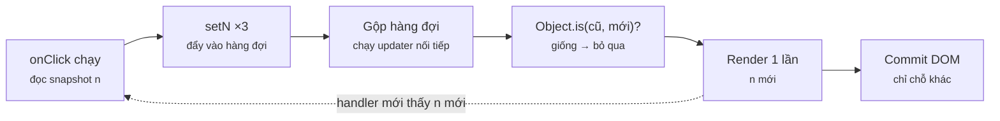

Đọc sơ đồ: Trái → phải: handler chỉ xếp hàng; React gộp hàng đợi, tính state mới, so với cũ, rồi mới render 1 lần. Mũi tên đứt: render xong thì handler mới có snapshot mới.

### 4 · Ví dụ thực tế
**Ví dụ 1.** Hai nút "+3": một nút dùng giá trị, một nút dùng updater.

`m2/l21-updater.tsx`

```tsx
import { root } from "./dom";
import { act, useState } from "react";
import { createRoot } from "react-dom/client";

function Likes() {
  const [n, setN] = useState(0);
  console.log(`render n=${n}`);
  const plus3Wrong = () => { setN(n + 1); setN(n + 1); setN(n + 1); };          // n đóng băng = 0
  const plus3Right = () => { setN((p) => p + 1); setN((p) => p + 1); setN((p) => p + 1); }; // p = giá trị mới nhất
  return (<>
    <button id="wrong" onClick={plus3Wrong}>+3 (giá trị)</button>
    <button id="right" onClick={plus3Right}>+3 (updater)</button>
  </>);
}

await act(() => createRoot(root).render(<Likes />));
console.log("--- bấm +3 kiểu setN(n + 1) ---");
await act(() => root.querySelector<HTMLButtonElement>("#wrong")!.click());
console.log("--- bấm +3 kiểu setN(p => p + 1) ---");
await act(() => root.querySelector<HTMLButtonElement>("#right")!.click());
```

```console
❯ npx tsx m2/l21-updater.tsx
render n=0
--- bấm +3 kiểu setN(n + 1) ---
render n=1
--- bấm +3 kiểu setN(p => p + 1) ---
render n=4
```

Nút đầu: 3 lần `setN(0 + 1)` → 1. Nút sau: 3 hàm chạy nối tiếp 1→2→3→4. Mỗi click chỉ **1 dòng render** — batching gộp 3 lần set thành 1 lần render.

**Ví dụ 2.** Giỏ hàng lồng 2 tầng (object → array → object). So sánh sửa tại chỗ và copy từng tầng bị đổi.

`m2/l21-immutable.tsx`

```tsx
import { root } from "./dom";
import { act, useState } from "react";
import { createRoot } from "react-dom/client";

type Line = { sku: string; qty: number };
type Cart = { owner: string; lines: Line[] };

let api!: { bad: () => void; good: () => void };
function CartView() {
  const [cart, setCart] = useState<Cart>({ owner: "Huy", lines: [{ sku: "latte", qty: 1 }] });
  console.log(`render: latte x${cart.lines[0].qty}`);
  api = {
    bad: () => { cart.lines[0].qty++; setCart(cart); },  // ❌ sửa tại chỗ, cùng tham chiếu
    good: () => setCart((c) => ({                         // ✅ copy từng tầng bị đổi
      ...c,
      lines: c.lines.map((l) => (l.sku === "latte" ? { ...l, qty: l.qty + 1 } : l)),
    })),
  };
  return <p>{cart.lines[0].qty}</p>;
}

await act(() => createRoot(root).render(<CartView />));
console.log("--- bad(): mutate rồi setCart(cart) ---");
await act(() => api.bad());
console.log(`DOM hiển thị: ${root.textContent}`);
console.log("--- good(): spread object mới ---");
await act(() => api.good());
console.log(`DOM hiển thị: ${root.textContent}`);
```

```console
❯ npx tsx m2/l21-immutable.tsx
render: latte x1
--- bad(): mutate rồi setCart(cart) ---
DOM hiển thị: 1
--- good(): spread object mới ---
render: latte x3
DOM hiển thị: 3
```

`bad()`: không có dòng render, UI đứng ở 1 (cùng tham chiếu → React bỏ qua). Nhưng object **đã bị sửa ngầm** thành 2, nên `good()` cộng tiếp ra 3. Đó là kiểu bug "lúc được lúc không" khó lần nhất.

### 5 · Thử thật / bẫy
**Bẫy 1.** **Stale closure trong `setInterval`.** Effect chạy 1 lần (deps `[]`) nên callback giữ `sec = 0` vĩnh viễn → mỗi tick đều `setSec(0 + 1)`.

`m2/l21-trap-stale.tsx`

```tsx
import { root, wait } from "./dom";
import { act, useEffect, useState } from "react";
import { createRoot } from "react-dom/client";

function Timer({ fix }: { fix: boolean }) {
  const [sec, setSec] = useState(0);
  useEffect(() => {
    const id = setInterval(() => {
      if (fix) setSec((s) => s + 1); // ✅ đọc giá trị mới nhất
      else setSec(sec + 1);          // ❌ sec bị closure giữ = 0 mãi mãi
    }, 10);
    return () => clearInterval(id);
  }, []); // eslint-disable-line react-hooks/exhaustive-deps
  return <p>{sec}</p>;
}

for (const fix of [false, true]) {
  const app = createRoot(root);
  await act(() => app.render(<Timer fix={fix} />));
  await act(() => wait(55)); // để interval chạy ~5 lần
  console.log(`${fix ? "setSec(s => s + 1)" : "setSec(sec + 1)   "} sau ~5 tick: ${root.textContent}`);
  await act(() => app.unmount());
}
```

```console
❯ npx tsx m2/l21-trap-stale.tsx
setSec(sec + 1)    sau ~5 tick: 1
setSec(s => s + 1) sau ~5 tick: 5
```

Đồng hồ đứng ở 1. Updater không cần đọc closure nên không bị "cũ". Code AI hay sinh đúng lỗi này.

**Bẫy 2.** **Dùng biến thường thay state.** `let` bị tạo lại = 0 mỗi lần render, và đổi nó cũng không gây render.

`m2/l21-trap-var.tsx`

```tsx
import { root } from "./dom";
import { act, useState } from "react";
import { createRoot } from "react-dom/client";

function Clicker() {
  let clicks = 0;                       // ❌ biến thường: tạo lại = 0 mỗi lần render
  const [renders, setRenders] = useState(0);
  return (
    <button onClick={() => { clicks++; setRenders(renders + 1); }}>
      clicks={clicks} renders={renders}
    </button>
  );
}

await act(() => createRoot(root).render(<Clicker />));
for (let i = 0; i < 3; i++) {
  await act(() => root.querySelector("button")!.click());
  console.log(root.textContent);
}
```

```console
❯ npx tsx m2/l21-trap-var.tsx
clicks=0 renders=1
clicks=0 renders=2
clicks=0 renders=3
```

Cần **nhớ qua render + hiển thị** → state. Chỉ cần nhớ, không hiển thị → `useRef` (bài 2.3).

### 6 · Tóm tắt bằng hình
**(a) Cây thư mục sau bài này**

```text
sandbox/
├─ tsconfig.json  [SỬA]  ← include m2/**, exclude m2/tsfail/**
└─ m2/
   ├─ dom.ts  [MỚI]  ← DOM giả + wait(ms)
   ├─ l21-updater.tsx  [MỚI]  ← giá trị vs updater
   ├─ l21-immutable.tsx  [MỚI]  ← mutate vs copy từng tầng
   ├─ l21-trap-stale.tsx  [MỚI]  ← stale closure trong interval
   └─ l21-trap-var.tsx  [MỚI]  ← biến thường ≠ state
```

**(b) Đọc trong 10 giây**

**Đổi state đúng cách?**

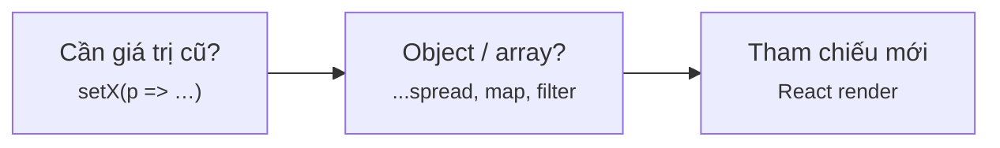

Đọc sơ đồ: Cần giá trị cũ → updater; đổi object → tạo object mới.

### 7 · Làm ngay (≤ 10 phút)
**Mục tiêu:** Sửa `m2/ex/ex21-start.tsx`: `addOne` phải bất biến, và bấm 1 lần (handler gọi 2 lần set) giỏ phải +2 latte.

File khởi đầu:

`m2/ex/ex21-start.tsx`

```tsx
import { root } from "../dom";
import { act, useState } from "react";
import { createRoot } from "react-dom/client";

type Line = { sku: string; qty: number };
const init: Line[] = [{ sku: "latte", qty: 1 }, { sku: "mocha", qty: 1 }];

// TODO: viết lại addOne cho bất biến (không sửa mảng/object cũ)
function addOne(lines: Line[], sku: string): Line[] {
  const line = lines.find((l) => l.sku === sku)!;
  line.qty++;
  return lines;
}

function Cart() {
  const [lines, setLines] = useState(init);
  // TODO: dùng updater để bấm 2 lần liên tiếp trong 1 handler vẫn +2
  const addTwo = () => { setLines(addOne(lines, "latte")); setLines(addOne(lines, "latte")); };
  return <button onClick={addTwo}>{lines.map((l) => `${l.sku} x${l.qty}`).join(" | ")}</button>;
}

await act(() => createRoot(root).render(<Cart />));
await act(() => root.querySelector("button")!.click());
console.log("DOM :", root.textContent);
console.log("init:", init.map((l) => `${l.sku} x${l.qty}`).join(" | "));
```

Chạy file khởi đầu (đang đỏ):

```console
❯ npx tsx m2/ex/ex21-start.tsx
DOM : latte x1 | mocha x1
init: latte x3 | mocha x1
```

Tiêu chí nghiệm thu:

- [ ] Dòng `DOM :` ra `latte x3 | mocha x1`
- [ ] Dòng `init:` vẫn `latte x1 | mocha x1` (không sửa dữ liệu gốc)
- [ ] `npx tsc -p .` không báo lỗi

Lệnh nghiệm thu:

```bash
npx tsx m2/ex/ex21-start.tsx && npx tsc -p .
```

Lời giải tham chiếu chạy ra (output cần đạt):

```console
❯ npx tsx m2/ex/ex21-solution.tsx
DOM : latte x3 | mocha x1
init: latte x1 | mocha x1
```

<details><summary>Gợi ý nếu bị đỏ</summary>

| Triệu chứng | Nguyên nhân | Sửa |
|---|---|---|
| DOM vẫn `latte x1` | Trả về cùng mảng đã sửa | `return lines.map(l => l.sku === sku ? { ...l, qty: l.qty + 1 } : l)` |
| DOM `latte x2` | Dùng `setLines(addOne(lines, …))` hai lần | Updater: `setLines(p => addOne(p, "latte"))` |
| `init:` bị đổi | Vẫn còn `line.qty++` | Xoá mọi phép gán lên object cũ |

`m2/ex/ex21-start.tsx` (diff)

```diff
 const init: Line[] = [{ sku: "latte", qty: 1 }, { sku: "mocha", qty: 1 }];
 
-// TODO: viết lại addOne cho bất biến (không sửa mảng/object cũ)
+// ✅ trả mảng mới, chỉ copy dòng bị đổi
 function addOne(lines: Line[], sku: string): Line[] {
-  const line = lines.find((l) => l.sku === sku)!;
-  line.qty++;
-  return lines;
+  return lines.map((l) => (l.sku === sku ? { ...l, qty: l.qty + 1 } : l));
 }
 
 function Cart() {
   const [lines, setLines] = useState(init);
-  // TODO: dùng updater để bấm 2 lần liên tiếp trong 1 handler vẫn +2
-  const addTwo = () => { setLines(addOne(lines, "latte")); setLines(addOne(lines, "latte")); };
+  // ✅ updater: mỗi lần nhận mảng mới nhất
+  const addTwo = () => { setLines((p) => addOne(p, "latte")); setLines((p) => addOne(p, "latte")); };
   return <button onClick={addTwo}>{lines.map((l) => `${l.sku} x${l.qty}`).join(" | ")}</button>;
 }
```

</details>

### 8 · 3 câu hỏi nhanh
1. Trong handler: `setN(n + 1); console.log(n)` — log ra gì?

   <details><summary>Đáp án</summary>

   Giá trị **cũ**. `n` là snapshot của lần render hiện tại; giá trị mới chỉ có ở lần gọi hàm component tiếp theo.

   </details>

2. `arr.push(x); setArr(arr)` — vì sao UI không đổi?

   <details><summary>Đáp án</summary>

   Cùng tham chiếu → `Object.is` trả true → React bỏ qua render. Dùng `setArr([...arr, x])`.

   </details>

3. Khi nào bắt buộc dùng updater `p => ...`?

   <details><summary>Đáp án</summary>

   Khi giá trị mới phụ thuộc giá trị cũ và có thể bị gọi nhiều lần trước khi render (nhiều set trong 1 handler, callback timer/async, closure cũ).

   </details>


---

## Bài 2.2 · useEffect: dùng đúng, không lạm dụng

_Nguồn roadmap: [Academind] Side Effect → Infinite Loop → Not All Side Effects Need useEffect → Effect Dependencies → Cleanup → Object & Function Dependencies · [BigReact] Side Effect → Cleanup → Race Condition → Dependency Array_

### 1 · Một câu & nằm ở đâu
`useEffect` là để **đồng bộ với hệ thống bên ngoài** (network, timer, subscription, DOM API) **sau** commit. Tính được từ props/state → tính thẳng trong render, đừng dùng effect.

Event handler → setState / dispatch → **[Render (gọi hook)]** → Commit + gán ref → **[Effect / cleanup]** → Lỗi → Boundary

<details><summary>m2/api.ts — server giả: user 1 trả chậm (60ms), user 2 nhanh (10ms)</summary>

`m2/api.ts`

```tsx
// API giả: thay cho fetch thật, độ trễ khác nhau để tái hiện race condition
export type User = { id: number; name: string };
const db: Record<number, User> = { 1: { id: 1, name: "An" }, 2: { id: 2, name: "Bình" } };
const delay: Record<number, number> = { 1: 60, 2: 10 }; // user 1 trả về CHẬM hơn

export function getUser(id: number, signal?: AbortSignal): Promise<User> {
  return new Promise((resolve, reject) => {
    const t = setTimeout(() => {
      if (!db[id]) return reject(new Error(`404 user ${id}`));
      console.log(`    (server trả user ${id})`);
      resolve(db[id]);
    }, delay[id] ?? 20);
    signal?.addEventListener("abort", () => {
      clearTimeout(t);
      console.log(`    (huỷ request user ${id})`);
      reject(new DOMException("Aborted", "AbortError"));
    });
  });
}
```

</details>

### 2 · Concept
| Câu hỏi | Trả lời | Bên C# |
|---|---|---|
| Effect chạy khi nào? | **Sau** commit (DOM đã cập nhật), không chặn vẽ | Event "AfterRender" |
| Deps `[a, b]` | Chạy lại khi `a` hoặc `b` đổi (so bằng `Object.is`) | — |
| Không có deps | Chạy sau **mọi** render | — |
| Cleanup `return () => …` | Chạy trước effect lần sau và khi unmount | `IDisposable.Dispose()` |
| Derived value (giá trị suy ra) | Tính trong render, **không** state + effect | Property chỉ có `get` |
| Race condition (đua kết quả) | Request cũ về sau ghi đè → hủy bằng `AbortController` hoặc cờ `ignore` | `CancellationToken` |

### 3 · Flow / lifecycle
**Khi deps đổi, effect chạy theo thứ tự nào?**

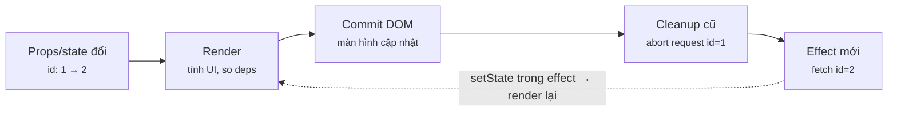

Đọc sơ đồ: Trái → phải: render và commit trước, cleanup của lần cũ chạy rồi mới tới effect mới. Effect gọi setState → vòng mới (mũi tên đứt) — deps sai là vòng lặp vô tận.

### 4 · Ví dụ thực tế
**Ví dụ 1.** Lọc menu theo từ khoá: bản "effect + state" (code AI hay sinh) vs bản tính thẳng.

`m2/l22-derived.tsx`

```tsx
import { root } from "./dom";
import { act, useEffect, useState } from "react";
import { createRoot } from "react-dom/client";

const menu = ["latte", "mocha", "cold brew", "matcha latte"];

function SearchEffect({ q }: { q: string }) {          // ❌ kiểu code AI hay sinh
  const [hits, setHits] = useState<string[]>([]);
  useEffect(() => setHits(menu.filter((m) => m.includes(q))), [q]);
  console.log(`  [effect] render, hits=${hits.length}`);
  return <p>{hits.join(", ")}</p>;
}
function SearchDerived({ q }: { q: string }) {         // ✅ tính thẳng trong render
  const hits = menu.filter((m) => m.includes(q));
  console.log(`  [derived] render, hits=${hits.length}`);
  return <p>{hits.join(", ")}</p>;
}

const app = createRoot(root);
for (const q of ["", "latte"]) {
  console.log(`q="${q}"`);
  await act(() => app.render(<><SearchEffect q={q} /><SearchDerived q={q} /></>));
}
```

```console
❯ npx tsx m2/l22-derived.tsx
q=""
  [effect] render, hits=0
  [derived] render, hits=4
  [effect] render, hits=4
q="latte"
  [effect] render, hits=4
  [derived] render, hits=2
  [effect] render, hits=2
```

Bản effect render **2 lần** mỗi lần đổi `q`, và lần đầu vẽ ra dữ liệu **cũ** (`hits=0`, rồi `hits=4` khi q đã là "latte"). Bản derived: 1 render, luôn đúng.

**Ví dụ 2.** Fetch đúng chuẩn: mỗi effect 1 `AbortController`, cleanup thì `abort()`. Đổi user 1 → 2 khi request 1 chưa về.

`m2/l22-fetch.tsx`

```tsx
import { root, wait } from "./dom";
import { getUser, type User } from "./api";
import { act, useEffect, useState } from "react";
import { createRoot } from "react-dom/client";

function Profile({ id }: { id: number }) {
  const [user, setUser] = useState<User | null>(null);
  useEffect(() => {
    const ctrl = new AbortController();               // 1 request = 1 controller
    console.log(`  effect: tải user ${id}`);
    getUser(id, ctrl.signal)
      .then(setUser)
      .catch((e: Error) => { if (e.name !== "AbortError") console.log(e.message); });
    return () => { console.log(`  cleanup: bỏ user ${id}`); ctrl.abort(); };
  }, [id]);
  return <p>{user ? user.name : "Đang tải…"}</p>;
}

const app = createRoot(root);
await act(() => app.render(<Profile id={1} />));
await act(() => app.render(<Profile id={2} />)); // đổi user khi request 1 chưa xong
await act(() => wait(100));
console.log(`Màn hình: ${root.textContent}`);
```

```console
❯ npx tsx m2/l22-fetch.tsx
  effect: tải user 1
  cleanup: bỏ user 1
    (huỷ request user 1)
  effect: tải user 2
    (server trả user 2)
Màn hình: Bình
```

Cleanup chạy **trước** effect mới → request 1 bị huỷ thật (server giả ngừng luôn). Bên C#: y hệt truyền `CancellationToken` rồi `Cancel()`.

### 5 · Thử thật / bẫy
**Bẫy 1.** **Không cleanup → race condition.** User 1 trả chậm hơn user 2, nên kết quả cũ về sau và ghi đè.

`m2/l22-trap-race.tsx`

```tsx
import { root, wait } from "./dom";
import { getUser, type User } from "./api";
import { act, useEffect, useState } from "react";
import { createRoot } from "react-dom/client";

function Profile({ id }: { id: number }) {
  const [user, setUser] = useState<User | null>(null);
  useEffect(() => {
    getUser(id).then((u) => {          // ❌ không cleanup: ai về sau thắng
      console.log(`  setUser(${u.name})`);
      setUser(u);
    });
  }, [id]);
  return <p>{user ? user.name : "Đang tải…"}</p>;
}

const app = createRoot(root);
await act(() => app.render(<Profile id={1} />));
await act(() => app.render(<Profile id={2} />)); // người dùng đã chọn Bình
await act(() => wait(100));
console.log(`Đang chọn user 2, màn hình: ${root.textContent}`);
```

```console
❯ npx tsx m2/l22-trap-race.tsx
    (server trả user 2)
  setUser(Bình)
    (server trả user 1)
  setUser(An)
Đang chọn user 2, màn hình: An
```

Người dùng chọn Bình nhưng thấy An. Lỗi chỉ lộ khi mạng chậm thất thường → test local hay bỏ sót.

**Bẫy 2.** **Object literal làm dependency → lặp vô tận.** `{ status }` là object mới mỗi render nên deps "luôn đổi".

`m2/l22-trap-loop.tsx`

```tsx
import { root } from "./dom";
import { act, useEffect, useState } from "react";
import { createRoot } from "react-dom/client";

let runs = 0;
function Orders({ status }: { status: string }) {
  const [rows, setRows] = useState<string[]>([]);
  const filter = { status };                     // ❌ object MỚI mỗi lần render
  useEffect(() => {
    if (++runs > 100) return;                   // chốt an toàn cho demo, code thật không có
    setRows([`đơn ${filter.status} #${runs}`]);  // setState → render → filter mới → effect lại
  }, [filter]);                                  // Object.is({..}, {..}) luôn false
  return <p>{rows[0]}</p>;
}

await act(() => createRoot(root).render(<Orders status="paid" />));
console.log(`effect đã chạy ${runs} lần cho 1 lần mount`);
```

```console
❯ npx tsx m2/l22-trap-loop.tsx
Maximum update depth exceeded. This can happen when a component calls setState inside useEffect, but useEffect either doesn't have a dependency array, or one of the dependencies changes on every render.
effect đã chạy 101 lần cho 1 lần mount
```

Không có chốt an toàn thì chạy mãi (đã thử: treo tới khi bị kill). Sửa: deps là giá trị nguyên thuỷ `[status]`, hoặc tạo object **bên trong** effect.

### 6 · Tóm tắt bằng hình
**(a) Cây thư mục sau bài này**

```text
sandbox/m2/
├─ api.ts  [MỚI]  ← server giả có độ trễ + AbortSignal
├─ l22-derived.tsx  [MỚI]  ← effect thừa vs derived value
├─ l22-fetch.tsx  [MỚI]  ← fetch + AbortController
├─ l22-trap-race.tsx  [MỚI]  ← race condition
└─ l22-trap-loop.tsx  [MỚI]  ← object dep → vòng lặp
```

**(b) Đọc trong 10 giây**

**Có cần useEffect không?**

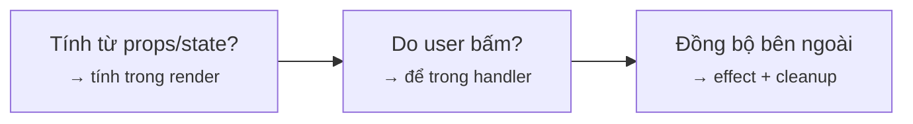

Đọc sơ đồ: Chỉ dùng effect khi phải đụng tới thứ nằm ngoài React.

### 7 · Làm ngay (≤ 10 phút)
**Mục tiêu:** Bỏ `useState` + `useEffect` thừa trong `m2/ex/ex22-start.tsx`: tổng tiền phải tính thẳng trong render.

File khởi đầu:

`m2/ex/ex22-start.tsx`

```tsx
import { root } from "../dom";
import { act, useEffect, useState } from "react";
import { createRoot } from "react-dom/client";

type Line = { name: string; price: number; qty: number };
let renders = 0;

function Invoice({ lines, vat }: { lines: Line[]; vat: number }) {
  renders++;
  // TODO: bỏ useState + useEffect, tính total thẳng trong render
  const [total, setTotal] = useState(0);
  useEffect(() => {
    setTotal(lines.reduce((s, l) => s + l.price * l.qty, 0) * (1 + vat));
  }, [lines, vat]);
  return <p>Tổng: {total.toLocaleString("vi-VN")}đ</p>;
}

const lines: Line[] = [{ name: "latte", price: 45000, qty: 2 }, { name: "bánh", price: 30000, qty: 1 }];
const app = createRoot(root);
for (const vat of [0, 0.1]) {
  renders = 0;
  await act(() => app.render(<Invoice lines={lines} vat={vat} />));
  console.log(`vat=${vat} → ${root.textContent} | renders=${renders}`);
}
```

Chạy file khởi đầu (đang đỏ):

```console
❯ npx tsx m2/ex/ex22-start.tsx
vat=0 → Tổng: 120.000đ | renders=2
vat=0.1 → Tổng: 132.000đ | renders=2
```

Tiêu chí nghiệm thu:

- [ ] Cả 2 dòng ra `renders=1`
- [ ] Tổng vẫn đúng: `120.000đ` và `132.000đ`
- [ ] File không còn `useEffect`; `npx tsc -p .` không báo lỗi

Lệnh nghiệm thu:

```bash
npx tsx m2/ex/ex22-start.tsx && ! grep -q useEffect m2/ex/ex22-start.tsx && npx tsc -p .
```

Lời giải tham chiếu chạy ra (output cần đạt):

```console
❯ npx tsx m2/ex/ex22-solution.tsx
vat=0 → Tổng: 120.000đ | renders=1
vat=0.1 → Tổng: 132.000đ | renders=1
```

<details><summary>Gợi ý nếu bị đỏ</summary>

| Triệu chứng | Nguyên nhân | Sửa |
|---|---|---|
| Vẫn `renders=2` | Còn `setTotal` trong effect | `const total = lines.reduce(…) * (1 + vat)` |
| `Tổng: 0đ` ở lần đầu | Còn `useState(0)` + effect | Xoá cả state lẫn effect |
| TS: `'useEffect' is declared but never used` | Import thừa | Chỉ giữ `import { act } from "react"` |

`m2/ex/ex22-start.tsx` (diff)

```diff
 import { root } from "../dom";
-import { act, useEffect, useState } from "react";
+import { act } from "react";
 import { createRoot } from "react-dom/client";
 
 function Invoice({ lines, vat }: { lines: Line[]; vat: number }) {
   renders++;
-  // TODO: bỏ useState + useEffect, tính total thẳng trong render
-  const [total, setTotal] = useState(0);
-  useEffect(() => {
-    setTotal(lines.reduce((s, l) => s + l.price * l.qty, 0) * (1 + vat));
-  }, [lines, vat]);
+  // ✅ derived value: tính thẳng, không state, không effect
+  const total = lines.reduce((s, l) => s + l.price * l.qty, 0) * (1 + vat);
   return <p>Tổng: {total.toLocaleString("vi-VN")}đ</p>;
 }
```

</details>

### 8 · 3 câu hỏi nhanh
1. Effect chạy trước hay sau khi DOM được cập nhật?

   <details><summary>Đáp án</summary>

   Sau commit. Muốn đo/sửa DOM trước khi trình duyệt vẽ thì có `useLayoutEffect` (hiếm dùng).

   </details>

2. Bạn review thấy `useEffect(() => setFullName(first + " " + last), [first, last])`. Sửa sao?

   <details><summary>Đáp án</summary>

   Xoá state + effect, viết `const fullName = first + " " + last`. Derived value không cần effect — lỗi số 1 trong code AI.

   </details>

3. Ở dev, React 19 StrictMode chạy effect 2 lần (mount → cleanup → mount). Mục đích?

   <details><summary>Đáp án</summary>

   Ép bạn viết cleanup đúng: nếu chạy 2 lần mà hỏng (2 kết nối, 2 subscription) thì cleanup đang thiếu.

   </details>


---

## Bài 2.3 · useRef, ref prop & useImperativeHandle

_Nguồn roadmap: [Academind] Refs → Manipulating the DOM via Refs → Refs vs State → Refs for More Than DOM → Forwarding Refs → useImperativeHandle · [BigReact] Variable vs useState vs useRef → useRef for Accessing Elements_

### 1 · Một câu & nằm ở đâu
`useRef` trả về 1 hộp `{ current }` **sống qua mọi render**; đổi `current` không gây render. Dùng để cầm DOM node, timer id, giá trị "nhớ nhưng không vẽ".

Event handler → setState / dispatch → **[Render (gọi hook)]** → **[Commit + gán ref]** → Effect / cleanup → Lỗi → Boundary

### 2 · Concept
| | Biến `let` | `useState` | `useRef` |
|---|---|---|---|
| Sống qua render | ✗ (tạo lại) | ✓ | ✓ |
| Đổi → render lại | ✗ | ✓ | ✗ |
| Đọc trong render | ✓ | ✓ | ✗ nên tránh |
| Dùng cho | tính tạm | thứ hiển thị | DOM node, timer id, giá trị trước |
| Bên C# | biến local | field + `StateHasChanged()` | field private thường |

**React 19:** `ref` là prop bình thường của function component — `forwardRef` chỉ còn gặp trong code cũ. `useImperativeHandle` cho phép component chỉ lộ **vài method** thay vì cả thẻ DOM (như expose interface thay vì class).

### 3 · Flow / lifecycle
**ref.current có giá trị từ lúc nào?**

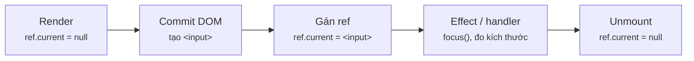

Đọc sơ đồ: Trái → phải: trong render ref còn null; React gán DOM node vào ref lúc commit, nên effect và handler mới dùng được.

### 4 · Ví dụ thực tế
**Ví dụ 1.** Ba loại "biến" trong 1 component: ref, state, `let`.

`m2/l23-ref-vs-state.tsx`

```tsx
import { root } from "./dom";
import { act, useRef, useState } from "react";
import { createRoot } from "react-dom/client";

let api!: { clickRef: () => void; clickState: () => void; peek: () => string };
function Stats() {
  const views = useRef(0);             // hộp {current}, sống qua mọi render, đổi KHÔNG render lại
  const [likes, setLikes] = useState(0);
  let temp = 0;                        // biến thường: về 0 mỗi render
  console.log(`  render: views.current=${views.current} likes=${likes}`);
  api = {
    clickRef: () => { views.current++; temp++; },
    clickState: () => setLikes((n) => n + 1),
    peek: () => `views=${views.current} temp=${temp}`,
  };
  return <p>{likes} likes · {views.current} views</p>;
}

await act(() => createRoot(root).render(<Stats />));
console.log("--- tăng ref 3 lần ---");
for (let i = 0; i < 3; i++) await act(() => api.clickRef());
console.log(`  (không render) ${api.peek()} | DOM: ${root.textContent}`);
console.log("--- tăng state 1 lần ---");
await act(() => api.clickState());
console.log(`  ${api.peek()} | DOM: ${root.textContent}`);
```

```console
❯ npx tsx m2/l23-ref-vs-state.tsx
  render: views.current=0 likes=0
--- tăng ref 3 lần ---
  (không render) views=3 temp=3 | DOM: 0 likes · 0 views
--- tăng state 1 lần ---
  render: views.current=3 likes=1
  views=3 temp=0 | DOM: 1 likes · 3 views
```

Tăng ref 3 lần: không render, DOM vẫn 0 views. Khi state đổi → render → DOM mới hiện `3 views`. `temp` về 0 ngay sau render.

**Ví dụ 2.** Component `SearchInput` nhận `ref` như prop (React 19) và chỉ lộ `focus` + `clear`.

`m2/l23-imperative.tsx`

```tsx
import { root } from "./dom";
import { act, useImperativeHandle, useRef, type Ref } from "react";
import { createRoot } from "react-dom/client";

export type SearchHandle = { focus: () => void; clear: () => void };

// React 19: ref là prop bình thường, không cần forwardRef
function SearchInput({ ref }: { ref: Ref<SearchHandle> }) {
  const inputRef = useRef<HTMLInputElement>(null);
  useImperativeHandle(ref, () => ({          // chỉ lộ 2 hàm, giấu thẻ <input>
    focus: () => inputRef.current?.focus(),
    clear: () => { if (inputRef.current) inputRef.current.value = ""; },
  }), []);
  return <input ref={inputRef} defaultValue="cà phê" />;
}

function Toolbar() {
  const search = useRef<SearchHandle>(null);
  return (<>
    <SearchInput ref={search} />
    <button onClick={() => { search.current?.clear(); search.current?.focus(); }}>Tìm mới</button>
  </>);
}

await act(() => createRoot(root).render(<Toolbar />));
const input = root.querySelector("input")!;
console.log(`trước: value="${input.value}" focus=${document.activeElement === input}`);
await act(() => root.querySelector("button")!.click());
console.log(`sau  : value="${input.value}" focus=${document.activeElement === input}`);
```

```console
❯ npx tsx m2/l23-imperative.tsx
trước: value="cà phê" focus=false
sau  : value="" focus=true
```

Cha chỉ thấy `SearchHandle`, không đụng được `style`, `value` của thẻ thật → đổi ruột `SearchInput` không vỡ code cha.

### 5 · Thử thật / bẫy
**Bẫy 1.** **Đọc `ref.current` trong render.** Lần render đầu DOM chưa có.

`m2/l23-trap-render.tsx`

```tsx
import { root } from "./dom";
import { act, useEffect, useRef } from "react";
import { createRoot } from "react-dom/client";

function AutoFocus() {
  const ref = useRef<HTMLInputElement>(null);
  console.log(`trong render: ref.current = ${ref.current}`); // ❌ DOM chưa tồn tại
  useEffect(() => {
    console.log(`trong effect: ref.current = <${ref.current?.tagName.toLowerCase()}>`); // ✅ sau commit
    ref.current?.focus();
  }, []);
  return <input ref={ref} />;
}

await act(() => createRoot(root).render(<AutoFocus />));
```

```console
❯ npx tsx m2/l23-trap-render.tsx
trong render: ref.current = null
trong effect: ref.current = <input>
```

Đụng DOM qua ref → để trong effect hoặc event handler.

**Bẫy 2.** **Truyền `ref` cho component không nhận nó.** React 19 coi `ref` là prop thường: component không chuyển xuống thẻ thật thì ref mãi `null`.

`m2/l23-trap-noprop.tsx`

```tsx
import { root } from "./dom";
import { act, useRef, type Ref } from "react";
import { createRoot } from "react-dom/client";

function FancyInput({ placeholder }: { placeholder: string }) { // ❌ không nhận ref
  return <input className="fancy" placeholder={placeholder} />;
}
function FancyInputFixed({ ref, placeholder }: { ref?: Ref<HTMLInputElement>; placeholder: string }) {
  return <input ref={ref} className="fancy" placeholder={placeholder} />; // ✅ chuyển ref xuống thẻ thật
}

function Form() {
  const a = useRef<HTMLInputElement>(null), b = useRef<HTMLInputElement>(null);
  // @ts-expect-error -- TS chặn: FancyInput không có prop ref (code JS thì lọt)
  const bad = <FancyInput ref={a} placeholder="email" />;
  return <>{bad}<FancyInputFixed ref={b} placeholder="email" /><button onClick={() => {
    console.log(`FancyInput      : a.current = ${a.current}`);
    console.log(`FancyInputFixed : b.current = <${b.current?.tagName.toLowerCase()} class="${b.current?.className}">`);
  }}>check</button></>;
}

await act(() => createRoot(root).render(<Form />));
await act(() => root.querySelector("button")!.click());
```

```console
❯ npx tsx m2/l23-trap-noprop.tsx
FancyInput      : a.current = null
FancyInputFixed : b.current = <input class="fancy">
```

TS chặn được (dòng `@ts-expect-error`), JS thì im lặng. Code React ≤ 18 làm việc này bằng `forwardRef((props, ref) => …)`.

### 6 · Tóm tắt bằng hình
**(a) Cây thư mục sau bài này**

```text
sandbox/m2/
├─ l23-ref-vs-state.tsx  [MỚI]  ← let vs state vs ref
├─ l23-imperative.tsx  [MỚI]  ← ref prop + useImperativeHandle
├─ l23-trap-render.tsx  [MỚI]  ← ref null trong render
└─ l23-trap-noprop.tsx  [MỚI]  ← ref không được chuyển xuống
```

**(b) Đọc trong 10 giây**

**Chọn let, state hay ref?**

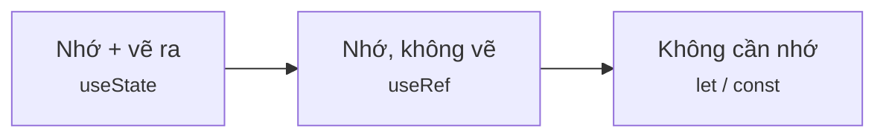

Đọc sơ đồ: Hỏi 2 câu: có cần nhớ qua render không, có cần vẽ ra không.

### 7 · Làm ngay (≤ 10 phút)
**Mục tiêu:** Sửa đồng hồ bấm giờ `m2/ex/ex23-start.tsx`: bấm Stop phải dừng hẳn.

File khởi đầu:

`m2/ex/ex23-start.tsx`

```tsx
import { root, wait } from "../dom";
import { act, useState } from "react";
import { createRoot } from "react-dom/client";

function Stopwatch() {
  const [ms, setMs] = useState(0);
  // TODO: id của interval phải sống qua các lần render → dùng useRef
  let timer: ReturnType<typeof setInterval> | undefined;
  const start = () => { timer = setInterval(() => setMs((m) => m + 10), 10); };
  const stop = () => clearInterval(timer);
  return (<>
    <output>{ms}</output>
    <button id="start" onClick={start}>Start</button>
    <button id="stop" onClick={stop}>Stop</button>
  </>);
}

const shown = () => Number(root.querySelector("output")!.textContent);
const app = createRoot(root);
await act(() => app.render(<Stopwatch />));
await act(() => root.querySelector<HTMLButtonElement>("#start")!.click());
await act(() => wait(60));
await act(() => root.querySelector<HTMLButtonElement>("#stop")!.click());
const atStop = shown();
await act(() => wait(60));
console.log(`đang chạy: ${atStop > 0 ? "OK" : "FAIL"} | sau Stop còn nhảy thêm: ${shown() - atStop}ms`);
await act(() => app.unmount());
process.exit(0); // bản lỗi: interval rò rỉ sẽ giữ Node chạy mãi
```

Chạy file khởi đầu (đang đỏ):

```console
❯ npx tsx m2/ex/ex23-start.tsx
đang chạy: OK | sau Stop còn nhảy thêm: 60ms
```

Tiêu chí nghiệm thu:

- [ ] Output ra `sau Stop còn nhảy thêm: 0ms`
- [ ] Dùng `useRef`, không dùng state cho timer id
- [ ] `npx tsc -p .` không báo lỗi

Lệnh nghiệm thu:

```bash
npx tsx m2/ex/ex23-start.tsx && npx tsc -p .
```

Lời giải tham chiếu chạy ra (output cần đạt):

```console
❯ npx tsx m2/ex/ex23-solution.tsx
đang chạy: OK | sau Stop còn nhảy thêm: 0ms
```

<details><summary>Gợi ý nếu bị đỏ</summary>

| Triệu chứng | Nguyên nhân | Sửa |
|---|---|---|
| Vẫn nhảy sau Stop | `let timer` về `undefined` sau mỗi render (setMs gây render) | `const timer = useRef<…>(undefined)`, dùng `timer.current` |
| TS: `Expected 1 arguments` | `useRef<T>()` không tham số bị cấm ở React 19 | Truyền giá trị đầu: `useRef<…>(undefined)` |
| Bỏ dòng `process.exit` thì lệnh treo | Interval rò rỉ giữ Node sống | Đúng là bug — sửa xong vẫn nên giữ dòng đó cho chắc |

`m2/ex/ex23-start.tsx` (diff)

```diff
 import { root, wait } from "../dom";
-import { act, useState } from "react";
+import { act, useRef, useState } from "react";
 import { createRoot } from "react-dom/client";
 
 function Stopwatch() {
   const [ms, setMs] = useState(0);
-  // TODO: id của interval phải sống qua các lần render → dùng useRef
-  let timer: ReturnType<typeof setInterval> | undefined;
-  const start = () => { timer = setInterval(() => setMs((m) => m + 10), 10); };
-  const stop = () => clearInterval(timer);
+  // ✅ ref giữ id qua mọi render, đổi nó không gây render
+  const timer = useRef<ReturnType<typeof setInterval>>(undefined);
+  const start = () => { timer.current = setInterval(() => setMs((m) => m + 10), 10); };
+  const stop = () => clearInterval(timer.current);
   return (<>
     <output>{ms}</output>
```

</details>

### 8 · 3 câu hỏi nhanh
1. Đổi `ref.current` có làm component render lại không?

   <details><summary>Đáp án</summary>

   Không. Ref là hộp ngoài vòng render. Muốn UI đổi theo thì phải là state.

   </details>

2. Vì sao không nên đọc `ref.current` ngay trong thân component?

   <details><summary>Đáp án</summary>

   Lần render đầu ref còn null; các lần sau giá trị có thể lệch với UI đang render. React gán ref lúc commit.

   </details>

3. Thấy `forwardRef` trong code React 19 mới viết — có sai không?

   <details><summary>Đáp án</summary>

   Không sai (vẫn chạy), nhưng thừa: React 19 nhận `ref` như prop. Nó sẽ bị deprecate dần.

   </details>


---

## Bài 2.4 · useReducer: state + logic gom về 1 chỗ

_Nguồn roadmap: [Academind] Introducing useReducer → Dispatching Actions · [BigReact] First Look at useReducer → Step by Step → Payload in Dispatch → useReducer with Data Loading_

### 1 · Một câu & nằm ở đâu
Reducer là hàm thuần `(state, action) => stateMới`. Component chỉ `dispatch` **ý định** ("add", "fail"); mọi luật đổi state nằm trong reducer — test được như hàm thường. Đây đúng là tư duy Redux (Module 3).

**[Event handler]** → **[setState / dispatch]** → **[Render (gọi hook)]** → Commit + gán ref → Effect / cleanup → Lỗi → Boundary

### 2 · Concept
| Phần | Vai trò | Bên C# |
|---|---|---|
| `state` | 1 object duy nhất, bất biến | Aggregate / immutable record |
| `action` | `{ type, ...payload }`, kiểu **discriminated union** (union phân biệt theo `type`) | Command (MediatR request) |
| `reducer` | `switch (action.type)`, trả state mới, **không I/O** | Handler thuần |
| `dispatch` | Gửi action, React gọi reducer rồi render | `mediator.Send()` |
| `never` ở `default` | Quên case → tsc đỏ | Switch expression thiếu nhánh |

Khi nào dùng: nhiều `useState` đổi cùng nhau (loading/data/error), hoặc luật đổi state có `if/else` dày.

### 3 · Flow / lifecycle
**dispatch đi qua những bước nào?**

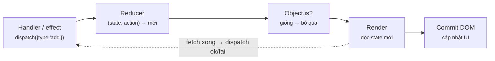

Đọc sơ đồ: Trái → phải: component gửi action, React gọi reducer thuần, so state mới với cũ rồi render. I/O (fetch) nằm ngoài reducer — trong effect/handler — rồi dispatch kết quả (mũi tên đứt).

### 4 · Ví dụ thực tế
**Ví dụ 1.** Reducer giỏ hàng với action union + chốt `never`. File `.ts` thuần, không import React.

`m2/cart-reducer.ts`

```tsx
// Reducer = hàm thuần (state, action) => state mới. Không React, không I/O.
export type Line = { sku: string; qty: number };
export type CartState = { lines: Line[]; coupon: string | null };
export type CartAction =                       // discriminated union: switch theo "type"
  | { type: "add"; sku: string }
  | { type: "remove"; sku: string }
  | { type: "applyCoupon"; code: string };

export function cartReducer(state: CartState, action: CartAction): CartState {
  switch (action.type) {
    case "add": {
      const has = state.lines.some((l) => l.sku === action.sku);
      const lines = has
        ? state.lines.map((l) => (l.sku === action.sku ? { ...l, qty: l.qty + 1 } : l))
        : [...state.lines, { sku: action.sku, qty: 1 }];
      return { ...state, lines };
    }
    case "remove":
      return { ...state, lines: state.lines.filter((l) => l.sku !== action.sku) };
    case "applyCoupon":
      return { ...state, coupon: action.code.toUpperCase() };
    default: {
      const never: never = action;             // thiếu case → tsc báo đỏ ở đây
      return never;
    }
  }
}
```

```console
❯ npx tsc -p . && echo "tsc strict: 0 lỗi"
tsc strict: 0 lỗi
```

Không có `useState`, không I/O — chỉ là hàm. Test bằng cách gọi trực tiếp, không cần render.

**Ví dụ 2.** Gọi reducer như hàm thường, rồi gắn vào component bằng `useReducer`.

`m2/l24-reducer.tsx`

```tsx
import { root } from "./dom";
import { cartReducer, type CartState } from "./cart-reducer";
import { act, useReducer } from "react";
import { createRoot } from "react-dom/client";

// 1) Test reducer như hàm thường — không cần render gì cả
const s0: CartState = { lines: [], coupon: null };
const s1 = cartReducer(s0, { type: "add", sku: "latte" });
const s2 = cartReducer(s1, { type: "add", sku: "latte" });
console.log("thuần:", JSON.stringify(s2), "| s0 còn nguyên:", JSON.stringify(s0));

// 2) Gắn vào component: state + logic đi chung, component chỉ dispatch "ý định"
function Cart() {
  const [cart, dispatch] = useReducer(cartReducer, s0);
  return (<>
    <button id="add" onClick={() => dispatch({ type: "add", sku: "mocha" })}>+ mocha</button>
    <button id="cp" onClick={() => dispatch({ type: "applyCoupon", code: "sale10" })}>mã</button>
    <p>{cart.lines.map((l) => `${l.sku} x${l.qty}`).join(", ")} · coupon={cart.coupon}</p>
  </>);
}
await act(() => createRoot(root).render(<Cart />));
for (const id of ["add", "add", "cp"]) await act(() => root.querySelector<HTMLButtonElement>(`#${id}`)!.click());
console.log("UI   :", root.querySelector("p")!.textContent);
```

```console
❯ npx tsx m2/l24-reducer.tsx
thuần: {"lines":[{"sku":"latte","qty":2}],"coupon":null} | s0 còn nguyên: {"lines":[],"coupon":null}
UI   : mocha x2 · coupon=SALE10
```

`s0` không bị đụng tới — reducer bất biến. Component không biết "add" làm gì, chỉ biết gửi ý định.

**Ví dụ 3.** Loading/success/error bằng 1 union thay vì 3 state rời — không thể có trạng thái vô lý "đang loading mà có error".

`m2/l24-loading.tsx`

```tsx
import { root, wait } from "./dom";
import { getUser, type User } from "./api";
import { act, useEffect, useReducer } from "react";
import { createRoot } from "react-dom/client";

type State =                                    // 1 union thay cho 3 useState rời
  | { status: "loading" }
  | { status: "success"; user: User }
  | { status: "error"; message: string };
type Action = { type: "start" } | { type: "ok"; user: User } | { type: "fail"; message: string };

const reducer = (_: State, a: Action): State =>
  a.type === "start" ? { status: "loading" } : a.type === "ok" ? { status: "success", user: a.user } : { status: "error", message: a.message };

function Profile({ id }: { id: number }) {
  const [s, dispatch] = useReducer(reducer, { status: "loading" });
  useEffect(() => {
    let ignore = false;                         // cờ chống race (bài 2.2)
    dispatch({ type: "start" });
    getUser(id).then((user) => !ignore && dispatch({ type: "ok", user }),
                      (e: Error) => !ignore && dispatch({ type: "fail", message: e.message }));
    return () => { ignore = true; };
  }, [id]);
  console.log(`  render: ${JSON.stringify(s)}`);
  return null;
}

const app = createRoot(root);
for (const id of [2, 9]) { console.log(`id=${id}`); await act(() => app.render(<Profile id={id} />)); await act(() => wait(40)); }
```

```console
❯ npx tsx m2/l24-loading.tsx
id=2
  render: {"status":"loading"}
  render: {"status":"loading"}
    (server trả user 2)
  render: {"status":"success","user":{"id":2,"name":"Bình"}}
id=9
  render: {"status":"success","user":{"id":2,"name":"Bình"}}
  render: {"status":"loading"}
  render: {"status":"error","message":"404 user 9"}
```

I/O nằm trong effect, reducer chỉ nhận kết quả. Render `loading` 2 lần ở mount vì `start` trả object mới — vô hại, nhưng biết để khỏi giật mình.

### 5 · Thử thật / bẫy
**Bẫy 1.** **Mutate trong reducer.** `push` rồi trả lại cùng object → React tưởng không đổi.

`m2/l24-trap-mutate.tsx`

```tsx
import { root } from "./dom";
import { act, useReducer } from "react";
import { createRoot } from "react-dom/client";

type S = { items: string[] };
function badReducer(s: S, item: string): S {
  s.items.push(item);            // ❌ sửa state cũ rồi trả lại CÙNG object
  return s;
}
function goodReducer(s: S, item: string): S {
  return { ...s, items: [...s.items, item] }; // ✅ object mới
}

function Todo({ reducer, label }: { reducer: (s: S, i: string) => S; label: string }) {
  const [s, add] = useReducer(reducer, { items: [] });
  return <button onClick={() => add("mua sữa")}>{label}: {s.items.length} việc</button>;
}

await act(() => createRoot(root).render(<>
  <Todo reducer={badReducer} label="bad" /><Todo reducer={goodReducer} label="good" /></>));
const [bad, good] = root.querySelectorAll("button");
await act(() => { bad.click(); good.click(); });
console.log(bad.textContent, "|", good.textContent);
```

```console
❯ npx tsx m2/l24-trap-mutate.tsx
bad: 0 việc | good: 1 việc
```

Cùng luật `Object.is` như bài 2.1. Redux Toolkit dùng Immer để "viết như mutate" mà vẫn ra object mới (Module 3).

**Bẫy 2.** **Thêm action mà quên case.** Đây là lý do có dòng `const never: never = action`.

`m2/tsfail/l24-trap-exhaustive.ts`

```tsx
import type { CartState } from "../cart-reducer";

// Đồng đội thêm action mới vào union nhưng quên viết case xử lý
type CartAction =
  | { type: "add"; sku: string }
  | { type: "clear" };                         // ← mới thêm

export function cartReducer(state: CartState, action: CartAction): CartState {
  switch (action.type) {
    case "add":
      return { ...state, lines: [...state.lines, { sku: action.sku, qty: 1 }] };
    default: {
      const never: never = action;             // chốt chặn: còn case chưa xử lý → đỏ
      return never;
    }
  }
}
```

```console
❯ npx tsc -p tsconfig.fail.json
m2/tsfail/l24-trap-exhaustive.ts(13,13): error TS2322: Type '{ type: "clear"; }' is not assignable to type 'never'.
```

Lỗi bắt ở compile time, trước khi merge. Không có chốt này, action `clear` rơi vào `default` và bị lờ đi im lặng.

### 6 · Tóm tắt bằng hình
**(a) Cây thư mục sau bài này**

```text
sandbox/
├─ tsconfig.fail.json  [MỚI]  ← chỉ kiểm m2/tsfail (cố tình đỏ)
└─ m2/
   ├─ cart-reducer.ts  [MỚI]  ← reducer thuần + never
   ├─ l24-reducer.tsx  [MỚI]  ← gọi thẳng + useReducer
   ├─ l24-loading.tsx  [MỚI]  ← status union + fetch
   ├─ l24-trap-mutate.tsx  [MỚI]  ← mutate trong reducer
   └─ tsfail/l24-trap-exhaustive.ts  [MỚI]  ← quên case → tsc đỏ
```

**(b) Đọc trong 10 giây**

**Ai làm gì trong useReducer?**

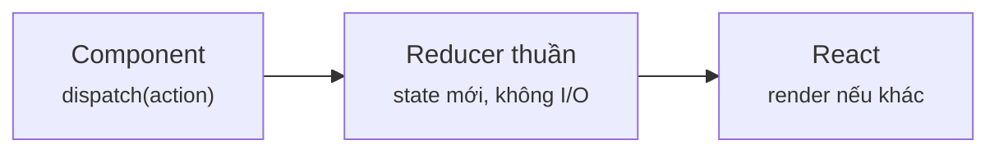

Đọc sơ đồ: Component nói 'muốn gì', reducer quyết 'thành gì', React lo vẽ.

### 7 · Làm ngay (≤ 10 phút)
**Mục tiêu:** Viết case `"dec"` trong `m2/ex/ex24-start.ts`: giảm qty 1, về 0 thì xoá dòng, không sửa state cũ.

File khởi đầu:

`m2/ex/ex24-start.ts`

```tsx
type Line = { sku: string; qty: number };
type State = { lines: Line[] };
type Action = { type: "add"; sku: string } | { type: "dec"; sku: string };

export function reducer(s: State, a: Action): State {
  switch (a.type) {
    case "add":
      return { lines: s.lines.some((l) => l.sku === a.sku)
        ? s.lines.map((l) => (l.sku === a.sku ? { ...l, qty: l.qty + 1 } : l))
        : [...s.lines, { sku: a.sku, qty: 1 }] };
    case "dec":
      return s; // TODO: giảm qty 1; về 0 thì xoá dòng. Không sửa s.
    default: {
      const never: never = a;
      return never;
    }
  }
}

// chạy thử: thêm 2 latte + 1 mocha, rồi giảm latte 1 lần và mocha 1 lần
const steps: Action[] = [
  { type: "add", sku: "latte" }, { type: "add", sku: "latte" }, { type: "add", sku: "mocha" },
  { type: "dec", sku: "latte" }, { type: "dec", sku: "mocha" },
];
const before: State = steps.slice(0, 3).reduce(reducer, { lines: [] });
const after = steps.slice(3).reduce(reducer, before);
console.log("trước:", JSON.stringify(before.lines));
console.log("sau  :", JSON.stringify(after.lines));
```

Chạy file khởi đầu (đang đỏ):

```console
❯ npx tsx m2/ex/ex24-start.ts
trước: [{"sku":"latte","qty":2},{"sku":"mocha","qty":1}]
sau  : [{"sku":"latte","qty":2},{"sku":"mocha","qty":1}]
```

Tiêu chí nghiệm thu:

- [ ] Dòng `sau  :` ra `[{"sku":"latte","qty":1}]`
- [ ] Vẫn giữ chốt `never` ở `default`
- [ ] `npx tsc -p .` không báo lỗi

Lệnh nghiệm thu:

```bash
npx tsx m2/ex/ex24-start.ts && npx tsc -p .
```

Lời giải tham chiếu chạy ra (output cần đạt):

```console
❯ npx tsx m2/ex/ex24-solution.ts
trước: [{"sku":"latte","qty":2},{"sku":"mocha","qty":1}]
sau  : [{"sku":"latte","qty":1}]
```

<details><summary>Gợi ý nếu bị đỏ</summary>

| Triệu chứng | Nguyên nhân | Sửa |
|---|---|---|
| `mocha` vẫn còn với `qty: 0` | Chỉ `map` giảm, chưa lọc | Thêm `.filter(l => l.qty > 0)` |
| Dòng `trước:` cũng bị đổi | Có `l.qty--` trên object cũ | `{ ...l, qty: l.qty - 1 }` |
| TS: `not assignable to type 'never'` | Xoá case `dec` hoặc gõ sai tên | Case phải khớp đúng `"dec"` trong union |

`m2/ex/ex24-start.ts` (diff)

```diff
         : [...s.lines, { sku: a.sku, qty: 1 }] };
     case "dec":
-      return s; // TODO: giảm qty 1; về 0 thì xoá dòng. Không sửa s.
+      return { lines: s.lines
+        .map((l) => (l.sku === a.sku ? { ...l, qty: l.qty - 1 } : l))
+        .filter((l) => l.qty > 0) };
     default: {
       const never: never = a;
```

</details>

### 8 · 3 câu hỏi nhanh
1. Có được `fetch()` trong reducer không?

   <details><summary>Đáp án</summary>

   Không. Reducer phải thuần (cùng input → cùng output, không side effect). I/O để ở effect/handler, xong thì dispatch kết quả.

   </details>

2. Ba `useState` (`loading`, `data`, `error`) vs 1 reducer với union `status` — lợi gì?

   <details><summary>Đáp án</summary>

   Union loại bỏ trạng thái vô lý (loading + error cùng lúc) và TS thu hẹp kiểu: trong nhánh `success` chắc chắn có `user`.

   </details>

3. `useReducer` liên quan Redux thế nào?

   <details><summary>Đáp án</summary>

   Cùng mô hình action → reducer → state mới. Redux đưa store ra ngoài cây component + middleware + devtools; `useReducer` là bản local.

   </details>


---

## Bài 2.5 · Custom hooks & Rules of Hooks

_Nguồn roadmap: [Academind] Rules of Hooks → Creating a Custom Hook → Returning State Values → Exposing Nested Functions → Using in Multiple Components → Flexible Custom Hooks · [BigReact] How to Create a Custom Hook · [NextAI] Create your first custom hook_

### 1 · Một câu & nằm ở đâu
Custom hook = hàm `useXxx` gọi các hook khác. Nó tái sử dụng **logic**, không chia sẻ **state**: mỗi component gọi có state riêng. Hook phải được gọi cùng thứ tự ở mọi lần render.

Event handler → setState / dispatch → **[Render (gọi hook)]** → Commit + gán ref → **[Effect / cleanup]** → Lỗi → Boundary

### 2 · Concept
| Quy tắc | Lý do | Bên C# |
|---|---|---|
| Tên bắt đầu bằng `use` | Linter nhận ra để kiểm luật hook | Quy ước như hậu tố `Async` |
| Chỉ gọi ở top-level (không trong `if`, `for`, callback) | React lưu hook theo **thứ tự gọi** trên Fiber, không theo tên | Mảng truy cập theo index |
| Mỗi lần gọi = state riêng | `useResource` ở 3 avatar = 3 bộ state | Service `Transient`, không phải `Singleton` |
| Hàm/object truyền vào làm deps phải ổn định | Mỗi render tạo mới → effect chạy lại | — |
| Trả về union có `status` | Component dùng `if` thu hẹp kiểu | Result pattern |

### 3 · Flow / lifecycle
**React tìm đúng state của hook bằng cách nào?**

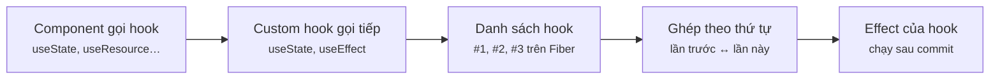

Đọc sơ đồ: Trái → phải: mỗi lần render React đi theo danh sách hook trên Fiber theo thứ tự gọi. Lệch thứ tự (hook trong if) → hook thứ 2 đọc nhầm state của hook khác.

### 4 · Ví dụ thực tế
**Ví dụ 1.** `useResource`: gom useState + useEffect + AbortController (bài 2.2) thành 1 hook generic, trả union có `status`.

`m2/useResource.ts`

```tsx
import { useEffect, useState } from "react";

// Custom hook = hàm tên bắt đầu bằng "use", được gọi hook khác bên trong.
// Thứ nó chia sẻ là LOGIC, không phải state: mỗi component gọi có state riêng.
export type Resource<T> =
  | { status: "loading" }
  | { status: "success"; data: T }
  | { status: "error"; error: string };

export function useResource<K, T>(key: K, load: (key: K, signal: AbortSignal) => Promise<T>): Resource<T> {
  const [res, setRes] = useState<Resource<T>>({ status: "loading" });
  useEffect(() => {
    const ctrl = new AbortController();
    setRes({ status: "loading" });
    load(key, ctrl.signal).then(
      (data) => setRes({ status: "success", data }),
      (e: Error) => { if (e.name !== "AbortError") setRes({ status: "error", error: e.message }); },
    );
    return () => ctrl.abort();
  }, [key, load]);                 // load phải ỔN ĐỊNH (khai báo ngoài component) — xem bẫy 2
  return res;
}
```

```console
❯ npx tsc -p . && echo "tsc strict: 0 lỗi"
tsc strict: 0 lỗi
```

`K`, `T` là generic như C#: `useResource(2, getUser)` tự suy ra `T = User`.

**Ví dụ 2.** 3 avatar dùng chung hook, mỗi cái có state riêng; 1 cái lỗi không kéo cái khác.

`m2/l25-use.tsx`

```tsx
import { root, wait } from "./dom";
import { getUser } from "./api";
import { useResource } from "./useResource";
import { act } from "react";
import { createRoot } from "react-dom/client";

function Avatar({ id }: { id: number }) {
  const r = useResource(id, getUser);            // 1 dòng thay cho useState + useEffect + abort
  if (r.status === "loading") return <span>⏳</span>;
  if (r.status === "error") return <span>⚠ {r.error}</span>;
  return <span>👤 {r.data.name}</span>;          // TS biết chắc r.data là User
}

function Header() {
  return <p><Avatar id={1} /> · <Avatar id={2} /> · <Avatar id={7} /></p>;
}

await act(() => createRoot(root).render(<Header />));
console.log(`ngay sau mount: ${root.textContent}`);
await act(() => wait(80));
console.log(`sau 80ms      : ${root.textContent}`);
```

```console
❯ npx tsx m2/l25-use.tsx
ngay sau mount: ⏳ · ⏳ · ⏳
    (server trả user 2)
    (server trả user 1)
sau 80ms      : 👤 An · 👤 Bình · ⚠ 404 user 7
```

Thứ tự server trả (2 trước 1) không quan trọng — mỗi hook giữ kết quả của chính nó. Logic dùng lại, state không dùng chung. Muốn **chung** state thì cần Context/Zustand (Module 3).

### 5 · Thử thật / bẫy
**Bẫy 1.** **Gọi hook trong `if`.** Render 1 có 1 hook, render 2 có 2 hook → React mất dấu.

`m2/l25-trap-conditional.tsx`

```tsx
import { root } from "./dom";
import { act, useState } from "react";
import { createRoot } from "react-dom/client";

function Profile({ vip }: { vip: boolean }) {
  const [name] = useState("Huy");
  if (vip) {
    // ❌ hook trong if: số hook mỗi lần render khác nhau
    const [badge] = useState("⭐");
    return <p>{name} {badge}</p>;
  }
  return <p>{name}</p>;
}

const app = createRoot(root);
await act(() => app.render(<Profile vip={false} />));
console.log("render 1 (vip=false): OK");
await act(() => app.render(<Profile vip={true} />));
```

```console
❯ npx tsx m2/l25-trap-conditional.tsx
render 1 (vip=false): OK
React has detected a change in the order of Hooks called by Profile. This will lead to bugs and errors if not fixed. For more information, read the Rules of Hooks: https://react.dev/link/rules-of-hooks

   Previous render            Next render
   ------------------------------------------------------
1. useState                   useState
2. undefined                  useState
   ^^^^^^^^^^^^^^^^^^^^^^^^^^^^^^^^^^^^^^^^^^^^^^^^^^^^^^

/home/claude/sandbox/node_modules/react-dom/cjs/react-dom-client.development.js:8224
          throw Error("Rendered more hooks than during the previous render.");
                ^

```

(… còn 13 dòng — đã trích dòng 1–13 / 26 của `npx tsx m2/l25-trap-conditional.tsx`)

Sửa: gọi `useState` ở top-level, chỉ đặt **cách dùng** trong `if`. Linter `eslint-plugin-react-hooks` bắt lỗi này trước khi chạy.

**Bẫy 2.** **Truyền arrow function inline cho hook có deps.** `useResource(id, (k) => …)` tạo hàm mới mỗi render → effect chạy lại → `setRes` → render → hàm mới…

`m2/l25-trap-inline.tsx`

```tsx
import { root } from "./dom";
import { useResource } from "./useResource";
import { act } from "react";
import { createRoot } from "react-dom/client";

const t0 = performance.now();
let calls = 0;
function Avatar({ id }: { id: number }) {
  // ❌ arrow MỚI mỗi render → dep "load" đổi → effect chạy lại → setState → render → ...
  const r = useResource(id, (k: number) => {
    if (++calls === 200) {                       // chốt an toàn cho demo
      console.log(`1 avatar đã gọi API ${calls} lần sau ${Math.round(performance.now() - t0)}ms`);
      process.exit(0);
    }
    return Promise.resolve({ id: k, name: "Bình" });
  });
  return <span>{r.status}</span>;
}

await act(() => createRoot(root).render(<Avatar id={2} />));
```

```console
❯ npx tsx m2/l25-trap-inline.tsx
Maximum update depth exceeded. This can happen when a component calls setState inside useEffect, but useEffect either doesn't have a dependency array, or one of the dependencies changes on every render.
1 avatar đã gọi API 200 lần sau 38ms
```

(… còn 2 dòng — đã trích dòng 3–4 / 4 của `npx tsx m2/l25-trap-inline.tsx`)

Trong ~vài chục ms đã gọi API 200 lần (con số đo thật ở dòng trên). Sửa: khai báo loader ngoài component (như `getUser`) hoặc bọc `useCallback` (Module 7). Đây là lý do TanStack Query dùng `queryKey` thay vì so hàm.

### 6 · Tóm tắt bằng hình
**(a) Cây thư mục sau bài này**

```text
sandbox/m2/
├─ useResource.ts  [MỚI]  ← custom hook generic
├─ l25-use.tsx  [MỚI]  ← 3 component, 3 state riêng
├─ l25-trap-conditional.tsx  [MỚI]  ← hook trong if
└─ l25-trap-inline.tsx  [MỚI]  ← hàm inline làm deps
```

**(b) Đọc trong 10 giây**

**Custom hook chia sẻ cái gì?**

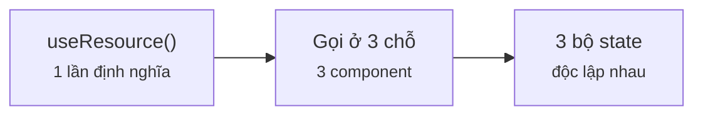

Đọc sơ đồ: Chung logic, riêng state — mỗi lần gọi là một bộ state mới.

### 7 · Làm ngay (≤ 10 phút)
**Mục tiêu:** Viết `useCounter(initial, { min, max, step })` trong `m2/ex/ex25-start.tsx`, trả `{ value, inc, dec, reset }`, giá trị kẹp trong `[min, max]`.

File khởi đầu:

`m2/ex/ex25-start.tsx`

```tsx
import { root } from "../dom";
import { act } from "react";
import { createRoot } from "react-dom/client";

type Opts = { min?: number; max?: number; step?: number };
// TODO: dùng useState; inc/dec bị kẹp trong [min, max]; reset về initial
export function useCounter(initial: number, { min = -Infinity, max = Infinity, step = 1 }: Opts = {}) {
  void min; void max; void step;
  return { value: initial, inc: () => {}, dec: () => {}, reset: () => {} };
}

function Qty({ label }: { label: string }) {
  const q = useCounter(1, { min: 1, max: 3 });
  return (<p>
    {label}={q.value}
    <button className="dec" onClick={q.dec} /><button className="inc" onClick={q.inc} /><button className="reset" onClick={q.reset} />
  </p>);
}

await act(() => createRoot(root).render(<><Qty label="latte" /><Qty label="mocha" /></>));
const [latte, mocha] = root.querySelectorAll("p");
const click = (p: Element, c: string, n = 1) => act(() => { for (let i = 0; i < n; i++) p.querySelector<HTMLElement>(`.${c}`)!.click(); });
await click(latte, "inc", 5); console.log("latte +5 →", latte.textContent);
await click(latte, "dec", 9); console.log("latte -9 →", latte.textContent);
await click(mocha, "inc");    console.log("mocha +1 →", mocha.textContent, "| latte:", latte.textContent);
await click(mocha, "reset");  console.log("mocha ↺  →", mocha.textContent);
```

Chạy file khởi đầu (đang đỏ):

```console
❯ npx tsx m2/ex/ex25-start.tsx
latte +5 → latte=1
latte -9 → latte=1
mocha +1 → mocha=1 | latte: latte=1
mocha ↺  → mocha=1
```

Tiêu chí nghiệm thu:

- [ ] `latte +5 → latte=3` (kẹp max) và `latte -9 → latte=1` (kẹp min)
- [ ] `mocha +1 → mocha=2` mà `latte` không đổi (state riêng)
- [ ] `mocha ↺ → mocha=1`; `npx tsc -p .` không báo lỗi

Lệnh nghiệm thu:

```bash
npx tsx m2/ex/ex25-start.tsx && npx tsc -p .
```

Lời giải tham chiếu chạy ra (output cần đạt):

```console
❯ npx tsx m2/ex/ex25-solution.tsx
latte +5 → latte=3
latte -9 → latte=1
mocha +1 → mocha=2 | latte: latte=1
mocha ↺  → mocha=1
```

<details><summary>Gợi ý nếu bị đỏ</summary>

| Triệu chứng | Nguyên nhân | Sửa |
|---|---|---|
| `latte +5 → latte=2` | `setValue(clamp(value + step))` — 5 click trong 1 act đọc cùng snapshot | Updater: `setValue(v => clamp(v + step))` |
| `latte=6` | Quên kẹp | `Math.min(max, Math.max(min, n))` |
| Bấm mocha mà latte cũng đổi | Để state ở biến module (ngoài hook) | `useState` phải nằm **trong** `useCounter` |

</details>

### 8 · 3 câu hỏi nhanh
1. 2 component cùng gọi `useCounter()` — chúng có chung `value` không?

   <details><summary>Đáp án</summary>

   Không. Mỗi lần gọi hook tạo state riêng trên Fiber của component đó. Muốn chung thì lift state lên cha, Context, hoặc store.

   </details>

2. Vì sao không được gọi hook trong `if`?

   <details><summary>Đáp án</summary>

   React khớp hook theo thứ tự gọi. Số/thứ tự hook đổi giữa các render → hook đọc nhầm state ("Rendered more hooks than during the previous render").

   </details>

3. Hàm bình thường gọi `useState` bên trong nhưng tên là `getCart()` — sai ở đâu?

   <details><summary>Đáp án</summary>

   Chạy thì vẫn chạy, nhưng linter không nhận là hook nên không kiểm luật hook. Đổi tên thành `useCart`.

   </details>


---

## Bài 2.6 · Portals & Error Boundaries

_Nguồn roadmap: [Academind] Introducing & Understanding Portals → Introducing Error Boundaries_

### 1 · Một câu & nằm ở đâu
**Portal** vẽ con ra chỗ khác trong DOM (modal, toast) nhưng vẫn là con trong **cây React** (event, context vẫn đi theo). **Error Boundary** bắt lỗi lúc render của cây con và thay bằng UI dự phòng — thiếu nó, 1 lỗi làm trắng cả trang.

Event handler → setState / dispatch → Render (gọi hook) → **[Commit + gán ref]** → Effect / cleanup → **[Lỗi → Boundary]**

### 2 · Concept
| | Portal | Error Boundary |
|---|---|---|
| API | `createPortal(jsx, domNode)` | Class có `getDerivedStateFromError` + `componentDidCatch` |
| Giải quyết | `overflow: hidden`, `z-index` của cha cắt modal | 1 widget lỗi kéo sập cả app |
| Cây DOM | Nằm ở `#modal-root` | Không đổi |
| Cây React | Vẫn là con → event bubble lên cha React | Bọc quanh cây con muốn cô lập |
| Bắt được | — | Lỗi khi **render**, lifecycle, constructor |
| **Không** bắt | — | Event handler, `setTimeout`, promise → tự `try/catch` |
| Bên C# | — | `try/catch` quanh 1 vùng UI + middleware log |

Error Boundary **chưa có hook tương đương** → vẫn viết class (hoặc dùng `react-error-boundary`).

### 3 · Flow / lifecycle
**Lỗi lúc render đi đâu?**

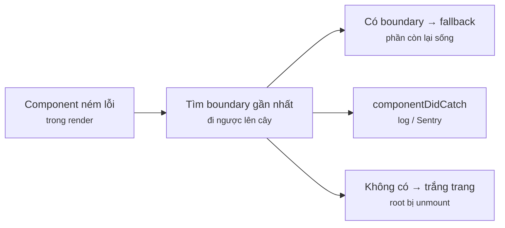

Đọc sơ đồ: Trái → phải: component ném lỗi, React tìm boundary gần nhất phía trên, đổi sang fallback rồi commit; componentDidCatch chạy sau để log. Không có boundary → cả root bị gỡ.

### 4 · Ví dụ thực tế
**Ví dụ 1.** Modal qua portal: nằm ở `#modal-root` trong DOM, nhưng click vẫn bubble lên `<section onClick>` của cha React.

`m2/l26-portal.tsx`

```tsx
import { root } from "./dom";
import { act, useState, type ReactNode } from "react";
import { createPortal } from "react-dom";
import { createRoot } from "react-dom/client";

function Modal({ children }: { children: ReactNode }) {
  // DOM: gắn vào #modal-root (thoát overflow/z-index của cha). Cây React: vẫn là con của Page.
  return createPortal(<div className="modal">{children}</div>, document.getElementById("modal-root")!);
}

function Page() {
  const [open, setOpen] = useState(true);
  return (
    <section onClick={(e) => console.log(`Page nhận click từ <${(e.target as Element).tagName.toLowerCase()}>`)}>
      <h1>Đơn hàng</h1>
      {open && <Modal><button onClick={() => setOpen(false)}>Đóng</button></Modal>}
    </section>
  );
}

await act(() => createRoot(root).render(<Page />));
const btn = document.querySelector(".modal button")!;
console.log(`cha DOM của nút: #${btn.parentElement!.parentElement!.id}`);
console.log(`#root có chứa nút? ${root.contains(btn)}`);
await act(() => (btn as HTMLElement).click());
console.log(`#modal-root sau khi đóng: "${document.getElementById("modal-root")!.innerHTML}"`);
```

```console
❯ npx tsx m2/l26-portal.tsx
cha DOM của nút: #modal-root
#root có chứa nút? false
Page nhận click từ <button>
#modal-root sau khi đóng: ""
```

Nút không nằm trong `#root` nhưng `Page` vẫn nhận click — event đi theo **cây React**, không theo cây DOM. Đóng modal thì portal tự dọn.

**Ví dụ 2.** Boundary dùng lại được: nhận `fallback(error, reset)`.

`m2/ErrorBoundary.tsx`

```tsx
import { Component, type ErrorInfo, type ReactNode } from "react";

type Props = { fallback: (error: Error, reset: () => void) => ReactNode; children: ReactNode };
type State = { error: Error | null };

// Chưa có hook tương đương → vẫn phải viết class (hoặc dùng lib react-error-boundary)
export class ErrorBoundary extends Component<Props, State> {
  state: State = { error: null };
  static getDerivedStateFromError(error: Error): State {   // lúc render: đổi sang UI dự phòng
    return { error };
  }
  componentDidCatch(error: Error, info: ErrorInfo) {        // sau commit: log/gửi Sentry
    console.log(`[log] ${error.message} | tại ${info.componentStack?.split("\n")[1].trim().split(" (")[0].replace("at ", "")}`);
  }
  reset = () => this.setState({ error: null });
  render() {
    return this.state.error ? this.props.fallback(this.state.error, this.reset) : this.props.children;
  }
}
```

```console
❯ npx tsc -p . && echo "tsc strict: 0 lỗi"
tsc strict: 0 lỗi
```

`getDerivedStateFromError` chạy lúc render (chỉ đổi state). `componentDidCatch` chạy sau commit (được phép side effect: log, gửi Sentry).

**Ví dụ 3.** Dashboard có widget thời tiết nhận `null` từ API.

`m2/l26-boundary.tsx`

```tsx
import { root } from "./dom";
import { ErrorBoundary } from "./ErrorBoundary";
import { act } from "react";
import { createRoot } from "react-dom/client";

function Weather({ data }: { data: { temp: number } | null }) {
  return <p>🌡 {data!.temp}°C</p>;               // API trả null → ném TypeError lúc render
}

function Dashboard() {
  return (<main>
    <h1>Bảng điều khiển</h1>
    <ErrorBoundary fallback={(e) => <p>⚠ Widget thời tiết lỗi: {e.message}</p>}>
      <Weather data={null} />
    </ErrorBoundary>
    <p>📦 Đơn hôm nay: 42</p>
  </main>);
}

const app = createRoot(root, { onCaughtError: () => {} }); // tắt log mặc định, đã tự log ở boundary
await act(() => app.render(<Dashboard />));
console.log("Màn hình:", [...root.querySelectorAll("h1, p")].map((n) => n.textContent).join(" | "));
```

```console
❯ npx tsx m2/l26-boundary.tsx
[log] Cannot read properties of null (reading 'temp') | tại Weather
Màn hình: Bảng điều khiển | ⚠ Widget thời tiết lỗi: Cannot read properties of null (reading 'temp') | 📦 Đơn hôm nay: 42
```

Widget hỏng hiện fallback; tiêu đề và "Đơn hôm nay" vẫn sống. `onCaughtError` (React 19) là chỗ log mặc định — ở đây tắt đi vì boundary đã tự log.

### 5 · Thử thật / bẫy
**Bẫy 1.** **Tưởng boundary bắt lỗi trong `onClick`.** Handler chạy ngoài lúc render → boundary không biết.

`m2/l26-trap-handler.tsx`

```tsx
import { root } from "./dom";
import { ErrorBoundary } from "./ErrorBoundary";
import { act } from "react";
import { createRoot } from "react-dom/client";

function PayButton() {
  return <button onClick={() => { throw new Error("cổng thanh toán timeout"); }}>Thanh toán</button>;
}

window.addEventListener("error", (e) => { e.preventDefault(); console.log(`window.onerror bắt: ${e.error.message}`); });
await act(() => createRoot(root).render(
  <ErrorBoundary fallback={() => <p>⚠ fallback</p>}><PayButton /></ErrorBoundary>,
));
await act(() => root.querySelector("button")!.click());
console.log(`Màn hình: ${root.innerHTML}`); // boundary KHÔNG kích hoạt
```

```console
❯ npx tsx m2/l26-trap-handler.tsx
window.onerror bắt: cổng thanh toán timeout
Màn hình: <button>Thanh toán</button>
```

Lỗi lọt ra `window`, UI vẫn hiện nút như không có gì. Handler/async thì `try/catch` rồi `setState` lỗi để hiện ra.

**Bẫy 2.** **Không có boundary nào.** React 19 gỡ **cả root** khi lỗi render không ai bắt.

`m2/l26-trap-noboundary.tsx`

```tsx
import { root } from "./dom";
import { act } from "react";
import { createRoot } from "react-dom/client";

function Weather({ data }: { data: { temp: number } | null }) {
  return <p>🌡 {data!.temp}°C</p>;
}
function Dashboard() {
  return <main><h1>Bảng điều khiển</h1><Weather data={null} /><p>📦 Đơn: 42</p></main>;
}

try {
  await act(() => createRoot(root).render(<Dashboard />));
} catch (e) {
  console.log(`lỗi văng lên root: ${(e as Error).message}`);
}
console.log(`#root sau lỗi: "${root.innerHTML}"`); // cả trang trắng
```

```console
❯ npx tsx m2/l26-trap-noboundary.tsx
lỗi văng lên root: Cannot read properties of null (reading 'temp')
#root sau lỗi: ""
```

`#root` rỗng: trắng trang vì 1 widget. Tối thiểu nên có 1 boundary ở gốc app + 1 boundary quanh từng widget độc lập.

### 6 · Tóm tắt bằng hình
**(a) Cây thư mục sau bài này**

```text
sandbox/m2/
├─ dom.ts  [SỬA]  ← thêm #modal-root
├─ ErrorBoundary.tsx  [MỚI]  ← boundary dùng lại, có reset
├─ l26-portal.tsx  [MỚI]  ← modal qua portal
├─ l26-boundary.tsx  [MỚI]  ← cô lập widget lỗi
├─ l26-trap-handler.tsx  [MỚI]  ← lỗi handler không bị bắt
└─ l26-trap-noboundary.tsx  [MỚI]  ← trắng trang
```

**(b) Đọc trong 10 giây**

**Đặt boundary ở đâu?**

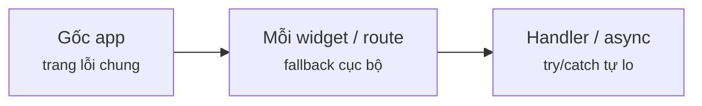

Đọc sơ đồ: Một ở gốc để không bao giờ trắng trang, thêm ở từng vùng độc lập.

### 7 · Làm ngay (≤ 10 phút)
**Mục tiêu:** Thêm nút "Thử lại" vào fallback trong `m2/ex/ex26-start.tsx` để khi có mạng lại, widget hiện tỉ giá.

File khởi đầu:

`m2/ex/ex26-start.tsx`

```tsx
import { root } from "../dom";
import { ErrorBoundary } from "../ErrorBoundary";
import { act } from "react";
import { createRoot } from "react-dom/client";

let online = false;
function Rates() {                     // mất mạng thì ném lỗi lúc render
  if (!online) throw new Error("mất mạng");
  return <p>USD = 25.400đ</p>;
}

function App() {
  return (
    // TODO: fallback hiện thêm nút "Thử lại" gọi reset()
    <ErrorBoundary fallback={(e) => <p>⚠ {e.message}</p>}>
      <Rates />
    </ErrorBoundary>
  );
}

await act(() => createRoot(root, { onCaughtError: () => {} }).render(<App />));
console.log("lần 1:", root.textContent);
const retry = root.querySelector("button");
if (!retry) console.log("❌ không có nút Thử lại");
else { online = true; await act(() => retry.click()); console.log("có mạng lại, bấm Thử lại:", root.textContent); }
```

Chạy file khởi đầu (đang đỏ):

```console
❯ npx tsx m2/ex/ex26-start.tsx
[log] mất mạng | tại Rates
lần 1: ⚠ mất mạng
❌ không có nút Thử lại
```

Tiêu chí nghiệm thu:

- [ ] Dòng cuối ra `có mạng lại, bấm Thử lại: USD = 25.400đ`
- [ ] Không sửa `ErrorBoundary.tsx`, chỉ dùng tham số `reset`
- [ ] `npx tsc -p .` không báo lỗi

Lệnh nghiệm thu:

```bash
npx tsx m2/ex/ex26-start.tsx && npx tsc -p .
```

Lời giải tham chiếu chạy ra (output cần đạt):

```console
❯ npx tsx m2/ex/ex26-solution.tsx
[log] mất mạng | tại Rates
lần 1: ⚠ mất mạng Thử lại
có mạng lại, bấm Thử lại: USD = 25.400đ
```

<details><summary>Gợi ý nếu bị đỏ</summary>

| Triệu chứng | Nguyên nhân | Sửa |
|---|---|---|
| `❌ không có nút Thử lại` | Fallback chưa render `<button>` | `fallback={(e, reset) => <p>⚠ {e.message} <button onClick={reset}>Thử lại</button></p>}` |
| Bấm rồi vẫn `⚠ mất mạng` | Gọi `reset` khi `online` còn false | Lệnh chạy thử đã bật `online = true` trước khi bấm — kiểm lại thứ tự |
| TS: `reset` implicitly `any` | Viết fallback tách rời, mất suy luận kiểu | Để inline trong prop, hoặc ghi `reset: () => void` |

`m2/ex/ex26-start.tsx` (diff)

```diff
 function App() {
   return (
-    // TODO: fallback hiện thêm nút "Thử lại" gọi reset()
-    <ErrorBoundary fallback={(e) => <p>⚠ {e.message}</p>}>
+    // ✅ fallback nhận reset → xoá error trong boundary → render lại children
+    <ErrorBoundary fallback={(e, reset) => <p>⚠ {e.message} <button onClick={reset}>Thử lại</button></p>}>
       <Rates />
     </ErrorBoundary>
```

</details>

### 8 · 3 câu hỏi nhanh
1. Modal render qua portal ra `document.body`. Context của cha có tới được modal không?

   <details><summary>Đáp án</summary>

   Có. Portal chỉ đổi vị trí DOM; trong cây React nó vẫn là con, nên context, event bubbling đều đi theo cây React.

   </details>

2. Error Boundary có bắt được lỗi `await fetch()` bị reject trong `useEffect` không?

   <details><summary>Đáp án</summary>

   Không — đó là async, ngoài lúc render. Bắt bằng `try/catch` rồi `setState({ error })`; muốn đẩy lên boundary thì ném lại trong lần render sau.

   </details>

3. Vì sao Error Boundary vẫn là class trong React 19?

   <details><summary>Đáp án</summary>

   Chưa có hook nào cho `getDerivedStateFromError` / `componentDidCatch`. Thực tế hay dùng lib `react-error-boundary` (bên trong vẫn là class).

   </details>

