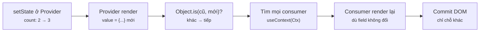
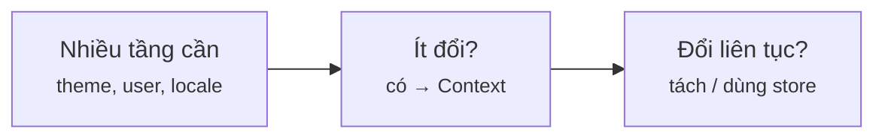
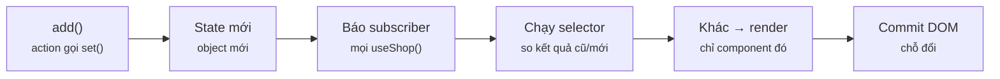
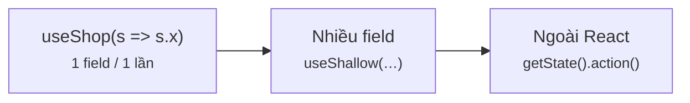
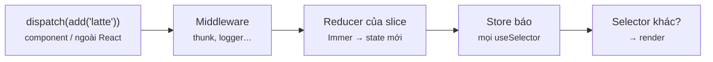
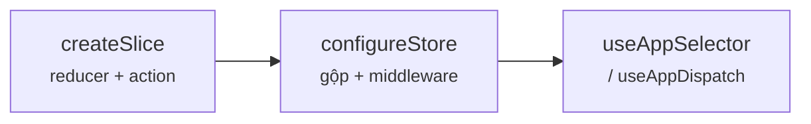
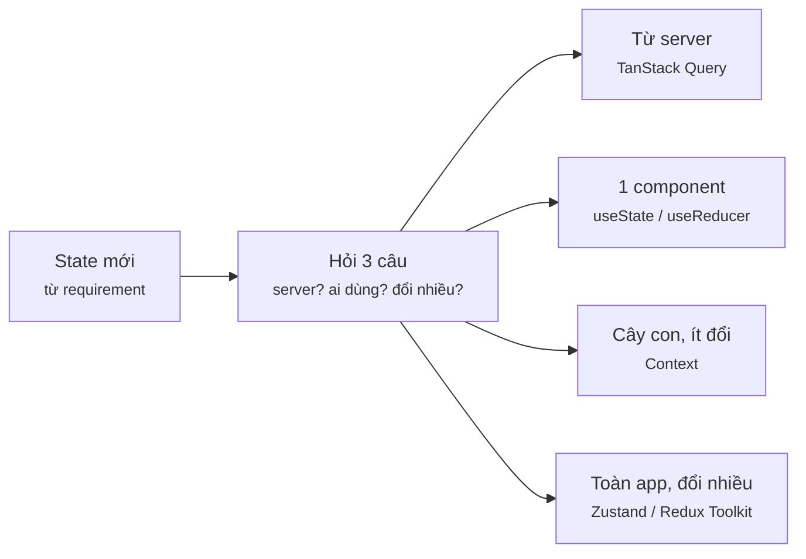
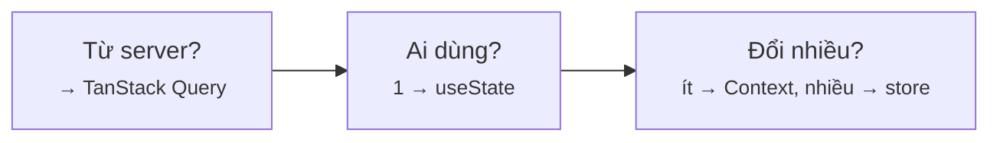

# Module 3 · State mức app

_Context API · Zustand · Redux Toolkit · bảng quyết định chọn chỗ đặt state_

**Đã chạy với:** Node 22.22.0 · TypeScript 7.0.2 · React 19.3.1 · react-dom 19.3.1 · Zustand 5.0.15 · @reduxjs/toolkit 2.13.0 · react-redux 9.3.0 · jsdom 29.1.1 · tsx 4.23.15

Như Module 1–2: React chạy thật trong Node + jsdom (DOM giả). `m3/dom.ts` thêm bộ đếm `track()` để **đo** số lần render của từng component — mọi con số "render thêm" trong bài là số đo thật. `m3/api.ts` là **server giả** (in-memory, trễ 20ms, bật/tắt mạng được) thay cho API thật, cùng hợp đồng `Promise`.

Vị trí: Đã học Module 2 · Hooks nâng cao (useState → useReducer → custom hook) · **Đang học Module 3** · Sắp tới Module 4 · Routing (React Router: route, loader/action, protected route)

## Bài 3.1 · Context API: đúng use-case, đúng giới hạn

_Nguồn roadmap: [Academind] Prop Drilling → Introducing the Context API → Creating & Providing The Context → Linking the Context to State → What Happens When Context Values Change? · [BigReact] How the Context API Works → Context API + Children Prop_

### 1 · Một câu & nằm ở đâu
Context là **đường ống** đưa 1 giá trị xuống cả cây con, khỏi truyền prop qua từng tầng. Nó **không** phải state manager: state vẫn là `useState` ở Provider. Value đổi → **mọi** component đọc context render lại, kể cả khi chỉ dùng field không đổi.

Requirement → state → **[Chọn chỗ đặt]** → **[Cấp xuống (Provider / store)]** → **[Component đọc (selector)]** → Đổi (set / dispatch) → **[Ai render lại?]**

<details><summary>m3/dom.ts — DOM giả dùng cho mọi ví dụ</summary>

`m3/dom.ts`

```tsx
// Giả lập trình duyệt trong Node để React render thật (không cần mở Chrome)
import { JSDOM } from "jsdom";

const dom = new JSDOM('<!doctype html><div id="root"></div>');
Object.assign(globalThis, {
  window: dom.window,
  document: dom.window.document,
  HTMLElement: dom.window.HTMLElement,
  IS_REACT_ACT_ENVIRONMENT: true, // cho phép dùng act() ngoài test runner
});

export const root = dom.window.document.getElementById("root")!;
export const wait = (ms: number) => new Promise((r) => setTimeout(r, ms));

// Đếm số lần render theo tên component — dùng để so Context / Zustand / Redux
export const renders: Record<string, number> = {};
export const track = (name: string) => { renders[name] = (renders[name] ?? 0) + 1; };
export const report = () => Object.entries(renders).map(([k, v]) => `${k}=${v}`).join(" ");
export const resetRenders = () => { for (const k in renders) delete renders[k]; };
```

</details>

### 2 · Concept
| Mảnh | Vai trò | Bên C# |
|---|---|---|
| `createContext(default)` | Tạo "kênh"; `default` chỉ dùng khi **không có** Provider phía trên | Khai báo interface cho DI |
| `<Ctx value={x}>` (React 19; code cũ: `Ctx.Provider`) | Cấp `x` cho cả cây con | `services.AddScoped`, scope = cây con |
| `useContext(Ctx)` | Đọc Provider **gần nhất** phía trên | Constructor injection |
| Value đổi (so `Object.is`) | Mọi consumer render lại — **không có selector** | — |
| `children` truyền từ ngoài vào Provider | Không render lại nếu không đọc context | — |

**Prop drilling** (khoan prop: truyền prop qua nhiều tầng không dùng tới nó). Thử `children` / composition trước; nhiều tầng thật sự cần cùng 1 giá trị ít đổi (theme, user, locale) → Context.

### 3 · Flow / lifecycle
**Provider đổi value thì ai render lại?**



Đọc sơ đồ: Trái → phải: setState ở Provider tạo value mới; React so bằng Object.is, khác → đánh dấu MỌI consumer bên dưới, không cần biết consumer dùng field nào. Component con không đọc context thì được tha.

### 4 · Ví dụ thực tế
**Ví dụ 1.** `UserBadge` ở tầng 3 đọc user; `Layout`, `Sidebar` không còn nhận/forward prop `user`.

`m3/l31-context.tsx`

```tsx
import { root } from "./dom";
import { act, createContext, useContext, useState } from "react";
import { createRoot } from "react-dom/client";

type User = { name: string; role: "staff" | "admin" };
const UserContext = createContext<User | null>(null);      // 1) tạo "kênh"

function UserBadge() {                                      // 3) đọc ở tầng sâu bất kỳ
  const user = useContext(UserContext);
  return <b>{user ? `${user.name} (${user.role})` : "khách"}</b>;
}
// Layout và Sidebar KHÔNG nhận/forward prop user nữa
const Sidebar = () => <nav>Menu · <UserBadge /></nav>;
const Layout = () => <main><Sidebar /></main>;

let login!: (u: User) => void;
function App() {
  const [user, setUser] = useState<User | null>(null);
  login = setUser;
  return (                                                  // 2) cung cấp giá trị cho cả cây con
    <UserContext value={user}>
      <Layout />
    </UserContext>
  );
}

await act(() => createRoot(root).render(<App />));
console.log("trước login:", root.textContent);
await act(() => login({ name: "Huy", role: "admin" }));
console.log("sau login  :", root.textContent);
```

```console
❯ npx tsx m3/l31-context.tsx
trước login: Menu · khách
sau login  : Menu · Huy (admin)
```

Ba bước: `createContext` → bọc `<UserContext value>` → `useContext` ở đâu cũng được. State thật vẫn là `useState` trong `App`; context chỉ chở nó đi.

**Ví dụ 2.** Giỏ hàng + theme chung 1 context. Thêm 3 ly, đếm ai render lại. `Footer` nằm trong Provider nhưng không đọc context.

`m3/l31-rerender.tsx`

```tsx
import { root, track, report, resetRenders } from "./dom";
import { act, createContext, useContext, useState, type ReactNode } from "react";
import { createRoot } from "react-dom/client";

type Shop = { count: number; theme: "light" | "dark" };
const ShopContext = createContext<Shop>({ count: 0, theme: "light" });

let addToCart!: () => void;
function ShopProvider({ children }: { children: ReactNode }) {
  const [count, setCount] = useState(0);
  addToCart = () => setCount((c) => c + 1);
  return <ShopContext value={{ count, theme: "light" }}>{children}</ShopContext>;
}
function CartBadge() { track("CartBadge"); return <span>🛒{useContext(ShopContext).count} · </span>; }
function ThemeLabel() { track("ThemeLabel"); return <span>{useContext(ShopContext).theme} · </span>; }
function Footer() { track("Footer"); return <footer>© cafe</footer>; }   // không đọc context

await act(() => createRoot(root).render(
  <ShopProvider><CartBadge /><ThemeLabel /><Footer /></ShopProvider>,
));
resetRenders();
for (let i = 0; i < 3; i++) await act(() => addToCart());
console.log("sau 3 lần add:", root.textContent);
console.log("render thêm  :", report());
```

```console
❯ npx tsx m3/l31-rerender.tsx
sau 3 lần add: 🛒3 · light · © cafe
render thêm  : CartBadge=3 ThemeLabel=3
```

`ThemeLabel` render 3 lần dù theme vẫn `light` — Context không có selector. `Footer` = 0 vì nó được truyền qua `children` từ ngoài: Provider render lại không tạo lại phần tử đó. Đây chính là câu phỏng vấn "sao không dùng Context thay Redux cho gọn?".

### 5 · Thử thật / bẫy
**Bẫy 1.** **Object literal làm `value`.** Cha của Provider render vì lý do khác (đồng hồ) → `{ count, add }` là object mới → consumer render lại, `memo()` cũng không cứu.

`m3/l31-trap-literal.tsx`

```tsx
import { root, track, report, resetRenders } from "./dom";
import { act, createContext, memo, useContext, useMemo, useState } from "react";
import { createRoot } from "react-dom/client";

type Cart = { count: number; add: () => void };
const CartContext = createContext<Cart | null>(null);

const Badge = memo(function Badge({ name }: { name: string }) {   // memo: props không đổi thì bỏ qua
  track(name);
  return <span>🛒{useContext(CartContext)!.count}</span>;
});

let tick!: () => void;
function App({ fix }: { fix: boolean }) {
  const [, setClock] = useState(0);             // state KHÔNG liên quan giỏ hàng (đồng hồ)
  tick = () => setClock((c) => c + 1);
  const [count, setCount] = useState(0);
  const literal = { count, add: () => setCount((c) => c + 1) };              // ❌ object mới mỗi render
  const stable = useMemo(() => ({ count, add: () => setCount((c) => c + 1) }), [count]); // ✅
  return <CartContext value={fix ? stable : literal}><Badge name={fix ? "useMemo" : "literal"} /></CartContext>;
}

for (const fix of [false, true]) {
  const app = createRoot(root);
  await act(() => app.render(<App fix={fix} />));
  resetRenders();
  for (let i = 0; i < 5; i++) await act(() => tick());   // đồng hồ nhảy 5 lần, giỏ hàng không đổi
  console.log(`value=${fix ? "useMemo" : "{...} "} → Badge render thêm: ${report() || "0"}`);
  await act(() => app.unmount());
}
```

```console
❯ npx tsx m3/l31-trap-literal.tsx
value={...}  → Badge render thêm: literal=5
value=useMemo → Badge render thêm: 0
```

Giỏ không đổi mà Badge vẫn render 5 lần. Bọc value bằng `useMemo` (deps là đúng những thứ value phụ thuộc). Code AI hay bỏ sót dòng này.

**Bẫy 2.** **Quên bọc Provider.** Default "giả" (`add: () => {}`) làm app chạy im lặng mà không làm gì.

`m3/l31-trap-noprovider.tsx`

```tsx
import { root } from "./dom";
import { act, createContext, useContext } from "react";
import { createRoot } from "react-dom/client";

type Cart = { count: number; add: () => void };
// ❌ default "giả" → quên bọc Provider vẫn chạy, chỉ là không làm gì
const LooseCart = createContext<Cart>({ count: 0, add: () => {} });
// ✅ default null + custom hook ném lỗi rõ ràng
const StrictCart = createContext<Cart | null>(null);
function useCart() {
  const ctx = useContext(StrictCart);
  if (!ctx) throw new Error("useCart() phải nằm trong <CartProvider>");
  return ctx;
}

function LooseButton() {
  const { count, add } = useContext(LooseCart);
  return <button onClick={add}>🛒{count}</button>;
}
function StrictButton() { const { count, add } = useCart(); return <button onClick={add}>🛒{count}</button>; }

await act(() => createRoot(root).render(<LooseButton />));   // quên Provider
await act(() => root.querySelector("button")!.click());
console.log("Loose : bấm add →", root.textContent, "(im lặng, không lỗi)");
try {
  await act(() => createRoot(document.body.appendChild(document.createElement("div"))).render(<StrictButton />));
} catch (e) { console.log("Strict:", (e as Error).message); }
```

```console
❯ npx tsx m3/l31-trap-noprovider.tsx
Loose : bấm add → 🛒0 (im lặng, không lỗi)
Strict: useCart() phải nằm trong <CartProvider>
```

Pattern chuẩn: default `null` + custom hook `useCart()` ném lỗi rõ ràng. Lỗi lộ ra ngay lần render đầu thay vì user bấm mãi không thấy gì.

### 6 · Tóm tắt bằng hình
**(a) Cây thư mục sau bài này**

```text
sandbox/
├─ tsconfig.json  [SỬA]  ← include m3/**
└─ m3/
   ├─ dom.ts  [MỚI]  ← DOM giả + track()/report() đếm render
   ├─ l31-context.tsx  [MỚI]  ← create → value → useContext
   ├─ l31-rerender.tsx  [MỚI]  ← value đổi → mọi consumer render
   ├─ l31-trap-literal.tsx  [MỚI]  ← value={{…}} mới mỗi render
   └─ l31-trap-noprovider.tsx  [MỚI]  ← default giả vs hook ném lỗi
```

**(b) Đọc trong 10 giây**

**Khi nào dùng Context?**



Đọc sơ đồ: Nhiều tầng cần + ít đổi → Context. Đổi liên tục → tách context hoặc dùng store có selector.

### 7 · Làm ngay (≤ 10 phút)
**Mục tiêu:** Sửa `m3/ex/ex31-start.tsx`: tách 1 context thành 2 (`CountContext`, `ThemeContext`) để `ThemeLabel` không render lại khi thêm ly.

File khởi đầu:

`m3/ex/ex31-start.tsx`

```tsx
import { root, track, renders, resetRenders } from "../dom";
import { act, createContext, useContext, useState, type ReactNode } from "react";
import { createRoot } from "react-dom/client";

// TODO: tách thành 2 context (CountContext, ThemeContext) để ThemeLabel không render lại khi count đổi
type Shop = { count: number; theme: string };
const ShopContext = createContext<Shop>({ count: 0, theme: "light" });

let add!: () => void;
function ShopProvider({ children }: { children: ReactNode }) {
  const [count, setCount] = useState(0);
  const [theme] = useState("light");
  add = () => setCount((c) => c + 1);
  return <ShopContext value={{ count, theme }}>{children}</ShopContext>;
}
function CartBadge() { track("CartBadge"); return <span>🛒{useContext(ShopContext).count} </span>; }
function ThemeLabel() { track("ThemeLabel"); return <span>{useContext(ShopContext).theme}</span>; }

await act(() => createRoot(root).render(<ShopProvider><CartBadge /><ThemeLabel /></ShopProvider>));
resetRenders();
for (let i = 0; i < 3; i++) await act(() => add());
console.log(`UI: ${root.textContent} | CartBadge render thêm: ${renders.CartBadge ?? 0} | ThemeLabel render thêm: ${renders.ThemeLabel ?? 0}`);
```

Chạy file khởi đầu (đang đỏ):

```console
❯ npx tsx m3/ex/ex31-start.tsx
UI: 🛒3 light | CartBadge render thêm: 3 | ThemeLabel render thêm: 3
```

Tiêu chí nghiệm thu:

- [ ] Output ra `ThemeLabel render thêm: 0`
- [ ] `CartBadge render thêm: 3` và UI vẫn `🛒3 light`
- [ ] `npx tsc -p .` không báo lỗi

Lệnh nghiệm thu:

```bash
npx tsx m3/ex/ex31-start.tsx && npx tsc -p .
```

Lời giải tham chiếu chạy ra (output cần đạt):

```console
❯ npx tsx m3/ex/ex31-solution.tsx
UI: 🛒3 light | CartBadge render thêm: 3 | ThemeLabel render thêm: 0
```

<details><summary>Gợi ý nếu bị đỏ</summary>

| Triệu chứng | Nguyên nhân | Sửa |
|---|---|---|
| Vẫn `ThemeLabel render thêm: 3` | Còn 1 value object chứa cả count lẫn theme | 2 context, mỗi cái 1 giá trị nguyên thuỷ: `<ThemeContext value={theme}><CountContext value={count}>` |
| UI ra `🛒 light` (mất số) | `CartBadge` vẫn đọc context cũ | `useContext(CountContext)` trả thẳng số, không còn `.count` |
| TS: `Cannot find name 'ShopContext'` | Xoá context cũ nhưng còn chỗ dùng | Đổi cả 2 consumer sang context mới |

`m3/ex/ex31-start.tsx` (diff)

```diff
 import { createRoot } from "react-dom/client";
 
-// TODO: tách thành 2 context (CountContext, ThemeContext) để ThemeLabel không render lại khi count đổi
-type Shop = { count: number; theme: string };
-const ShopContext = createContext<Shop>({ count: 0, theme: "light" });
+// ✅ tách theo tần suất đổi: count đổi liên tục, theme gần như không đổi
+const CountContext = createContext(0);
+const ThemeContext = createContext("light");
 
 let add!: () => void;
   const [theme] = useState("light");
   add = () => setCount((c) => c + 1);
-  return <ShopContext value={{ count, theme }}>{children}</ShopContext>;
+  return <ThemeContext value={theme}><CountContext value={count}>{children}</CountContext></ThemeContext>;
 }
-function CartBadge() { track("CartBadge"); return <span>🛒{useContext(ShopContext).count} </span>; }
-function ThemeLabel() { track("ThemeLabel"); return <span>{useContext(ShopContext).theme}</span>; }
+function CartBadge() { track("CartBadge"); return <span>🛒{useContext(CountContext)} </span>; }
+function ThemeLabel() { track("ThemeLabel"); return <span>{useContext(ThemeContext)}</span>; }
 
 await act(() => createRoot(root).render(<ShopProvider><CartBadge /><ThemeLabel /></ShopProvider>));
```

</details>

### 8 · 3 câu hỏi nhanh
1. Context có phải state manager không?

   <details><summary>Đáp án</summary>

   Không. Nó chỉ **vận chuyển** giá trị. State vẫn nằm ở `useState`/`useReducer` trong Provider. Context + `useReducer` mới thành "Redux mini".

   </details>

2. Component A đọc `ctx.theme`, Provider đổi `ctx.count`. A có render lại không?

   <details><summary>Đáp án</summary>

   Có. Context không có selector: value mới (khác tham chiếu) → mọi consumer render. Cách giảm: tách context theo tần suất đổi, `useMemo` value, hoặc chuyển sang store có selector (Zustand/Redux).

   </details>

3. Vì sao component truyền qua `children` vào Provider không render lại khi value đổi?

   <details><summary>Đáp án</summary>

   Phần tử `children` được tạo ở **cha** của Provider. Provider render lại chỉ đưa lại đúng object phần tử cũ → React bỏ qua. Chỉ consumer `useContext` bị đánh dấu.

   </details>


---

## Bài 3.2 · Zustand: store nhỏ gọn, chỉ đăng ký phần mình cần

_Nguồn roadmap: [NextAI] State Management libraries → Create your first store in Zustand → Subscribe only to what you need → One store with multiple slices → Async actions for API calls_

### 1 · Một câu & nằm ở đâu
`create()` trả về **1 hook** gắn với store sống **ngoài** cây React — không cần Provider. Component gọi `useShop(s => s.theme)` và chỉ render lại khi **kết quả selector** đổi. Action là hàm thường trong store, async cũng được.

Requirement → state → Chọn chỗ đặt → **[Cấp xuống (Provider / store)]** → **[Component đọc (selector)]** → **[Đổi (set / dispatch)]** → **[Ai render lại?]**

<details><summary>m3/api.ts — server giả: trễ 20ms, bật/tắt mạng, đếm request</summary>

`m3/api.ts`

```tsx
// API giả cho Zustand/Redux thunk: in-memory, có độ trễ, cùng hợp đồng Promise như fetch thật
export type Product = { id: number; name: string; price: number };
const db: Product[] = [
  { id: 1, name: "latte", price: 45000 },
  { id: 2, name: "mocha", price: 50000 },
  { id: 3, name: "cold brew", price: 55000 },
];
export let online = true;
export const setOnline = (v: boolean) => { online = v; };
export const stats = { calls: 0 };                                     // đếm số request thật
export const setPrice = (id: number, price: number) => { db.find((p) => p.id === id)!.price = price; };

export function fetchMenu(): Promise<Product[]> {
  stats.calls++;
  return new Promise((resolve, reject) =>
    setTimeout(() => (online ? resolve(db.map((p) => ({ ...p }))) : reject(new Error("503 menu service down"))), 20),
  );
}
```

</details>

### 2 · Concept
| Khái niệm | Zustand | Bên C# |
|---|---|---|
| Store | `create<T>()(set => ({…}))` → hook `useShop`; state là **module singleton** | Singleton service |
| Selector | `useShop(s => s.theme)`: render lại khi kết quả đổi (`Object.is`) | Subscribe event có filter |
| Action | Hàm trong store, gọi `set(partial)` — **merge nông** | Method trên service |
| Ngoài React | `useShop.getState().add()`, `useShop.setState()` | Resolve từ container |
| Slice | Chia store thành nhiều hàm nhỏ rồi spread vào 1 store | `partial class` |
| Async | `async` action, `set()` nhiều lần (loading → ok / error) | `async Task` method |

### 3 · Flow / lifecycle
**Gọi add() thì component nào render lại?**



Đọc sơ đồ: Trái → phải: action gọi set(), store báo mọi subscriber; Zustand chạy lại selector của từng component, chỉ component có kết quả selector khác mới render. Selector là "bộ lọc" mà Context không có.

### 4 · Ví dụ thực tế
**Ví dụ 1.** 1 store, 3 slice (giỏ, theme, menu async). Không có Provider, không reducer `switch`.

`m3/shop-store.ts`

```tsx
import { create, type StateCreator } from "zustand";
import { fetchMenu, type Product } from "./api";

type CartSlice = { lines: Record<string, number>; add: (sku: string) => void };   // sku → qty
type UiSlice = { theme: "light" | "dark"; toggleTheme: () => void };
type MenuSlice = {
  menu: { status: "idle" | "loading" | "ok" | "error"; items: Product[]; error?: string };
  loadMenu: () => Promise<void>;
};
export type Shop = CartSlice & UiSlice & MenuSlice;

// mỗi slice là 1 hàm nhỏ; set() merge nông, giống setState({...}) của class component
const cartSlice: StateCreator<Shop, [], [], CartSlice> = (set) => ({
  lines: {},
  add: (sku) => set((s) => ({ lines: { ...s.lines, [sku]: (s.lines[sku] ?? 0) + 1 } })),
});
const uiSlice: StateCreator<Shop, [], [], UiSlice> = (set) => ({
  theme: "light",
  toggleTheme: () => set((s) => ({ theme: s.theme === "light" ? "dark" : "light" })),
});
const menuSlice: StateCreator<Shop, [], [], MenuSlice> = (set) => ({
  menu: { status: "idle", items: [] },
  loadMenu: async () => {                            // async action: chỉ là hàm async gọi set()
    set({ menu: { status: "loading", items: [] } });
    try { set({ menu: { status: "ok", items: await fetchMenu() } }); }
    catch (e) { set({ menu: { status: "error", items: [], error: (e as Error).message } }); }
  },
});
export const useShop = create<Shop>()((...a) => ({ ...cartSlice(...a), ...uiSlice(...a), ...menuSlice(...a) }));
```

```console
❯ npx tsc -p . && echo "tsc strict: 0 lỗi"
tsc strict: 0 lỗi
```

`set(fn)` nhận state hiện tại (như updater ở bài 2.1) và **merge nông** kết quả vào store. Lồng sâu (`lines`) thì vẫn phải tự spread — Zustand không có Immer mặc định.

**Ví dụ 2.** Cùng kịch bản với bài 3.1: thêm 3 ly, rồi đổi theme. Đếm ai render.

`m3/l32-selector.tsx`

```tsx
import { root, track, report, resetRenders } from "./dom";
import { useShop } from "./shop-store";
import { act } from "react";
import { createRoot } from "react-dom/client";

// Không cần Provider: store sống ngoài cây React, component "đăng ký" phần mình cần
function CartBadge() {
  const qty = useShop((s) => Object.values(s.lines).reduce((a, b) => a + b, 0)); // selector → number
  track("CartBadge");
  return <span>🛒{qty} </span>;
}
function ThemeLabel() {
  const theme = useShop((s) => s.theme);                                          // chỉ theo dõi theme
  track("ThemeLabel");
  return <span>{theme}</span>;
}

await act(() => createRoot(root).render(<><CartBadge /><ThemeLabel /></>));
resetRenders();
const { add, toggleTheme } = useShop.getState();     // gọi action từ ngoài React cũng được
for (let i = 0; i < 3; i++) await act(() => add("latte"));
console.log("3 lần add     →", root.textContent, "| render thêm:", report());
resetRenders();
await act(() => toggleTheme());
console.log("1 lần đổi theme →", root.textContent, "| render thêm:", report());
```

```console
❯ npx tsx m3/l32-selector.tsx
3 lần add     → 🛒3 light | render thêm: CartBadge=3
1 lần đổi theme → 🛒3 dark | render thêm: ThemeLabel=1
```

So với Context (`ThemeLabel=3`): ở đây thêm ly **không đụng** `ThemeLabel`, đổi theme không đụng `CartBadge`. Selector trả **số** / **chuỗi** (giá trị nguyên thuỷ) → so `Object.is` luôn ổn định.

**Ví dụ 3.** Async action `loadMenu` gọi API giả; lần 2 tắt mạng.

`m3/l32-async.tsx`

```tsx
import { root, wait } from "./dom";
import { setOnline } from "./api";
import { useShop } from "./shop-store";
import { act, useEffect } from "react";
import { createRoot } from "react-dom/client";

function Menu() {
  const menu = useShop((s) => s.menu);
  const loadMenu = useShop((s) => s.loadMenu);       // hàm trong store ổn định → deps an toàn
  useEffect(() => { void loadMenu(); }, [loadMenu]);
  console.log(`  render: ${menu.status}`);
  if (menu.status === "error") return <p>⚠ {menu.error}</p>;
  if (menu.status !== "ok") return <p>⏳</p>;
  return <p>{menu.items.map((p) => p.name).join(", ")}</p>;
}

for (const net of [true, false]) {
  console.log(`online=${net}`);
  setOnline(net);
  const app = createRoot(root);
  await act(() => app.render(<Menu />));
  await act(() => wait(40));
  console.log(`  màn hình: ${root.textContent}`);
  await act(() => app.unmount());
}
```

```console
❯ npx tsx m3/l32-async.tsx
online=true
  render: idle
  render: loading
  render: ok
  màn hình: latte, mocha, cold brew
online=false
  render: ok
  render: loading
  render: error
  màn hình: ⚠ 503 menu service down
```

Để ý lần 2 render đầu là `ok`, không phải `idle`: store là singleton nên **sống qua unmount** — tiện (giữ giỏ hàng khi đổi trang), nhưng trong test phải reset store giữa các case.

### 5 · Thử thật / bẫy
**Bẫy 1.** **Selector trả object mới.** `useShop(s => ({ theme, add }))` tạo object mới mỗi lần → Zustand v5 thấy "state luôn đổi" → vòng lặp vô tận.

`m3/l32-trap-object.tsx`

```tsx
import { root } from "./dom";
import { useShop } from "./shop-store";
import { act } from "react";
import { createRoot } from "react-dom/client";
import { useShallow } from "zustand/react/shallow";

function Bad() {
  // ❌ selector trả object MỚI mỗi lần gọi → Zustand tưởng state luôn đổi
  const { theme, add } = useShop((s) => ({ theme: s.theme, add: s.add }));
  return <button onClick={() => add("mocha")}>{theme}</button>;
}
function Good() {
  // ✅ useShallow so từng field (shallow equal) thay vì so tham chiếu
  const { theme, add } = useShop(useShallow((s) => ({ theme: s.theme, add: s.add })));
  return <button onClick={() => add("mocha")}>{theme}</button>;
}

try {
  await act(() => createRoot(root).render(<Bad />));
} catch (e) { console.log("Bad :", (e as Error).message.split("\n")[0].slice(0, 90)); }
const box = document.body.appendChild(document.createElement("div"));
await act(() => createRoot(box).render(<Good />));
console.log("Good:", box.textContent);
```

```console
❯ npx tsx m3/l32-trap-object.tsx
The result of getSnapshot should be cached to avoid an infinite loop
Bad : Maximum update depth exceeded. This can happen when a component repeatedly calls setState 
Good: light
```

Muốn lấy nhiều field 1 lúc → bọc `useShallow`, hoặc gọi `useShop` 2 lần, mỗi lần 1 field. Code AI port từ Zustand v4 hay dính lỗi này.

**Bẫy 2.** **Gọi `useShop()` không selector.** Destructure `{ theme }` nhưng thật ra đang đăng ký **cả store**.

`m3/l32-trap-whole.tsx`

```tsx
import { root, track, report, resetRenders } from "./dom";
import { useShop } from "./shop-store";
import { act } from "react";
import { createRoot } from "react-dom/client";

function ThemeWhole() {
  const { theme } = useShop();              // ❌ không selector = đăng ký CẢ store
  track("ThemeWhole");
  return <span>{theme} </span>;
}
function ThemePicked() {
  const theme = useShop((s) => s.theme);    // ✅ chỉ theme
  track("ThemePicked");
  return <span>{theme}</span>;
}

await act(() => createRoot(root).render(<><ThemeWhole /><ThemePicked /></>));
resetRenders();
for (let i = 0; i < 5; i++) await act(() => useShop.getState().add("latte"));
console.log("5 lần add vào giỏ → render thêm:", report());
```

```console
❯ npx tsx m3/l32-trap-whole.tsx
5 lần add vào giỏ → render thêm: ThemeWhole=5
```

Thêm giỏ 5 lần → `ThemeWhole` render 5 lần, `ThemePicked` 0. Viết vậy là quay lại đúng nhược điểm của Context. Review code: thấy `useStore()` trơn → yêu cầu thêm selector.

### 6 · Tóm tắt bằng hình
**(a) Cây thư mục sau bài này**

```text
sandbox/m3/
├─ api.ts  [MỚI]  ← server giả cho async action / thunk
├─ shop-store.ts  [MỚI]  ← store Zustand 3 slice
├─ l32-selector.tsx  [MỚI]  ← selector → chỉ đúng component render
├─ l32-async.tsx  [MỚI]  ← loading / ok / error
├─ l32-trap-object.tsx  [MỚI]  ← object selector → lặp vô tận
└─ l32-trap-whole.tsx  [MỚI]  ← useShop() trơn = cả store
```

**(b) Đọc trong 10 giây**

**Viết 1 dòng Zustand đúng?**



Đọc sơ đồ: Luôn có selector; trả giá trị nguyên thuỷ, nhiều field thì useShallow.

### 7 · Làm ngay (≤ 10 phút)
**Mục tiêu:** Trong `m3/ex/ex32-start.tsx`: viết action `dec(sku)` (giảm 1, về 0 thì xoá key, không sửa object cũ) và sửa `Total` dùng selector.

File khởi đầu:

`m3/ex/ex32-start.tsx`

```tsx
import { root, track, renders, resetRenders } from "../dom";
import { act } from "react";
import { createRoot } from "react-dom/client";
import { create } from "zustand";

type Cart = {
  lines: Record<string, number>; theme: string;
  add: (sku: string) => void; dec: (sku: string) => void; toggleTheme: () => void;
};
const useCart = create<Cart>()((set) => ({
  lines: {}, theme: "light",
  add: (sku) => set((s) => ({ lines: { ...s.lines, [sku]: (s.lines[sku] ?? 0) + 1 } })),
  dec: () => {},   // TODO: giảm 1; về 0 thì xoá key; không sửa s.lines cũ
  toggleTheme: () => set((s) => ({ theme: s.theme === "light" ? "dark" : "light" })),
}));

function Total() {
  const { lines } = useCart();   // TODO: dùng selector để đổi theme không làm Total render lại
  track("Total");
  return <p>{Object.values(lines).reduce((a, b) => a + b, 0)} ly</p>;
}

await act(() => createRoot(root).render(<Total />));
const s = useCart.getState();
await act(() => { s.add("latte"); s.add("latte"); s.add("mocha"); s.dec("latte"); s.dec("mocha"); });
console.log("lines:", JSON.stringify(useCart.getState().lines), "| UI:", root.textContent);
resetRenders();
await act(() => s.toggleTheme());
console.log("Total render thêm khi đổi theme:", renders.Total ?? 0);
```

Chạy file khởi đầu (đang đỏ):

```console
❯ npx tsx m3/ex/ex32-start.tsx
lines: {"latte":2,"mocha":1} | UI: 3 ly
Total render thêm khi đổi theme: 1
```

Tiêu chí nghiệm thu:

- [ ] Dòng đầu ra `lines: {"latte":1} | UI: 1 ly`
- [ ] Dòng 2 ra `Total render thêm khi đổi theme: 0`
- [ ] `npx tsc -p .` không báo lỗi

Lệnh nghiệm thu:

```bash
npx tsx m3/ex/ex32-start.tsx && npx tsc -p .
```

Lời giải tham chiếu chạy ra (output cần đạt):

```console
❯ npx tsx m3/ex/ex32-solution.tsx
lines: {"latte":1} | UI: 1 ly
Total render thêm khi đổi theme: 0
```

<details><summary>Gợi ý nếu bị đỏ</summary>

| Triệu chứng | Nguyên nhân | Sửa |
|---|---|---|
| `mocha` vẫn còn với `0` | Giảm nhưng không xoá key | Rest destructuring: `const { [sku]: qty = 0, ...rest } = s.lines` |
| Vẫn `render thêm … 1` | `useCart()` không selector | `const lines = useCart((s) => s.lines)` |
| Dòng `lines` đúng nhưng UI cũ | Sửa thẳng `s.lines[sku]--` | Luôn trả object `lines` mới để `Object.is` thấy khác |

`m3/ex/ex32-start.tsx` (diff)

```diff
   lines: {}, theme: "light",
   add: (sku) => set((s) => ({ lines: { ...s.lines, [sku]: (s.lines[sku] ?? 0) + 1 } })),
-  dec: () => {},   // TODO: giảm 1; về 0 thì xoá key; không sửa s.lines cũ
+  dec: (sku) => set((s) => {        // ✅ copy, sửa bản copy, trả object mới
+    const { [sku]: qty = 0, ...rest } = s.lines;
+    return { lines: qty > 1 ? { ...rest, [sku]: qty - 1 } : rest };
+  }),
   toggleTheme: () => set((s) => ({ theme: s.theme === "light" ? "dark" : "light" })),
 }));
 
 function Total() {
-  const { lines } = useCart();   // TODO: dùng selector để đổi theme không làm Total render lại
+  const lines = useCart((s) => s.lines);   // ✅ chỉ đăng ký lines
   track("Total");
   return <p>{Object.values(lines).reduce((a, b) => a + b, 0)} ly</p>;
```

</details>

### 8 · 3 câu hỏi nhanh
1. Zustand cần Provider không? Vì sao Context cần?

   <details><summary>Đáp án</summary>

   Không. Store là biến module (singleton) ngoài cây React; hook subscribe thẳng vào nó. Context cần Provider vì giá trị gắn với 1 vị trí trong cây.

   </details>

2. `useShop(s => s.items.filter(i => i.hot))` có vấn đề gì?

   <details><summary>Đáp án</summary>

   `filter` trả mảng mới mỗi lần → selector "luôn khác" → lặp vô tận (v5) hoặc render thừa. Lấy `s.items` rồi lọc trong component, hoặc `useShallow`, hoặc lưu sẵn kết quả trong store.

   </details>

3. Gọi action từ 1 hàm không phải component (interceptor axios, websocket handler) thế nào?

   <details><summary>Đáp án</summary>

   `useShop.getState().logout()`. Đọc: `useShop.getState().token`. Đây là lợi thế lớn so với Context (chỉ đọc được trong component).

   </details>


---

## Bài 3.3 · Redux Toolkit: slice, thunk, middleware

_Nguồn roadmap: [Academind] Redux vs React Context → How Redux Works → Core Redux Concepts → Redux Toolkit → State Slices → Redux & Side Effects → Action Creator Thunk · [BigReact] Store & Provider → useSelector → Redux Thunk → Redux Toolkit → createSlice → createAsyncThunk → Error Handling_

### 1 · Một câu & nằm ở đâu
Redux = **useReducer (bài 2.4) đặt ra ngoài cây**, cả app dùng chung, có thêm **middleware** chen giữa dispatch và reducer. Redux Toolkit (RTK) là cách viết hiện đại: `createSlice` sinh reducer + action, Immer cho "viết như mutate", `createAsyncThunk` lo I/O.

Requirement → state → Chọn chỗ đặt → **[Cấp xuống (Provider / store)]** → **[Component đọc (selector)]** → **[Đổi (set / dispatch)]** → **[Ai render lại?]**

<details><summary>m3/rtk/store.ts — configureStore + hook có kiểu (useAppSelector / useAppDispatch)</summary>

`m3/rtk/store.ts`

```tsx
import { configureStore } from "@reduxjs/toolkit";
import { useDispatch, useSelector } from "react-redux";
import { cartSlice } from "./cartSlice";
import { menuSlice } from "./menuSlice";

// 1 store cho cả app; mỗi slice quản 1 nhánh của state
export const makeStore = () =>
  configureStore({ reducer: { cart: cartSlice.reducer, menu: menuSlice.reducer } });

export type AppStore = ReturnType<typeof makeStore>;
export type RootState = ReturnType<AppStore["getState"]>;
export type AppDispatch = AppStore["dispatch"];

// hook có sẵn kiểu — dùng thay useSelector/useDispatch trần
export const useAppSelector = useSelector.withTypes<RootState>();
export const useAppDispatch = useDispatch.withTypes<AppDispatch>();
```

</details>

<details><summary>m3/l33-thunk.ts — chạy thunk + middleware logger (dùng ở ví dụ 3)</summary>

`m3/l33-thunk.ts`

```tsx
import { configureStore, type Middleware } from "@reduxjs/toolkit";
import { setOnline } from "./api";
import { cartSlice } from "./rtk/cartSlice";
import { loadMenu, menuSlice } from "./rtk/menuSlice";

// middleware = ống nằm giữa dispatch và reducer (giống ASP.NET middleware): ở đây chỉ log
const logger: Middleware = () => (next) => (action) => {
  console.log("  →", (action as { type: string }).type);
  return next(action);
};
const store = configureStore({
  reducer: { cart: cartSlice.reducer, menu: menuSlice.reducer },
  middleware: (getDefault) => getDefault().concat(logger),
});

for (const net of [true, false]) {
  setOnline(net);
  console.log(`online=${net}: dispatch(loadMenu())`);
  const result = await store.dispatch(loadMenu());
  const m = store.getState().menu;
  console.log(`  state.menu = ${m.status} ${m.error ?? m.items.map((p) => p.name).join(", ")} | thunk trả: ${result.meta.requestStatus}`);
}
```

</details>

### 2 · Concept
| Mảnh | Vai trò | Bên C# |
|---|---|---|
| `configureStore` | 1 store, gộp reducer các slice; kèm sẵn thunk, DevTools, kiểm tra mutate | `Host.CreateBuilder()` |
| `createSlice` | Reducer + action creator từ 1 chỗ; **Immer**: viết `state.x = 1` ra object mới | Aggregate + command handler |
| Action `{ type, payload }` | Object thuần → log, replay, time-travel được | MediatR `IRequest` |
| `useSelector` / `useDispatch` | Đọc 1 lát state (có selector như Zustand) / gửi action | Query / `mediator.Send()` |
| `createAsyncThunk` | 1 hàm async → tự dispatch `pending` → `fulfilled` \| `rejected` | Handler async + kết quả |
| Middleware | Chen giữa dispatch và reducer (log, undo, analytics) | ASP.NET middleware / `IPipelineBehavior` |

### 3 · Flow / lifecycle
**dispatch(action) đi qua những đâu?**



Đọc sơ đồ: Trái → phải: component gửi action, đi qua chuỗi middleware (thunk chặn hàm async ở đây), tới reducer của slice — phần bạn viết — rồi store báo useSelector; selector khác kết quả mới render.

### 4 · Ví dụ thực tế
**Ví dụ 1.** Slice giỏ hàng: 3 reducer viết kiểu "mutate", RTK sinh luôn action creator.

`m3/rtk/cartSlice.ts`

```tsx
import { createSlice, type PayloadAction } from "@reduxjs/toolkit";

type CartState = { lines: Record<string, number>; theme: "light" | "dark" };
const initialState: CartState = { lines: {}, theme: "light" };

// createSlice = reducer + action creators + action type, sinh từ 1 chỗ
export const cartSlice = createSlice({
  name: "cart",
  initialState,
  reducers: {
    add(state, action: PayloadAction<string>) {
      // Immer: viết như mutate, RTK tự tạo object mới (state ở đây là "draft")
      state.lines[action.payload] = (state.lines[action.payload] ?? 0) + 1;
    },
    remove(state, action: PayloadAction<string>) {
      delete state.lines[action.payload];
    },
    toggleTheme(state) {
      state.theme = state.theme === "light" ? "dark" : "light";
    },
  },
});

export const { add, remove, toggleTheme } = cartSlice.actions;
```

```console
❯ npx tsc -p . && echo "tsc strict: 0 lỗi"
tsc strict: 0 lỗi
```

`state` trong reducer là **draft** của Immer: gán thoải mái, Immer ghi lại thay đổi rồi tạo object mới. Không cần `switch`, không cần hằng `ADD_ITEM` như Redux cổ.

**Ví dụ 2.** Gọi slice như hàm thuần, rồi gắn vào React qua `<Provider store>`. Cùng kịch bản đếm render với 3.1 / 3.2.

`m3/l33-app.tsx`

```tsx
import { root, track, report, resetRenders } from "./dom";
import { add, cartSlice, toggleTheme } from "./rtk/cartSlice";
import { makeStore, useAppDispatch, useAppSelector } from "./rtk/store";
import { act } from "react";
import { createRoot } from "react-dom/client";
import { Provider } from "react-redux";

// action chỉ là object thuần; reducer chỉ là hàm thuần (y như useReducer ở Module 2)
console.log("action :", JSON.stringify(add("latte")));
const s0 = cartSlice.getInitialState();
console.log("reducer:", JSON.stringify(cartSlice.reducer(s0, add("latte")).lines), "| s0 vẫn:", JSON.stringify(s0.lines));

function CartBadge() {
  const qty = useAppSelector((s) => Object.values(s.cart.lines).reduce((a, b) => a + b, 0));
  const dispatch = useAppDispatch();
  track("CartBadge");
  return <button onClick={() => dispatch(add("latte"))}>🛒{qty} </button>;
}
function ThemeLabel() { const t = useAppSelector((s) => s.cart.theme); track("ThemeLabel"); return <span>{t}</span>; }

const store = makeStore();
await act(() => createRoot(root).render(<Provider store={store}><CartBadge /><ThemeLabel /></Provider>));
resetRenders();
for (let i = 0; i < 3; i++) await act(() => root.querySelector("button")!.click());
console.log("3 click   →", root.textContent, "| render thêm:", report());
resetRenders();
await act(() => store.dispatch(toggleTheme()));          // dispatch từ ngoài React cũng được
console.log("đổi theme →", root.textContent, "| render thêm:", report());
```

```console
❯ npx tsx m3/l33-app.tsx
action : {"type":"cart/add","payload":"latte"}
reducer: {"latte":1} | s0 vẫn: {}
3 click   → 🛒3 light | render thêm: CartBadge=3
đổi theme → 🛒3 dark | render thêm: ThemeLabel=1
```

Action chỉ là `{"type":"cart/add","payload":"latte"}`. `s0` không bị đụng dù reducer "mutate". Render đúng như Zustand — `useSelector` cũng là selector.

**Ví dụ 3.** Thunk `loadMenu` + 3 case. Chạy bằng `m3/l33-thunk.ts` (có middleware logger tự viết 4 dòng — xem phần thu gọn ở đầu bài).

`m3/rtk/menuSlice.ts`

```tsx
import { createAsyncThunk, createSlice } from "@reduxjs/toolkit";
import { fetchMenu, type Product } from "../api";

// Thunk = action "đặc biệt" chạy I/O, tự dispatch pending → fulfilled | rejected
export const loadMenu = createAsyncThunk("menu/load", () => fetchMenu());

type MenuState = { status: "idle" | "loading" | "ok" | "error"; items: Product[]; error?: string };
const initialState: MenuState = { status: "idle", items: [] };

export const menuSlice = createSlice({
  name: "menu",
  initialState,
  reducers: {},
  extraReducers: (b) => {                 // nghe action do thunk sinh ra (không phải của slice này)
    b.addCase(loadMenu.pending, (s) => { s.status = "loading"; s.error = undefined; })
     .addCase(loadMenu.fulfilled, (s, a) => { s.status = "ok"; s.items = a.payload; })
     .addCase(loadMenu.rejected, (s, a) => { s.status = "error"; s.error = a.error.message; });
  },
});
```

```console
❯ npx tsx m3/l33-thunk.ts
online=true: dispatch(loadMenu())
  → menu/load/pending
  → menu/load/fulfilled
  state.menu = ok latte, mocha, cold brew | thunk trả: fulfilled
online=false: dispatch(loadMenu())
  → menu/load/pending
  → menu/load/rejected
  state.menu = error 503 menu service down | thunk trả: rejected
```

Thunk tự sinh 3 action `menu/load/pending|fulfilled|rejected`; logger in ra đúng thứ tự đi qua middleware. `await dispatch(thunk)` trả về kết quả nên component có thể `if (result.meta.requestStatus === "rejected")` để hiện toast.

### 5 · Thử thật / bẫy
**Bẫy 1.** **Vừa mutate vừa return trong reducer.** Immer chỉ chấp nhận **một** trong hai.

`m3/l33-trap-immer.ts`

```tsx
import { createSlice, type PayloadAction } from "@reduxjs/toolkit";

const todo = createSlice({
  name: "todo",
  initialState: { items: [] as string[] },
  reducers: {
    // ❌ vừa mutate draft vừa return object mới → Immer không biết lấy cái nào
    addBad(state, a: PayloadAction<string>) {
      state.items.push(a.payload);
      return { items: [...state.items] };
    },
    addMutate(state, a: PayloadAction<string>) { state.items.push(a.payload); },            // ✅ chỉ mutate
    addReturn: (state, a: PayloadAction<string>) => ({ items: [...state.items, a.payload] }), // ✅ chỉ return
  },
});

const s0 = todo.getInitialState();
for (const name of ["addMutate", "addReturn", "addBad"] as const) {
  try {
    const s1 = todo.reducer(s0, todo.actions[name]("mua sữa"));
    console.log(`${name.padEnd(9)} OK  → ${JSON.stringify(s1)} | s0 = ${JSON.stringify(s0)}`);
  } catch (e) { console.log(`${name.padEnd(9)} LỖI → ${(e as Error).message.slice(0, 110)}`); }
}
```

```console
❯ npx tsx m3/l33-trap-immer.ts
addMutate OK  → {"items":["mua sữa"]} | s0 = {"items":[]}
addReturn OK  → {"items":["mua sữa"]} | s0 = {"items":[]}
addBad    LỖI → [Immer] An immer producer returned a new value *and* modified its draft. Either return a new value *or* modify
```

Quy tắc: hoặc gán vào `state`, hoặc `return` object mới — không bao giờ cả hai. Ngoài reducer (component, thunk) thì vẫn **cấm** mutate state: chỉ trong slice mới có Immer.

**Bẫy 2.** **Selector trả mảng mới.** `Object.keys()` / `filter()` / `map()` mỗi lần ra mảng khác → `useSelector` tưởng đổi → render thừa (dev mode còn cảnh báo).

`m3/l33-trap-selector.tsx`

```tsx
import { root, track, report, resetRenders } from "./dom";
import { toggleTheme } from "./rtk/cartSlice";
import { makeStore, useAppSelector, type RootState } from "./rtk/store";
import { createSelector } from "@reduxjs/toolkit";
import { act } from "react";
import { createRoot } from "react-dom/client";
import { Provider } from "react-redux";

function SkusBad() {   // ❌ Object.keys trả MẢNG MỚI mỗi lần → useSelector tưởng state đổi
  const skus = useAppSelector((s) => Object.keys(s.cart.lines));
  track("SkusBad");
  return <p>{skus.join(",")}</p>;
}
const selectSkus = createSelector([(s: RootState) => s.cart.lines], (lines) => Object.keys(lines));
function SkusGood() {  // ✅ memoized selector: input không đổi → trả lại đúng mảng cũ
  const skus = useAppSelector(selectSkus);
  track("SkusGood");
  return <p>{skus.join(",")}</p>;
}

const store = makeStore();
await act(() => createRoot(root).render(<Provider store={store}><SkusBad /><SkusGood /></Provider>));
resetRenders();
for (let i = 0; i < 4; i++) await act(() => store.dispatch(toggleTheme()));   // giỏ hàng KHÔNG đổi
console.log("4 lần đổi theme → render thêm:", report());
```

```console
❯ npx tsx m3/l33-trap-selector.tsx
Selector unknown returned a different result when called with the same parameters. This can lead to unnecessary rerenders.

❯ npx tsx m3/l33-trap-selector.tsx
4 lần đổi theme → render thêm: SkusBad=4
```

(… còn 20 dòng — đã trích dòng 1–1 / 21 của `npx tsx m3/l33-trap-selector.tsx`)

(… còn 20 dòng — đã trích dòng 21–21 / 21 của `npx tsx m3/l33-trap-selector.tsx`)

Giỏ không đổi mà `SkusBad` vẫn render 4 lần; `SkusGood` = 0. `createSelector` (Reselect, có sẵn trong RTK) nhớ kết quả theo input — cùng ý tưởng với `useShallow` bên Zustand.

### 6 · Tóm tắt bằng hình
**(a) Cây thư mục sau bài này**

```text
sandbox/m3/
├─ rtk/
│  ├─ cartSlice.ts  [MỚI]  ← createSlice + Immer
│  ├─ menuSlice.ts  [MỚI]  ← createAsyncThunk + extraReducers
│  └─ store.ts  [MỚI]  ← configureStore + hook có kiểu
├─ l33-app.tsx  [MỚI]  ← Provider + useSelector + dispatch
├─ l33-thunk.ts  [MỚI]  ← middleware logger + thunk
├─ l33-trap-immer.ts  [MỚI]  ← mutate + return
└─ l33-trap-selector.tsx  [MỚI]  ← mảng mới → render thừa
```

**(b) Đọc trong 10 giây**

**Redux Toolkit gồm mấy mảnh?**



Đọc sơ đồ: Slice cho logic, store gộp slice, hook để đọc/gửi.

### 7 · Làm ngay (≤ 10 phút)
**Mục tiêu:** `m3/ex/ex33-start.ts`: khi mất mạng, menu kẹt ở `loading`. Thêm case `loadMenu.rejected` → `status: "error"` + message, **giữ** `items` cũ.

File khởi đầu:

`m3/ex/ex33-start.ts`

```tsx
import { configureStore, createAsyncThunk, createSlice } from "@reduxjs/toolkit";
import { fetchMenu, setOnline, type Product } from "../api";

export const loadMenu = createAsyncThunk("menu/load", () => fetchMenu());

type MenuState = { status: "idle" | "loading" | "ok" | "error"; items: Product[]; error?: string };
const initialState: MenuState = { status: "idle", items: [] };

const menuSlice = createSlice({
  name: "menu",
  initialState,
  reducers: {},
  extraReducers: (b) => {
    b.addCase(loadMenu.pending, (s) => { s.status = "loading"; })
     .addCase(loadMenu.fulfilled, (s, a) => { s.status = "ok"; s.items = a.payload; });
    // TODO: xử lý loadMenu.rejected → status "error", error = message; giữ nguyên items cũ
  },
});

const store = configureStore({ reducer: { menu: menuSlice.reducer } });
const show = () => { const m = store.getState().menu; return `${m.status} | items=${m.items.length} | error=${m.error ?? "-"}`; };
setOnline(true);  await store.dispatch(loadMenu()); console.log("lần 1 (online) :", show());
setOnline(false); await store.dispatch(loadMenu()); console.log("lần 2 (offline):", show());
```

Chạy file khởi đầu (đang đỏ):

```console
❯ npx tsx m3/ex/ex33-start.ts
lần 1 (online) : ok | items=3 | error=-
lần 2 (offline): loading | items=3 | error=-
```

Tiêu chí nghiệm thu:

- [ ] Dòng 2 ra `error | items=3 | error=503 menu service down`
- [ ] Dòng 1 vẫn `ok | items=3 | error=-`
- [ ] `npx tsc -p .` không báo lỗi

Lệnh nghiệm thu:

```bash
npx tsx m3/ex/ex33-start.ts && npx tsc -p .
```

Lời giải tham chiếu chạy ra (output cần đạt):

```console
❯ npx tsx m3/ex/ex33-solution.ts
lần 1 (online) : ok | items=3 | error=-
lần 2 (offline): error | items=3 | error=503 menu service down
```

<details><summary>Gợi ý nếu bị đỏ</summary>

| Triệu chứng | Nguyên nhân | Sửa |
|---|---|---|
| `items=0` ở dòng 2 | Reset `s.items = []` trong rejected | Chỉ đổi `status` và `error`; giữ dữ liệu cũ để UI vẫn có cái mà hiện |
| TS: `a.error.message` kiểu `string | undefined` | Đúng vậy — `SerializedError` có field tuỳ chọn | Kiểu `error?: string` đã khớp; gán thẳng được |
| TS báo lỗi ở dấu `;` | `.addCase(...)` chuỗi bị ngắt bởi `;` | Bỏ `;` sau case `fulfilled`, nối tiếp `.addCase(loadMenu.rejected, …)` |

`m3/ex/ex33-start.ts` (diff)

```diff
   extraReducers: (b) => {
     b.addCase(loadMenu.pending, (s) => { s.status = "loading"; })
-     .addCase(loadMenu.fulfilled, (s, a) => { s.status = "ok"; s.items = a.payload; });
-    // TODO: xử lý loadMenu.rejected → status "error", error = message; giữ nguyên items cũ
+     .addCase(loadMenu.fulfilled, (s, a) => { s.status = "ok"; s.items = a.payload; })
+     .addCase(loadMenu.rejected, (s, a) => { s.status = "error"; s.error = a.error.message; }); // ✅ items cũ vẫn giữ
   },
 });
```

</details>

### 8 · 3 câu hỏi nhanh
1. Redux khác `useReducer` ở đâu, nếu cùng mô hình action → reducer?

   <details><summary>Đáp án</summary>

   Store nằm ngoài cây (dùng chung toàn app, đọc/dispatch từ ngoài React), có **middleware** (thunk, log, undo), DevTools time-travel, và `useSelector` để chỉ render khi lát state mình cần đổi.

   </details>

2. Vì sao trong `createSlice` được viết `state.items.push(x)`, còn trong `useReducer` thì cấm?

   <details><summary>Đáp án</summary>

   RTK bọc reducer bằng **Immer**: `state` là draft, Immer ghi lại thay đổi rồi tạo object mới. `useReducer` thuần không có Immer → push là mutate thật → React thấy cùng tham chiếu.

   </details>

3. Thunk khác middleware thế nào?

   <details><summary>Đáp án</summary>

   Thunk **là** 1 middleware (cài sẵn trong `configureStore`): thấy dispatch một **hàm** thì gọi hàm đó với `dispatch, getState` thay vì đưa tới reducer. `createAsyncThunk` là hàm sinh thunk chuẩn kèm 3 action pending/fulfilled/rejected.

   </details>


---

## Bài 3.4 · Bảng quyết định: đặt state ở đâu

_Nguồn roadmap: Roadmap Session 3.4 (bảng quyết định) + Phase 13.1 (đọc requirement → phác kiến trúc) · tổng hợp 3.1–3.3_

### 1 · Một câu & nằm ở đâu
Trước khi viết state, hỏi 3 câu: **dữ liệu gốc ở server?** (→ TanStack Query, không phải store) · **ai dùng?** (1 component → `useState`) · **đổi nhiều không?** (ít → Context, nhiều → Zustand / Redux). Đặt state **thấp nhất có thể**.

**[Requirement → state]** → **[Chọn chỗ đặt]** → Cấp xuống (Provider / store) → Component đọc (selector) → Đổi (set / dispatch) → **[Ai render lại?]**

### 2 · Concept
| Tình huống | Chọn | Vì sao | Bên C# |
|---|---|---|---|
| Dữ liệu gốc ở API/DB (menu, đơn hàng) | TanStack Query (Module 5) | Cần cache, chống trùng request, refetch khi cũ | `IMemoryCache` + `HttpClient` có hết hạn |
| Chỉ 1 component dùng (ô tìm kiếm, modal mở/đóng) | `useState` / `useReducer` | Gần chỗ dùng nhất = render ít nhất | Biến local |
| Cây con, ít đổi (theme, user, locale) | Context | Không cần thư viện; đổi hiếm nên render thừa không đáng kể | Scoped DI |
| Toàn app, đổi liên tục (giỏ hàng, filter) | Zustand | Selector, không Provider, gọi được ngoài React | Singleton service + event |
| Như trên + team lớn, cần DevTools / middleware / undo | Redux Toolkit | Luật chặt, log mọi action, time-travel | CQRS + MediatR pipeline |

### 3 · Flow / lifecycle
**Có 1 mẩu state mới — đặt nó ở đâu?**



Đọc sơ đồ: Trái → phải: đọc requirement, hỏi theo thứ tự (server? → ai dùng? → đổi nhiều?) rồi rẽ nhánh. Câu "server?" hỏi đầu tiên vì đó là lỗi đặt sai phổ biến nhất.

### 4 · Ví dụ thực tế
**Ví dụ 1.** Cùng 1 bài toán cho cả 3 công cụ: `Badge` đọc số ly, `Label` đọc theme, thêm 100 ly. Số đo thật:

`m3/l34-bench.tsx`

```tsx
import { root, track, report, resetRenders } from "./dom";
import { useShop } from "./shop-store";
import { add } from "./rtk/cartSlice";
import { makeStore, useAppSelector } from "./rtk/store";
import { act, createContext, useContext, useState, type FC, type ReactNode } from "react";
import { createRoot } from "react-dom/client";
import { Provider } from "react-redux";
// Cùng 1 bài toán cho cả 3: Badge đọc số ly, Label đọc theme. Thêm 100 ly vào giỏ.
const Ctx = createContext({ qty: 0, theme: "light" });
let ctxAdd = () => {};
function CtxShop({ children }: { children: ReactNode }) {
  const [qty, setQty] = useState(0);
  ctxAdd = () => setQty((q) => q + 1);
  return <Ctx value={{ qty, theme: "light" }}>{children}</Ctx>;
}
const store = makeStore(), sum = (l: Record<string, number>) => Object.values(l).reduce((a, b) => a + b, 0);
type Case = { name: string; Wrap: FC<{ children: ReactNode }>; qty: () => number; theme: () => string; add: () => void };
const cases: Case[] = [
  { name: "Context", Wrap: CtxShop, qty: () => useContext(Ctx).qty, theme: () => useContext(Ctx).theme, add: () => ctxAdd() },
  { name: "Zustand", Wrap: ({ children }) => children, qty: () => useShop((s) => sum(s.lines)), theme: () => useShop((s) => s.theme), add: () => useShop.getState().add("latte") },
  { name: "Redux", Wrap: ({ children }) => <Provider store={store}>{children}</Provider>, qty: () => useAppSelector((s) => sum(s.cart.lines)), theme: () => useAppSelector((s) => s.cart.theme), add: () => store.dispatch(add("latte")) },
];
for (const c of cases) {
  const Badge = () => { track("Badge"); return <i>{c.qty()} ly · </i>; };
  const Label = () => { track("Label"); return <i>{c.theme()}</i>; };
  const app = createRoot(root); await act(() => app.render(<c.Wrap><Badge /><Label /></c.Wrap>)); resetRenders();
  for (let i = 0; i < 100; i++) await act(() => c.add());
  console.log(`${c.name.padEnd(7)} → ${root.textContent} | render thêm: ${report()}`);
  await act(() => app.unmount());
}
```

```console
❯ npx tsx m3/l34-bench.tsx
Context → 100 ly · light | render thêm: Badge=100 Label=100
Zustand → 100 ly · light | render thêm: Badge=100
Redux   → 100 ly · light | render thêm: Badge=100
```

Kết quả UI giống hệt nhau; khác nhau ở **ai phải render**. Context: `Label` render 100 lần vô ích. Zustand và Redux: selector chặn lại → 0. Với 2 component thì không sao; với giỏ hàng xuất hiện ở 30 chỗ thì đây là lag thật.

**Ví dụ 2.** Bảng quyết định viết thành code, chạy trên 6 requirement của app quán cà phê.

`m3/l34-decide.ts`

```tsx
// Bảng quyết định (roadmap Session 3.4) viết thành code: đọc requirement → chọn chỗ đặt state
type Need = {
  fromServer: boolean;      // dữ liệu gốc nằm ở API/DB?
  usedBy: "one" | "subtree" | "app";
  changesOften: boolean;    // đổi nhiều lần/giây hay theo thao tác user liên tục?
  bigTeamOrDevtools?: boolean;
};
type Tool = "TanStack Query" | "useState/useReducer" | "Context" | "Zustand" | "Redux Toolkit";

function pick(n: Need): Tool {
  if (n.fromServer) return "TanStack Query";               // server state: cache, refetch, stale
  if (n.usedBy === "one") return "useState/useReducer";
  if (n.usedBy === "subtree" && !n.changesOften) return "Context";
  return n.bigTeamOrDevtools ? "Redux Toolkit" : "Zustand";
}

const reqs: [string, Need][] = [
  ["Menu + giá lấy từ API", { fromServer: true, usedBy: "app", changesOften: false }],
  ["Ô tìm kiếm trong trang Menu", { fromServer: false, usedBy: "one", changesOften: true }],
  ["Theme sáng/tối, user đã login", { fromServer: false, usedBy: "subtree", changesOften: false }],
  ["Giỏ hàng: badge, sidebar, checkout", { fromServer: false, usedBy: "app", changesOften: true }],
  ["Giỏ hàng, team 15 dev, cần undo + log", { fromServer: false, usedBy: "app", changesOften: true, bigTeamOrDevtools: true }],
  ["Wizard đặt bàn 4 bước, nhiều if/else", { fromServer: false, usedBy: "one", changesOften: true }],
];
for (const [req, need] of reqs) console.log(`${req.padEnd(38)} → ${pick(need)}`);
```

```console
❯ npx tsx m3/l34-decide.ts
Menu + giá lấy từ API                  → TanStack Query
Ô tìm kiếm trong trang Menu            → useState/useReducer
Theme sáng/tối, user đã login          → Context
Giỏ hàng: badge, sidebar, checkout     → Zustand
Giỏ hàng, team 15 dev, cần undo + log  → Redux Toolkit
Wizard đặt bàn 4 bước, nhiều if/else   → useState/useReducer
```

Thứ tự `if` **là** thứ tự câu hỏi: server trước tiên. Wizard 4 bước nhiều `if/else` → `useReducer` local, không cần store toàn app chỉ vì "logic phức tạp".

### 5 · Thử thật / bẫy
**Bẫy 1.** **Nhét dữ liệu server vào store client.** 2 màn hình cùng tự `loadMenu()` khi mount; server đổi giá thì store không biết.

`m3/l34-trap-server.tsx`

```tsx
import { root, wait } from "./dom";
import { setPrice, stats } from "./api";
import { useShop } from "./shop-store";
import { act, useEffect } from "react";
import { createRoot } from "react-dom/client";

// ❌ dữ liệu server nhét vào store client: mỗi màn hình tự gọi loadMenu khi mount
function useMenu() {
  const menu = useShop((s) => s.menu), loadMenu = useShop((s) => s.loadMenu);
  useEffect(() => { void loadMenu(); }, [loadMenu]);
  return menu;
}
function MenuPage() { const m = useMenu(); return <p>Menu: {m.items.map((p) => `${p.name} ${p.price / 1000}k`).join(", ")}</p>; }
function OrderPage() { const m = useMenu(); return <p>Order: latte {m.items[0]?.price / 1000}k</p>; }

const app = createRoot(root);
await act(() => app.render(<><MenuPage key="menu" /><OrderPage key="order" /></>));
await act(() => wait(40));
console.log(`2 màn hình mount → server nhận ${stats.calls} request giống hệt nhau`);
setPrice(1, 49000);                                     // quản lý đổi giá latte trên server
await act(() => app.render(<><OrderPage key="order" /></>)); // user đóng Menu, ở lại Order
await act(() => wait(500));
console.log(`server: latte 49k | UI sau 500ms: ${root.textContent} ← không ai biết data đã cũ`);
```

```console
❯ npx tsx m3/l34-trap-server.tsx
2 màn hình mount → server nhận 2 request giống hệt nhau
server: latte 49k | UI sau 500ms: Order: latte 45k ← không ai biết data đã cũ
```

Gọi trùng 2 request, và giá cũ nằm đó vô thời hạn — không có khái niệm "dữ liệu này đã cũ". Tự vá thì phải tự viết cache key, dedupe, stale time, refetch… đó chính là TanStack Query (Module 5).

**Bẫy 2.** **Đặt state quá cao.** Ô ghi chú cho barista để state ở trang cha → mỗi phím gõ, cả `MenuList` render lại.

`m3/l34-trap-high.tsx`

```tsx
import { root, track, report, resetRenders } from "./dom";
import { act, useState } from "react";
import { createRoot } from "react-dom/client";

const MenuList = () => { track("MenuList"); return <ul><li>latte</li><li>mocha</li></ul>; };

function PageHigh() {                       // ❌ state ghi chú đặt ở cha
  const [note, setNote] = useState("");
  track("PageHigh");
  return <><MenuList /><input value={note} onChange={(e) => setNote(e.target.value)} /></>;
}
function NoteBox() {                        // ✅ "move state down": state về đúng chỗ dùng
  const [note, setNote] = useState("");
  return <input value={note} onChange={(e) => setNote(e.target.value)} />;
}
function PageLow() { track("PageLow"); return <><MenuList /><NoteBox /></>; }

const type = async (text: string) => {      // gõ từng ký tự như người thật
  const input = root.querySelector("input")!;
  const setter = Object.getOwnPropertyDescriptor(window.HTMLInputElement.prototype, "value")!.set!;
  for (let i = 1; i <= text.length; i++)
    await act(() => { setter.call(input, text.slice(0, i)); input.dispatchEvent(new window.Event("input", { bubbles: true })); });
};
for (const [label, Page] of [["state ở cha ", PageHigh], ["state ở NoteBox", PageLow]] as const) {
  const app = createRoot(root); await act(() => app.render(<Page />)); resetRenders();
  await type("ít đá");
  console.log(`${label.padEnd(15)} → gõ 5 ký tự, render thêm: ${report() || "0"}`);
  await act(() => app.unmount());
}
```

```console
❯ npx tsx m3/l34-trap-high.tsx
state ở cha     → gõ 5 ký tự, render thêm: PageHigh=5 MenuList=5
state ở NoteBox → gõ 5 ký tự, render thêm: 0
```

"Move state down": state xuống đúng component dùng nó → cha và anh em không bị kéo theo. Code AI hay dồn mọi `useState` lên component trang — bảng 13.2 trong roadmap gọi đúng tên lỗi này.

### 6 · Tóm tắt bằng hình
**(a) Cây thư mục sau bài này**

```text
sandbox/m3/
├─ api.ts  [SỬA]  ← thêm stats.calls + setPrice
├─ l34-bench.tsx  [MỚI]  ← Context vs Zustand vs Redux: đếm render
├─ l34-decide.ts  [MỚI]  ← bảng quyết định thành code
├─ l34-trap-server.tsx  [MỚI]  ← server data trong store → trùng, cũ
└─ l34-trap-high.tsx  [MỚI]  ← state quá cao → render thừa
```

**(b) Đọc trong 10 giây**

**3 câu hỏi theo thứ tự?**



Đọc sơ đồ: Hỏi đúng thứ tự, dừng ở câu đầu tiên trả lời được.

### 7 · Làm ngay (≤ 10 phút)
**Mục tiêu:** Giỏ hàng trong `m3/ex/ex34-start.tsx` dùng toàn app và đổi liên tục, nhưng đang là Context. Chuyển sang **1 store Zustand** + selector.

File khởi đầu:

`m3/ex/ex34-start.tsx`

```tsx
import { root, track, renders, resetRenders } from "../dom";
import { act, createContext, useContext, useState, type ReactNode } from "react";
import { createRoot } from "react-dom/client";

// Giỏ hàng: dùng toàn app, đổi liên tục → bảng 3.4 nói: Zustand.
// TODO: thay CartContext + CartProvider bằng 1 store Zustand (create) và selector trong từng component.
type Cart = { qty: number; owner: string; add: () => void };
const CartContext = createContext<Cart | null>(null);
function CartProvider({ children }: { children: ReactNode }) {
  const [qty, setQty] = useState(0);
  return <CartContext value={{ qty, owner: "Huy", add: () => setQty((q) => q + 1) }}>{children}</CartContext>;
}
const useCart = () => useContext(CartContext)!;

function Badge() { track("Badge"); return <span>🛒{useCart().qty} </span>; }
function Owner() { track("Owner"); return <span>{useCart().owner} </span>; }
function AddBtn() { track("AddBtn"); return <button onClick={useCart().add}>+</button>; }

await act(() => createRoot(root).render(<CartProvider><Badge /><Owner /><AddBtn /></CartProvider>));
resetRenders();
for (let i = 0; i < 5; i++) await act(() => root.querySelector("button")!.click());
console.log(`UI: ${root.textContent} | Badge=${renders.Badge ?? 0} Owner=${renders.Owner ?? 0} AddBtn=${renders.AddBtn ?? 0}`);
```

Chạy file khởi đầu (đang đỏ):

```console
❯ npx tsx m3/ex/ex34-start.tsx
UI: 🛒5 Huy + | Badge=5 Owner=5 AddBtn=5
```

Tiêu chí nghiệm thu:

- [ ] Output ra `Badge=5 Owner=0 AddBtn=0`
- [ ] UI vẫn `🛒5 Huy +`; file không còn `createContext`
- [ ] `npx tsc -p .` không báo lỗi

Lệnh nghiệm thu:

```bash
npx tsx m3/ex/ex34-start.tsx && ! grep -q createContext m3/ex/ex34-start.tsx && npx tsc -p .
```

Lời giải tham chiếu chạy ra (output cần đạt):

```console
❯ npx tsx m3/ex/ex34-solution.tsx
UI: 🛒5 Huy + | Badge=5 Owner=0 AddBtn=0
```

<details><summary>Gợi ý nếu bị đỏ</summary>

| Triệu chứng | Nguyên nhân | Sửa |
|---|---|---|
| `Owner=5` | Đọc cả store: `useCart()` hoặc selector trả object | Mỗi component 1 selector 1 field: `useCart((s) => s.owner)` |
| `AddBtn=5` | `AddBtn` lấy `add` qua object mới mỗi lần | `useCart((s) => s.add)` — hàm trong store ổn định, không đổi tham chiếu |
| `Maximum update depth exceeded` | Selector `s => ({ qty: s.qty })` | Trả giá trị nguyên thuỷ, hoặc bọc `useShallow` |

`m3/ex/ex34-start.tsx` (diff)

```diff
 import { root, track, renders, resetRenders } from "../dom";
-import { act, createContext, useContext, useState, type ReactNode } from "react";
+import { act } from "react";
 import { createRoot } from "react-dom/client";
+import { create } from "zustand";
 
-// Giỏ hàng: dùng toàn app, đổi liên tục → bảng 3.4 nói: Zustand.
-// TODO: thay CartContext + CartProvider bằng 1 store Zustand (create) và selector trong từng component.
+// ✅ store Zustand: không Provider, mỗi component chọn đúng field mình cần
 type Cart = { qty: number; owner: string; add: () => void };
-const CartContext = createContext<Cart | null>(null);
-function CartProvider({ children }: { children: ReactNode }) {
-  const [qty, setQty] = useState(0);
-  return <CartContext value={{ qty, owner: "Huy", add: () => setQty((q) => q + 1) }}>{children}</CartContext>;
-}
-const useCart = () => useContext(CartContext)!;
+const useCart = create<Cart>()((set) => ({
+  qty: 0,
+  owner: "Huy",
+  add: () => set((s) => ({ qty: s.qty + 1 })),
+}));
 
-function Badge() { track("Badge"); return <span>🛒{useCart().qty} </span>; }
-function Owner() { track("Owner"); return <span>{useCart().owner} </span>; }
-function AddBtn() { track("AddBtn"); return <button onClick={useCart().add}>+</button>; }
+function Badge() { track("Badge"); return <span>🛒{useCart((s) => s.qty)} </span>; }
+function Owner() { track("Owner"); return <span>{useCart((s) => s.owner)} </span>; }
+function AddBtn() { track("AddBtn"); return <button onClick={useCart((s) => s.add)}>+</button>; }
 
-await act(() => createRoot(root).render(<CartProvider><Badge /><Owner /><AddBtn /></CartProvider>));
+await act(() => createRoot(root).render(<><Badge /><Owner /><AddBtn /></>));
 resetRenders();
 for (let i = 0; i < 5; i++) await act(() => root.querySelector("button")!.click());
```

</details>

### 8 · 3 câu hỏi nhanh
1. Requirement: "Trang chi tiết đơn hàng, lấy từ `/api/orders/:id`, admin sửa trạng thái". State đơn hàng đặt ở đâu?

   <details><summary>Đáp án</summary>

   TanStack Query (server state). Sửa trạng thái = mutation + invalidate query. Không copy vào Redux/Zustand — sẽ có 2 nguồn sự thật và dữ liệu cũ.

   </details>

2. Phỏng vấn: "Sao không dùng Context thay Redux cho gọn?"

   <details><summary>Đáp án</summary>

   Context không có selector: value đổi là **mọi** consumer render (bench: `Label=100`). Hợp với dữ liệu ít đổi. State đổi liên tục, dùng khắp app cần store có selector (Zustand/Redux), cộng thêm DevTools, middleware, gọi được ngoài React.

   </details>

3. Review code AI: `const [isOpen, setIsOpen] = useState(false)` cho 1 dropdown được đặt trong `App.tsx`. Sửa gì?

   <details><summary>Đáp án</summary>

   Move state down vào chính component Dropdown. Đặt ở `App` làm cả app render lại mỗi lần mở/đóng và tăng prop drilling.

   </details>

