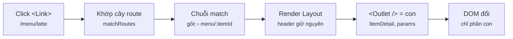
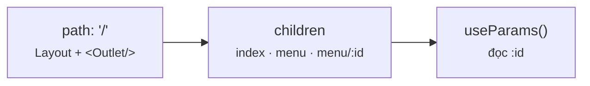
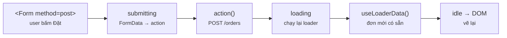
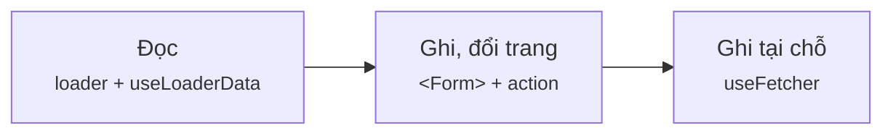
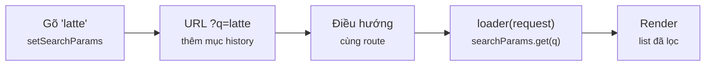
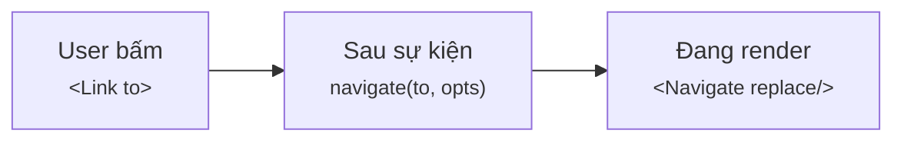
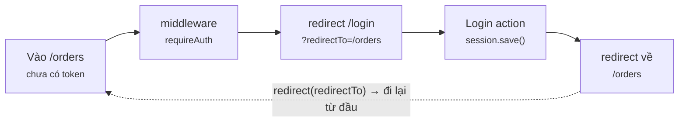
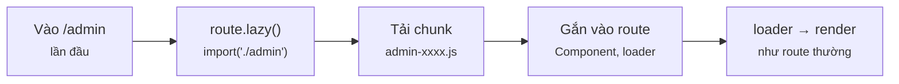
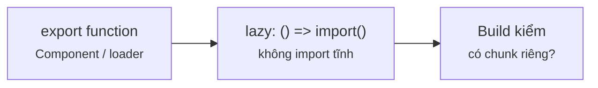

# Module 4 · Routing

_React Router: route lồng nhau · loader/action · URL làm state · bảo vệ route · lazy_

**Đã chạy với:** Node 22.22.0 · TypeScript 7.0.2 · React 19.3.1 · react-dom 19.3.1 · React Router 8.4.0 · esbuild 0.28.2 · jsdom 29.1.1 · tsx 4.23.15

React Router chạy thật trong Node + jsdom (DOM giả) bằng `createMemoryRouter`: cùng router, cùng API với `createBrowserRouter`, chỉ khác lịch sử URL nằm trong bộ nhớ thay vì thanh địa chỉ. `m4/api.ts` là **server giả** (in-memory, trễ 20ms, ghi log mọi request). Số **ms** là đo thật lúc build — chạy lại sẽ lệch vài ms, thứ tự thì không đổi. Bài 4.5 bundle bằng esbuild thật → số **byte** là thật.

Vị trí: Đã học Module 3 · State mức app (Context · Zustand · Redux Toolkit) · **Đang học Module 4** · Sắp tới Module 5 · Data fetching thực chiến (TanStack Query, form actions)

## Bài 4.1 · Route cơ bản → lồng nhau → động

_Nguồn roadmap: [Academind] Defining Routes → Layouts & Nested Routes → NavLink → Dynamic Routes → Relative & Absolute Paths → Index Routes · [BigReact] Page Routes → Route Links → NavLink → Outlet → Index → useParams_

### 1 · Một câu & nằm ở đâu
Route là **bảng ánh xạ URL → cây component**. Route cha giữ khung chung (header, sidebar) và chừa 1 lỗ `<Outlet />` cho route con. Đổi URL **không** tải lại trang: router chỉ thay phần con khớp mới.

**[URL đổi]** → **[Khớp route]** → Tải code (lazy) → Middleware (guard) → Loader / action → **[Render + Outlet]**

<details><summary>m4/dom.ts — DOM giả dùng cho mọi ví dụ</summary>

`m4/dom.ts`

```tsx
// Giả lập trình duyệt trong Node để React + React Router chạy thật (không cần mở Chrome)
import { JSDOM } from "jsdom";

const dom = new JSDOM('<!doctype html><div id="root"></div>', { url: "http://cafe.local/" });
Object.assign(globalThis, {
  window: dom.window,
  document: dom.window.document,
  HTMLElement: dom.window.HTMLElement,
  localStorage: dom.window.localStorage,
  FormData: dom.window.FormData,  // <Form> đọc ô input bằng FormData của DOM
  IS_REACT_ACT_ENVIRONMENT: true, // cho phép dùng act() ngoài test runner
});

export const root = dom.window.document.getElementById("root")!;
export const wait = (ms: number) => new Promise((r) => setTimeout(r, ms));
let t0 = Date.now();
export const resetClock = () => { t0 = Date.now(); };                 // đặt mốc 0ms
export const ms = () => `${String(Date.now() - t0).padStart(3)}ms`;   // thời gian thật từ mốc

// Đếm số lần render/mount theo tên
export const renders: Record<string, number> = {};
export const track = (name: string) => { renders[name] = (renders[name] ?? 0) + 1; };

// Bấm vào <a> có đúng chữ đó (giống người dùng click link)
export function clickLink(text: string) {
  const a = [...root.querySelectorAll("a")].find((x) => x.textContent === text);
  if (!a) throw new Error(`không thấy link "${text}"`);
  a.dispatchEvent(new window.MouseEvent("click", { bubbles: true, cancelable: true, button: 0 }));
}
```

</details>

### 2 · Concept
| Mảnh | Vai trò | Bên C# |
|---|---|---|
| `createBrowserRouter([...])` + `<RouterProvider>` | Khai báo cây route 1 chỗ, gắn vào app | Route table trong `Program.cs` |
| `children` + `<Outlet />` | Route con render **vào trong** layout của cha | `_Layout.cshtml` + `@RenderBody()` |
| `{ index: true }` | Con mặc định khi URL dừng đúng ở cha (`/`) | Default action |
| `path: "menu/:itemId"` + `useParams()` | Đoạn động trong URL → biến | `[Route("menu/{itemId}")]` |
| `<Link>` / `<NavLink>` | Điều hướng không reload; NavLink tự thêm class `active` | `asp-route` tag helper |
| `to="latte"` vs `to="/latte"` | Không có `/` = **tương đối** route hiện tại; có `/` = từ gốc | `~/` vs đường dẫn tương đối |

### 3 · Flow / lifecycle
**URL đổi thì router làm gì?**



Đọc sơ đồ: Trái → phải: URL mới được so với cây route, ra 1 CHUỖI match từ gốc tới lá. Mỗi route trong chuỗi render component của nó; cha đặt con vào chỗ `<Outlet />`. Chỉ phần khác so với trước bị vẽ lại.

### 4 · Ví dụ thực tế
**Ví dụ 1.** Layout + index + route động. Đi qua 4 URL, in chuỗi route khớp và màn hình.

`m4/l41-nested.tsx`

```tsx
import { root } from "./dom";
import { act } from "react";
import { createRoot } from "react-dom/client";
import { createMemoryRouter, Outlet, RouterProvider, useParams } from "react-router";

function Layout() {                                   // khung chung: header + chỗ trống cho con
  return <div>[☕ Header] <Outlet /></div>;
}
const Home = () => <p>Trang chủ</p>, MenuList = () => <p>Danh sách món</p>;
function ItemDetail() {
  const { itemId } = useParams();                     // lấy :itemId từ URL
  return <p>Chi tiết món: {itemId}</p>;
}

const router = createMemoryRouter([
  {
    path: "/", element: <Layout />, children: [
      { index: true, element: <Home /> },              // khớp đúng "/"
      { path: "menu", element: <MenuList /> },
      { path: "menu/:itemId", element: <ItemDetail /> },
    ],
  },
]);

await act(() => createRoot(root).render(<RouterProvider router={router} />));
for (const url of ["/", "/menu", "/menu/latte", "/menu/mocha"]) {
  await act(() => router.navigate(url));
  const chain = router.state.matches.map((m) => m.route.path ?? "(index)").join(" › ");
  console.log(`${url.padEnd(12)} khớp: ${chain.padEnd(18)} → ${root.textContent}`);
}
```

```console
❯ npx tsx m4/l41-nested.tsx
/            khớp: / › (index)        → [☕ Header] Trang chủ
/menu        khớp: / › menu           → [☕ Header] Danh sách món
/menu/latte  khớp: / › menu/:itemId   → [☕ Header] Chi tiết món: latte
/menu/mocha  khớp: / › menu/:itemId   → [☕ Header] Chi tiết món: mocha
```

`/` khớp **2** route: Layout + index. `/menu/latte` và `/menu/mocha` cùng 1 route, khác `itemId`. Header nằm ở cha nên có ở mọi trang mà không component con nào phải tự vẽ.

**Ví dụ 2.** `NavLink` tự biết mình đang "active"; `Link to="latte"` là đường dẫn tương đối. Đếm số lần Layout **mount**.

`m4/l41-navlink.tsx`

```tsx
import { root, track, renders, clickLink } from "./dom";
import { act, useEffect } from "react";
import { createRoot } from "react-dom/client";
import { createMemoryRouter, Link, NavLink, Outlet, RouterProvider } from "react-router";

function Layout() {
  useEffect(() => track("Layout mount"), []);          // chỉ đếm lần MOUNT, không đếm render
  return <><nav><NavLink to="/" end>Home</NavLink> · <NavLink to="/menu">Menu</NavLink></nav><Outlet /></>;
}
const Menu = () => <ul><li><Link to="latte">Latte</Link></li></ul>;   // relative: /menu + latte

const router = createMemoryRouter([
  { path: "/", element: <Layout />, children: [
    { index: true, element: <p>Home</p> },
    { path: "menu", element: <Menu /> },
    { path: "menu/:id", element: <p>Món đang xem</p> },
  ] },
]);
await act(() => createRoot(root).render(<RouterProvider router={router} />));
const navClass = () => [...root.querySelectorAll("nav a")].map((a) => `${a.textContent}.${a.className || "-"}`).join(" ");
for (const text of ["Menu", "Latte", "Home"]) {
  await act(() => clickLink(text));
  console.log(`click ${text.padEnd(5)} → url=${router.state.location.pathname.padEnd(11)} nav: ${navClass()}`);
}
console.log("Layout mount:", renders["Layout mount"], "lần (không reload trang)");
```

```console
❯ npx tsx m4/l41-navlink.tsx
click Menu  → url=/menu       nav: Home.- Menu.active
click Latte → url=/menu/latte nav: Home.- Menu.active
click Home  → url=/           nav: Home.active Menu.-
Layout mount: 1 lần (không reload trang)
```

Ở `/menu/latte`, `Menu` vẫn active vì NavLink so **tiền tố** URL. `Home` cần `end` để chỉ active đúng ở `/`. Layout mount **1 lần** suốt 3 click: SPA chỉ đổi phần trong Outlet, không tải lại trang.

### 5 · Thử thật / bẫy
**Bẫy 1.** **Quên `<Outlet />`.** Route con vẫn **khớp**, nhưng cha không chừa chỗ → con không hiện, cũng không có lỗi nào.

`m4/l41-trap-outlet.tsx`

```tsx
import { root } from "./dom";
import { act } from "react";
import { createRoot } from "react-dom/client";
import { createMemoryRouter, Outlet, RouterProvider } from "react-router";

const LayoutBad = () => <div>[Header]</div>;                    // ❌ quên <Outlet />
const LayoutGood = () => <div>[Header] <Outlet /></div>;        // ✅

for (const [name, Layout] of [["Bad ", LayoutBad], ["Good", LayoutGood]] as const) {
  const router = createMemoryRouter(
    [{ path: "/", element: <Layout />, children: [{ path: "menu", element: <p>Danh sách món</p> }] }],
    { initialEntries: ["/menu"] },
  );
  const app = createRoot(root);
  await act(() => app.render(<RouterProvider router={router} />));
  const matched = router.state.matches.map((m) => m.route.path).join(" › ");
  console.log(`${name}: khớp ${matched} | màn hình: "${root.textContent}"`);
  await act(() => app.unmount());
}
```

```console
❯ npx tsx m4/l41-trap-outlet.tsx
Bad : khớp / › menu | màn hình: "[Header]"
Good: khớp / › menu | màn hình: "[Header] Danh sách món"
```

Cả 2 đều khớp `/ ` menu›. Thấy layout hiện mà nội dung trang trống → kiểm tra Outlet trước tiên.

**Bẫy 2.** **Tuyệt đối vs tương đối.** Thêm 1 dấu `/` ở đầu là nhảy về gốc.

`m4/l41-trap-abs.tsx`

```tsx
import { root, clickLink } from "./dom";
import { act } from "react";
import { createRoot } from "react-dom/client";
import { createMemoryRouter, Link, Outlet, RouterProvider } from "react-router";

function Menu() {
  return (
    <ul>
      <li><Link to="latte">tương đối</Link></li>      {/* /menu + latte = /menu/latte */}
      <li><Link to="/latte">tuyệt đối</Link></li>     {/* bắt đầu bằng "/" = tính từ gốc */}
    </ul>
  );
}
const routes = [{ path: "/", element: <Outlet />, children: [
  { path: "menu", element: <Menu /> },
  { path: "menu/:id", element: <p>Chi tiết món</p> },
] }];

for (const text of ["tương đối", "tuyệt đối"]) {
  const router = createMemoryRouter(routes, { initialEntries: ["/menu"] });
  const app = createRoot(root);
  await act(() => app.render(<RouterProvider router={router} />));
  await act(() => clickLink(text));
  console.log(`${text.padEnd(9)} → ${router.state.location.pathname.padEnd(11)} | ${root.textContent?.slice(0, 60)}`);
  await act(() => app.unmount());
}
```

```console
❯ npx tsx m4/l41-trap-abs.tsx
tương đối → /menu/latte | Chi tiết món
tuyệt đối → /latte      | Unexpected Application Error!404 Not Found
```

`/latte` không khớp route nào → màn lỗi mặc định `404 Not Found`. Code AI copy link từ trang khác sang hay dính lỗi này khi route được lồng lại.

### 6 · Tóm tắt bằng hình
**(a) Cây thư mục sau bài này**

```text
sandbox/
├─ tsconfig.json  [SỬA]  ← include m4/**
└─ m4/
   ├─ dom.ts  [MỚI]  ← DOM giả + clickLink() + đồng hồ ms
   ├─ api.ts  [MỚI]  ← server giả cho cả module
   ├─ l41-nested.tsx  [MỚI]  ← Layout + Outlet + index + :itemId
   ├─ l41-navlink.tsx  [MỚI]  ← NavLink active, Link tương đối
   ├─ l41-trap-outlet.tsx  [MỚI]  ← quên Outlet → con biến mất
   └─ l41-trap-abs.tsx  [MỚI]  ← /latte vs latte
```

**(b) Đọc trong 10 giây**

**Cây route đọc thế nào?**



Đọc sơ đồ: Cha = khung, Outlet = lỗ, con = nội dung theo URL.

### 7 · Làm ngay (≤ 10 phút)
**Mục tiêu:** Thêm route `orders/:orderId` vào `m4/ex/ex41-start.tsx`, trang hiện `Đơn #<orderId>`.

File khởi đầu:

`m4/ex/ex41-start.tsx`

```tsx
import { root } from "../dom";
import { act } from "react";
import { createRoot } from "react-dom/client";
import { createMemoryRouter, Outlet, RouterProvider } from "react-router";

const Layout = () => <div>[☕] <Outlet /></div>;
const Orders = () => <p>Tất cả đơn</p>;
// TODO 1: viết OrderDetail đọc :orderId bằng useParams, hiển thị "Đơn #<orderId>"

const router = createMemoryRouter([
  { path: "/", element: <Layout />, children: [
    { index: true, element: <p>Home</p> },
    { path: "orders", element: <Orders /> },
    // TODO 2: thêm route con "orders/:orderId" → <OrderDetail />
  ] },
]);

await act(() => createRoot(root).render(<RouterProvider router={router} />));
for (const url of ["/orders", "/orders/A12"]) {
  await act(() => router.navigate(url));
  console.log(`${url.padEnd(11)} → ${root.textContent}`);
}
```

Chạy file khởi đầu (đang đỏ):

```console
❯ npx tsx m4/ex/ex41-start.tsx
/orders     → [☕] Tất cả đơn
/orders/A12 → Unexpected Application Error!404 Not Found
```

Tiêu chí nghiệm thu:

- [ ] Dòng 2 ra `/orders/A12 → [☕] Đơn #A12` (có header của Layout)
- [ ] Dòng 1 vẫn `/orders → [☕] Tất cả đơn`
- [ ] `npx tsc -p .` không báo lỗi

Lệnh nghiệm thu:

```bash
npx tsx m4/ex/ex41-start.tsx && npx tsc -p .
```

Lời giải tham chiếu chạy ra (output cần đạt):

```console
❯ npx tsx m4/ex/ex41-solution.tsx
/orders     → [☕] Tất cả đơn
/orders/A12 → [☕] Đơn #A12
```

<details><summary>Gợi ý nếu bị đỏ</summary>

| Triệu chứng | Nguyên nhân | Sửa |
|---|---|---|
| Vẫn `404 Not Found` | Route chưa nằm trong `children` của `/` | Thêm `{ path: "orders/:orderId", element: <OrderDetail /> }` vào mảng children |
| Ra `Đơn #` trống | Tên trong `useParams` khác tên trong path | Path `:orderId` ↔ `const { orderId } = useParams()` |
| Mất `[☕]` | Route để ngang hàng `/` thay vì làm con | Đặt vào `children` để render trong Outlet của Layout |

`m4/ex/ex41-start.tsx` (diff)

```diff
 import { act } from "react";
 import { createRoot } from "react-dom/client";
-import { createMemoryRouter, Outlet, RouterProvider } from "react-router";
+import { createMemoryRouter, Outlet, RouterProvider, useParams } from "react-router";
 
 const Layout = () => <div>[☕] <Outlet /></div>;
 const Orders = () => <p>Tất cả đơn</p>;
-// TODO 1: viết OrderDetail đọc :orderId bằng useParams, hiển thị "Đơn #<orderId>"
+function OrderDetail() {
+  const { orderId } = useParams();
+  return <p>Đơn #{orderId}</p>;
+}
 
 const router = createMemoryRouter([
     { index: true, element: <p>Home</p> },
     { path: "orders", element: <Orders /> },
-    // TODO 2: thêm route con "orders/:orderId" → <OrderDetail />
+    { path: "orders/:orderId", element: <OrderDetail /> },
   ] },
 ]);
```

</details>

### 8 · 3 câu hỏi nhanh
1. URL `/` khớp những route nào trong cây `{ path: "/", children: [{ index: true }, { path: "menu" }] }`?

   <details><summary>Đáp án</summary>

   2 route: cha `/` **và** con `index`. Router luôn trả về **chuỗi** từ gốc tới lá; mỗi tầng render 1 component, lồng qua Outlet.

   </details>

2. Vì sao `<NavLink to="/">` cần `end`?

   <details><summary>Đáp án</summary>

   NavLink active khi URL **bắt đầu bằng** `to`. Mọi URL đều bắt đầu bằng `/` → Home luôn active. `end` bắt phải khớp đúng tới cuối.

   </details>

3. Đổi từ `/menu/latte` sang `/menu/mocha`: `ItemDetail` mount lại hay chỉ render lại?

   <details><summary>Đáp án</summary>

   Chỉ render lại với `itemId` mới — cùng route, cùng vị trí trong cây. Vì vậy state cục bộ trong ItemDetail **được giữ**; nếu muốn reset theo id thì gắn `key={itemId}` (bài 1.3).

   </details>


---

## Bài 4.2 · Loader & action: dữ liệu đi cùng route

_Nguồn roadmap: [Academind] Data Fetching with a loader() → When Are loader() Functions Executed? → Custom Errors → action() → useFetcher() → Deferring · [Modern] Loaders → Client Loader → Actions → Form Validation · [BigReact] New Way of Data Loading → useNavigation → Sending Data with Action_

### 1 · Một câu & nằm ở đâu
**Loader** = hàm lấy dữ liệu gắn vào route, chạy **trước** khi render, các loader trong chuỗi match chạy **song song**. **Action** = hàm nhận `<Form method="post">`; xong action, router **tự chạy lại loader** để màn hình khớp server. Component chỉ việc đọc `useLoaderData()`.

URL đổi → Khớp route → Tải code (lazy) → Middleware (guard) → **[Loader / action]** → **[Render + Outlet]**

<details><summary>m4/api.ts — server giả: trễ 20ms, ghi log mọi request</summary>

`m4/api.ts`

```tsx
// API giả cho cả module: in-memory, trễ 20ms, cùng hợp đồng Promise như fetch thật
export type Item = { id: string; name: string; price: number };
export type Order = { id: string; item: string; qty: number };

const menu: Item[] = [
  { id: "latte", name: "Latte", price: 45000 },
  { id: "mocha", name: "Mocha", price: 50000 },
  { id: "cold-brew", name: "Cold Brew", price: 55000 },
  { id: "matcha", name: "Matcha Latte", price: 52000 },
];
const orders: Order[] = [{ id: "A1", item: "latte", qty: 2 }];
export const log: string[] = [];                         // server ghi lại mọi request
const delay = <T>(v: () => T, ms = 20) =>
  new Promise<T>((ok, fail) => setTimeout(() => { try { ok(v()); } catch (e) { fail(e); } }, ms));

export const getMenu = (q = "") => {
  log.push(`GET /menu?q=${q}`);
  return delay(() => menu.filter((m) => m.name.toLowerCase().includes(q.toLowerCase())));
};
export const getItem = (id: string) => { log.push(`GET /menu/${id}`); return delay(() => menu.find((m) => m.id === id)); };
export const getOrders = (token?: string | null) => {
  log.push(`GET /orders ${token ? "🔑" : "(không token)"}`);
  return delay(() => { if (token !== "tok-huy") throw new Error("401 Unauthorized"); return [...orders]; });
};
export const createOrder = (item: string, qty: number) => {
  log.push(`POST /orders ${item}×${qty}`);
  return delay(() => { const o = { id: `A${orders.length + 1}`, item, qty }; orders.push(o); return o; });
};
export const login = (user: string, pass: string) =>
  delay(() => (user === "huy" && pass === "123" ? "tok-huy" : null));
```

</details>

### 2 · Concept
| Mảnh | Vai trò | Bên C# |
|---|---|---|
| `loader({ params, request })` | Lấy dữ liệu cho route, **trước** render; cả chuỗi chạy song song | `OnGetAsync()` của Razor Page |
| `useLoaderData<typeof loader>()` | Đọc kết quả, kiểu suy ra từ loader | `@Model` |
| `action({ request })` + `<Form method="post">` | Nhận form, ghi dữ liệu; xong → **revalidate** mọi loader | `OnPostAsync()` + PRG |
| `useNavigation().state` | `idle` → `submitting` → `loading` → `idle` | — |
| `throw data(msg, { status })` + `ErrorBoundary` | Dừng ở loader/action, hiện UI lỗi của route đó | `return NotFound()` + error page |
| `useFetcher()` | Gọi action/loader **không** đổi URL (nút like, +1 nhanh) | AJAX tới handler |
| `useActionData()` | Đọc giá trị action **trả về** (lỗi validate) | `ModelState` |

### 3 · Flow / lifecycle
**Bấm "Đặt" trong <Form> thì chuyện gì xảy ra?**



Đọc sơ đồ: Trái → phải: Form chặn submit của trình duyệt, gửi FormData cho action của route (submitting). Action ghi server. Router tự gọi lại loader (loading) để dữ liệu trên màn hình không cũ, rồi render. Không có dòng setState nào do bạn viết.

### 4 · Ví dụ thực tế
**Ví dụ 1.** Route cha `/menu` và con `:itemId` đều có loader. Theo dõi mốc thời gian thật.

`m4/l42-loader.tsx`

```tsx
import { root, ms, resetClock } from "./dom";
import { getMenu, getItem } from "./api";
import { act } from "react";
import { createRoot } from "react-dom/client";
import { createMemoryRouter, Outlet, RouterProvider, useLoaderData, type LoaderFunctionArgs } from "react-router";

async function menuLoader() {                                   // chạy TRƯỚC khi render
  console.log(`${ms()} loader menu   bắt đầu`); return { items: await getMenu() };
}
async function itemLoader({ params }: LoaderFunctionArgs) {     // params = :itemId trong URL
  console.log(`${ms()} loader item   bắt đầu (${params.itemId})`);
  return { item: await getItem(params.itemId!) };
}
function Menu() {
  const { items } = useLoaderData<typeof menuLoader>();          // kiểu suy ra từ loader
  console.log(`${ms()} render Menu   (${items.length} món sẵn rồi)`);
  return <div>Menu {items.length} món | <Outlet /></div>;
}
function Item() {
  const { item } = useLoaderData<typeof itemLoader>();
  console.log(`${ms()} render Item   (${item?.name})`); return <b>{item?.name} {item?.price}đ</b>;
}

const router = createMemoryRouter([{ path: "/menu", loader: menuLoader, Component: Menu,
  children: [{ path: ":itemId", loader: itemLoader, Component: Item }] }], { initialEntries: ["/"] });
router.subscribe((s) => console.log(`${ms()} navigation: ${s.navigation.state}`));

await act(() => createRoot(root).render(<RouterProvider router={router} />)); resetClock();
await act(() => router.navigate("/menu/mocha"));
console.log(`${ms()} màn hình: ${root.textContent}`);
```

```console
❯ npx tsx m4/l42-loader.tsx
  5ms navigation: loading
  7ms loader menu   bắt đầu
  8ms loader item   bắt đầu (mocha)
 30ms navigation: idle
 34ms render Menu   (4 món sẵn rồi)
 35ms render Item   (Mocha)
 41ms màn hình: Menu 4 món | Mocha 50000đ
```

2 loader bắt đầu **cùng 1 mốc** (song song), component chỉ render sau khi `navigation: idle` — lúc render đã có đủ dữ liệu, không có trạng thái "đang tải" nào trong component. `params.itemId` đến thẳng từ URL.

**Ví dụ 2.** `<Form method="post">` + `action`. Không `useState`, không `onSubmit`, không `fetch` lại danh sách bằng tay.

`m4/l42-action.tsx`

```tsx
import { root, ms, resetClock, wait } from "./dom";
import { createOrder, getOrders } from "./api";
import { act } from "react";
import { createRoot } from "react-dom/client";
import { createMemoryRouter, Form, RouterProvider, useLoaderData, type ActionFunctionArgs } from "react-router";

const ordersLoader = async () => ({ orders: await getOrders("tok-huy") });
async function ordersAction({ request }: ActionFunctionArgs) {      // nhận POST từ <Form>
  const fd = await request.formData();
  console.log(`${ms()} action nhận: item=${fd.get("item")} qty=${fd.get("qty")}`);
  await createOrder(String(fd.get("item")), Number(fd.get("qty")));
  return null;                                   // xong action → router tự chạy lại loader
}
function Orders() {
  const { orders } = useLoaderData<typeof ordersLoader>();
  return <>
    <p>{orders.map((o) => `${o.id}:${o.item}×${o.qty}`).join(" ")}</p>
    <Form method="post"><input name="item" defaultValue="mocha" /><input name="qty" defaultValue="3" /><button>Đặt</button></Form>
  </>;
}
const router = createMemoryRouter([{ path: "/orders", loader: ordersLoader, action: ordersAction,
  Component: Orders, HydrateFallback: () => <p>⏳</p> }], { initialEntries: ["/orders"] });

await act(() => createRoot(root).render(<RouterProvider router={router} />));
await act(() => wait(40));
console.log(`trước   : ${root.querySelector("p")!.textContent}`);
router.subscribe((s) => console.log(`${ms()} navigation: ${s.navigation.state}`));
resetClock();
await act(async () => { root.querySelector("form")!.requestSubmit(); await wait(80); });   // user bấm "Đặt"
console.log(`sau     : ${root.querySelector("p")!.textContent}`);
```

```console
❯ npx tsx m4/l42-action.tsx
trước   : A1:latte×2
 10ms navigation: submitting
 15ms action nhận: item=mocha qty=3
 37ms navigation: loading
 59ms navigation: idle
sau     : A1:latte×2 A2:mocha×3
```

Thứ tự `submitting → loading → idle` đúng như sơ đồ. Bước `loading` là router **tự** gọi lại `ordersLoader` nên `A2` hiện ra. Đây là pattern Post/Redirect/Get quen thuộc bên ASP.NET, nhưng không reload trang.

**Ví dụ 3.** Nút "+1" trên từng dòng menu: gọi action mà **không** rời trang → `useFetcher`.

`m4/l42-fetcher.tsx`

```tsx
import { root, ms, resetClock, wait } from "./dom";
import { createOrder, getMenu } from "./api";
import { act } from "react";
import { createRoot } from "react-dom/client";
import { createMemoryRouter, RouterProvider, useFetcher, useLoaderData, type ActionFunctionArgs } from "react-router";

const menuLoader = async () => ({ items: await getMenu() });
async function quickOrder({ request }: ActionFunctionArgs) {
  const fd = await request.formData();
  return await createOrder(String(fd.get("item")), 1);           // trả về → fetcher.data
}
function Row({ id }: { id: string }) {
  const fetcher = useFetcher<typeof quickOrder>();                // mỗi dòng 1 fetcher riêng
  return <fetcher.Form method="post" action="/quick">
    <input name="item" defaultValue={id} /><button>[+1 {id}]</button>{fetcher.data ? ` ← đã đặt ${fetcher.data.id} ` : " "}
  </fetcher.Form>;
}
const Menu = () => <>{useLoaderData<typeof menuLoader>().items.slice(0, 2).map((i) => <Row key={i.id} id={i.id} />)}</>;
const router = createMemoryRouter([
  { path: "/menu", loader: menuLoader, Component: Menu, HydrateFallback: () => null },
  { path: "/quick", action: quickOrder },                          // route chỉ có action, không UI
], { initialEntries: ["/menu"] });
await act(() => createRoot(root).render(<RouterProvider router={router} />));
await act(() => wait(40));
router.subscribe((s) => console.log(`${ms()} navigation=${s.navigation.state} | fetcher=${[...s.fetchers.values()].map((f) => f.state).join(",") || "-"}`));
resetClock();
await act(async () => { root.querySelector("form")!.requestSubmit(); await wait(80); });     // bấm +1 ở dòng latte
console.log(`URL vẫn: ${router.state.location.pathname} | màn hình: ${root.textContent}`);
```

```console
❯ npx tsx m4/l42-fetcher.tsx
 15ms navigation=idle | fetcher=submitting
 45ms navigation=idle | fetcher=loading
 67ms navigation=idle | fetcher=idle
URL vẫn: /menu | màn hình: [+1 latte] ← đã đặt A2 [+1 mocha]
```

`navigation` đứng yên `idle` suốt — chỉ fetcher đi `submitting → loading → idle`. URL không đổi, history không thêm mục. Mỗi dòng có fetcher riêng nên bấm 2 dòng cùng lúc không đè nhau.

### 5 · Thử thật / bẫy
**Bẫy 1.** **Fetch trong `useEffect` thay vì loader → thác nước (waterfall).** Con chỉ bắt đầu fetch sau khi cha fetch xong **và** render.

`m4/l42-trap-waterfall.tsx`

```tsx
import { root, ms, resetClock, wait } from "./dom";
import { getItem, getMenu, type Item } from "./api";
import { useEffect, useState } from "react";
import { createRoot } from "react-dom/client";
import { createMemoryRouter, Outlet, RouterProvider, useParams } from "react-router";

// ❌ kiểu "cũ": mỗi component tự fetch trong useEffect SAU KHI render
function Menu() {
  const [items, setItems] = useState<Item[] | null>(null);
  useEffect(() => { console.log(`${ms()} effect Menu fetch`); getMenu().then(setItems); }, []);
  if (!items) return <p>⏳ menu…</p>;                     // con chưa render → con chưa fetch
  return <div>{items.length} món | <Outlet /></div>;
}
function Detail() {
  const { id } = useParams();
  const [item, setItem] = useState<Item>();
  useEffect(() => { console.log(`${ms()} effect Detail fetch`); getItem(id!).then((x) => { console.log(`${ms()} Detail có dữ liệu`); setItem(x); }); }, [id]);
  return <b>{item?.name ?? "⏳"}</b>;
}
const router = createMemoryRouter([{ path: "/menu", Component: Menu, children: [{ path: ":id", Component: Detail }] }],
  { initialEntries: ["/"] });
Object.assign(globalThis, { IS_REACT_ACT_ENVIRONMENT: false });   // render như trình duyệt thật, không gom bằng act()
createRoot(root).render(<RouterProvider router={router} />);
await wait(20); resetClock();
await router.navigate("/menu/mocha");
await wait(120);
console.log(`màn hình: ${root.textContent}`);
```

```console
❯ npx tsx m4/l42-trap-waterfall.tsx
 15ms effect Menu fetch
 40ms effect Detail fetch
 61ms Detail có dữ liệu
màn hình: 4 món | Mocha
```

So với ví dụ 1: ở đó 2 loader xuất phát **cùng mốc**; ở đây `Detail` phải chờ `Menu` xong mới bắt đầu → tổng thời gian gần gấp đôi, cộng thêm màn `⏳` nhấp nháy. Code AI kiểu "useState + useEffect + fetch" là dấu hiệu này (bảng 13.2 trong roadmap).

**Bẫy 2.** **`throw` lỗi validate trong action.** Throw là "lỗi hệ thống" → ErrorBoundary thay **cả trang**, form và chữ user gõ biến mất.

`m4/l42-trap-throw.tsx`

```tsx
import { root, wait } from "./dom";
import { act } from "react";
import { createRoot } from "react-dom/client";
import { createMemoryRouter, data, Form, RouterProvider, useActionData, type ActionFunctionArgs } from "react-router";

async function actionBad({ request }: ActionFunctionArgs) {
  const qty = Number((await request.formData()).get("qty"));
  if (qty < 1) throw new Error("Số lượng phải ≥ 1");                 // ❌ throw → errorElement thay CẢ trang
  return { ok: true };
}
async function actionGood({ request }: ActionFunctionArgs) {
  const qty = Number((await request.formData()).get("qty"));
  if (qty < 1) return data({ error: "Số lượng phải ≥ 1" }, { status: 400 });   // ✅ trả lỗi về form
  return { ok: true };
}
function OrderForm() {
  const res = useActionData<{ error?: string }>();
  return <Form method="post">[Form đặt món] <input name="qty" defaultValue="0" /><button>Đặt</button> {res?.error}</Form>;
}
for (const [name, action] of [["throw ", actionBad], ["return", actionGood]] as const) {
  const router = createMemoryRouter([{ path: "/", action, Component: OrderForm,
    ErrorBoundary: () => <p>💥 Trang lỗi (form mất, chữ user gõ mất)</p> }]);
  const app = createRoot(root);
  await act(() => app.render(<RouterProvider router={router} />));
  await act(async () => { root.querySelector("form")!.requestSubmit(); await wait(30); });
  console.log(`${name}: ${root.textContent}`);
  await act(() => app.unmount());
}
```

```console
❯ npx tsx m4/l42-trap-throw.tsx
throw : 💥 Trang lỗi (form mất, chữ user gõ mất)
return: [Form đặt món] Đặt Số lượng phải ≥ 1
```

Lỗi người dùng sửa được (thiếu ô, sai số) → `return data({ error }, { status: 400 })` rồi đọc bằng `useActionData`. Chỉ `throw` khi trang thật sự không hiển thị nổi (404, 500).

### 6 · Tóm tắt bằng hình
**(a) Cây thư mục sau bài này**

```text
sandbox/m4/
├─ dom.ts  [SỬA]  ← thêm FormData của DOM, resetClock()
├─ l42-loader.tsx  [MỚI]  ← loader cha + con chạy song song
├─ l42-action.tsx  [MỚI]  ← Form → action → revalidate
├─ l42-fetcher.tsx  [MỚI]  ← useFetcher: không đổi URL
├─ l42-trap-waterfall.tsx  [MỚI]  ← useEffect fetch nối đuôi
└─ l42-trap-throw.tsx  [MỚI]  ← throw vs return lỗi validate
```

**(b) Đọc trong 10 giây**

**Đọc / ghi dữ liệu route bằng gì?**



Đọc sơ đồ: Đọc = loader. Ghi có đổi trang = Form + action. Ghi tại chỗ = fetcher.

### 7 · Làm ngay (≤ 10 phút)
**Mục tiêu:** `m4/ex/ex42-start.tsx`: mở món không tồn tại thì app vỡ ở component. Cho loader `throw` 404 và thêm `ErrorBoundary` hiện `404 · Không có món <id>`.

File khởi đầu:

`m4/ex/ex42-start.tsx`

```tsx
import { root, wait } from "../dom";
import { getItem } from "../api";
import { act } from "react";
import { createRoot } from "react-dom/client";
import { createMemoryRouter, RouterProvider, useLoaderData, type LoaderFunctionArgs } from "react-router";

async function itemLoader({ params }: LoaderFunctionArgs) {
  const item = await getItem(params.id!);
  // TODO 1: không có món → throw data(`Không có món ${params.id}`, { status: 404 })
  return { item: item! };
}
function Item() {
  const { item } = useLoaderData<typeof itemLoader>();
  return <p>{item.name}: {item.price}đ</p>;
}
// TODO 2: ErrorBoundary dùng useRouteError + isRouteErrorResponse → hiện "<status> · <data>"

const router = createMemoryRouter([{ path: "/menu/:id", loader: itemLoader, Component: Item, HydrateFallback: () => null }], { initialEntries: ["/menu/latte"] });
await act(() => createRoot(root).render(<RouterProvider router={router} />));
for (const url of ["/menu/latte", "/menu/tra-sua"]) {
  await act(async () => { await router.navigate(url); await wait(30); });
  console.log(`${url.padEnd(14)} → ${root.textContent?.slice(0, 70)}`);
}
```

Chạy file khởi đầu (đang đỏ):

```console
❯ npx tsx m4/ex/ex42-start.tsx 2>&1 | grep "→"
/menu/latte    → Latte: 45000đ
/menu/tra-sua  → Unexpected Application Error!Cannot read properties of undefined (read
```

Tiêu chí nghiệm thu:

- [ ] Dòng 2 ra `/menu/tra-sua → 404 · Không có món tra-sua`
- [ ] Dòng 1 vẫn `Latte: 45000đ`
- [ ] Trong `Item`, `item` có kiểu `Item` (không còn dấu `!`); `npx tsc -p .` không báo lỗi

Lệnh nghiệm thu:

```bash
npx tsx m4/ex/ex42-start.tsx && npx tsc -p .
```

Lời giải tham chiếu chạy ra (output cần đạt):

```console
❯ npx tsx m4/ex/ex42-solution.tsx
/menu/latte    → Latte: 45000đ
/menu/tra-sua  → 404 · Không có món tra-sua
```

<details><summary>Gợi ý nếu bị đỏ</summary>

| Triệu chứng | Nguyên nhân | Sửa |
|---|---|---|
| Vẫn `Cannot read properties of undefined` | Loader vẫn `return` khi không có món | `if (!item) throw data(…, { status: 404 })` **trước** `return` |
| Ra `Unexpected Application Error!` | Chưa gắn ErrorBoundary vào route | Thêm `ErrorBoundary: ItemError` cạnh `Component` |
| Ra `Lỗi không xác định` | `throw new Error()` thay vì `throw data()` | `isRouteErrorResponse` chỉ nhận lỗi tạo bằng `data()` (có status) |

`m4/ex/ex42-start.tsx` (diff)

```diff
 import { act } from "react";
 import { createRoot } from "react-dom/client";
-import { createMemoryRouter, RouterProvider, useLoaderData, type LoaderFunctionArgs } from "react-router";
+import { createMemoryRouter, data, isRouteErrorResponse, RouterProvider, useLoaderData, useRouteError, type LoaderFunctionArgs } from "react-router";
 
 async function itemLoader({ params }: LoaderFunctionArgs) {
   const item = await getItem(params.id!);
-  // TODO 1: không có món → throw data(`Không có món ${params.id}`, { status: 404 })
-  return { item: item! };
+  if (!item) throw data(`Không có món ${params.id}`, { status: 404 });   // ✅ dừng ở loader
+  return { item };                                                       // ✅ item: Item (hết undefined)
 }
 function Item() {
   return <p>{item.name}: {item.price}đ</p>;
 }
-// TODO 2: ErrorBoundary dùng useRouteError + isRouteErrorResponse → hiện "<status> · <data>"
+function ItemError() {
+  const err = useRouteError();
+  return <p>{isRouteErrorResponse(err) ? `${err.status} · ${err.data}` : "Lỗi không xác định"}</p>;
+}
 
-const router = createMemoryRouter([{ path: "/menu/:id", loader: itemLoader, Component: Item, HydrateFallback: () => null }], { initialEntries: ["/menu/latte"] });
+const router = createMemoryRouter([{ path: "/menu/:id", loader: itemLoader, Component: Item, ErrorBoundary: ItemError, HydrateFallback: () => null }], { initialEntries: ["/menu/latte"] });
 await act(() => createRoot(root).render(<RouterProvider router={router} />));
 for (const url of ["/menu/latte", "/menu/tra-sua"]) {
```

</details>

### 8 · 3 câu hỏi nhanh
1. Route cha và con đều có loader. Chúng chạy nối tiếp hay song song? Vì sao quan trọng?

   <details><summary>Đáp án</summary>

   Song song (ví dụ 1: cùng mốc ms). Đây là lý do loader nhanh hơn useEffect: không phải chờ cha render xong con mới fetch.

   </details>

2. Sau khi action chạy xong, làm sao danh sách trên màn hình có đơn mới?

   <details><summary>Đáp án</summary>

   Router tự **revalidate**: gọi lại loader của các route đang hiện (bước `loading`). Không cần `setState` hay refetch tay.

   </details>

3. Khi nào dùng `useFetcher` thay `<Form>`?

   <details><summary>Đáp án</summary>

   Khi thao tác **không** nên đổi URL / thêm mục vào history: like, +1, đánh dấu đã đọc, autosave. Form thường = điều hướng (POST rồi ở lại/chuyển trang).

   </details>


---

## Bài 4.3 · Query params, location, navigate: URL làm state

_Nguồn roadmap: [BigReact] How useSearchParams Hook Works → How useLocation Hook Works → How useNavigate Hook Works → How the Navigate Component Works → Link vs Navigate vs useNavigate_

### 1 · Một câu & nằm ở đâu
Thứ gì user muốn **giữ khi Back / reload / gửi link** (ô tìm, filter, trang số mấy) thì để trên URL bằng `useSearchParams`, không phải `useState`. Điều hướng: `<Link>` khi user bấm, `useNavigate()` sau 1 sự kiện trong code, `<Navigate>` khi đang render mà phải chuyển trang.

**[URL đổi]** → Khớp route → Tải code (lazy) → Middleware (guard) → **[Loader / action]** → **[Render + Outlet]**

### 2 · Concept
| Công cụ | Dùng khi | Bên C# |
|---|---|---|
| `useSearchParams()` | Đọc/ghi `?q=latte&page=2`; đổi = 1 lần điều hướng → loader chạy lại | `[FromQuery]` |
| `useLocation()` | `pathname`, `search`, `state` (dữ liệu kèm, **không** lên URL) | `HttpContext.Request` |
| `<Link to>` | User bấm để đi | `<a asp-page>` |
| `useNavigate()(to, opts)` | Trong event handler / effect: sau khi submit, timeout… | `RedirectToAction` trong handler |
| `<Navigate to replace />` | Ngay lúc render phát hiện phải đi chỗ khác | Middleware redirect |
| `{ replace: true }` | Thay mục hiện tại trong history thay vì thêm | `Location.Replace` |

### 3 · Flow / lifecycle
**Gõ vào ô tìm thì URL và dữ liệu đi đâu?**



Đọc sơ đồ: Trái → phải: setSearchParams không lưu vào state React mà đổi URL; đổi URL = 1 lần điều hướng → loader đọc lại ?q= → render. Vì sống trên URL nên Back, reload, copy link đều giữ nguyên.

### 4 · Ví dụ thực tế
**Ví dụ 1.** Ô tìm món sống trên URL. Gõ → vào chi tiết → bấm Back.

`m4/l43-search.tsx`

```tsx
import { root, wait } from "./dom";
import { getMenu, log } from "./api";
import { act } from "react";
import { createRoot } from "react-dom/client";
import { createMemoryRouter, RouterProvider, useLoaderData, useSearchParams, type LoaderFunctionArgs } from "react-router";

async function menuLoader({ request }: LoaderFunctionArgs) {
  const q = new URL(request.url).searchParams.get("q") ?? "";    // loader đọc ?q= từ URL
  return { items: await getMenu(q) };
}
let setQ!: (q: string) => void;
function Menu() {
  const { items } = useLoaderData<typeof menuLoader>();
  const [params, setParams] = useSearchParams();                  // giống useState, nhưng nằm trong URL
  setQ = (q) => setParams(q ? { q } : {});
  return <p>ô tìm: "{params.get("q") ?? ""}" → {items.map((i) => i.name).join(", ")}</p>;
}
const router = createMemoryRouter([
  { path: "/menu", loader: menuLoader, Component: Menu, HydrateFallback: () => null },
  { path: "/menu/:id", Component: () => <p>chi tiết</p> },
], { initialEntries: ["/menu"] });
const show = (step: string) => console.log(`${step.padEnd(16)} url=${(router.state.location.pathname + router.state.location.search).padEnd(15)} ${root.textContent}`);

await act(() => createRoot(root).render(<RouterProvider router={router} />)); await act(() => wait(30)); show("mở trang");
await act(async () => { setQ("latte"); await wait(30); });  show("gõ 'latte'");
await act(async () => { await router.navigate("/menu/matcha"); }); show("vào chi tiết");
await act(async () => { await router.navigate(-1); await wait(30); }); show("bấm Back");
console.log("server nhận:", log.join(" · "));
```

```console
❯ npx tsx m4/l43-search.tsx
mở trang         url=/menu           ô tìm: "" → Latte, Mocha, Cold Brew, Matcha Latte
gõ 'latte'       url=/menu?q=latte   ô tìm: "latte" → Latte, Matcha Latte
vào chi tiết     url=/menu/matcha    chi tiết
bấm Back         url=/menu?q=latte   ô tìm: "latte" → Latte, Matcha Latte
server nhận: GET /menu?q= · GET /menu?q=latte · GET /menu?q=latte
```

Back về đúng `?q=latte`, ô tìm và danh sách khớp nhau vì cả hai đọc từ **cùng 1 nguồn**: URL. Server log cho thấy loader chạy lại mỗi khi `q` đổi — đúng hợp đồng "URL đổi → dữ liệu đổi".

**Ví dụ 2.** Đặt món xong: chuyển sang trang đơn bằng `navigate(…, { replace, state })`, rồi bấm Back.

`m4/l43-navigate.tsx`

```tsx
import { root, clickLink } from "./dom";
import { act } from "react";
import { createRoot } from "react-dom/client";
import { createMemoryRouter, Link, RouterProvider, useLocation, useNavigate, useParams } from "react-router";

function OrderForm() {
  const navigate = useNavigate();                                  // điều hướng bằng code, SAU 1 sự kiện
  const submit = () => navigate("/orders/A2", { replace: true, state: { flash: "Đặt thành công ☕" } });
  return <button onClick={submit}>Đặt</button>;
}
function OrderDetail() {
  const { id } = useParams();
  const { state } = useLocation();                                 // state đi kèm lần navigate, KHÔNG nằm trên URL
  return <p>Đơn {id} {(state as { flash?: string } | null)?.flash ?? "(không flash)"}</p>;
}
const router = createMemoryRouter([
  { path: "/menu", element: <Link to="/order">Đặt món</Link> },
  { path: "/order", Component: OrderForm },
  { path: "/orders/:id", Component: OrderDetail },
], { initialEntries: ["/menu"] });
const show = (step: string) => console.log(`${step.padEnd(14)} ${router.state.historyAction.padEnd(7)} ${router.state.location.pathname.padEnd(11)} | ${root.textContent}`);

await act(() => createRoot(root).render(<RouterProvider router={router} />));
await act(() => clickLink("Đặt món"));                              show("click Link");
await act(() => root.querySelector("button")!.click());             show("bấm Đặt");
await act(() => router.navigate(-1));                               show("bấm Back");
await act(() => router.navigate("/orders/A2"));                     show("mở lại URL");
```

```console
❯ npx tsx m4/l43-navigate.tsx
click Link     PUSH    /order      | Đặt
bấm Đặt        REPLACE /orders/A2  | Đơn A2 Đặt thành công ☕
bấm Back       POP     /menu       | Đặt món
mở lại URL     PUSH    /orders/A2  | Đơn A2 (không flash)
```

`REPLACE` thay mục `/order` → Back về thẳng `/menu`, không quay lại form vừa submit (tránh đặt trùng). `state.flash` chỉ đi theo **lần điều hướng đó**: mở lại URL thì mất — đúng thứ cần cho thông báo 1 lần, sai chỗ nếu là dữ liệu chính.

### 5 · Thử thật / bẫy
**Bẫy 1.** **Gọi `navigate()` ngay trong lúc render.** Router bỏ qua lời gọi, chỉ in cảnh báo — trang "bảo mật" vẫn hiện.

`m4/l43-trap-render.tsx`

```tsx
import { root } from "./dom";
import { act } from "react";
import { createRoot } from "react-dom/client";
import { createMemoryRouter, Navigate, RouterProvider, useNavigate } from "react-router";

const isLoggedIn = false;
function CheckoutBad() {
  const navigate = useNavigate();
  if (!isLoggedIn) navigate("/login");             // ❌ gọi navigate ngay trong lúc render
  return <p>Thanh toán</p>;
}
function CheckoutGood() {
  if (!isLoggedIn) return <Navigate to="/login" replace />;   // ✅ render ra <Navigate>
  return <p>Thanh toán</p>;
}
for (const [name, Page] of [["Bad ", CheckoutBad], ["Good", CheckoutGood]] as const) {
  const router = createMemoryRouter([
    { path: "/checkout", Component: Page }, { path: "/login", element: <p>Trang login</p> },
  ], { initialEntries: ["/checkout"] });
  const app = createRoot(root);
  await act(() => app.render(<RouterProvider router={router} />));
  console.log(`${name}: url=${router.state.location.pathname} | ${root.textContent}`);
  await act(() => app.unmount());
}
```

```console
❯ npx tsx m4/l43-trap-render.tsx
You should call navigate() in a React.useEffect(), not when your component is first rendered.
Bad : url=/checkout | Thanh toán
Good: url=/login | Trang login
```

Đang render mà phải đổi trang → render `<Navigate replace />`. `useNavigate()` chỉ dùng trong event handler hoặc `useEffect`. (Bảo vệ route đúng cách còn tốt hơn nữa: bài 4.4.)

**Bẫy 2.** **Filter để trong `useState`.** Rời trang là component unmount → state mất; Back về thấy filter trống.

`m4/l43-trap-usestate.tsx`

```tsx
import { root } from "./dom";
import { act, useState } from "react";
import { createRoot } from "react-dom/client";
import { createMemoryRouter, RouterProvider, useSearchParams } from "react-router";

const MENU = ["Latte", "Mocha", "Cold Brew", "Matcha Latte"];
let setFilter!: (q: string) => void;
function MenuState() {                                   // ❌ filter nằm trong useState
  const [q, setQ] = useState("");
  setFilter = setQ;
  return <p>"{q}" → {MENU.filter((m) => m.toLowerCase().includes(q)).join(", ")}</p>;
}
function MenuUrl() {                                     // ✅ filter nằm trên URL
  const [params, setParams] = useSearchParams();
  const q = params.get("q") ?? "";
  setFilter = (v) => setParams({ q: v });
  return <p>"{q}" → {MENU.filter((m) => m.toLowerCase().includes(q)).join(", ")}</p>;
}
for (const [name, Menu] of [["useState       ", MenuState], ["useSearchParams", MenuUrl]] as const) {
  const router = createMemoryRouter([{ path: "/menu", Component: Menu }, { path: "/menu/:id", element: <p>chi tiết</p> }],
    { initialEntries: ["/menu"] });
  const app = createRoot(root);
  await act(() => app.render(<RouterProvider router={router} />));
  await act(() => setFilter("latte"));
  await act(() => router.navigate("/menu/matcha"));
  await act(() => router.navigate(-1));                  // user bấm Back
  console.log(`${name}: sau Back ${root.textContent}`);
  await act(() => app.unmount());
}
```

```console
❯ npx tsx m4/l43-trap-usestate.tsx
useState       : sau Back "" → Latte, Mocha, Cold Brew, Matcha Latte
useSearchParams: sau Back "latte" → Latte, Matcha Latte
```

Quy tắc nhanh: "user có muốn gửi link này cho người khác không?" — có → URL. Modal mở/đóng, hover → `useState`. Ô tìm, filter, sort, tab, page → search params.

### 6 · Tóm tắt bằng hình
**(a) Cây thư mục sau bài này**

```text
sandbox/m4/
├─ l43-search.tsx  [MỚI]  ← ?q= → loader đọc request.url
├─ l43-navigate.tsx  [MỚI]  ← navigate + replace + location.state
├─ l43-trap-render.tsx  [MỚI]  ← navigate() lúc render vs <Navigate>
└─ l43-trap-usestate.tsx  [MỚI]  ← filter mất khi Back
```

**(b) Đọc trong 10 giây**

**Chuyển trang bằng cái nào?**



Đọc sơ đồ: User bấm → Link. Code sau sự kiện → useNavigate. Đang render → `<Navigate>`.

### 7 · Làm ngay (≤ 10 phút)
**Mục tiêu:** Phân trang đơn hàng trong `m4/ex/ex43-start.tsx` đang dùng `useState` nên Back về là quay lại trang 1. Chuyển sang `?page=`.

File khởi đầu:

`m4/ex/ex43-start.tsx`

```tsx
import { root } from "../dom";
import { act, useState } from "react";
import { createRoot } from "react-dom/client";
import { createMemoryRouter, RouterProvider } from "react-router";

const ORDERS = ["A1", "A2", "A3", "A4", "A5", "A6"];
// TODO: thay useState bằng useSearchParams → trang hiện tại nằm ở ?page=, mặc định 1
function Orders() {
  const [page, setPage] = useState(1);
  const rows = ORDERS.slice((page - 1) * 2, page * 2);
  return <p>trang {page}: {rows.join(", ")} <button onClick={() => setPage(page + 1)}>›</button></p>;
}

const router = createMemoryRouter([{ path: "/orders", Component: Orders }, { path: "/orders/:id", element: <p>chi tiết</p> }],
  { initialEntries: ["/orders"] });
await act(() => createRoot(root).render(<RouterProvider router={router} />));
await act(() => root.querySelector("button")!.click());          // sang trang 2
await act(() => router.navigate("/orders/A3"));                  // mở 1 đơn
await act(() => router.navigate(-1));                            // Back
const { pathname, search } = router.state.location;
console.log(`sau Back: ${root.textContent} | url=${pathname}${search}`);
```

Chạy file khởi đầu (đang đỏ):

```console
❯ npx tsx m4/ex/ex43-start.tsx
sau Back: trang 1: A1, A2 › | url=/orders
```

Tiêu chí nghiệm thu:

- [ ] Output ra `sau Back: trang 2: A3, A4 ` | url=/orders?page=2›
- [ ] File không còn `useState`
- [ ] `npx tsc -p .` không báo lỗi

Lệnh nghiệm thu:

```bash
npx tsx m4/ex/ex43-start.tsx && ! grep -q useState m4/ex/ex43-start.tsx && npx tsc -p .
```

Lời giải tham chiếu chạy ra (output cần đạt):

```console
❯ npx tsx m4/ex/ex43-solution.tsx
sau Back: trang 2: A3, A4 › | url=/orders?page=2
```

<details><summary>Gợi ý nếu bị đỏ</summary>

| Triệu chứng | Nguyên nhân | Sửa |
|---|---|---|
| `trang NaN` | `params.get("page")` trả `null` ở lần đầu | `Number(params.get("page") ?? "1")` |
| TS: `Type 'number' is not assignable to type 'string'` | Search params chỉ chứa chuỗi | `setParams({ page: String(page + 1) })` |
| Trang `12` thay vì `2` | Cộng chuỗi: `"1" + 1` | Đổi sang số trước khi cộng |

`m4/ex/ex43-start.tsx` (diff)

```diff
 import { root } from "../dom";
-import { act, useState } from "react";
+import { act } from "react";
 import { createRoot } from "react-dom/client";
-import { createMemoryRouter, RouterProvider } from "react-router";
+import { createMemoryRouter, RouterProvider, useSearchParams } from "react-router";
 
 const ORDERS = ["A1", "A2", "A3", "A4", "A5", "A6"];
-// TODO: thay useState bằng useSearchParams → trang hiện tại nằm ở ?page=, mặc định 1
 function Orders() {
-  const [page, setPage] = useState(1);
+  const [params, setParams] = useSearchParams();
+  const page = Number(params.get("page") ?? "1");               // URL là chuỗi → tự đổi sang số
   const rows = ORDERS.slice((page - 1) * 2, page * 2);
-  return <p>trang {page}: {rows.join(", ")} <button onClick={() => setPage(page + 1)}>›</button></p>;
+  return <p>trang {page}: {rows.join(", ")} <button onClick={() => setParams({ page: String(page + 1) })}>›</button></p>;
 }
 
```

</details>

### 8 · 3 câu hỏi nhanh
1. `location.state` khác search params thế nào? Cho 1 ví dụ dùng đúng mỗi cái.

   <details><summary>Đáp án</summary>

   `state` đi kèm **1 lần** điều hướng, không lên URL, mất khi mở lại link → flash "Đặt thành công". Search params nằm trên URL, sống qua Back/reload/share → filter, trang số mấy.

   </details>

2. Vì sao sau khi submit form nên `navigate(…, { replace: true })`?

   <details><summary>Đáp án</summary>

   Thay mục form trong history → Back không quay lại form vừa submit (tránh user submit lại / thấy form trống khó hiểu).

   </details>

3. Review code AI: `useEffect(() => { if (!user) navigate("/login") }, [user])` trong trang private. Vấn đề?

   <details><summary>Đáp án</summary>

   Trang private **render 1 lần** (và loader của nó đã chạy) trước khi effect đẩy đi → nháy nội dung, lộ request. Bảo vệ ở tầng route (middleware, bài 4.4) để chặn trước khi render/loader.

   </details>


---

## Bài 4.4 · Auth & protected route

_Nguồn roadmap: [Academind] How Authentication Works → Auth Action → Attaching Auth Tokens → UI Based on Auth Status → Route Protection → Automatic Logout → Token Expiration · [Modern] Auth Context → Login → Refresh Token On Page Refresh → Axios Interceptor → Refresh Token When It Expires_

### 1 · Một câu & nằm ở đâu
Gom các route cần login vào **1 route không path** có `middleware: [requireAuth]`. Middleware chạy **trước mọi loader con**: chưa login (hoặc token hết hạn) → `throw redirect("/login?redirectTo=…")`, không loader nào kịp gọi API. Login action lưu token rồi `redirect` về `redirectTo`.

URL đổi → Khớp route → Tải code (lazy) → **[Middleware (guard)]** → **[Loader / action]** → Render + Outlet

<details><summary>m4/auth.ts — session (token + hạn) trong localStorage + middleware requireAuth</summary>

`m4/auth.ts`

```tsx
// Phiên đăng nhập: token + hạn dùng, lưu localStorage để reload trang không mất
import { redirect, type MiddlewareFunction } from "react-router";

type Session = { user: string; token: string; exp: number };
const KEY = "cafe.session";

export const session = {
  get(): Session | null {
    try {
      const s = JSON.parse(localStorage.getItem(KEY) ?? "null") as Session | null;
      return s && s.exp > Date.now() ? s : null;           // hết hạn = coi như chưa login
    } catch { return null; }
  },
  save: (user: string, token: string, ttlMs: number) =>
    localStorage.setItem(KEY, JSON.stringify({ user, token, exp: Date.now() + ttlMs })),
  clear: () => localStorage.removeItem(KEY),
};

// Middleware chạy TRƯỚC mọi loader con → chưa login thì không loader nào được gọi
export const requireAuth: MiddlewareFunction = ({ request }) => {
  if (session.get()) return;
  const { pathname, search } = new URL(request.url);
  throw redirect(`/login?redirectTo=${encodeURIComponent(pathname + search)}`);
};
```

</details>

### 2 · Concept
| Mảnh | Vai trò | Bên C# |
|---|---|---|
| Route không `path` + `middleware` | Nhóm route dùng chung 1 cổng kiểm tra | `[Authorize]` trên controller / `MapGroup().RequireAuthorization()` |
| `throw redirect("/login?redirectTo=…")` | Đá về login, nhớ chỗ đang định vào | Challenge → `ReturnUrl` |
| Login `action` → lưu token → `redirect(redirectTo)` | Đăng nhập xong quay lại đúng trang | `SignInAsync` + `LocalRedirect(returnUrl)` |
| Token gắn vào mọi request trong loader | `Authorization: Bearer …` | `DelegatingHandler` |
| Hạn token: hẹn giờ logout + kiểm tra ở middleware | Hẹn giờ cho UX; middleware là chốt chặn cuối | Cookie `ExpireTimeSpan` |
| **Không** dùng loader cha làm guard | Loader cha/con chạy song song → con vẫn gọi API | — |

### 3 · Flow / lifecycle
**Chưa login mà vào /orders thì đi đường nào?**



Đọc sơ đồ: Trái → phải: middleware chạy trước loader. Không có session → redirect về login kèm redirectTo; loader /orders KHÔNG chạy nên server không nhận request nào. Login action lưu token rồi redirect về /orders, lần này middleware cho qua.

### 4 · Ví dụ thực tế
**Ví dụ 1.** Nhóm route cần login + login action quay lại đúng chỗ. Xem cả log server.

`m4/l44-guard.tsx`

```tsx
import { root, wait } from "./dom";
import { getOrders, log, login } from "./api";
import { requireAuth, session } from "./auth";
import { act } from "react";
import { createRoot } from "react-dom/client";
import { createMemoryRouter, Form, redirect, RouterProvider, useLoaderData, type ActionFunctionArgs } from "react-router";

async function loginAction({ request }: ActionFunctionArgs) {
  const fd = await request.formData();
  const token = await login(String(fd.get("user")), String(fd.get("pass")));
  if (!token) return { error: "Sai mật khẩu" };
  session.save(String(fd.get("user")), token, 60 * 60_000);                       // hạn 1 giờ
  return redirect(new URL(request.url).searchParams.get("redirectTo") ?? "/");     // quay lại chỗ cũ
}
const ordersLoader = async () => ({ orders: await getOrders(session.get()?.token) }); // gắn token vào request
const Orders = () => <p>Đơn của bạn: {useLoaderData<typeof ordersLoader>().orders.map((o) => o.id).join(", ")}</p>;
const Login = () => <Form method="post"><input name="user" defaultValue="huy" /><input name="pass" defaultValue="123" /><button>Đăng nhập</button></Form>;

const router = createMemoryRouter([
  { path: "/", element: <p>Home</p> }, { path: "/login", action: loginAction, Component: Login },
  { middleware: [requireAuth], children: [{ path: "/orders", loader: ordersLoader, Component: Orders }] }, // nhóm cần login
]);
const url = () => router.state.location.pathname + router.state.location.search;
await act(() => createRoot(root).render(<RouterProvider router={router} />));
await act(async () => { await router.navigate("/orders"); await wait(30); });
console.log(`vào /orders khi chưa login → ${url()} | ${root.textContent}`);
await act(async () => { root.querySelector("form")!.requestSubmit(); await wait(80); });
console.log(`bấm Đăng nhập            → ${url()} | ${root.textContent}`);
console.log(`server nhận: ${log.join(" · ")}`);
```

```console
❯ npx tsx m4/l44-guard.tsx
vào /orders khi chưa login → /login?redirectTo=%2Forders | Đăng nhập
bấm Đăng nhập            → /orders | Đơn của bạn: A1
server nhận: GET /orders 🔑
```

Lần đầu bị đá sang `/login?redirectTo=%2Forders`; đăng nhập xong về thẳng `/orders`. Server chỉ nhận **1** request và nó có token — không có request "thử trước" nào lọt ra khi chưa login.

**Ví dụ 2.** Token hết hạn: hẹn giờ tự logout, và middleware chặn nếu hẹn giờ bị lỡ (máy sleep, tab ngủ).

`m4/l44-expire.tsx`

```tsx
import { root, wait, ms, resetClock } from "./dom";
import { requireAuth, session } from "./auth";
import { act } from "react";
import { createRoot } from "react-dom/client";
import { createMemoryRouter, RouterProvider } from "react-router";

const router = createMemoryRouter([
  { path: "/login", element: <p>Login</p> },
  { middleware: [requireAuth], children: [{ path: "/orders", element: <p>Đơn của bạn</p> }, { path: "/profile", element: <p>Hồ sơ</p> }] },
]);
let timer: ReturnType<typeof setTimeout> | undefined;
function startSession(ttlMs: number) {                     // gọi ngay sau khi login thành công
  session.save("huy", "tok-huy", ttlMs);
  clearTimeout(timer);                                     // login lại → huỷ hẹn giờ cũ
  timer = setTimeout(() => { session.clear(); void router.navigate("/login?reason=expired"); }, ttlMs);
}
const show = (s: string) => console.log(`${ms()} ${s.padEnd(22)} url=${router.state.location.pathname}${router.state.location.search}`);

await act(() => createRoot(root).render(<RouterProvider router={router} />));
resetClock();
startSession(60);                                           // token sống 60ms (thật: 1 giờ)
await act(() => router.navigate("/orders"));          show("vào /orders");
await act(() => wait(80));                            show("ngồi yên 80ms");
clearTimeout(timer); session.save("huy", "tok-huy", 30);    // phiên 2: giả sử timer bị lỡ (máy sleep)
await act(() => wait(50));
await act(() => router.navigate("/profile"));         show("token hết, vào /profile");
```

```console
❯ npx tsx m4/l44-expire.tsx
 20ms vào /orders            url=/orders
105ms ngồi yên 80ms          url=/login?reason=expired
163ms token hết, vào /profile url=/login?redirectTo=%2Fprofile
```

Lớp 1 — hẹn giờ: đúng hạn là tự về `/login?reason=expired`, user không phải bấm gì. Lớp 2 — middleware: `session.get()` coi token quá hạn là `null`, nên lần điều hướng kế tiếp bị chặn dù timer không chạy. Luôn `clearTimeout` khi login lại, nếu không timer cũ sẽ logout phiên mới.

### 5 · Thử thật / bẫy
**Bẫy 1.** **Guard bằng loader của route cha** (cách phổ biến trong khoá học cũ). Redirect vẫn đúng, nhưng loader con **đã gọi API** rồi.

`m4/l44-trap-loaderguard.tsx`

```tsx
import { root, wait } from "./dom";
import { getOrders, log } from "./api";
import { requireAuth, session } from "./auth";
import { act } from "react";
import { createRoot } from "react-dom/client";
import { createMemoryRouter, Outlet, redirect, RouterProvider, type RouteObject } from "react-router";

const ordersRoute = { path: "/orders", loader: () => getOrders(session.get()?.token), element: <p>Đơn</p> };
const guardLoader = () => {                                  // ❌ guard kiểu cũ: loader của route cha
  if (!session.get()) throw redirect("/login");
  return null;
};
const cases: [string, RouteObject][] = [
  ["guard = loader cha  ", { loader: guardLoader, element: <Outlet />, children: [ordersRoute] }],
  ["guard = middleware  ", { middleware: [requireAuth], element: <Outlet />, children: [ordersRoute] }],   // ✅
];
session.clear();                                             // chưa đăng nhập
for (const [name, guarded] of cases) {
  log.length = 0;
  const router = createMemoryRouter([{ path: "/login", element: <p>Login</p> }, guarded], { initialEntries: ["/login"] });
  const app = createRoot(root);
  await act(() => app.render(<RouterProvider router={router} />));
  await act(async () => { await router.navigate("/orders"); await wait(40); });
  console.log(`${name}→ ${router.state.location.pathname} | server nhận: ${log.join(", ") || "(không gì)"}`);
  await act(() => app.unmount());
}
```

```console
❯ npx tsx m4/l44-trap-loaderguard.tsx
guard = loader cha  → /login | server nhận: GET /orders (không token)
guard = middleware  → /login | server nhận: (không gì)
```

Cả 2 đều về `/login`, nhưng cách loader cha để lọt `GET /orders` không token (server trả 401, log bẩn, lộ endpoint). Lý do: loader cha và con chạy **song song** (bài 4.2). Middleware chạy **trước** → chặn tận gốc. Không có middleware (code cũ) thì phải kiểm tra trong **từng** loader.

**Bẫy 2.** **`/login` nằm chung nhóm cần login** → redirect về login, login lại bị chặn, redirect tiếp… vòng lặp vô tận.

`m4/l44-trap-loop.tsx`

```tsx
import { root, wait } from "./dom";
import { requireAuth, session } from "./auth";
import { act } from "react";
import { createRoot } from "react-dom/client";
import { createMemoryRouter, RouterProvider } from "react-router";

const urls: string[] = [];
const counted: typeof requireAuth = (args, next) => {
  urls.push(new URL(args.request.url).pathname + new URL(args.request.url).search);
  if (urls.length > 5) throw new Error("cầu chì demo: dừng sau 5 lần redirect");   // không có dòng này → treo tab
  return requireAuth(args, next);
};
session.clear();
const router = createMemoryRouter([
  { path: "/", element: <p>Home</p> },
  { middleware: [counted], children: [                      // ❌ /login nằm CHUNG nhóm cần login
    { path: "/orders", element: <p>Đơn</p> },
    { path: "/login", element: <p>Login</p> },
  ] },
]);
await act(() => createRoot(root).render(<RouterProvider router={router} />));
await act(async () => { await router.navigate("/orders"); await wait(50); });
urls.forEach((u, i) => console.log(`lần ${i + 1}: middleware chặn ${decodeURIComponent(u).slice(0, 70)}`));
console.log(`màn hình: ${root.textContent?.slice(0, 80)}`);
```

```console
❯ npx tsx m4/l44-trap-loop.tsx
lần 1: middleware chặn /orders
lần 2: middleware chặn /login?redirectTo=/orders
lần 3: middleware chặn /login?redirectTo=/login?redirectTo=%2Forders
lần 4: middleware chặn /login?redirectTo=/login?redirectTo=%2Flogin%3FredirectTo%3D%252Forder
lần 5: middleware chặn /login?redirectTo=/login?redirectTo=%2Flogin%3FredirectTo%3D%252Flogin
lần 6: middleware chặn /login?redirectTo=/login?redirectTo=%2Flogin%3FredirectTo%3D%252Flogin
màn hình: Unexpected Application Error!cầu chì demo: dừng sau 5 lần redirectError: cầu chì
```

`redirectTo` lồng vào nhau mỗi vòng. Ngoài đời không có "cầu chì" (dòng 10) → tab treo. Route công khai (`/login`, `/register`, `/forgot`) luôn đặt **ngoài** nhóm có middleware.

### 6 · Tóm tắt bằng hình
**(a) Cây thư mục sau bài này**

```text
sandbox/m4/
├─ auth.ts  [MỚI]  ← session + middleware requireAuth
├─ l44-guard.tsx  [MỚI]  ← nhóm route bảo vệ + login → redirectTo
├─ l44-expire.tsx  [MỚI]  ← hẹn giờ logout + chặn token hết hạn
├─ l44-trap-loaderguard.tsx  [MỚI]  ← loader cha để lọt request
└─ l44-trap-loop.tsx  [MỚI]  ← /login trong nhóm bảo vệ
```

**(b) Đọc trong 10 giây**

**Cây route có auth trông thế nào?**


Đọc sơ đồ: Công khai ở ngoài, cần login gom vào 1 nhóm có middleware.

### 7 · Làm ngay (≤ 10 phút)
**Mục tiêu:** `m4/ex/ex44-start.tsx`: `/orders` chưa được bảo vệ và login luôn về `/`. Đưa `/orders` vào nhóm có `requireAuth`, cho login quay về `redirectTo`.

File khởi đầu:

`m4/ex/ex44-start.tsx`

```tsx
import { root, wait } from "../dom";
import { getOrders, log, login } from "../api";
import { requireAuth, session } from "../auth";
import { act } from "react";
import { createRoot } from "react-dom/client";
import { createMemoryRouter, Form, redirect, RouterProvider, type ActionFunctionArgs } from "react-router";

async function loginAction({ request }: ActionFunctionArgs) {
  const fd = await request.formData();
  const token = await login(String(fd.get("user")), String(fd.get("pass")));
  if (!token) return { error: "Sai mật khẩu" };
  session.save("huy", token, 60 * 60_000);
  return redirect("/");                         // TODO 2: quay lại ?redirectTo= (mặc định "/")
}
const Login = () => <Form method="post"><input name="user" defaultValue="huy" /><input name="pass" defaultValue="123" /><button>OK</button></Form>;
const router = createMemoryRouter([
  { path: "/", element: <p>Home</p> }, { path: "/login", action: loginAction, Component: Login },
  { path: "/orders", loader: () => getOrders(session.get()?.token), element: <p>Đơn</p>, ErrorBoundary: () => <p>💥 lỗi</p> },
  // TODO 1: đưa /orders vào 1 route không path có middleware: [requireAuth]
]);
const url = () => decodeURIComponent(router.state.location.pathname + router.state.location.search);
session.clear();
await act(() => createRoot(root).render(<RouterProvider router={router} />));
await act(async () => { await router.navigate("/orders"); await wait(40); });
console.log(`chưa login, vào /orders → ${url()} | ${root.textContent}`);
if (root.querySelector("form")) await act(async () => { root.querySelector("form")!.requestSubmit(); await wait(80); });
console.log(`sau đăng nhập          → ${url()} | server: ${log.join(", ")}`);
```

Chạy file khởi đầu (đang đỏ):

```console
❯ npx tsx m4/ex/ex44-start.tsx
chưa login, vào /orders → /orders | 💥 lỗi
sau đăng nhập          → /orders | server: GET /orders (không token)
```

Tiêu chí nghiệm thu:

- [ ] Dòng 1 ra `→ /login?redirectTo=/orders`
- [ ] Dòng 2 ra `→ /orders | server: GET /orders 🔑` (không còn request `không token`)
- [ ] `npx tsc -p .` không báo lỗi

Lệnh nghiệm thu:

```bash
npx tsx m4/ex/ex44-start.tsx && npx tsc -p .
```

Lời giải tham chiếu chạy ra (output cần đạt):

```console
❯ npx tsx m4/ex/ex44-solution.tsx
chưa login, vào /orders → /login?redirectTo=/orders | OK
sau đăng nhập          → /orders | server: GET /orders 🔑
```

<details><summary>Gợi ý nếu bị đỏ</summary>

| Triệu chứng | Nguyên nhân | Sửa |
|---|---|---|
| Vẫn `💥 lỗi` | `/orders` vẫn đứng ngoài nhóm | `{ middleware: [requireAuth], children: [ {/orders…} ] }` |
| Login xong về `/` | Action còn `redirect("/")` | `redirect(new URL(request.url).searchParams.get("redirectTo") ?? "/")` |
| Treo / không dừng | Đưa luôn `/login` vào nhóm | `/login` phải nằm ngoài nhóm (bẫy 2) |

`m4/ex/ex44-start.tsx` (diff)

```diff
   if (!token) return { error: "Sai mật khẩu" };
   session.save("huy", token, 60 * 60_000);
-  return redirect("/");                         // TODO 2: quay lại ?redirectTo= (mặc định "/")
+  return redirect(new URL(request.url).searchParams.get("redirectTo") ?? "/");
 }
 const Login = () => <Form method="post"><input name="user" defaultValue="huy" /><input name="pass" defaultValue="123" /><button>OK</button></Form>;
 const router = createMemoryRouter([
   { path: "/", element: <p>Home</p> }, { path: "/login", action: loginAction, Component: Login },
-  { path: "/orders", loader: () => getOrders(session.get()?.token), element: <p>Đơn</p>, ErrorBoundary: () => <p>💥 lỗi</p> },
-  // TODO 1: đưa /orders vào 1 route không path có middleware: [requireAuth]
+  { middleware: [requireAuth], children: [
+    { path: "/orders", loader: () => getOrders(session.get()?.token), element: <p>Đơn</p>, ErrorBoundary: () => <p>💥 lỗi</p> },
+  ] },
 ]);
 const url = () => decodeURIComponent(router.state.location.pathname + router.state.location.search);
```

</details>

### 8 · 3 câu hỏi nhanh
1. Vì sao guard bằng loader của route cha không đủ?

   <details><summary>Đáp án</summary>

   Loader cha và con chạy **song song**: cha throw redirect thì con đã gửi request rồi (bẫy 1: `GET /orders` không token). Middleware chạy **trước** mọi loader nên chặn được.

   </details>

2. Token lưu ở đâu để reload trang không bị logout? Có rủi ro gì?

   <details><summary>Đáp án</summary>

   localStorage (hoặc cookie). localStorage đọc được bằng JS → nếu trang dính XSS thì token bị lấy. Production hay dùng cookie `HttpOnly` + refresh token; client chỉ biết "đã login" qua 1 endpoint `/me`.

   </details>

3. Ẩn nút "Đơn hàng" khi chưa login có thay được guard không?

   <details><summary>Đáp án</summary>

   Không. Ẩn nút là UX; user gõ thẳng URL vẫn vào. Và guard phía client cũng chỉ là UX — **server** vẫn phải trả 401 cho request không token.

   </details>


---

## Bài 4.5 · Lazy loading route

_Nguồn roadmap: [Academind] Understanding Lazy Loading → Adding Lazy Loading_

### 1 · Một câu & nằm ở đâu
`lazy: () => import("./admin")` bảo bundler **cắt** trang đó ra 1 file JS riêng (chunk). Lúc mở app chỉ tải code trang chủ; chunk admin chỉ tải khi có người vào `/admin`, và chỉ tải **1 lần**. Module lazy export **tên** `Component`, `loader`… chứ không phải `default`.

URL đổi → Khớp route → **[Tải code (lazy)]** → Middleware (guard) → Loader / action → Render + Outlet

<details><summary>m4/l45-admin.tsx — module trang admin: export Component + loader</summary>

`m4/l45-admin.tsx`

```tsx
// Trang admin "nặng" (thật: chart, bảng lớn…) — chỉ tải khi có người vào /admin
import { useLoaderData } from "react-router";
import { ms } from "./dom";

console.log(`${ms()} 📦 module l45-admin được tải + chạy`);   // dòng này chạy đúng 1 lần khi import

export async function loader() {
  return { revenue: 12_500_000 };
}
export function Component() {
  const { revenue } = useLoaderData<typeof loader>();
  return <p>Admin · doanh thu {revenue.toLocaleString("vi-VN")}đ</p>;
}
```

</details>

<details><summary>m4/build.sh — bundle bằng esbuild + liệt kê chunk, kích thước, file nào tải ngay</summary>

`m4/build.sh`

```bash
# Bundle như lúc deploy: esbuild, minify, tách chunk theo import() (Vite/webpack tách chunk cùng nguyên tắc)
entry=$1; out=m4/dist/$(basename "$entry" .tsx)
rm -rf "$out"
npx esbuild "$entry" --bundle --splitting --format=esm --minify --jsx=automatic \
  --define:process.env.NODE_ENV='"production"' --outdir="$out" --log-level=warning
for f in "$out"/*.js; do
  printf "%-28s %7s B  %s\n" "$(basename "$f")" "$(wc -c < "$f")" "$(grep -q "${MARK:-ADMIN_DASHBOARD}" "$f" && echo "← có ${MARK:-ADMIN_DASHBOARD}")"
done
entryJs="$out/$(basename "$entry" .tsx).js"
eager=$(grep -o 'from"./[^"]*"' "$entryJs" | sed 's/from"\.\///;s/"//' | tr '\n' ' ')
echo "$(basename "$entryJs") tải ngay lúc mở trang: ${eager:-(không kéo thêm file nào — mọi thứ đã nằm trong nó)}"
```

</details>

### 2 · Concept
| Mảnh | Vai trò | Bên C# |
|---|---|---|
| `import("./x")` (dynamic import) | Bundler thấy → tách `x` ra chunk riêng | `Assembly.LoadFrom` lúc cần |
| `route.lazy` | Router gọi import khi route khớp lần đầu, rồi cache | `Lazy<T>` |
| Module export `Component`, `loader`, `ErrorBoundary` | Tên phải khớp thuộc tính route | Convention theo tên |
| `React.lazy` + `<Suspense>` | Lazy 1 component bất kỳ (không phải route) | — |
| Import tĩnh cùng module ở chỗ khác | Bundler buộc phải gộp lại → mất tách chunk | — |

### 3 · Flow / lifecycle
**Lần đầu vào /admin thì tải gì?**



Đọc sơ đồ: Trái → phải: route khớp nhưng chưa có code → router gọi lazy(), trình duyệt tải chunk admin qua mạng, chạy module, gắn Component/loader vào route, rồi chạy loader và render như route thường. Lần sau bỏ qua bước 2–3.

### 4 · Ví dụ thực tế
**Ví dụ 1.** Route `/admin` lazy. Vào admin → về home → vào admin lần nữa; đo thời gian mỗi lần.

`m4/l45-lazy.tsx`

```tsx
import { root, ms, resetClock } from "./dom";
import { act } from "react";
import { createRoot } from "react-dom/client";
import { createMemoryRouter, RouterProvider } from "react-router";

const router = createMemoryRouter([
  { path: "/", element: <p>Home</p> },
  { path: "/admin", lazy: () => import("./l45-admin") },     // chưa import gì lúc khởi động
]);
console.log("app khởi động: chưa import l45-admin");
await act(() => createRoot(root).render(<RouterProvider router={router} />));
resetClock();
for (const url of ["/admin", "/", "/admin"]) {
  const start = Date.now();
  await act(() => router.navigate(url));
  console.log(`${ms()} → ${url.padEnd(7)} mất ${String(Date.now() - start).padStart(2)}ms | ${root.textContent}`);
}
```

```console
❯ npx tsx m4/l45-lazy.tsx
app khởi động: chưa import l45-admin
 13ms 📦 module l45-admin được tải + chạy
 44ms → /admin  mất 44ms | Admin · doanh thu 12.500.000đ
 49ms → /       mất  5ms | Home
 53ms → /admin  mất  4ms | Admin · doanh thu 12.500.000đ
```

Dòng `📦` chỉ in **1 lần**: lần đầu vào `/admin` trả giá tải module, lần sau router dùng lại. Ở đây "tải" là Node đọc file; trên trình duyệt là 1 request mạng — chậm hơn nhiều, nên càng đáng tách những trang ít người vào.

**Ví dụ 2.** App thật cho trình duyệt (`createBrowserRouter`), bundle như lúc deploy rồi xem bundler tạo ra những file nào.

`m4/app/main.tsx`

```tsx
// Entry của app thật (trình duyệt): bundler thấy import() → tự tách chunk
import { createRoot } from "react-dom/client";
import { createBrowserRouter, Link, Outlet } from "react-router";
import { RouterProvider } from "react-router/dom";

const Layout = () => <><nav><Link to="/">Menu</Link> · <Link to="/admin">Admin</Link></nav><Outlet /></>;

const router = createBrowserRouter([
  { path: "/", Component: Layout, children: [
    { index: true, element: <p>Menu hôm nay</p> },
    { path: "admin", lazy: () => import("./admin") },        // ✅ chunk riêng, tải khi vào /admin
  ] },
]);
createRoot(document.getElementById("root")!).render(<RouterProvider router={router} />);
```

```console
❯ bash m4/build.sh m4/app/main.tsx
admin-OKCSDYV7.js                419 B  ← có ADMIN_DASHBOARD
chunk-AXYECJVO.js               1325 B  
main.js                       319944 B  
main.js tải ngay lúc mở trang: chunk-AXYECJVO.js
```

Code admin nằm trong `admin-….js` riêng; `main.js` lúc mở trang chỉ kéo thêm 1 chunk nhỏ dùng chung (JSX runtime). `main.js` ~320 KB là React + React Router — phần này trang nào cũng cần. Trang admin thật có chart/table nặng thì phần tách ra mới lớn.

### 5 · Thử thật / bẫy
**Bẫy 1.** **Có `lazy` nhưng chỗ khác vẫn `import` tĩnh cùng module** ("chỉ để hiện preview ở sidebar"). Bundler buộc phải gộp code admin vào thứ tải ngay.

`m4/app/main-bad.tsx`

```tsx
// ❌ Vẫn khai báo lazy, nhưng 1 chỗ khác import tĩnh cùng module → bundler gộp vào main
import { createRoot } from "react-dom/client";
import { createBrowserRouter, Link, Outlet } from "react-router";
import { RouterProvider } from "react-router/dom";
import { Component as AdminPreview } from "./admin";              // "chỉ để hiện preview nhỏ ở sidebar"

const Layout = () => <><nav><Link to="/">Menu</Link> · <Link to="/admin">Admin</Link></nav><Outlet /></>;

const router = createBrowserRouter([
  { path: "/", Component: Layout, children: [
    { index: true, element: <p>Menu hôm nay</p> },
    { path: "admin", lazy: () => import("./admin") },
    { path: "preview", Component: AdminPreview },
  ] },
]);
createRoot(document.getElementById("root")!).render(<RouterProvider router={router} />);
```

```console
❯ bash m4/build.sh m4/app/main-bad.tsx
admin-ARDS35MC.js                 64 B  
chunk-YTHHAZTX.js               1675 B  ← có ADMIN_DASHBOARD
main-bad.js                   319982 B  
main-bad.js tải ngay lúc mở trang: chunk-YTHHAZTX.js
```

Chunk `admin-….js` chỉ còn 64 B (vỏ rỗng); code admin bị kéo sang `chunk-…` mà `main-bad.js` **tải ngay lúc mở trang**. Review code: grep tên module lazy, thấy thêm 1 `import … from` tĩnh là mất tác dụng.

**Bẫy 2.** **Module chỉ có `export default`** (thói quen `React.lazy`). Route lazy tìm `Component` theo **tên** → không thấy → trang trắng, không lỗi runtime. May là TypeScript strict bắt được.

`m4/tsfail/l45-trap-default.tsx`

```tsx
import { root } from "../dom";
import { act } from "react";
import { createRoot } from "react-dom/client";
import { createMemoryRouter, RouterProvider, type RouteObject } from "react-router";

const cases: [string, RouteObject][] = [
  // ❌ module chỉ có export default → router không thấy "Component" nào
  ["lazy: () => import(…)           ", { path: "/report", lazy: () => import("../l45-report") }],
  // ✅ map default → Component (hoặc sửa module thành export function Component)
  ["lazy: … ({ Component: m.default })", { path: "/report", lazy: async () => ({ Component: (await import("../l45-report")).default }) }],
];
for (const [name, route] of cases) {
  const router = createMemoryRouter([{ path: "/", element: <p>Home</p> }, route]);
  const app = createRoot(root);
  await act(() => app.render(<RouterProvider router={router} />));
  await act(() => router.navigate("/report"));
  console.log(`${name} → url=${router.state.location.pathname} | màn hình: "${root.textContent}"`);
  await act(() => app.unmount());
}
```

```console
❯ npx tsc -p tsconfig.fail.json
m4/tsfail/l45-trap-default.tsx(8,59): error TS2322: Type '() => Promise<typeof import("../l45-report")>' is not assignable to type 'LazyRouteDefinition<BaseRouteObject> | undefined'.

❯ npx tsx --tsconfig tsconfig.fail.json m4/tsfail/l45-trap-default.tsx
lazy: () => import(…)            → url=/report | màn hình: ""
lazy: … ({ Component: m.default }) → url=/report | màn hình: "Báo cáo tháng"
```

(… còn 3 dòng — đã trích dòng 1–1 / 4 của `npx tsc -p tsconfig.fail.json`)

Màn hình rỗng `""` dù URL đúng. Sửa 1 trong 2: đổi module thành `export function Component`, hoặc `lazy: async () => ({ Component: (await import("./x")).default })`. File lỗi này nằm trong `m4/tsfail/` (loại khỏi tsconfig chính).

### 6 · Tóm tắt bằng hình
**(a) Cây thư mục sau bài này**

```text
sandbox/
├─ tsconfig.json  [SỬA]  ← loại m4/tsfail, m4/dist
├─ tsconfig.fail.json  [MỚI]  ← kiểm riêng code cố tình đỏ
└─ m4/
   ├─ build.sh  [MỚI]  ← esbuild + liệt kê chunk
   ├─ l45-admin.tsx  [MỚI]  ← module lazy: Component + loader
   ├─ l45-lazy.tsx  [MỚI]  ← tải 1 lần, lần sau dùng lại
   ├─ l45-report.tsx  [MỚI]  ← module export default
   ├─ app/main.tsx  [MỚI]  ← entry trình duyệt, admin lazy
   ├─ app/main-bad.tsx  [MỚI]  ← lazy + import tĩnh = mất tách
   ├─ app/admin.tsx  [MỚI]  ← trang admin (chunk riêng)
   └─ tsfail/l45-trap-default.tsx  [MỚI]  ← default export → trang trắng
```

**(b) Đọc trong 10 giây**

**Tách 1 trang ra chunk riêng đúng cách?**



Đọc sơ đồ: Export theo tên, chỉ import động, kiểm bằng build.

### 7 · Làm ngay (≤ 10 phút)
**Mục tiêu:** `m4/ex/ex45-start.tsx` import tĩnh trang báo cáo nên code của nó nằm trong file chính. Chuyển route `reports` sang `lazy`.

File khởi đầu:

`m4/ex/ex45-start.tsx`

```tsx
import { createRoot } from "react-dom/client";
import { createBrowserRouter, Outlet } from "react-router";
import { RouterProvider } from "react-router/dom";
import { Component as Reports } from "./ex45-reports";       // TODO: bỏ import tĩnh này

const router = createBrowserRouter([
  { path: "/", element: <Outlet />, children: [
    { index: true, element: <p>Menu hôm nay</p> },
    { path: "reports", Component: Reports },                 // TODO: đổi sang lazy: () => import(...)
  ] },
]);
createRoot(document.getElementById("root")!).render(<RouterProvider router={router} />);
```

Chạy file khởi đầu (đang đỏ):

```console
❯ MARK=REPORTS_PAGE bash m4/build.sh m4/ex/ex45-start.tsx
ex45-start.js                 321238 B  ← có REPORTS_PAGE
ex45-start.js tải ngay lúc mở trang: (không kéo thêm file nào — mọi thứ đã nằm trong nó)
```

Tiêu chí nghiệm thu:

- [ ] Có file `ex45-reports-….js` với nhãn `← có REPORTS_PAGE`
- [ ] File chính `ex45-start.js` **không** có nhãn đó
- [ ] `npx tsc -p .` không báo lỗi

Lệnh nghiệm thu:

```bash
MARK=REPORTS_PAGE bash m4/build.sh m4/ex/ex45-start.tsx && npx tsc -p .
```

Lời giải tham chiếu chạy ra (output cần đạt):

```console
❯ MARK=REPORTS_PAGE bash m4/build.sh m4/ex/ex45-solution.tsx
chunk-AXYECJVO.js               1325 B  
ex45-reports-AZ55ZNYA.js         321 B  ← có REPORTS_PAGE
ex45-solution.js              319776 B  
ex45-solution.js tải ngay lúc mở trang: chunk-AXYECJVO.js
```

<details><summary>Gợi ý nếu bị đỏ</summary>

| Triệu chứng | Nguyên nhân | Sửa |
|---|---|---|
| Vẫn chỉ 1 file JS | Còn dòng `import { Component as Reports }` | Xoá import tĩnh; chỉ còn `import()` trong `lazy` |
| TS: `'Reports' is not defined` | Xoá import nhưng route còn `Component: Reports` | Thay cả thuộc tính: `lazy: () => import("./ex45-reports")` |
| Có chunk nhưng trang trắng khi chạy | Module export `default` | Module phải `export function Component` (bẫy 2) |

`m4/ex/ex45-start.tsx` (diff)

```diff
 import { createBrowserRouter, Outlet } from "react-router";
 import { RouterProvider } from "react-router/dom";
-import { Component as Reports } from "./ex45-reports";       // TODO: bỏ import tĩnh này
 
 const router = createBrowserRouter([
   { path: "/", element: <Outlet />, children: [
     { index: true, element: <p>Menu hôm nay</p> },
-    { path: "reports", Component: Reports },                 // TODO: đổi sang lazy: () => import(...)
+    { path: "reports", lazy: () => import("./ex45-reports") },   // ✅ chunk riêng
   ] },
 ]);
```

</details>

### 8 · 3 câu hỏi nhanh
1. Lazy cái gì thì đáng, lazy cái gì thì phí?

   <details><summary>Đáp án</summary>

   Đáng: trang ít người vào hoặc nặng (admin, báo cáo, editor, chart). Phí: trang chủ, layout, trang ai cũng vào ngay — tách ra chỉ thêm 1 request chờ.

   </details>

2. Vì sao `route.lazy` tốt hơn bọc `React.lazy` trong `element`?

   <details><summary>Đáp án</summary>

   `route.lazy` tải code ngay khi điều hướng bắt đầu, **trước** render, cùng pha với loader. `React.lazy` trong `element` chỉ tải khi component render — tức sau khi loader xong → thêm 1 bước nối đuôi, lại là thác nước như bẫy 1 bài 4.2.

   </details>

3. Làm sao chắc 1 trang đã thật sự tách chunk?

   <details><summary>Đáp án</summary>

   Nhìn output build (như `build.sh`, hoặc `vite build` liệt kê file + kích thước) và tab Network khi mở trang: chunk đó chỉ xuất hiện lúc vào route. Đọc code không đủ — 1 import tĩnh ở xa là mất (bẫy 1).

   </details>

