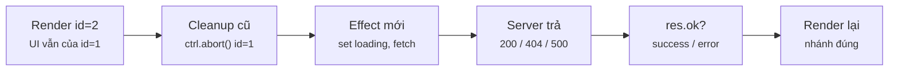
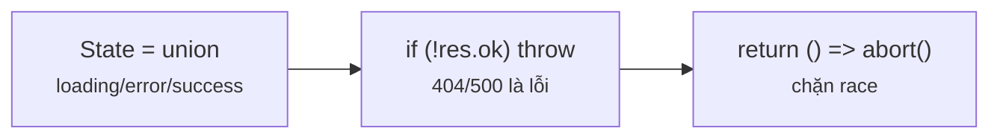
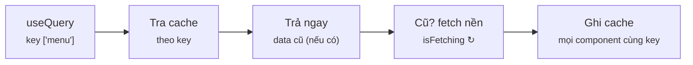
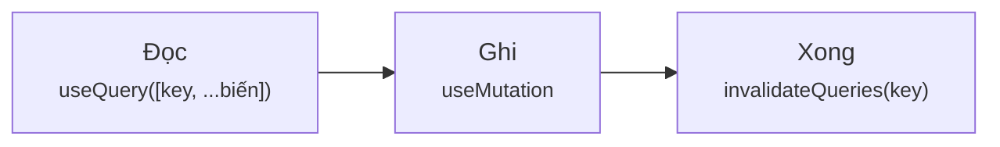
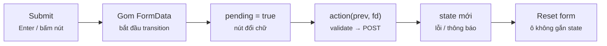
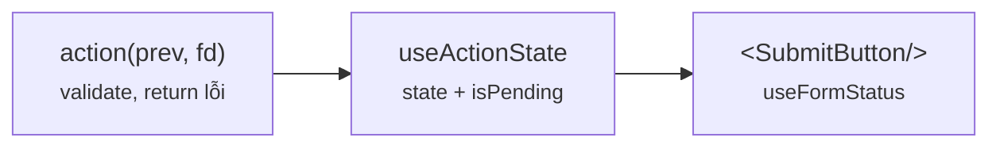

# Module 5 · Data fetching thực chiến

_fetch chuẩn (loading/error/optimistic) · TanStack Query · form actions & validation_

**Đã chạy với:** Node 22.22.0 · TypeScript 7.0.2 · React 19.3.1 · react-dom 19.3.1 · @tanstack/react-query 5.104.3 · jsdom 29.1.1 · tsx 4.23.15

React chạy thật trong Node + jsdom (DOM giả), render **không** bọc `act()` để thứ tự cập nhật giống trình duyệt. `m5/server.ts` là **server HTTP thật** (`node:http` trên localhost, trễ 30ms, ghi log mọi request) — mọi ví dụ gọi `fetch()` thật của Node, không mock. Số **ms** là đo thật lúc build — chạy lại sẽ lệch vài ms, thứ tự thì không đổi.

Vị trí: Đã học Module 4 · Routing (loader/action, bảo vệ route, lazy) · **Đang học Module 5** · Sắp tới Module 6 · Styling (Tailwind, CSS Modules, animation)

## Bài 5.1 · Fetch chuẩn: loading · error · race · optimistic

_Nguồn roadmap: [Academind] How NOT to Send HTTP Requests → Sending HTTP Requests via useEffect → Handling Loading States → Handling HTTP Errors → Sending Data with POST Requests → Using Optimistic Updating → Deleting Data · [BigReact] Race Condition_

### 1 · Một câu & nằm ở đâu
Tự fetch trong `useEffect` thì bạn phải tự lo **4 thứ**: trạng thái (loading / error / success — 1 union, không 3 biến rời), `res.ok` (fetch **không** throw khi 404/500), **huỷ** request cũ khi input đổi (AbortController), và optimistic update kèm **hoàn tác**. Bài này làm đủ 4 thứ bằng tay — để hiểu TanStack Query (bài 5.2) đang làm hộ cái gì.

User thao tác → **[Gửi request]** → **[Đang chờ (pending)]** → **[Server trả / lỗi]** → **[Cache / state]** → Render UI

<details><summary>m5/dom.ts — DOM giả dùng cho mọi ví dụ</summary>

`m5/dom.ts`

```tsx
// Giả lập trình duyệt trong Node để React chạy thật (không cần mở Chrome)
import { JSDOM } from "jsdom";

const dom = new JSDOM('<!doctype html><div id="root"></div>', { url: "http://cafe.local/" });
Object.assign(globalThis, {
  window: dom.window,
  document: dom.window.document,
  HTMLElement: dom.window.HTMLElement,
  FormData: dom.window.FormData,      // <form action> đọc ô input bằng FormData của DOM
  IS_REACT_ACT_ENVIRONMENT: false,     // render như trình duyệt thật: không gom bằng act()
});

export const root = dom.window.document.getElementById("root")!;
export const wait = (ms: number) => new Promise((r) => setTimeout(r, ms));
let t0 = Date.now();
export const resetClock = () => { t0 = Date.now(); };                  // đặt mốc 0ms
export const ms = () => `${String(Date.now() - t0).padStart(3)}ms`;    // thời gian thật từ mốc
export const show = (label: string) => console.log(`${ms()} ${label.padEnd(14)} | ${root.textContent}`);

// Gõ vào input như user (React lắng nghe sự kiện "input")
export function type(el: HTMLInputElement, value: string) {
  const setter = Object.getOwnPropertyDescriptor(dom.window.HTMLInputElement.prototype, "value")!.set!;
  setter.call(el, value);
  el.dispatchEvent(new dom.window.Event("input", { bubbles: true }));
}
export const $ = <T extends Element = HTMLElement>(sel: string) => root.querySelector(sel) as T;
export const click = (sel: string) => $<HTMLElement>(sel).click();
```

</details>

<details><summary>m5/server.ts — server HTTP thật trên localhost: trễ 30ms, log request, giả lỗi được</summary>

`m5/server.ts`

```tsx
// Server HTTP THẬT (node:http) trên localhost → ví dụ dùng fetch() thật, không mock
import { createServer, type IncomingMessage } from "node:http";
import type { AddressInfo } from "node:net";

export type Item = { id: number; name: string; price: number };
const menu: Item[] = [
  { id: 1, name: "Latte", price: 45000 }, { id: 2, name: "Mocha", price: 50000 },
  { id: 3, name: "Cold Brew", price: 55000 }, { id: 4, name: "Matcha Latte", price: 52000 },
];
export const log: string[] = [];                       // server ghi lại mọi request
const slow = new Map<string, number>();                // q → độ trễ riêng (để dựng race condition)
let failNext = 0;                                      // status lỗi cho request ghi kế tiếp
const body = (req: IncomingMessage) =>
  new Promise<string>((ok) => { let s = ""; req.on("data", (c) => (s += c)); req.on("end", () => ok(s)); });

const srv = createServer(async (req, res) => {
  const u = new URL(req.url!, "http://x");
  log.push(`${req.method} ${u.pathname}${u.search}`);
  const reply = (status: number, data: unknown) => setTimeout(() => {
    res.writeHead(status, { "content-type": "application/json" }).end(JSON.stringify(data));
  }, slow.get(u.searchParams.get("q") ?? "") ?? 30);
  const id = Number(u.pathname.split("/")[2]);
  if (req.method !== "GET" && failNext) { const s = failNext; failNext = 0; return reply(s, { error: `HTTP ${s}` }); }
  if (req.method === "GET" && u.pathname === "/menu") {
    const q = (u.searchParams.get("q") ?? "").toLowerCase();
    return reply(200, menu.filter((m) => m.name.toLowerCase().includes(q)));
  }
  if (req.method === "GET" && u.pathname.startsWith("/menu/")) {
    const m = menu.find((x) => x.id === id);
    return m ? reply(200, m) : reply(404, { error: "không có món" });
  }
  if (req.method === "POST" && u.pathname === "/menu") {
    const m = { id: menu.length + 1, ...(JSON.parse(await body(req)) as Omit<Item, "id">) };
    menu.push(m); return reply(201, m);
  }
  if (req.method === "DELETE" && u.pathname.startsWith("/menu/")) {
    menu.splice(menu.findIndex((x) => x.id === id), 1); return reply(204, null);
  }
  reply(404, { error: "no route" });
});
await new Promise<void>((ok) => srv.listen(0, "127.0.0.1", ok));
export const API = `http://127.0.0.1:${(srv.address() as AddressInfo).port}`;
export const server = {
  slow: (q: string, ms: number) => slow.set(q, ms),
  failNext: (status: number) => { failNext = status; },
  close: () => { srv.closeAllConnections(); srv.close(); },
};
```

</details>

### 2 · Concept
| Mảnh | Vai trò | Bên C# |
|---|---|---|
| `useEffect(() => { fetch… }, [id])` | Chạy **sau** render, chạy lại khi `id` đổi | `OnParametersSetAsync` của Blazor |
| `type State = {status:"loading"} \| {status:"error"…} \| {status:"success"…}` | 1 biến, 3 nhánh loại trừ nhau — không có trạng thái vô lý | Discriminated union / `OneOf<…>` |
| `if (!res.ok) throw …` | `fetch` chỉ reject khi **lỗi mạng**; 404/500 vẫn "thành công" | `EnsureSuccessStatusCode()` |
| `AbortController` + cleanup `() => ctrl.abort()` | Input đổi / unmount → huỷ request cũ, chặn race condition (response cũ về sau đè response mới) | `CancellationToken` |
| Optimistic update | Đổi UI **trước**, gọi server **sau**; lỗi → trả lại bản cũ | Chưa có tương đương sẵn |

### 3 · Flow / lifecycle
**Đổi id thì effect fetch chạy thế nào?**



Đọc sơ đồ: Trái → phải: render xong mới tới effect. Effect huỷ request của id cũ (cleanup), set loading, gọi fetch mới. Server trả → kiểm res.ok → set success hoặc error → render lại. Request bị abort rơi vào catch với AbortError và bị bỏ qua.

### 4 · Ví dụ thực tế
**Ví dụ 1.** Hook fetch "đủ chuẩn": state là union, kiểm `res.ok`, huỷ khi đổi `id`. Gọi món có thật (`id=1`) rồi món không có (`id=99`).

`m5/l51-fetch.tsx`

```tsx
import { root, wait, resetClock, show } from "./dom";
import { API, server, type Item } from "./server";
import { useEffect, useState } from "react";
import { createRoot } from "react-dom/client";

type State = { status: "loading" } | { status: "error"; error: string } | { status: "success"; data: Item };
function ItemCard({ id }: { id: number }) {
  const [state, setState] = useState<State>({ status: "loading" });
  useEffect(() => {
    const ctrl = new AbortController();
    setState({ status: "loading" });
    fetch(`${API}/menu/${id}`, { signal: ctrl.signal })
      .then(async (res) => {
        if (!res.ok) throw new Error(`HTTP ${res.status}`);        // fetch KHÔNG tự throw khi 4xx/5xx
        setState({ status: "success", data: (await res.json()) as Item });
      })
      .catch((e: Error) => { if (e.name !== "AbortError") setState({ status: "error", error: e.message }); });
    return () => ctrl.abort();                                       // đổi id / unmount → huỷ request cũ
  }, [id]);
  if (state.status === "loading") return <p>⏳ đang tải…</p>;
  if (state.status === "error") return <p>⚠ {state.error}</p>;
  return <p>{state.data.name}: {state.data.price}đ</p>;
}

const app = createRoot(root);
for (const id of [1, 99]) {
  resetClock(); app.render(<ItemCard id={id} />);
  await wait(5); show(`id=${id}`); await wait(100); show(`id=${id}`);
}
app.unmount(); server.close();
```

```console
❯ npx tsx m5/l51-fetch.tsx
 13ms id=1           | ⏳ đang tải…
113ms id=1           | Latte: 45000đ
  7ms id=99          | ⏳ đang tải…
107ms id=99          | ⚠ HTTP 404
```

Mỗi lần chỉ hiện **đúng 1** nhánh — TypeScript ép bạn: `state.data` chỉ truy cập được trong nhánh `success`. `404` hiện ra là lỗi rõ ràng chứ không phải `undefined` nhờ dòng 14.

**Ví dụ 2.** Xoá món kiểu **optimistic**: biến khỏi danh sách ngay, server lỗi thì hoàn tác. Lần 2 cho server trả 500.

`m5/l51-optimistic.tsx`

```tsx
import { root, wait, resetClock, show, click } from "./dom";
import { API, server, log, type Item } from "./server";
import { useEffect, useState } from "react";
import { createRoot } from "react-dom/client";

function Menu() {
  const [items, setItems] = useState<Item[]>([]);
  const [error, setError] = useState("");
  useEffect(() => { fetch(`${API}/menu`).then((r) => r.json()).then((d: Item[]) => setItems(d)); }, []);
  async function remove(id: number) {
    const before = items;                                         // giữ bản cũ để hoàn tác
    setItems(items.filter((i) => i.id !== id)); setError("");     // 1. UI đổi NGAY, chưa chờ server
    const res = await fetch(`${API}/menu/${id}`, { method: "DELETE" });
    if (!res.ok) { setItems(before); setError(` ⚠ xoá lỗi ${res.status}, đã hoàn tác`); }  // 2. lỗi → rollback
  }
  return <ul>{items.map((i) => <li key={i.id}>{i.name} <button data-id={i.id} onClick={() => remove(i.id)}>✕</button> </li>)}{error}</ul>;
}

createRoot(root).render(<Menu />);
await wait(150);                                 resetClock(); show("ban đầu");
click('button[data-id="1"]'); await wait(5);     show("xoá Latte");
await wait(50);                                  show("server 204");
server.failNext(500);
resetClock(); click('button[data-id="2"]'); await wait(5); show("xoá Mocha");
await wait(50);                                  show("server 500");
console.log("server nhận:", log.join(" · "));
server.close(); process.exit(0);
```

```console
❯ npx tsx m5/l51-optimistic.tsx
  0ms ban đầu        | Latte ✕ Mocha ✕ Cold Brew ✕ Matcha Latte ✕ 
 19ms xoá Latte      | Mocha ✕ Cold Brew ✕ Matcha Latte ✕ 
 70ms server 204     | Mocha ✕ Cold Brew ✕ Matcha Latte ✕ 
  8ms xoá Mocha      | Cold Brew ✕ Matcha Latte ✕ 
 59ms server 500     | Mocha ✕ Cold Brew ✕ Matcha Latte ✕  ⚠ xoá lỗi 500, đã hoàn tác
server nhận: GET /menu · DELETE /menu/1 · DELETE /menu/2
```

Mocha biến mất sau **vài ms** dù server mất ~50ms — user không phải chờ. Khi server 500, danh sách quay lại bản `before` + báo lỗi. Đây là pattern "gửi lạc quan, sai thì rollback", giống transaction phía UI.

### 5 · Thử thật / bẫy
**Bẫy 1.** **Race condition**: user gõ `l` rồi `la`. Request `l` chậm (150ms) về **sau** request `la` (30ms) → kết quả cũ đè kết quả mới.

`m5/l51-trap-race.tsx`

```tsx
import { root, wait } from "./dom";
import { API, server, type Item } from "./server";
import { useEffect, useState } from "react";
import { createRoot } from "react-dom/client";

function SearchBad({ q }: { q: string }) {                          // ❌ ai về sau thắng
  const [items, setItems] = useState<Item[]>([]);
  useEffect(() => {
    fetch(`${API}/menu?q=${q}`).then((r) => r.json()).then((d: Item[]) => setItems(d));
  }, [q]);
  return <p>"{q}" → {items.map((i) => i.name).join(", ")}</p>;
}
function SearchGood({ q }: { q: string }) {                         // ✅ huỷ request cũ khi q đổi
  const [items, setItems] = useState<Item[]>([]);
  useEffect(() => {
    const ctrl = new AbortController();
    fetch(`${API}/menu?q=${q}`, { signal: ctrl.signal }).then((r) => r.json())
      .then((d: Item[]) => setItems(d)).catch(() => {});             // AbortError: bỏ qua
    return () => ctrl.abort();
  }, [q]);
  return <p>"{q}" → {items.map((i) => i.name).join(", ")}</p>;
}
server.slow("l", 150);                                              // "l" chậm 150ms, "la" chỉ 30ms
for (const [name, Search] of [["Bad ", SearchBad], ["Good", SearchGood]] as const) {
  const app = createRoot(root);
  app.render(<Search q="l" />); await wait(10);                     // user gõ "l"…
  app.render(<Search q="la" />); await wait(200);                   // …rồi "la" ngay sau đó
  console.log(`${name}: ${root.textContent}`); app.unmount();
}
server.close();
```

```console
❯ npx tsx m5/l51-trap-race.tsx
Bad : "la" → Latte, Cold Brew, Matcha Latte
Good: "la" → Latte, Matcha Latte
```

Bad: ô tìm ghi `"la"` nhưng danh sách lại là của `"l"` (có Cold Brew). Good: cleanup `abort()` huỷ request `l` nên nó không bao giờ được `setItems`. Code AI fetch trong `useEffect` mà không có `return () => …` là lỗi này (bảng 13.2 trong roadmap).

**Bẫy 2.** **3 state rời nhau** (`loading`, `error`, `data`) — kiểu hay gặp nhất trong code cũ / code AI. Quên reset 1 biến là ra trạng thái vô lý.

`m5/l51-trap-flags.tsx`

```tsx
import { root, wait } from "./dom";
import { API, server, type Item } from "./server";
import { useEffect, useState } from "react";
import { createRoot } from "react-dom/client";

function ItemCard({ id }: { id: number }) {                          // ❌ 3 state rời nhau
  const [loading, setLoading] = useState(true);
  const [error, setError] = useState("");
  const [data, setData] = useState<Item | null>(null);
  useEffect(() => {
    setLoading(true);                                                // quên setError("") ở đây
    fetch(`${API}/menu/${id}`).then(async (res) => {
      if (!res.ok) throw new Error(`HTTP ${res.status}`);
      setData((await res.json()) as Item);
    }).catch((e: Error) => setError(e.message)).finally(() => setLoading(false));
  }, [id]);
  return <p>{loading && "⏳ "}{error && `⚠ ${error} `}{data && `${data.name}: ${data.price}đ`}</p>;
}

const app = createRoot(root);
for (const id of [99, 2]) {
  app.render(<ItemCard id={id} />);
  await wait(5);  console.log(`id=${id} đang tải: ${root.textContent}`);
  await wait(60); console.log(`id=${id} xong    : ${root.textContent}`);
}
app.unmount(); server.close();
```

```console
❯ npx tsx m5/l51-trap-flags.tsx
id=99 đang tải: ⏳ 
id=99 xong    : ⚠ HTTP 404 
id=2 đang tải: ⏳ ⚠ HTTP 404 
id=2 xong    : ⚠ HTTP 404 Mocha: 50000đ
```

Đang tải món 2 mà vẫn treo lỗi của món 99, xong rồi thì hiện **cùng lúc** lỗi + dữ liệu. Với union ở ví dụ 1, trạng thái này **không viết ra được** — compiler chặn từ đầu.

### 6 · Tóm tắt bằng hình
**(a) Cây thư mục sau bài này**

```text
sandbox/
├─ tsconfig.json  [SỬA]  ← include m5/**, lib DOM
└─ m5/
   ├─ dom.ts  [MỚI]  ← DOM giả + type()/click()/đồng hồ ms
   ├─ server.ts  [MỚI]  ← server HTTP thật cho cả module
   ├─ l51-fetch.tsx  [MỚI]  ← union state + res.ok + abort
   ├─ l51-optimistic.tsx  [MỚI]  ← xoá lạc quan + rollback
   ├─ l51-trap-race.tsx  [MỚI]  ← response cũ đè response mới
   └─ l51-trap-flags.tsx  [MỚI]  ← 3 biến rời → lỗi + data cùng lúc
```

**(b) Đọc trong 10 giây**

**Fetch tay cần đủ mấy thứ?**



Đọc sơ đồ: Thiếu 1 trong 3 là có bug thật. Đếm xem code AI của bạn có đủ không.

### 7 · Làm ngay (≤ 10 phút)
**Mục tiêu:** `m5/ex/ex51-start.tsx`: mở món `id=99` đang hiện `: đ` (dữ liệu rỗng) thay vì lỗi. Sửa để ra `⚠ HTTP 404`.

File khởi đầu:

`m5/ex/ex51-start.tsx`

```tsx
import { root, wait } from "../dom";
import { API, server, type Item } from "../server";
import { useEffect, useState } from "react";
import { createRoot } from "react-dom/client";

type State = { status: "loading" } | { status: "error"; error: string } | { status: "success"; data: Item };

function ItemCard({ id }: { id: number }) {
  const [state, setState] = useState<State>({ status: "loading" });
  useEffect(() => {
    const ctrl = new AbortController();
    fetch(`${API}/menu/${id}`, { signal: ctrl.signal })
      .then(async (res) => {
        // TODO: res.ok === false → throw new Error(`HTTP ${res.status}`)
        setState({ status: "success", data: (await res.json()) as Item });
      })
      .catch((e: Error) => { if (e.name !== "AbortError") setState({ status: "error", error: e.message }); });
    return () => ctrl.abort();
  }, [id]);
  if (state.status === "loading") return <p>⏳</p>;
  if (state.status === "error") return <p>⚠ {state.error}</p>;
  return <p>{state.data.name}: {state.data.price}đ</p>;
}

const app = createRoot(root);
for (const id of [3, 99]) {
  app.render(<ItemCard key={id} id={id} />); await wait(120);
  console.log(`id=${id} → ${root.textContent}`);
}
app.unmount(); server.close();
```

Chạy file khởi đầu (đang đỏ):

```console
❯ npx tsx m5/ex/ex51-start.tsx
id=3 → Cold Brew: 55000đ
id=99 → : đ
```

Tiêu chí nghiệm thu:

- [ ] Dòng 1 vẫn `id=3 → Cold Brew: 55000đ`
- [ ] Dòng 2 ra `id=99 → ⚠ HTTP 404`
- [ ] `npx tsc -p .` không báo lỗi

Lệnh nghiệm thu:

```bash
npx tsx m5/ex/ex51-start.tsx && npx tsc -p .
```

Lời giải tham chiếu chạy ra (output cần đạt):

```console
❯ npx tsx m5/ex/ex51-solution.tsx
id=3 → Cold Brew: 55000đ
id=99 → ⚠ HTTP 404
```

<details><summary>Gợi ý nếu bị đỏ</summary>

| Triệu chứng | Nguyên nhân | Sửa |
|---|---|---|
| Vẫn `: đ` | Chưa kiểm `res.ok`; `res.json()` đọc được body lỗi `{ error }` như dữ liệu thường | `if (!res.ok) throw new Error(…)` **trước** `res.json()` |
| Ra `⚠ The user aborted a request` | Bỏ mất điều kiện `e.name !== "AbortError"` trong catch | Giữ nguyên dòng catch; abort là chủ động, không phải lỗi |
| Ra `⏳` | Throw nằm ngoài `.then`, hoặc quên `async` | Throw bên trong `.then(async (res) => …)` để rơi xuống `.catch` |

`m5/ex/ex51-start.tsx` (diff)

```diff
     fetch(`${API}/menu/${id}`, { signal: ctrl.signal })
       .then(async (res) => {
-        // TODO: res.ok === false → throw new Error(`HTTP ${res.status}`)
+        if (!res.ok) throw new Error(`HTTP ${res.status}`);              // ✅ 4xx/5xx thành lỗi
         setState({ status: "success", data: (await res.json()) as Item });
       })
```

</details>

### 8 · 3 câu hỏi nhanh
1. `fetch("/menu/99")` trả 404. Promise của nó resolve hay reject?

   <details><summary>Đáp án</summary>

   **Resolve** — với `res.ok === false`. `fetch` chỉ reject khi lỗi mạng / bị abort. Vì vậy luôn phải tự kiểm `res.ok` (hoặc dùng 1 hàm `http()` bọc sẵn như `m5/api.ts` ở bài 5.2).

   </details>

2. Vì sao cần `return () => ctrl.abort()` dù component không unmount?

   <details><summary>Đáp án</summary>

   Cleanup chạy **mỗi khi dependency đổi**, trước effect mới. Không abort thì request cũ vẫn bay, về muộn và `setState` đè dữ liệu mới (bẫy 1). Thay bằng cờ `let ignore = true` cũng được, nhưng abort còn tiết kiệm băng thông.

   </details>

3. Optimistic update nên dùng cho thao tác nào, tránh cho thao tác nào?

   <details><summary>Đáp án</summary>

   Nên: thao tác gần như luôn thành công, dễ hoàn tác (like, xoá item, đổi thứ tự, đánh dấu đã đọc). Tránh: thanh toán, đặt hàng, thứ có hậu quả ngoài đời — user phải thấy "đang xử lý" rồi mới thấy "xong".

   </details>


---

## Bài 5.2 · TanStack Query: server state có cache

_Nguồn roadmap: [Academind] React Query: What & Why? → Installing & Using Tanstack Query → Cache & Stale Data → Dynamic Query Functions & Query Keys → Mutations → Invalidating Queries → Optimistic Updating · [Modern] What Is TanStack Query? → useQuery → Mutations · [NextAI] useQuery → useMutation, Query Invalidation, and Optimistic UI_

### 1 · Một câu & nằm ở đâu
Dữ liệu từ server **không phải** state của bạn — nó là bản sao có thể cũ. TanStack Query giữ bản sao đó trong 1 **cache theo key**: component nào cần thì `useQuery(key)`, cùng key = cùng 1 request, có `staleTime`, tự refetch nền. Ghi bằng `useMutation`, xong thì `invalidateQueries(key)` để cache tự tải lại. Thay toàn bộ phần tự làm ở bài 5.1.

User thao tác → **[Gửi request]** → **[Đang chờ (pending)]** → Server trả / lỗi → **[Cache / state]** → **[Render UI]**

<details><summary>m5/api.ts — lớp gọi API dùng chung: fetch thật + 4xx/5xx thành lỗi</summary>

`m5/api.ts`

```tsx
// Lớp gọi API dùng chung: fetch thật + biến 4xx/5xx thành lỗi (bài 5.1)
import { API, type Item } from "./server";

export async function http<T>(path: string, init?: RequestInit): Promise<T> {
  const res = await fetch(API + path, { ...init, headers: { "content-type": "application/json" } });
  if (!res.ok) throw new Error(`HTTP ${res.status}`);
  return (res.status === 204 ? null : await res.json()) as T;
}
export const getMenu = (q = "") => http<Item[]>(`/menu?q=${q}`);
export const getItem = (id: number) => http<Item>(`/menu/${id}`);
export const addItem = (name: string, price: number) =>
  http<Item>("/menu", { method: "POST", body: JSON.stringify({ name, price }) });
export const deleteItem = (id: number) => http<null>(`/menu/${id}`, { method: "DELETE" });
```

</details>

### 2 · Concept
| Mảnh | Vai trò | Bên C# |
|---|---|---|
| `QueryClient` + `<QueryClientProvider>` | Giữ cache cho cả app | `IMemoryCache` đăng ký singleton |
| `queryKey: ["item", id]` | Địa chỉ ô cache; **mọi biến** queryFn dùng phải nằm trong key | Cache key `$"item:{id}"` |
| `useQuery({ queryKey, queryFn, staleTime })` | Đọc cache; không có / đã cũ → fetch; trùng key → dùng chung 1 request | `GetOrCreateAsync` + dedupe |
| `staleTime` | Bao lâu coi là "tươi" (mặc định **0**: luôn refetch nền khi mount lại) | `AbsoluteExpirationRelativeToNow` |
| `useMutation({ mutationFn, onSuccess })` | Ghi dữ liệu, có `isPending` / `isError` sẵn | Command handler |
| `invalidateQueries({ queryKey })` | Đánh dấu cũ → query đang hiện tự refetch | `cache.Remove(key)` rồi đọc lại |
| `onMutate` / `onError` / `onSettled` | Optimistic: sửa cache ngay, lỗi thì trả lại | — |

### 3 · Flow / lifecycle
**Component gọi useQuery(["menu"]) thì chuyện gì xảy ra?**



Đọc sơ đồ: Trái → phải: tra cache theo key. Có dữ liệu thì trả NGAY (dù cũ). Nếu đã quá staleTime thì vẫn trả bản cũ trước, đồng thời fetch nền; dữ liệu mới về thì mọi component dùng key đó render lại. Chưa có gì thì mới hiện loading.

### 4 · Ví dụ thực tế
**Ví dụ 1.** 2 component cùng key mount cùng lúc, rồi mount lại khi còn tươi, rồi mount lại khi đã cũ (`staleTime: 100`). Đếm request server **thật** nhận.

`m5/l52-cache.tsx`

```tsx
import { root, wait, resetClock, show } from "./dom";
import { server, log } from "./server";
import { getMenu } from "./api";
import { QueryClient, QueryClientProvider, queryOptions, useQuery } from "@tanstack/react-query";
import { createRoot } from "react-dom/client";

const menuQuery = queryOptions({ queryKey: ["menu"], queryFn: () => getMenu(), staleTime: 100 }); // tươi 100ms
function MenuCount({ who }: { who: string }) {
  const { data, isFetching } = useQuery(menuQuery);              // cùng key = cùng 1 ô cache
  return <span>[{who}: {data ? `${data.length} món` : "⏳"}{data && isFetching ? " ↻" : ""}] </span>;
}

const qc = new QueryClient();
const app = createRoot(root);
const mount = (...who: string[]) =>
  app.render(<QueryClientProvider client={qc}>{who.map((w) => <MenuCount key={w} who={w} />)}</QueryClientProvider>);
const req = () => `xong, req=${log.length}`;   // đếm request server thật nhận

resetClock(); mount("A", "B");     await wait(5);  show("mount A+B"); await wait(120); show(req());
mount();  mount("C");               await wait(5);  show(`C · req=${log.length}`);
await wait(150); mount(); mount("D"); await wait(5); show("D (đã cũ)");   await wait(80); show(req());
app.unmount(); qc.clear(); server.close();
```

```console
❯ npx tsx m5/l52-cache.tsx
 16ms mount A+B      | [A: ⏳] [B: ⏳] 
137ms xong, req=1    | [A: 4 món] [B: 4 món] 
143ms C · req=1      | [C: 4 món] 
300ms D (đã cũ)      | [D: 4 món ↻] 
380ms xong, req=2    | [D: 4 món]
```

A và B chung **1** request (dedupe). C mount lại khi còn tươi: có dữ liệu **ngay**, 0 request. D mount khi đã cũ: vẫn hiện dữ liệu cũ ngay (`↻` = đang fetch nền), không có màn `⏳`. Bài 5.1 muốn được thế này phải tự viết cả 1 lớp cache.

**Ví dụ 2.** Thêm món bằng `useMutation`, xong thì `invalidateQueries`. Không `setState`, không fetch lại bằng tay.

`m5/l52-mutation.tsx`

```tsx
import { root, wait, resetClock, show, click } from "./dom";
import { server, log } from "./server";
import { addItem, getMenu } from "./api";
import { QueryClient, QueryClientProvider, useMutation, useQuery, useQueryClient } from "@tanstack/react-query";
import { createRoot } from "react-dom/client";

function Menu() {
  const qc = useQueryClient();
  const { data = [] } = useQuery({ queryKey: ["menu"], queryFn: () => getMenu() });
  const add = useMutation({
    mutationFn: () => addItem("Bạc Xỉu", 35000),                       // ghi: POST
    onSuccess: () => qc.invalidateQueries({ queryKey: ["menu"] }),      // đánh dấu cũ → tự refetch
  });
  return <p>
    {data.map((i) => i.name).join(", ")}
    <button onClick={() => add.mutate()} disabled={add.isPending}>{add.isPending ? " [đang thêm…]" : " [+ Bạc Xỉu]"}</button>
  </p>;
}

createRoot(root).render(<QueryClientProvider client={new QueryClient()}><Menu /></QueryClientProvider>);
await wait(150); log.length = 0; resetClock();
show("ban đầu");
click("button"); await wait(5);    show("bấm thêm");
await wait(50);                    show("POST xong, GET…");
await wait(50);                    show("GET lại xong");
console.log("server nhận:", log.join(" · "));
server.close(); process.exit(0);
```

```console
❯ npx tsx m5/l52-mutation.tsx
  0ms ban đầu        | Latte, Mocha, Cold Brew, Matcha Latte [+ Bạc Xỉu]
 21ms bấm thêm       | Latte, Mocha, Cold Brew, Matcha Latte [đang thêm…]
 71ms POST xong, GET… | Latte, Mocha, Cold Brew, Matcha Latte [đang thêm…]
122ms GET lại xong   | Latte, Mocha, Cold Brew, Matcha Latte, Bạc Xỉu [+ Bạc Xỉu]
server nhận: POST /menu · GET /menu?q=
```

Thứ tự server nhận: `POST` rồi tự `GET` lại. Nút giữ `đang thêm…` cho tới khi **danh sách mới** về, vì `onSuccess` **trả về** promise của `invalidateQueries` → mutation chờ nó. Bỏ `return` (viết `{ … }`) thì nút nhả sớm, danh sách cập nhật chậm 1 nhịp.

**Ví dụ 3.** Optimistic với TanStack Query: sửa **cache** ngay trong `onMutate`, lỗi thì trả bản cũ. Server trả 500.

`m5/l52-optimistic.tsx`

```tsx
import { root, wait, resetClock, show, click } from "./dom";
import { server, type Item } from "./server";
import { deleteItem, getMenu } from "./api";
import { QueryClient, QueryClientProvider, useMutation, useQuery, useQueryClient } from "@tanstack/react-query";
import { createRoot } from "react-dom/client";

function Menu() {
  const qc = useQueryClient();
  const { data = [] } = useQuery({ queryKey: ["menu"], queryFn: () => getMenu() });
  const del = useMutation({
    mutationFn: deleteItem,
    onMutate: async (id: number) => {
      await qc.cancelQueries({ queryKey: ["menu"] });                  // chặn refetch đang bay đè lên
      const before = qc.getQueryData<Item[]>(["menu"]);
      qc.setQueryData<Item[]>(["menu"], (old = []) => old.filter((i) => i.id !== id));  // sửa cache NGAY
      return { before };                                                // → context cho onError
    },
    onError: (_e, _id, ctx) => qc.setQueryData(["menu"], ctx?.before),  // lỗi → trả cache cũ
    onSettled: () => qc.invalidateQueries({ queryKey: ["menu"] }),      // xong (đúng/sai) → đồng bộ server
  });
  return <ul>{data.map((i) => <li key={i.id}>{i.name} <button data-id={i.id} onClick={() => del.mutate(i.id)}>✕</button> </li>)}
    {del.isError && ` ⚠ ${del.error.message}, đã hoàn tác`}</ul>;
}

createRoot(root).render(<QueryClientProvider client={new QueryClient()}><Menu /></QueryClientProvider>);
await wait(150); server.failNext(500); resetClock();
show("ban đầu");
click('button[data-id="2"]'); await wait(5); show("xoá Mocha");
await wait(120);                             show("server 500");
server.close(); process.exit(0);
```

```console
❯ npx tsx m5/l52-optimistic.tsx
  0ms ban đầu        | Latte ✕ Mocha ✕ Cold Brew ✕ Matcha Latte ✕ 
 22ms xoá Mocha      | Latte ✕ Cold Brew ✕ Matcha Latte ✕ 
142ms server 500     | Latte ✕ Mocha ✕ Cold Brew ✕ Matcha Latte ✕  ⚠ HTTP 500, đã hoàn tác
```

Cùng hành vi với ví dụ 2 bài 5.1 nhưng logic nằm ở cache, không ở component: mọi màn hình đang hiện `["menu"]` đều thấy Mocha biến mất rồi quay lại. `cancelQueries` chặn 1 refetch đang bay về đè lên bản lạc quan; `onSettled` đồng bộ lại với server dù đúng hay sai.

### 5 · Thử thật / bẫy
**Bẫy 1.** **`queryKey` thiếu tham số.** `queryFn` dùng `id` nhưng key chỉ là `["item"]` → đổi món vẫn trúng ô cache của món đầu.

`m5/l52-trap-key.tsx`

```tsx
import { root, wait } from "./dom";
import { server } from "./server";
import { getItem } from "./api";
import { QueryClient, QueryClientProvider, useQuery } from "@tanstack/react-query";
import { createRoot } from "react-dom/client";

function ItemBad({ id }: { id: number }) {                         // ❌ key không có id
  const { data } = useQuery({ queryKey: ["item"], queryFn: () => getItem(id), staleTime: 60_000 });
  return <b>{data?.name ?? "⏳"}</b>;
}
function ItemGood({ id }: { id: number }) {                        // ✅ mọi biến queryFn dùng → nằm trong key
  const { data } = useQuery({ queryKey: ["item", id], queryFn: () => getItem(id), staleTime: 60_000 });
  return <b>{data?.name ?? "⏳"}</b>;
}

for (const [name, Item] of [["Bad ", ItemBad], ["Good", ItemGood]] as const) {
  const qc = new QueryClient(), app = createRoot(root), shown: string[] = [];
  for (const id of [1, 2, 3]) {                                    // user bấm qua 3 món
    app.render(<QueryClientProvider client={qc}><Item id={id} /></QueryClientProvider>);
    await wait(100); shown.push(`id=${id}→${root.textContent}`);
  }
  console.log(`${name}: ${shown.join("  ")}`); app.unmount();
}
server.close(); process.exit(0);         // QueryClient còn hẹn giờ dọn cache 5 phút → thoát tay
```

```console
❯ npx tsx m5/l52-trap-key.tsx
Bad : id=1→Latte  id=2→Latte  id=3→Latte
Good: id=1→Latte  id=2→Mocha  id=3→Cold Brew
```

Không lỗi, không cảnh báo — chỉ sai dữ liệu. Luật: **biến nào queryFn đọc thì nằm trong key** (id, filter, page, user). Plugin ESLint `@tanstack/eslint-plugin-query` (`exhaustive-deps`) bắt được lỗi này khi review code AI.

**Bẫy 2.** **Chép data của query vào `useState`** "để còn sửa". Bản chép không còn nối với cache: invalidate xong cache có dữ liệu mới, UI vẫn hiện bản cũ.

`m5/l52-trap-copy.tsx`

```tsx
import { root, wait } from "./dom";
import { server, type Item } from "./server";
import { addItem, getMenu } from "./api";
import { QueryClient, QueryClientProvider, useQuery, useQueryClient } from "@tanstack/react-query";
import { useEffect, useState } from "react";
import { createRoot } from "react-dom/client";
let addOne!: () => Promise<void>;
function MenuBad() {                                               // ❌ chép data vào useState "để sửa"
  const { data } = useQuery({ queryKey: ["menu"], queryFn: () => getMenu() });
  const [items, setItems] = useState<Item[]>([]);
  useEffect(() => { if (items.length === 0 && data) setItems(data); }, [data, items.length]);
  return <Shell n={items.length} />;
}
function MenuGood() {                                              // ✅ đọc thẳng từ cache
  const { data = [] } = useQuery({ queryKey: ["menu"], queryFn: () => getMenu() });
  return <Shell n={data.length} />;
}
function Shell({ n }: { n: number }) {
  const qc = useQueryClient();
  addOne = async () => { await addItem("Trà đào", 40000); await qc.invalidateQueries({ queryKey: ["menu"] }); };
  return <span>{n} món</span>;
}
for (const [name, Menu] of [["Bad ", MenuBad], ["Good", MenuGood]] as const) {
  const app = createRoot(root);
  app.render(<QueryClientProvider client={new QueryClient()}><Menu /></QueryClientProvider>);
  await wait(150); const before = root.textContent;
  await addOne(); await wait(20);                                  // thêm món + invalidate (refetch xong)
  console.log(`${name}: trước ${before} → sau khi thêm + invalidate: ${root.textContent}`); app.unmount();
}
server.close(); process.exit(0);         // QueryClient còn hẹn giờ dọn cache 5 phút → thoát tay
```

```console
❯ npx tsx m5/l52-trap-copy.tsx
Bad : trước 4 món → sau khi thêm + invalidate: 4 món
Good: trước 5 món → sau khi thêm + invalidate: 6 món
```

Bad đứng yên `4 món` trong khi server đã có món mới. Muốn sửa dữ liệu thì sửa **cache** (`setQueryData`) hoặc gọi mutation; cần giá trị phái sinh (lọc, sort) thì tính thẳng từ `data` lúc render. `useEffect(() => setX(data))` là dấu hiệu code AI cũ.

### 6 · Tóm tắt bằng hình
**(a) Cây thư mục sau bài này**

```text
sandbox/
├─ package.json  [SỬA]  ← + @tanstack/react-query
└─ m5/
   ├─ api.ts  [MỚI]  ← http() + getMenu/getItem/addItem/deleteItem
   ├─ l52-cache.tsx  [MỚI]  ← dedupe, staleTime, refetch nền
   ├─ l52-mutation.tsx  [MỚI]  ← useMutation + invalidate
   ├─ l52-optimistic.tsx  [MỚI]  ← onMutate/onError/onSettled
   ├─ l52-trap-key.tsx  [MỚI]  ← key thiếu id → sai món
   └─ l52-trap-copy.tsx  [MỚI]  ← chép vào useState → kẹt dữ liệu cũ
```

**(b) Đọc trong 10 giây**

**Đọc / ghi server data bằng gì?**



Đọc sơ đồ: Đọc qua key. Ghi qua mutation. Ghi xong thì báo cache cũ.

### 7 · Làm ngay (≤ 10 phút)
**Mục tiêu:** `m5/ex/ex52-start.tsx`: bấm `+` thì server đã lưu "Bạc Xỉu" nhưng danh sách không đổi. Cho mutation báo cache `["menu"]` cũ.

File khởi đầu:

`m5/ex/ex52-start.tsx`

```tsx
import { root, wait, click } from "../dom";
import { server } from "../server";
import { addItem, getMenu } from "../api";
import { QueryClient, QueryClientProvider, useMutation, useQuery } from "@tanstack/react-query";
import { createRoot } from "react-dom/client";

function Menu() {
  const { data = [] } = useQuery({ queryKey: ["menu"], queryFn: () => getMenu() });
  const add = useMutation({
    mutationFn: () => addItem("Bạc Xỉu", 35000),
    // TODO: thêm xong → invalidate ["menu"] để danh sách tự tải lại
  });
  return <p>{data.map((i) => i.name).join(", ")} <button onClick={() => add.mutate()}>+</button></p>;
}

createRoot(root).render(<QueryClientProvider client={new QueryClient()}><Menu /></QueryClientProvider>);
await wait(150);
click("button"); await wait(200);
console.log(`sau khi thêm: ${root.textContent}`);
server.close(); process.exit(0);
```

Chạy file khởi đầu (đang đỏ):

```console
❯ npx tsx m5/ex/ex52-start.tsx
sau khi thêm: Latte, Mocha, Cold Brew, Matcha Latte +
```

Tiêu chí nghiệm thu:

- [ ] Output ra `sau khi thêm: Latte, Mocha, Cold Brew, Matcha Latte, Bạc Xỉu +`
- [ ] Không có `useState` / `useEffect` / `getMenu()` gọi tay trong `onSuccess`
- [ ] `npx tsc -p .` không báo lỗi

Lệnh nghiệm thu:

```bash
npx tsx m5/ex/ex52-start.tsx && npx tsc -p .
```

Lời giải tham chiếu chạy ra (output cần đạt):

```console
❯ npx tsx m5/ex/ex52-solution.tsx
sau khi thêm: Latte, Mocha, Cold Brew, Matcha Latte, Bạc Xỉu +
```

<details><summary>Gợi ý nếu bị đỏ</summary>

| Triệu chứng | Nguyên nhân | Sửa |
|---|---|---|
| TS: `Cannot find name 'qc'` | Chưa lấy QueryClient trong component | `const qc = useQueryClient();` ở đầu `Menu` |
| Vẫn thiếu Bạc Xỉu | Invalidate sai key (`"menu"` thay vì `["menu"]`, hoặc `["menus"]`) | `qc.invalidateQueries({ queryKey: ["menu"] })` — đúng y key của `useQuery` |
| Có Bạc Xỉu 2 lần | Vừa `setQueryData` thêm tay vừa invalidate | Chọn 1: invalidate (đơn giản) hoặc setQueryData (không thêm request) |

`m5/ex/ex52-start.tsx` (diff)

```diff
 import { server } from "../server";
 import { addItem, getMenu } from "../api";
-import { QueryClient, QueryClientProvider, useMutation, useQuery } from "@tanstack/react-query";
+import { QueryClient, QueryClientProvider, useMutation, useQuery, useQueryClient } from "@tanstack/react-query";
 import { createRoot } from "react-dom/client";
 
 function Menu() {
+  const qc = useQueryClient();
   const { data = [] } = useQuery({ queryKey: ["menu"], queryFn: () => getMenu() });
   const add = useMutation({
     mutationFn: () => addItem("Bạc Xỉu", 35000),
-    // TODO: thêm xong → invalidate ["menu"] để danh sách tự tải lại
+    onSuccess: () => qc.invalidateQueries({ queryKey: ["menu"] }),   // ✅ cache cũ → refetch
   });
   return <p>{data.map((i) => i.name).join(", ")} <button onClick={() => add.mutate()}>+</button></p>;
```

</details>

### 8 · 3 câu hỏi nhanh
1. `staleTime` mặc định là bao nhiêu và hệ quả là gì?

   <details><summary>Đáp án</summary>

   **0** — dữ liệu cũ ngay khi về. Mỗi lần component mount lại / tab được focus lại sẽ refetch **nền** (vẫn hiện bản cũ ngay, không nháy loading). Danh mục ít đổi (menu, tỉnh thành) nên tăng `staleTime` để bớt request.

   </details>

2. Server data đặt trong Zustand/Redux, refetch bằng `useEffect` — thiếu gì so với TanStack Query?

   <details><summary>Đáp án</summary>

   Thiếu dedupe (2 component = 2 request), cache theo key + staleTime, refetch nền khi focus/reconnect, huỷ race condition, retry, trạng thái `isPending/isError/isFetching`, invalidate theo key. Đó là lý do bảng 3.4 trong roadmap: server state → TanStack Query.

   </details>

3. Review code AI: `useQuery({ queryKey: ["orders"], queryFn: () => getOrders(page) })`. Lỗi gì?

   <details><summary>Đáp án</summary>

   Key thiếu `page` → sang trang 2 vẫn trúng cache trang 1 (bẫy 1). Sửa: `queryKey: ["orders", page]`.

   </details>


---

## Bài 5.3 · Form actions & validation (React 19)

_Nguồn roadmap: [Academind] What are Form Actions? → useActionState() → useFormStatus() → Registering Multiple Form Actions → Adding Optimistic Updating · [Academind] Validating Input on Every Keystroke → Upon Lost Focus (Blur) → Upon Form Submission → Mixing Custom & Built-in Validation → Outsourcing Validation Logic_

### 1 · Một câu & nằm ở đâu
React 19 cho `<form action={fn}>` nhận **hàm** (kể cả async): React tự chặn submit, gom `FormData`, chạy hàm trong 1 transition. `useActionState` giữ kết quả lần chạy trước (lỗi validate, thông báo) + cờ `isPending`; `useFormStatus` cho nút bấm biết form đang gửi; `useOptimistic` hiện trước kết quả. Xong action, React **reset** form — muốn giữ chữ user gõ thì trả lại giá trị và gắn `defaultValue`.

**[User thao tác]** → Gửi request → **[Đang chờ (pending)]** → **[Server trả / lỗi]** → Cache / state → **[Render UI]**

### 2 · Concept
| Mảnh | Vai trò | Bên C# |
|---|---|---|
| `<form action={fn}>` | `fn(formData)` chạy khi submit; không cần `onSubmit` + `preventDefault` | `OnPost(FormModel m)` |
| `useActionState(fn, init)` → `[state, action, isPending]` | `fn(stateCũ, formData)` trả `state` mới: lỗi, thông báo, giá trị đã gõ | `ModelState` + `return Page()` |
| `useFormStatus()` | `pending` của **form cha gần nhất** — chỉ dùng trong component **con** của `<form>` | — |
| `useOptimistic(state, update)` | Bản hiển thị tạm trong lúc action chạy, tự bỏ khi xong | — |
| Validate: gõ / blur / submit | Gõ = khó chịu (báo lỗi khi chưa gõ xong); **blur** = báo khi rời ô; **submit** = chốt chặn cuối, server luôn phải kiểm lại | DataAnnotations client + server |
| Lỗi user sửa được → **return**, không throw | Throw = lỗi hệ thống, rơi vào Error Boundary | `ModelState.AddModelError` vs exception |

### 3 · Flow / lifecycle
**Bấm Thêm trong <form action> thì đi đường nào?**



Đọc sơ đồ: Trái → phải: React chặn submit mặc định, gom FormData, bắt đầu transition (isPending = true, useFormStatus().pending = true). Hàm action của bạn validate và gọi server, trả state mới. React render state đó (lỗi hoặc thông báo) rồi reset các ô input không gắn state.

### 4 · Ví dụ thực tế
**Ví dụ 1.** Form thêm món: validate trong action, lỗi thì **return**, hợp lệ thì gọi server. Gửi tên sai trước, rồi gửi đúng.

`m5/l53-action-state.tsx`

```tsx
import { root, wait, resetClock, show, type, $ } from "./dom";
import { server } from "./server";
import { addItem } from "./api";
import { useActionState } from "react";
import { createRoot } from "react-dom/client";

type State = { error?: string; done?: string };
async function addAction(_prev: State, fd: FormData): Promise<State> {   // (state cũ, FormData) → state mới
  const name = String(fd.get("name")).trim(), price = Number(fd.get("price"));
  if (name.length < 2) return { error: "Tên tối thiểu 2 ký tự" };         // lỗi user sửa được → RETURN
  if (!(price > 0)) return { error: "Giá phải > 0" };
  const item = await addItem(name, price);                                 // await thoải mái: action là async
  return { done: `Đã thêm #${item.id} ${item.name}` };
}
function AddForm() {
  const [state, formAction, isPending] = useActionState(addAction, {});
  return <form action={formAction}>
    <input name="name" /><input name="price" />
    <button>{isPending ? "[Đang lưu…]" : "[Thêm]"}</button> {state.error ?? state.done}
  </form>;
}
createRoot(root).render(<AddForm />); await wait(20);
const submit = (name: string, price: string) => {
  type($("input[name=name]"), name); type($("input[name=price]"), price);
  $<HTMLFormElement>("form").requestSubmit();                             // = user bấm Enter / nút
};
resetClock(); submit("B", "35000");       await wait(10); show("gửi 'B'");
resetClock(); submit("Bạc Xỉu", "35000"); await wait(5);  show("gửi 'Bạc Xỉu'");
await wait(80);                                           show("server xong");
server.close();
```

```console
❯ npx tsx m5/l53-action-state.tsx
 25ms gửi 'B'        | [Thêm] Tên tối thiểu 2 ký tự
 32ms gửi 'Bạc Xỉu'  | [Đang lưu…] Tên tối thiểu 2 ký tự
112ms server xong    | [Thêm] Đã thêm #5 Bạc Xỉu
```

Không có `useState` cho lỗi, cho loading, không `onSubmit`, không `preventDefault`. `isPending` bật ngay khi gửi và tắt khi action xong. Lỗi cũ còn hiện trong lúc chờ vì `state` chỉ đổi khi action **trả về**.

**Ví dụ 2.** Nút bấm tự biết form đang gửi (`useFormStatus`) + món mới hiện **trước** khi server trả (`useOptimistic`).

`m5/l53-optimistic.tsx`

```tsx
import { root, wait, resetClock, show, type, $ } from "./dom";
import { server, type Item } from "./server";
import { addItem, getMenu } from "./api";
import { useOptimistic, useState } from "react";
import { useFormStatus } from "react-dom";
import { createRoot } from "react-dom/client";

function SubmitButton() {                                     // con NẰM TRONG <form> → đọc được trạng thái form
  const { pending } = useFormStatus();
  return <button disabled={pending}>{pending ? "[…]" : "[Thêm]"}</button>;
}
function Menu({ initial }: { initial: Item[] }) {
  const [items, setItems] = useState(initial);
  const [shown, addShown] = useOptimistic(items, (cur, name: string) => [...cur, { id: -1, name: `${name} (đang gửi)`, price: 0 }]);
  async function action(fd: FormData) {
    const name = String(fd.get("name"));
    addShown(name);                                           // hiện NGAY, tự biến mất khi action xong
    const saved = await addItem(name, 30000);
    setItems((cur) => [...cur, saved]);                       // state thật thay bản lạc quan
  }
  return <form action={action}>{shown.map((i) => i.name).join(", ")} <input name="name" /><SubmitButton /></form>;
}

createRoot(root).render(<Menu initial={(await getMenu()).slice(0, 2)} />); await wait(20);
type($("input"), "Trà đào"); resetClock(); $<HTMLFormElement>("form").requestSubmit();
await wait(5);  show("bấm Thêm");
await wait(80); show("server xong");
server.close();
```

```console
❯ npx tsx m5/l53-optimistic.tsx
 14ms bấm Thêm       | Latte, Mocha, Trà đào (đang gửi) […]
 96ms server xong    | Latte, Mocha, Trà đào [Thêm]
```

`Trà đào (đang gửi)` xuất hiện sau vài ms, nút thành `[…]`. Khi action xong, bản lạc quan **tự biến mất** và được thay bằng món thật từ `setItems` — không có bước "dọn dẹp" nào phải viết. Nếu action throw, bản lạc quan cũng tự mất (state thật không đổi).

### 5 · Thử thật / bẫy
**Bẫy 1.** **Gọi `useFormStatus()` trong chính component render `<form>`.** Hook đọc form **cha** — ở đây không có cha → `pending` luôn `false`.

`m5/l53-trap-status.tsx`

```tsx
import { root, wait, $ } from "./dom";
import { server } from "./server";
import { addItem } from "./api";
import { useFormStatus } from "react-dom";
import { createRoot } from "react-dom/client";

const save = async () => { await addItem("Cacao", 40000); };
function FormBad() {                                          // ❌ gọi hook ở CHÍNH component render <form>
  const { pending } = useFormStatus();
  return <form action={save}><button>{pending ? "[Đang lưu…]" : "[Lưu]"}</button></form>;
}
function Btn() {
  const { pending } = useFormStatus();
  return <button>{pending ? "[Đang lưu…]" : "[Lưu]"}</button>;
}
const FormGood = () => <form action={save}><Btn /></form>;   // ✅ hook ở component CON của <form>

for (const [name, Form] of [["Bad ", FormBad], ["Good", FormGood]] as const) {
  const app = createRoot(root);
  app.render(<Form />); await wait(20);
  $<HTMLFormElement>("form").requestSubmit(); await wait(10);
  console.log(`${name}: 10ms sau khi bấm (request còn bay) → ${root.textContent}`);
  await wait(80); app.unmount();
}
server.close();
```

```console
❯ npx tsx m5/l53-trap-status.tsx
Bad : 10ms sau khi bấm (request còn bay) → [Lưu]
Good: 10ms sau khi bấm (request còn bay) → [Đang lưu…]
```

Không lỗi, không cảnh báo — nút chỉ không bao giờ đổi chữ, user bấm 2–3 lần là gửi trùng. Tách nút ra 1 component con (`SubmitButton`) là xong; component đó dùng lại được cho mọi form.

**Bẫy 2.** **Form tự reset sau action** → user gõ sai 1 ký tự, bấm gửi, thấy lỗi **và** ô trống trơn.

`m5/l53-trap-reset.tsx`

```tsx
import { root, wait, type, $ } from "./dom";
import { useActionState } from "react";
import { createRoot } from "react-dom/client";

type S = { error?: string; email: string };
async function signup(_p: S, fd: FormData): Promise<S> {
  const email = String(fd.get("email"));
  return email.includes("@") ? { email: "" } : { error: "Email thiếu @", email };   // trả lại cả giá trị đã gõ
}
function FormBad() {                                          // ❌ input không gắn với state → React reset form
  const [s, action] = useActionState(signup, { email: "" });
  return <form action={action}><input name="email" /> {s.error}</form>;
}
function FormGood() {                                         // ✅ defaultValue lấy lại từ state action trả về
  const [s, action] = useActionState(signup, { email: "" });
  return <form action={action}><input name="email" defaultValue={s.email} /> {s.error}</form>;
}

for (const [name, Form] of [["Bad ", FormBad], ["Good", FormGood]] as const) {
  const app = createRoot(root);
  app.render(<Form />); await wait(20);
  type($("input"), "huy.cafe-gmail.com");                     // gõ sai, quên @
  $<HTMLFormElement>("form").requestSubmit(); await wait(20);
  console.log(`${name}: lỗi "${root.textContent?.trim()}" | ô email còn: "${$<HTMLInputElement>("input").value}"`);
  app.unmount();
}
```

```console
❯ npx tsx m5/l53-trap-reset.tsx
Bad : lỗi "Email thiếu @" | ô email còn: ""
Good: lỗi "Email thiếu @" | ô email còn: "huy.cafe-gmail.com"
```

React reset form (như `form.reset()`) sau mỗi action để form "sạch" sau khi gửi thành công — nhưng nó làm cả khi bạn trả lỗi. Cách sửa: action trả lại chuỗi user đã gõ, input lấy `defaultValue` từ đó. Thành công thì trả `""` → ô trống như mong muốn.

### 6 · Tóm tắt bằng hình
**(a) Cây thư mục sau bài này**

```text
sandbox/m5/
├─ l53-action-state.tsx  [MỚI]  ← useActionState: validate + isPending
├─ l53-optimistic.tsx  [MỚI]  ← useFormStatus + useOptimistic
├─ l53-trap-status.tsx  [MỚI]  ← useFormStatus sai chỗ → pending luôn false
└─ l53-trap-reset.tsx  [MỚI]  ← form reset → mất chữ user gõ
```

**(b) Đọc trong 10 giây**

**Form React 19 gồm mấy mảnh?**



Đọc sơ đồ: Action giữ logic, hook giữ trạng thái, nút con đọc pending.

### 7 · Làm ngay (≤ 10 phút)
**Mục tiêu:** `m5/ex/ex53-start.tsx`: nhập giá `-5` bị báo lỗi nhưng **cả 2 ô** bị xoá. Giữ lại chữ user đã gõ khi có lỗi.

File khởi đầu:

`m5/ex/ex53-start.tsx`

```tsx
import { root, wait, type, $ } from "../dom";
import { useActionState } from "react";
import { createRoot } from "react-dom/client";

type S = { error?: string };                               // TODO 1: thêm name, price (chuỗi user đã gõ)
async function addAction(_p: S, fd: FormData): Promise<S> {
  const name = String(fd.get("name")), price = String(fd.get("price"));
  if (name.trim().length < 2) return { error: "Tên tối thiểu 2 ký tự" };   // TODO 2: trả kèm name, price
  if (!(Number(price) > 0)) return { error: "Giá phải > 0" };
  return {};
}
function AddForm() {
  const [s, action] = useActionState(addAction, {});
  return <form action={action}>
    <input name="name" />                                  {/* TODO 3: defaultValue từ state */}
    <input name="price" />
    {s.error}
  </form>;
}

createRoot(root).render(<AddForm />); await wait(20);
type($("input[name=name]"), "Bạc Xỉu"); type($("input[name=price]"), "-5");
$<HTMLFormElement>("form").requestSubmit(); await wait(20);
const v = (n: string) => $<HTMLInputElement>(`input[name=${n}]`).value;
console.log(`lỗi "${root.textContent?.trim()}" | name="${v("name")}" price="${v("price")}"`);
```

Chạy file khởi đầu (đang đỏ):

```console
❯ npx tsx m5/ex/ex53-start.tsx
lỗi "Giá phải > 0" | name="" price=""
```

Tiêu chí nghiệm thu:

- [ ] Output ra `lỗi "Giá phải > 0" | name="Bạc Xỉu" price="-5"`
- [ ] Cả 2 nhánh lỗi đều trả lại `name`, `price`
- [ ] `npx tsc -p .` không báo lỗi

Lệnh nghiệm thu:

```bash
npx tsx m5/ex/ex53-start.tsx && npx tsc -p .
```

Lời giải tham chiếu chạy ra (output cần đạt):

```console
❯ npx tsx m5/ex/ex53-solution.tsx
lỗi "Giá phải > 0" | name="Bạc Xỉu" price="-5"
```

<details><summary>Gợi ý nếu bị đỏ</summary>

| Triệu chứng | Nguyên nhân | Sửa |
|---|---|---|
| TS: `Property 'name' does not exist on type 'S'` | Chưa thêm field vào type state | `type S = { error?: string; name?: string; price?: string }` |
| Ô vẫn trống | Trả giá trị nhưng input chưa có `defaultValue` | `<input name="name" defaultValue={s.name} />` |
| Console: `changing an uncontrolled input to be controlled` | Dùng `value=` thay vì `defaultValue=` | Form action đi với input **uncontrolled** → `defaultValue` |

`m5/ex/ex53-start.tsx` (diff)

```diff
 import { createRoot } from "react-dom/client";
 
-type S = { error?: string };                               // TODO 1: thêm name, price (chuỗi user đã gõ)
+type S = { error?: string; name?: string; price?: string };   // ✅ giữ lại chuỗi user đã gõ
 async function addAction(_p: S, fd: FormData): Promise<S> {
   const name = String(fd.get("name")), price = String(fd.get("price"));
-  if (name.trim().length < 2) return { error: "Tên tối thiểu 2 ký tự" };   // TODO 2: trả kèm name, price
-  if (!(Number(price) > 0)) return { error: "Giá phải > 0" };
+  if (name.trim().length < 2) return { error: "Tên tối thiểu 2 ký tự", name, price };
+  if (!(Number(price) > 0)) return { error: "Giá phải > 0", name, price };
   return {};
 }
   const [s, action] = useActionState(addAction, {});
   return <form action={action}>
-    <input name="name" />                                  {/* TODO 3: defaultValue từ state */}
-    <input name="price" />
+    <input name="name" defaultValue={s.name} />
+    <input name="price" defaultValue={s.price} />
     {s.error}
   </form>;
```

</details>

### 8 · 3 câu hỏi nhanh
1. `useActionState` khác gì tự viết `onSubmit` + `useState(error)` + `useState(loading)`?

   <details><summary>Đáp án</summary>

   Gom 3 thứ vào 1: kết quả lần trước (`state`), cờ `isPending`, và hàm action chạy trong transition (UI không bị khoá, các action gửi liên tiếp được xếp hàng). Không cần `preventDefault` hay tự đọc từng ô input.

   </details>

2. Validate ở client rồi thì server có cần kiểm lại không?

   <details><summary>Đáp án</summary>

   **Luôn cần.** Validate client (blur/submit) là UX — ai cũng gọi thẳng API được. Client báo sớm cho user, server là chốt chặn thật (như `[ApiController]` tự trả 400 khi ModelState sai).

   </details>

3. Khi nào dùng form action của React 19, khi nào dùng `<Form>`/action của React Router (bài 4.2) hay `useMutation` (bài 5.2)?

   <details><summary>Đáp án</summary>

   App dùng React Router data mode → `<Form>` + route action (tự revalidate loader). Server state quản bằng TanStack Query → `useMutation` + invalidate (có thể gọi bên trong 1 form action). Form action thuần React 19 hợp với form độc lập, hoặc Server Actions bên Next.js (Module 11).

   </details>

