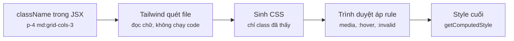
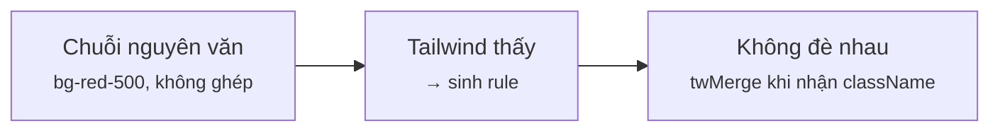
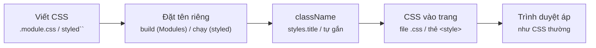
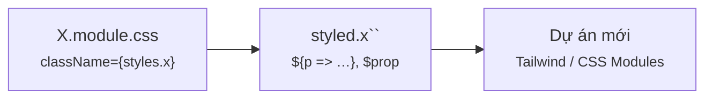
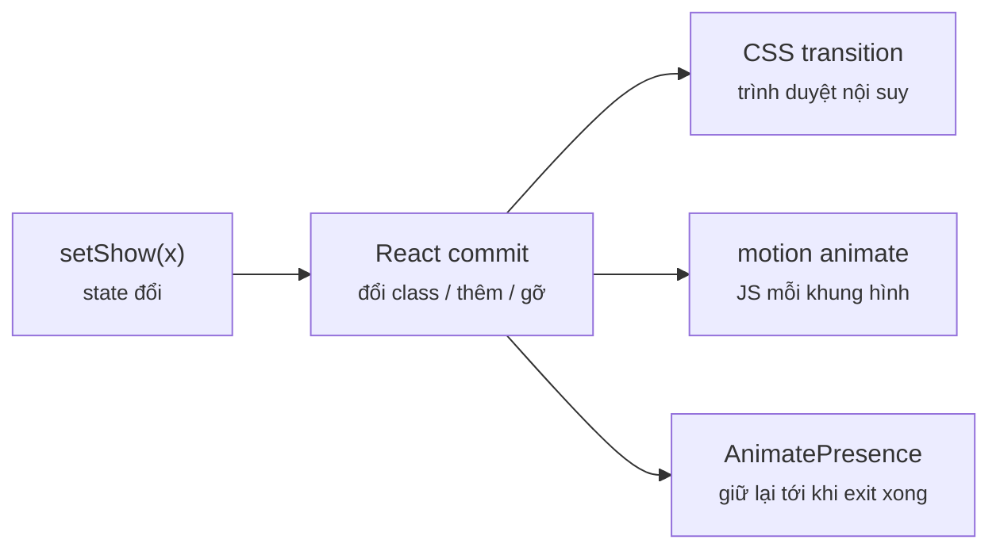
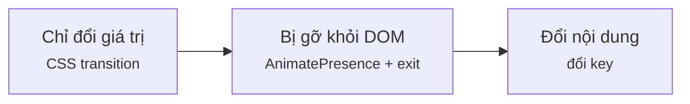

# Module 6 · Styling

_Tailwind thực chiến · CSS Modules & styled-components · Animation (CSS transition, motion)_

**Đã chạy với:** Node 22.22.0 · TypeScript 7.0.2 · React 19.3.1 · tailwindcss 4.3.3 (+ @tailwindcss/cli) · tailwind-merge 3.7.0 · Vite 8.3.4 · styled-components 6.6.0 · motion 14.4.0 · jsdom 29.1.1 · tsx 4.23.15 · Chromium 141 qua playwright-core 1.56.0

Style chỉ có nghĩa khi **trình duyệt thật** tính ra nó, nên bài này chạy 4 thứ thật: **Tailwind CLI v4** (`m6/tw.ts` gọi CLI, chỉ quét đúng file ví dụ), **pipeline dev của Vite** (`m6/vite-run.ts` nạp file `.tsx` qua Vite y như trong app → `import "*.module.css"` chạy thật), **Chromium headless** (`m6/browser.ts` render HTML rồi đọc `getComputedStyle`: màu, padding, grid, hover), và **jsdom có requestAnimationFrame** (`m6/dom.ts`) để motion chạy animation thật trong Node. Màu Tailwind v4 ra dạng `oklch(…)` là đúng — v4 dùng không gian màu OKLCH. Số **ms** đo thật, chạy lại lệch vài ms. Trên máy bạn cần thêm Chromium: `npx playwright install chromium`.

Vị trí: Đã học Module 5 · Data fetching (fetch chuẩn, TanStack Query, form actions) · **Đang học Module 6** · Sắp tới Module 7 · Performance & Design Patterns (memo, useMemo, useCallback, compound components)

## Bài 6.1 · Tailwind thực chiến: utility, variant, group/peer

_Nguồn roadmap: [BigReact] Setting Up Tailwind → Flexbox in Tailwind → Grid CSS in Tailwind → Gradients & Customizing Theme → Pseudo-classes and the Group Class → How the Peer Class Works → Animations in Tailwind · [NextAI] Configure tailwind in react application → Building card with tailwind_

### 1 · Một câu & nằm ở đâu
Tailwind = mỗi class làm **1 việc** (`p-4`, `grid-cols-3`), bạn ghép class ngay trong JSX thay vì viết file CSS. Điểm mấu chốt để không dính bug: Tailwind là **compiler quét CHỮ** trong file nguồn lúc build — class nào xuất hiện nguyên văn thì mới có CSS. Tiền tố (`md:`, `hover:`, `peer-invalid:`, `group-hover:`) là điều kiện; `@theme` thêm token riêng của bạn.

**[Viết style (class / CSS / JS)]** → **[Build tool xử lý]** → **[CSS vào trang]** → React gắn className → **[Trình duyệt tính style]** → Chuyển động

<details><summary>m6/tw.ts — chạy Tailwind CLI thật, chỉ quét file được chỉ định</summary>

`m6/tw.ts`

```tsx
// Chạy Tailwind CLI THẬT (v4), chỉ quét đúng các file nguồn được chỉ định → trả về CSS nó sinh ra
import { execSync } from "node:child_process";
import { mkdirSync, readFileSync, writeFileSync } from "node:fs";
import { resolve } from "node:path";

export function tailwind(...sources: string[]): string {
  mkdirSync("m6/.out", { recursive: true });
  writeFileSync("m6/.out/in.css", [
    '@import "tailwindcss" source(none);',          // tắt tự quét cả thư mục
    '@import "../theme.css";',                       // token riêng: espresso, crema
    ...sources.map((s) => `@source "${resolve(s)}";`),
  ].join("\n"));
  execSync("npx @tailwindcss/cli -i m6/.out/in.css -o m6/.out/tw.css", { stdio: "ignore" });
  return readFileSync("m6/.out/tw.css", "utf8");
}

// Tên các class utility Tailwind đã sinh (đọc lại từ chính file CSS ra)
export function utilities(css: string): string[] {
  const body = css.slice(css.indexOf("@layer utilities"));
  return [...body.matchAll(/^\s+\.([^\s{:\\]+(?:\\:[^\s{:\\]+)*)/gm)].map((m) => m[1].replace(/\\/g, ""));
}
```

</details>

<details><summary>m6/browser.ts — Chromium thật: render HTML, đọc getComputedStyle</summary>

`m6/browser.ts`

```tsx
// Chromium THẬT (playwright-core): đo style trình duyệt đã tính — thứ jsdom không làm được
import { chromium, type Page } from "playwright-core";
import { renderToStaticMarkup } from "react-dom/server";
import type { ReactElement } from "react";

const browser = await chromium.launch();

export async function open(ui: ReactElement, css: string, width = 1280): Promise<Page> {
  const page = await browser.newPage({ viewport: { width, height: 800 } });
  await page.setContent(`<!doctype html><style>${css}</style><body>${renderToStaticMarkup(ui)}</body>`);
  return page;
}
// getComputedStyle(el)[prop] — giá trị cuối cùng sau khi trình duyệt áp mọi rule
export const style = (page: Page, sel: string, prop: string) =>
  page.$eval(sel, (el, p) => getComputedStyle(el).getPropertyValue(p), prop);
export const close = () => browser.close();
```

</details>

<details><summary>m6/theme.css — token màu riêng: espresso, crema</summary>

`m6/theme.css`

```css
/* Token màu riêng của quán → sinh ra bg-espresso, text-espresso, bg-crema… */
@theme {
  --color-espresso: #4b2e1f;
  --color-crema: #f3e3c3;
}
```

</details>

### 2 · Concept
| Mảnh | Vai trò | Bên C# |
|---|---|---|
| `className="grid gap-4 p-4"` | Utility: 1 class ≈ 1 thuộc tính CSS. Ghép nhiều class thay vì đặt tên + viết CSS | Utility class Bootstrap trong Razor |
| Compiler (v4: `@import "tailwindcss"`) | **Đọc chữ** trong file (không chạy code), chỉ sinh CSS cho class thấy được → CSS nhỏ | Source generator: đọc source lúc build |
| `@theme { --color-espresso: … }` | Thêm token → tự có `bg-espresso`, `text-espresso`… (v4 bỏ `tailwind.config.js`) | ResourceDictionary (WPF/MAUI) |
| Variant `md:` `hover:` `invalid:` | Tiền tố = điều kiện: media query (mobile-first, `md` = ≥ 48rem) hoặc pseudo-class | VisualState / Trigger |
| `group` / `peer` | Con đổi style theo **cha** (`group-hover:`) hoặc theo **anh em đứng trước** (`peer-invalid:`) | DataTrigger bind tới element khác |
| Cài vào app Vite | `npm i tailwindcss @tailwindcss/vite` → thêm plugin `tailwindcss()` vào `vite.config` → `@import "tailwindcss";` trong `index.css` | Thêm NuGet + 1 dòng đăng ký |

### 3 · Flow / lifecycle
**Tailwind biến className thành style trên màn hình thế nào?**



Đọc sơ đồ: Trái → phải: bạn gõ class trong JSX. Lúc build, Tailwind QUÉT CHỮ trong file (không chạy code) và chỉ sinh rule cho class nó thấy. Trình duyệt áp rule theo điều kiện (màn rộng, hover, input sai) → ra style cuối cùng. Class ghép lúc chạy không qua được bước 2.

### 4 · Ví dụ thực tế
**Ví dụ 1.** Lưới menu: 1 cột trên mobile, 3 cột từ `md`, có màu riêng `bg-crema` và hover. Chạy Tailwind thật trên file này, rồi mở Chromium ở 360px và 1280px để đo.

`m6/l61-card.tsx`

```tsx
import { tailwind, utilities } from "./tw";
import { open, style, close } from "./browser";

const items = ["Latte", "Mocha", "Cold Brew"];
function Menu() {
  return (
    <ul id="menu" className="grid grid-cols-1 gap-4 p-4 md:grid-cols-3">
      {items.map((name) => (
        <li key={name} className="rounded-xl bg-crema p-4 shadow hover:bg-amber-200">
          <h3 className="font-semibold text-espresso">{name}</h3>
        </li>
      ))}
    </ul>
  );
}

const css = tailwind("m6/l61-card.tsx");                  // quét file này → sinh CSS
console.log(`CSS ra: ${(css.length / 1024).toFixed(1)} KB · ${utilities(css).length} utility`);
console.log(" ", utilities(css).join("  "));
for (const w of [360, 1280]) {
  const page = await open(<Menu />, css, w);
  console.log(`${w}px  grid-template-columns = ${await style(page, "#menu", "grid-template-columns")}`);
}
const page = await open(<Menu />, css);
console.log(`li nền        = ${await style(page, "li", "background-color")}`);
await page.hover("li");
console.log(`li nền (hover)= ${await style(page, "li", "background-color")}`);
await close();
```

```console
❯ npx tsx m6/l61-card.tsx
CSS ra: 7.7 KB · 11 utility
  grid  grid-cols-1  gap-4  rounded-xl  bg-crema  p-4  font-semibold  text-espresso  shadow  hover:bg-amber-200  md:grid-cols-3
360px  grid-template-columns = 328px
1280px  grid-template-columns = 405.328px 405.328px 405.344px
li nền        = rgb(243, 227, 195)
li nền (hover)= oklch(0.924 0.12 95.746)
```

CSS chỉ có đúng **11 utility** file này dùng (7.7 KB, phần lớn là reset `preflight`). Cùng 1 HTML: 360px ra **1** cột, 1280px ra **3** cột — đó là `md:grid-cols-3`, mobile-first (không tiền tố = mọi màn, `md:` = từ 48rem trở lên). Hover đổi nền thật trong trình duyệt, không có dòng JS nào.

**Ví dụ 2.** `peer` và `group`: báo lỗi email **không cần state**, mũi tên hiện khi hover cả thẻ. Gõ email sai/đúng và hover trong Chromium thật.

`m6/l61-variants.tsx`

```tsx
import { tailwind } from "./tw";
import { open, style, close } from "./browser";

function OrderForm() {
  return (
    <form className="space-y-3 p-4">
      {/* peer: thẻ ĐỨNG TRƯỚC; peer-invalid: áp lên anh em đứng SAU khi input không hợp lệ */}
      <input id="email" type="email" className="peer rounded border p-2 invalid:border-red-500" />
      <p id="err" className="hidden text-sm text-red-600 peer-invalid:block">Email chưa đúng</p>
      {/* group: cha; group-hover: con đổi style khi CHA bị hover */}
      <a id="card" className="group block rounded-xl bg-crema p-4">
        <span className="text-espresso group-hover:underline">Latte</span>
        <span id="arrow" className="opacity-0 transition group-hover:opacity-100"> →</span>
      </a>
    </form>
  );
}

const page = await open(<OrderForm />, tailwind("m6/l61-variants.tsx"));
const log = async (when: string) => console.log(
  `${when.padEnd(20)} #err display=${await style(page, "#err", "display")}` +
  `  #arrow opacity=${await style(page, "#arrow", "opacity")}`);
await log("ban đầu");
await page.fill("#email", "huy.cafe");        await log("gõ email sai");
await page.fill("#email", "huy@cafe.vn");     await log("sửa email đúng");
await page.hover("#card"); await page.waitForTimeout(200); await log("hover thẻ cha");
await close();
```

```console
❯ npx tsx m6/l61-variants.tsx
ban đầu              #err display=none  #arrow opacity=0
gõ email sai         #err display=block  #arrow opacity=0
sửa email đúng       #err display=none  #arrow opacity=0
hover thẻ cha        #err display=none  #arrow opacity=1
```

`#err` chỉ `display: block` khi input `:invalid` — trình duyệt tự kiểm `type="email"`, React không render lại lần nào. `peer` chỉ nhìn được anh em **đứng trước**: đặt `<p>` lên trên `<input>` là hết chạy. Với form thật vẫn cần validate ở action/server (bài 5.3) — `peer-invalid` chỉ là UX.

### 5 · Thử thật / bẫy
**Bẫy 1.** **Ghép tên class lúc chạy** — `bg-${tone}-500`. Lúc build Tailwind chỉ thấy đúng mấy chữ `bg-${tone}-500`, không biết `tone = "red"`.

`m6/l61-trap-dynamic.tsx`

```tsx
import { tailwind } from "./tw";
import { open, style, close } from "./browser";

type Tone = "red" | "green";
function Badge({ tone }: { tone: Tone }) {                       // ❌ ghép tên class lúc chạy
  return <span id="badge" className={`bg-${tone}-500 px-2 text-white`}>{tone}</span>;
}

const css = tailwind("m6/l61-trap-dynamic.tsx");                // Tailwind chỉ ĐỌC chữ trong file
const page = await open(<Badge tone="red" />, css);
const cls = (await page.getAttribute("#badge", "class"))!;
console.log("class lúc chạy :", cls);
for (const c of cls.split(" ")) console.log(`  CSS có .${c.padEnd(11)}?`, css.includes(`.${c} {`));
console.log("nền thật       :", await style(page, "#badge", "background-color"));
await close();
```

```console
❯ npx tsx m6/l61-trap-dynamic.tsx
class lúc chạy : bg-red-500 px-2 text-white
  CSS có .bg-red-500 ? false
  CSS có .px-2       ? true
  CSS có .text-white ? true
nền thật       : rgba(0, 0, 0, 0)
```

HTML có đúng class `bg-red-500` nhưng CSS **không có rule đó** → nền trong suốt. Không lỗi, không cảnh báo. Code AI rất hay viết kiểu này. Sửa: map giá trị sang **tên class đầy đủ** (`{ red: "bg-red-500" }`) — bài tập mục 7.

**Bẫy 2.** **Component nhận `className` rồi nối chuỗi.** `bg-espresso` + `bg-crema` cùng set `background-color`: ai thắng **không** phụ thuộc thứ tự trong `className`, mà theo thứ tự rule trong file CSS Tailwind sinh ra.

`m6/l61-trap-merge.tsx`

```tsx
import { twMerge } from "tailwind-merge";
import { tailwind } from "./tw";
import { open, style, close } from "./browser";

type P = { id: string; className?: string };
function ButtonBad({ id, className = "" }: P) {                  // ❌ nối chuỗi: 2 class cùng thuộc tính
  return <button id={id} className={`bg-espresso px-4 ${className}`}>Đặt món</button>;
}
function ButtonGood({ id, className = "" }: P) {                 // ✅ twMerge bỏ class bị ghi đè
  return <button id={id} className={twMerge("bg-espresso px-4", className)}>Đặt món</button>;
}

const page = await open(<>
  <ButtonBad id="bad" className="bg-crema px-8" />
  <ButtonGood id="good" className="bg-crema px-8" />
</>, tailwind("m6/l61-trap-merge.tsx"));
for (const id of ["bad", "good"]) {
  console.log(`${id.padEnd(4)} class="${await page.getAttribute("#" + id, "class")}"`);
  console.log(`     nền=${await style(page, "#" + id, "background-color")}  padding-left=${await style(page, "#" + id, "padding-left")}`);
}
await close();
```

```console
❯ npx tsx m6/l61-trap-merge.tsx
bad  class="bg-espresso px-4 bg-crema px-8"
     nền=rgb(75, 46, 31)  padding-left=32px
good class="bg-crema px-8"
     nền=rgb(243, 227, 195)  padding-left=32px
```

Bad: muốn nền crema mà ra espresso, còn `px-8` thì "ăn" — đúng sai **tuỳ may**, đổi tên màu là đổi kết quả. `twMerge` biết 2 class cùng nhóm thuộc tính nên bỏ class cũ → chỉ còn `bg-crema px-8`. Thư viện UI (shadcn/ui…) bọc sẵn thành hàm `cn()` = `twMerge(clsx(...))`.

### 6 · Tóm tắt bằng hình
**(a) Cây thư mục sau bài này**

```text
sandbox/
├─ package.json  [SỬA]  ← + tailwindcss, @tailwindcss/cli, tailwind-merge, playwright-core
└─ m6/
   ├─ theme.css  [MỚI]  ← @theme: token màu riêng
   ├─ tw.ts  [MỚI]  ← chạy Tailwind CLI thật
   ├─ browser.ts  [MỚI]  ← Chromium thật đo style
   ├─ l61-card.tsx  [MỚI]  ← grid responsive + hover + token
   ├─ l61-variants.tsx  [MỚI]  ← peer-invalid, group-hover
   ├─ l61-trap-dynamic.tsx  [MỚI]  ← class ghép lúc chạy → không có CSS
   └─ l61-trap-merge.tsx  [MỚI]  ← className đè nhau → twMerge
```

**(b) Đọc trong 10 giây**

**Class Tailwind có chạy không?**



Đọc sơ đồ: Hỏi đúng 2 câu khi review: chuỗi có nguyên văn trong file không, và có 2 class đè cùng thuộc tính không.

### 7 · Làm ngay (≤ 10 phút)
**Mục tiêu:** `m6/ex/ex61-start.tsx`: 2 badge trạng thái đang **không có màu nền**. Sửa để `open` nền xanh lá, `closed` nền đỏ — vẫn chọn màu theo `status`.

File khởi đầu:

`m6/ex/ex61-start.tsx`

```tsx
import { tailwind } from "../tw";
import { open, style, close } from "../browser";

type Status = "open" | "closed";
const COLOR: Record<Status, string> = { open: "green", closed: "red" };

function StatusBadge({ status }: { status: Status }) {
  // TODO: Tailwind không thấy class ghép lúc chạy → map status thẳng ra tên class ĐẦY ĐỦ
  return <span id={status} className={`bg-${COLOR[status]}-600 rounded px-2 text-white`}>{status}</span>;
}

const page = await open(<><StatusBadge status="open" /><StatusBadge status="closed" /></>, tailwind("m6/ex/ex61-start.tsx"));
for (const s of ["open", "closed"]) console.log(`${s.padEnd(6)} nền = ${await style(page, "#" + s, "background-color")}`);
await close();
```

Chạy file khởi đầu (đang đỏ):

```console
❯ npx tsx m6/ex/ex61-start.tsx
open   nền = rgba(0, 0, 0, 0)
closed nền = rgba(0, 0, 0, 0)
```

Tiêu chí nghiệm thu:

- [ ] `open` ra `oklch(0.627 0.194 149.214)` (green-600)
- [ ] `closed` ra `oklch(0.577 0.245 27.325)` (red-600)
- [ ] Không còn `${…}` nằm **bên trong** tên class
- [ ] `npx tsc -p .` không báo lỗi

Lệnh nghiệm thu:

```bash
npx tsx m6/ex/ex61-start.tsx && npx tsc -p .
```

Lời giải tham chiếu chạy ra (output cần đạt):

```console
❯ npx tsx m6/ex/ex61-solution.tsx
open   nền = oklch(0.627 0.194 149.214)
closed nền = oklch(0.577 0.245 27.325)
```

<details><summary>Gợi ý nếu bị đỏ</summary>

| Triệu chứng | Nguyên nhân | Sửa |
|---|---|---|
| Vẫn `rgba(0, 0, 0, 0)` | Map vẫn trả `"green"` rồi ghép `bg-…-600` | Map trả **cả tên class**: `{ open: "bg-green-600", closed: "bg-red-600" }` |
| Chỉ 1 badge có màu | Chỉ viết đủ 1 tên class, cái kia vẫn ghép | Cả 2 giá trị trong map đều là chuỗi đầy đủ |
| TS: `Element implicitly has an 'any' type` | Map khai báo `Record<string, string>` rồi index bằng biến lạ | Giữ `Record<Status, string>` |

`m6/ex/ex61-start.tsx` (diff)

```diff
 
 type Status = "open" | "closed";
-const COLOR: Record<Status, string> = { open: "green", closed: "red" };
+const BG: Record<Status, string> = { open: "bg-green-600", closed: "bg-red-600" };   // ✅ chuỗi đầy đủ
 
 function StatusBadge({ status }: { status: Status }) {
-  // TODO: Tailwind không thấy class ghép lúc chạy → map status thẳng ra tên class ĐẦY ĐỦ
-  return <span id={status} className={`bg-${COLOR[status]}-600 rounded px-2 text-white`}>{status}</span>;
+  return <span id={status} className={`${BG[status]} rounded px-2 text-white`}>{status}</span>;
 }
 
-const page = await open(<><StatusBadge status="open" /><StatusBadge status="closed" /></>, tailwind("m6/ex/ex61-start.tsx"));
+const page = await open(<><StatusBadge status="open" /><StatusBadge status="closed" /></>, tailwind("m6/ex/ex61-solution.tsx"));
 for (const s of ["open", "closed"]) console.log(`${s.padEnd(6)} nền = ${await style(page, "#" + s, "background-color")}`);
 await close();
```

</details>

### 8 · 3 câu hỏi nhanh
1. Viết `className={isAdmin ? "bg-red-500" : "bg-gray-200"}` có bị lỗi như bẫy 1 không?

   <details><summary>Đáp án</summary>

   **Không.** Cả 2 chuỗi xuất hiện **nguyên văn** trong file nên Tailwind thấy và sinh CSS cho cả hai. Luật chỉ là: tên class phải là chuỗi hoàn chỉnh ở đâu đó trong source — điều kiện, map, mảng đều được; ghép mảnh (`bg-${x}-500`) thì không.

   </details>

2. `md:grid-cols-3` áp dụng ở màn 360px hay 1280px? Vì sao gọi là mobile-first?

   <details><summary>Đáp án</summary>

   1280px. `md:` = `@media (width >= 48rem)`. Class **không** tiền tố áp cho mọi màn (kể cả mobile), tiền tố chỉ **thêm** điều kiện cho màn lớn hơn. Nên viết style mobile trước, rồi `md:` / `lg:` ghi đè lên.

   </details>

3. Review code AI: component nhận `className` và viết `className={"px-4 py-2 " + className}`. Góp ý gì?

   <details><summary>Đáp án</summary>

   Người dùng truyền `px-6` sẽ đè hay không là tuỳ thứ tự rule trong CSS sinh ra (bẫy 2). Dùng `twMerge("px-4 py-2", className)` (hoặc `cn()`) để class truyền vào chắc chắn thắng.

   </details>


---

## Bài 6.2 · CSS Modules & styled-components (đọc code cũ / team khác)

_Nguồn roadmap: [Academind] Scoping CSS Rules with CSS Modules → Introducing "Styled Components" → Styled Components: Pseudo Selectors, Nested Rules & Media Queries_

### 1 · Một câu & nằm ở đâu
CSS thường là **global**: 2 file cùng có `.title` là đè nhau. Hai cách scope hay gặp trong code có sẵn: **CSS Modules** — viết CSS bình thường trong `X.module.css`, build tool **băm tên class** lúc build, bạn dùng `styles.title`; **styled-components** — viết CSS trong template string, thư viện **sinh class lúc chạy**, style theo props. Dự án mới: CSS Modules hoặc Tailwind; styled-components đã vào **maintenance mode** (2025), học để đọc/sửa code cũ.

**[Viết style (class / CSS / JS)]** → **[Build tool xử lý]** → **[CSS vào trang]** → **[React gắn className]** → Trình duyệt tính style → Chuyển động

<details><summary>m6/vite-run.ts — chạy file .tsx qua pipeline dev thật của Vite</summary>

`m6/vite-run.ts`

```tsx
// Chạy 1 file .tsx qua pipeline THẬT của Vite (giống lúc dev) → import "*.module.css" hoạt động như trong app
import { createServer } from "vite";

const vite = await createServer({
  root: "m6", configFile: false, logLevel: "silent",
  server: { middlewareMode: true }, appType: "custom",
});
await vite.ssrLoadModule("/" + process.argv[2]);     // vd: npx tsx m6/vite-run.ts l62-card.tsx
await vite.close();
```

</details>

### 2 · Concept
| | CSS Modules | styled-components |
|---|---|---|
| Viết CSS ở đâu | File riêng `Card.module.css`, cú pháp CSS thuần | Template string ngay sau `styled.button` trong file TSX |
| Scope bằng cách | Build tool đổi `.title` → `._title_1c729_1` | Thư viện tự đặt tên class (`jOfKNX`) |
| CSS sinh ra lúc | **Build** — ra file `.css` tĩnh, 0 chi phí runtime | **Chạy** — JS tính CSS, chèn thẻ `<style>` |
| Style theo props | Ghép class: `featured ? styles.featured : ""` | `${(p) => p.$primary ? … : …}` ngay trong CSS |
| Hover / media query | CSS thuần | Lồng thẳng: `&:hover {…}`, `@media {…}` |
| Bên C# | **Blazor CSS isolation** (`Comp.razor.css` → attribute `b-xyz`) | — |

### 3 · Flow / lifecycle
**Hai cách scope CSS khác nhau ở bước nào?**



Đọc sơ đồ: Trái → phải: bạn viết CSS (file .module.css hoặc template string của styled-components). Bước 2 là khác biệt chính: CSS Modules băm tên lúc BUILD, styled-components sinh class lúc CHẠY. Bạn gắn tên đó vào className, CSS vào trang (file .css tĩnh hoặc thẻ style), trình duyệt áp rule như CSS thường.

### 4 · Ví dụ thực tế
**Ví dụ 1.** CSS Modules: file CSS thuần, tên ngắn gọn. Chạy qua Vite thật để xem Vite xuất ra CSS gì.

`m6/Card.module.css`

```css
/* Tên class viết thoải mái: .card, .title — Vite đổi thành tên riêng cho file này */
.card {
  padding: 16px;
  border-radius: 12px;
  background: #f3e3c3;
}
.title {
  color: #4b2e1f;
  font-weight: 600;
}
.featured {
  border: 2px solid #a0522d;
}
```

```console
❯ npx tsx m6/vite-run.ts l62-card.tsx
── CSS Vite xuất ra ──
/* Tên class viết thoải mái: .card, .title — Vite đổi thành tên riêng cho file này */
._card_1c729_1 {
  padding: 16px;
  border-radius: 12px;
  background: #f3e3c3;
}
._title_1c729_1 {
  color: #4b2e1f;
  font-weight: 600;
}
._featured_1c729_11 {
  border: 2px solid #a0522d;
}
```

(… còn 9 dòng — đã trích dòng 1–14 / 23 của `npx tsx m6/vite-run.ts l62-card.tsx`)

Vite (lúc dev và lúc build) đổi mỗi class thành `_tên_băm_dòng` — hash lấy từ đường dẫn file, nên `.title` ở file khác sẽ ra tên khác, không bao giờ đè nhau. CSS này là file tĩnh, không tốn JS lúc chạy.

**Ví dụ 2.** Component dùng module: `import styles` nhận **object tên đã băm**, ghép class theo prop. Cùng lần chạy trên, phần sau:

`m6/l62-card.tsx`

```tsx
import styles from "./Card.module.css";               // object: tên trong file → tên đã băm
import compiled from "./Card.module.css?inline";      // (chỉ để xem) CSS mà Vite thật sự xuất ra
import { renderToStaticMarkup } from "react-dom/server";

export function Card({ name, featured = false }: { name: string; featured?: boolean }) {
  return (
    <div className={featured ? `${styles.card} ${styles.featured}` : styles.card}>
      <h3 className={styles.title}>{name}</h3>
    </div>
  );
}

console.log("── CSS Vite xuất ra ──\n" + compiled.trim());
console.log("── styles (giá trị import) ──\n", styles);
console.log("── HTML React render ──");
console.log(renderToStaticMarkup(<><Card name="Latte" /><Card name="Mocha" featured /></>).replace(/<div/g, "\n<div").trim());
```

```console
❯ npx tsx m6/vite-run.ts l62-card.tsx
── styles (giá trị import) ──
 {
  card: '_card_1c729_1',
  title: '_title_1c729_1',
  featured: '_featured_1c729_11'
}
── HTML React render ──
<div class="_card_1c729_1"><h3 class="_title_1c729_1">Latte</h3></div>
<div class="_card_1c729_1 _featured_1c729_11"><h3 class="_title_1c729_1">Mocha</h3></div>
```

(… còn 14 dòng — đã trích dòng 15–23 / 23 của `npx tsx m6/vite-run.ts l62-card.tsx`)

`styles` chỉ là `Record<string, string>`. Biến thể (`featured`) = **thêm 1 class nữa**, không có logic CSS trong JS. Trong TypeScript, kiểu của `import "*.module.css"` đến từ `vite/client` (đã thêm vào `types` của tsconfig).

**Ví dụ 3.** styled-components: CSS trong template string, giá trị lấy từ props, lồng `&:hover` và `@media`. Render ra HTML + CSS mà thư viện sinh lúc chạy.

`m6/l62-styled.tsx`

```tsx
import styled, { ServerStyleSheet } from "styled-components";
import { renderToString } from "react-dom/server";

// Component = thẻ HTML + CSS viết trong template string; prop có "$" chỉ để style, không xuống DOM
const Button = styled.button<{ $primary?: boolean }>`
  padding: 8px 16px;
  border-radius: 8px;
  background: ${(p) => (p.$primary ? "#4b2e1f" : "#f3e3c3")};
  color: ${(p) => (p.$primary ? "white" : "#4b2e1f")};
  &:hover { opacity: 0.85; }
  @media (max-width: 600px) { width: 100%; }
`;

const sheet = new ServerStyleSheet();                  // gom CSS sinh ra trong lúc render
const html = renderToString(sheet.collectStyles(<>
  <Button>Xem menu</Button>
  <Button $primary>Đặt món</Button>
</>));
console.log("── HTML ──\n" + html.replace(/<button/g, "\n<button").trim());
const css = sheet.getStyleTags().replace(/<[^>]+>|\/\*[^*]*\*\/|data-styled[^}]*}/g, "");
console.log("── CSS sinh LÚC CHẠY ──\n" + css.match(/(@media[^{]+\{)?[^{}]+\{[^{}]*\}\}?/g)!.map((r) => r.trim()).join("\n"));
```

```console
❯ npx tsx m6/vite-run.ts l62-styled.tsx
── HTML ──
<button class="sc-bdnzMm jOfKNX">Xem menu</button>
<button class="sc-bdnzMm eLCRHM">Đặt món</button>
── CSS sinh LÚC CHẠY ──
.jOfKNX{padding:8px 16px;border-radius:8px;background:#f3e3c3;color:#4b2e1f;}
.jOfKNX:hover{opacity:0.85;}
@media (max-width: 600px){.jOfKNX{width:100%;}}
.eLCRHM{padding:8px 16px;border-radius:8px;background:#4b2e1f;color:white;}
.eLCRHM:hover{opacity:0.85;}
@media (max-width: 600px){.eLCRHM{width:100%;}}
```

Mỗi bộ props khác nhau → **1 class mới** (`jOfKNX` / `eLCRHM`) với CSS đầy đủ, tính bằng JS mỗi lần render. Đó là chi phí runtime khiến hệ sinh thái (Server Components, React 19) chuyển sang CSS sinh lúc build. Prop `$primary` có `$` = **transient prop**: chỉ để tính CSS, không lọt xuống `<button>` (bài tập mục 7).

### 5 · Thử thật / bẫy
**Bẫy 1.** **CSS Modules mà viết `className="title"`** (thói quen CSS thường). Trong file CSS ra không còn class nào tên `title`.

`m6/l62-trap-string.tsx`

```tsx
import styles from "./Card.module.css";
import compiled from "./Card.module.css?inline";
import { open, style, close } from "./browser";

const Bad = () => <h3 id="bad" className="title">Latte</h3>;            // ❌ chuỗi "title"
const Good = () => <h3 id="good" className={styles.title}>Latte</h3>;   // ✅ tên đã băm

const page = await open(<><Bad /><Good /></>, compiled);
for (const id of ["bad", "good"])
  console.log(`${id.padEnd(4)} class="${await page.getAttribute("#" + id, "class")}" → color=${await style(page, "#" + id, "color")}`);
await close();
```

```console
❯ npx tsx m6/vite-run.ts l62-trap-string.tsx
bad  class="title" → color=rgb(0, 0, 0)
good class="_title_1c729_1" → color=rgb(75, 46, 31)
```

Chromium đo: chữ `bad` màu đen mặc định. Luôn đi qua `styles.x`. Muốn chừa 1 class global (vd. class của thư viện ngoài) thì trong `.module.css` viết `:global(.ten-class) {…}`.

**Bẫy 2.** **Khai báo `styled.div` bên trong component.** Mỗi lần render tạo ra **1 kiểu component mới** → React thấy kiểu khác → gỡ cả cây con, dựng lại từ đầu.

`m6/l62-trap-inside.tsx`

```tsx
import { root, wait, click, type, $ } from "./dom";
import styled from "styled-components";
import { useState } from "react";
import { createRoot } from "react-dom/client";

function SearchBad() {
  const [n, setN] = useState(0);
  const Box = styled.div`padding: 8px;`;               // ❌ mỗi lần render = 1 component MỚI
  return <Box><input /><button onClick={() => setN(n + 1)}>render lại {n}</button></Box>;
}
const Box = styled.div`padding: 8px;`;                 // ✅ khai báo 1 lần, ngoài component
function SearchGood() {
  const [n, setN] = useState(0);
  return <Box><input /><button onClick={() => setN(n + 1)}>render lại {n}</button></Box>;
}

for (const [name, Search] of [["Bad ", SearchBad], ["Good", SearchGood]] as const) {
  const app = createRoot(root);
  app.render(<Search />); await wait(20);
  type($<HTMLInputElement>("input"), "latte");          // user gõ vào ô tìm
  click("button"); await wait(20);                      // state đổi → render lại
  console.log(`${name}: ô tìm còn "${$<HTMLInputElement>("input").value}"`);
  app.unmount();
}
```

```console
❯ npx tsx m6/vite-run.ts l62-trap-inside.tsx
The component styled.div with the id of "sc-dlnlqM" has been created dynamically.
You may see this warning because you've called styled inside another component.
To resolve this only create new StyledComponents outside of any render method and function component.
See https://styled-components.com/docs/basics#define-styled-components-outside-of-the-render-method for more info.

Bad : ô tìm còn ""
Good: ô tìm còn "latte"
```

(… còn 5 dòng — đã trích dòng 6–12 / 12 của `npx tsx m6/vite-run.ts l62-trap-inside.tsx`)

User gõ "latte", bấm 1 nút làm state đổi → ô tìm **trắng trơn** vì `<input>` bị unmount rồi mount lại (giống đổi `key`, Module 1). styled-components có cảnh báo ở dev, nhưng code AI hay "đóng gói" style vào trong component cho gọn. Luật: `styled.x`, `createContext`, component con — khai báo **ngoài** hàm component.

### 6 · Tóm tắt bằng hình
**(a) Cây thư mục sau bài này**

```text
sandbox/
├─ package.json  [SỬA]  ← + vite, styled-components
├─ tsconfig.json  [SỬA]  ← types: + vite/client (kiểu cho *.module.css)
└─ m6/
   ├─ vite-run.ts  [MỚI]  ← nạp .tsx qua Vite thật
   ├─ Card.module.css  [MỚI]  ← .card .title .featured → tên băm
   ├─ l62-card.tsx  [MỚI]  ← import styles + ghép class theo prop
   ├─ l62-styled.tsx  [MỚI]  ← styled.button + $prop + SSR sheet
   ├─ l62-trap-string.tsx  [MỚI]  ← className="title" → không ăn style
   └─ l62-trap-inside.tsx  [MỚI]  ← styled trong component → mất state
```

**(b) Đọc trong 10 giây**

**Gặp code cũ dùng gì thì đọc thế nào?**



Đọc sơ đồ: Thấy import styles từ .module.css → CSS thường, scope lúc build. Thấy styled.x + template string → CSS sinh lúc chạy, nhìn props có $.

### 7 · Làm ngay (≤ 10 phút)
**Mục tiêu:** `m6/ex/ex62-start.tsx`: tab "Cà phê" đang active nhưng React + styled-components đều cảnh báo prop `active` lọt xuống DOM. Sửa để hết cảnh báo, 2 tab vẫn ra 2 class khác nhau.

File khởi đầu:

`m6/ex/ex62-start.tsx`

```tsx
import styled, { ServerStyleSheet } from "styled-components";
import { renderToString } from "react-dom/server";

// TODO: prop "active" đang lọt xuống thẻ <button> thật → đổi thành prop chỉ-để-style
const Tab = styled.button<{ active?: boolean }>`
  border: 0;
  border-bottom: 2px solid ${(p) => (p.active ? "#a0522d" : "transparent")};
`;

const sheet = new ServerStyleSheet();
const html = renderToString(sheet.collectStyles(<><Tab active>Cà phê</Tab><Tab>Trà</Tab></>));
console.log(html.replace(/<button/g, "\n<button").trim());
```

Chạy file khởi đầu (đang đỏ):

```console
❯ npx tsx m6/vite-run.ts ex/ex62-start.tsx
styled-components: it looks like an unknown prop "active" is being sent through to the DOM, which will likely trigger a React console error. If you would like automatic filtering of unknown props, you can opt-into that behavior via `<StyleSheetManager shouldForwardProp={...}>` (connect an API like `@emotion/is-prop-valid`) or consider using transient props (`$` prefix for automatic filtering.)
Received `true` for a non-boolean attribute `active`.

If you want to write it to the DOM, pass a string instead: active="true" or active={value.toString()}.
<button class="sc-bdnzMm eiWWew">Cà phê</button>
<button class="sc-bdnzMm cUuhLp">Trà</button>
```

Tiêu chí nghiệm thu:

- [ ] Output **chỉ còn 2 dòng** `<button …>`, không còn cảnh báo
- [ ] 2 nút có class thứ 2 khác nhau (active ≠ không active)
- [ ] `npx tsc -p .` không báo lỗi

Lệnh nghiệm thu:

```bash
npx tsx m6/vite-run.ts ex/ex62-start.tsx && npx tsc -p .
```

Lời giải tham chiếu chạy ra (output cần đạt):

```console
❯ npx tsx m6/vite-run.ts ex/ex62-solution.tsx
<button class="sc-bdnzMm eiWWew">Cà phê</button>
<button class="sc-bdnzMm cUuhLp">Trà</button>
```

<details><summary>Gợi ý nếu bị đỏ</summary>

| Triệu chứng | Nguyên nhân | Sửa |
|---|---|---|
| TS: `Property 'active' does not exist` | Đổi tên ở generic nhưng chưa đổi trong `${(p) => p.active…}` | Đổi cả 3 chỗ: generic, hàm trong CSS, JSX `<Tab $active>` |
| 2 nút cùng class | Quên đổi `<Tab active>` → prop không còn khớp | `<Tab $active>Cà phê</Tab>` |
| Vẫn còn cảnh báo | Đổi `active` thành tên khác nhưng không có `$` | Chỉ tiền tố `$` mới được styled-components giữ lại |

`m6/ex/ex62-start.tsx` (diff)

```diff
 import { renderToString } from "react-dom/server";
 
-// TODO: prop "active" đang lọt xuống thẻ <button> thật → đổi thành prop chỉ-để-style
-const Tab = styled.button<{ active?: boolean }>`
+// ✅ "$active": styled-components dùng để tính CSS rồi GIỮ LẠI, không đưa xuống DOM
+const Tab = styled.button<{ $active?: boolean }>`
   border: 0;
-  border-bottom: 2px solid ${(p) => (p.active ? "#a0522d" : "transparent")};
+  border-bottom: 2px solid ${(p) => (p.$active ? "#a0522d" : "transparent")};
 `;
 
 const sheet = new ServerStyleSheet();
-const html = renderToString(sheet.collectStyles(<><Tab active>Cà phê</Tab><Tab>Trà</Tab></>));
+const html = renderToString(sheet.collectStyles(<><Tab $active>Cà phê</Tab><Tab>Trà</Tab></>));
 console.log(html.replace(/<button/g, "\n<button").trim());
```

</details>

### 8 · 3 câu hỏi nhanh
1. 2 file `Menu.module.css` và `Cart.module.css` đều có `.title`. Có đè nhau không?

   <details><summary>Đáp án</summary>

   **Không.** Build tool băm tên theo đường dẫn file: ra 2 class khác nhau (dạng `_title_abc12_1` và `_title_xyz34_1`). Đó là toàn bộ lý do tồn tại của CSS Modules — giống Blazor CSS isolation gắn `b-{hash}` riêng cho từng component.

   </details>

2. Vì sao styled-components chậm hơn CSS Modules lúc chạy, và vì sao điều đó quan trọng với React Server Components?

   <details><summary>Đáp án</summary>

   Nó tính CSS bằng JS **mỗi lần render** rồi chèn vào `<style>` (cần context + chạy trên client). CSS Modules/Tailwind sinh file `.css` tĩnh lúc build, không tốn JS. Server Components không chạy được runtime đó, nên hệ sinh thái chuyển sang CSS lúc build — và styled-components vào maintenance mode.

   </details>

3. Review code AI: `function Row() { const Cell = styled.td(…); … }` (khai báo `styled.td` **bên trong** component). Lỗi gì?

   <details><summary>Đáp án</summary>

   Mỗi render tạo kiểu component mới → React unmount + mount lại cả cây con: mất state, mất focus, tốn DOM (bẫy 2). Đưa `const Cell = styled.td…` ra ngoài hàm.

   </details>


---

## Bài 6.3 · Animation: CSS transition & motion (Framer Motion)

_Nguồn roadmap: [Academind] Animating with CSS Transitions → Introducing Framer Motion → Animating Between Conditional Values → Orchestrating Multi-Element Animations → Scroll-based Animations · [BigReact] Animations in Tailwind_

### 1 · Một câu & nằm ở đâu
React **không animate** — nó chỉ đổi class / thêm / gỡ phần tử. Đổi class thì **trình duyệt** tự nội suy nhờ CSS `transition` (rẻ nhất, đủ cho 80% trường hợp). Cái CSS không làm được là **exit**: React gỡ phần tử khỏi DOM ngay, chẳng còn gì để mờ dần. Thư viện **motion** (tên mới của Framer Motion, `import … from "motion/react"`) giải quyết: `<AnimatePresence>` giữ phần tử lại tới khi `exit` chạy xong.

Viết style (class / CSS / JS) → Build tool xử lý → CSS vào trang → **[React gắn className]** → **[Trình duyệt tính style]** → **[Chuyển động]**

<details><summary>m6/dom.ts — DOM giả dùng cho mọi ví dụ</summary>

`m6/dom.ts`

```tsx
// DOM giả (jsdom) có requestAnimationFrame ~60 khung/giây → React + motion chạy animation thật trong Node
import { JSDOM } from "jsdom";

const dom = new JSDOM('<!doctype html><div id="root"></div>', { pretendToBeVisual: true });
const w = dom.window;
Object.assign(globalThis, {
  window: w, document: w.document, Element: w.Element, HTMLElement: w.HTMLElement, SVGElement: w.SVGElement,
  getComputedStyle: w.getComputedStyle.bind(w),
  requestAnimationFrame: w.requestAnimationFrame, cancelAnimationFrame: w.cancelAnimationFrame,
  IS_REACT_ACT_ENVIRONMENT: false,                   // render như trình duyệt, không gom bằng act()
});

export const root = w.document.getElementById("root")!;
export const wait = (ms: number) => new Promise((r) => setTimeout(r, ms));
let t0 = Date.now();
export const resetClock = () => { t0 = Date.now(); };
export const until = (ms: number) => wait(Math.max(0, ms - (Date.now() - t0)));   // chờ tới mốc ms
export const ms = () => `${String(Date.now() - t0).padStart(3)}ms`;
export const $ = <T extends Element = HTMLElement>(sel: string) => root.querySelector(sel) as T;
export const click = (sel: string) => $(sel).click();
export function type(el: HTMLInputElement, value: string) {      // gõ như user
  w.Object.getOwnPropertyDescriptor(w.HTMLInputElement.prototype, "value")!.set!.call(el, value);
  el.dispatchEvent(new w.Event("input", { bubbles: true }));
}
```

</details>

### 2 · Concept
| Cách | Ai chạy chuyển động | Dùng khi | Bên C# |
|---|---|---|---|
| CSS `transition` (`transition-opacity duration-300`) | Trình duyệt, khi giá trị CSS đổi | Hover, hiện/ẩn khi phần tử **vẫn còn** trong DOM | WPF Storyboard theo trigger |
| CSS keyframes (`animate-spin`, `animate-pulse`) | Trình duyệt, tự chạy / lặp | Spinner, skeleton loading | — |
| `<motion.div initial animate>` | JS (motion) tính từng khung hình | Giá trị động, spring, nhiều phần tử nối nhau (`variants` + stagger) | — |
| `<AnimatePresence>` + `exit` | Giữ phần tử trong DOM tới khi exit xong rồi mới gỡ | Toast, modal, item bị xoá khỏi list | — |
| `whileInView` / `layout` | Animate khi cuộn tới / khi vị trí đổi | Scroll reveal, sắp xếp lại list | — |

### 3 · Flow / lifecycle
**State đổi → chuyển động chạy ở đâu?**



Đọc sơ đồ: Trái → phải: bạn đổi state, React render và commit (đổi class, thêm/gỡ phần tử). Từ đây tách 3 nhánh: CSS transition do trình duyệt nội suy; motion tính giá trị bằng JS mỗi khung hình; khi phần tử bị gỡ, chỉ AnimatePresence mới giữ nó lại cho exit chạy.

### 4 · Ví dụ thực tế
**Ví dụ 1.** CSS transition: React chỉ chọn class `opacity-0` hay `opacity-100`. Đổi class đúng như React commit, rồi đo `opacity` **trong Chromium** mỗi ~100ms.

`m6/l63-transition.tsx`

```tsx
import { tailwind } from "./tw";
import { open, close } from "./browser";
import { renderToStaticMarkup } from "react-dom/server";

function Toast({ show }: { show: boolean }) {          // React chỉ quyết định CLASS nào
  return <p id="toast" className={`transition-opacity duration-300 ${show ? "opacity-100" : "opacity-0"}`}>Đã thêm Latte</p>;
}

const page = await open(<Toast show={false} />, tailwind("m6/l63-transition.tsx"));
const nextClass = renderToStaticMarkup(<Toast show />).match(/class="([^"]+)"/)![1];
const samples = await page.evaluate(async (cls) => {
  const el = document.getElementById("toast")!;
  el.className = cls;                                   // = đúng việc React commit làm khi show: false → true
  const out: string[] = [], t0 = performance.now();
  for (const t of [0, 100, 200, 300, 400]) {
    while (performance.now() - t0 < t) await new Promise(requestAnimationFrame);
    out.push(`${String(Math.round(performance.now() - t0)).padStart(3)}ms  opacity=${(+getComputedStyle(el).opacity).toFixed(2)}`);
  }
  return out;
}, nextClass);
console.log(`class mới: "${nextClass}"`);
console.log(samples.join("\n"));
await close();
```

```console
❯ npx tsx m6/l63-transition.tsx
class mới: "transition-opacity duration-300 opacity-100"
  0ms  opacity=0.00
113ms  opacity=0.59
213ms  opacity=0.95
315ms  opacity=1.00
413ms  opacity=1.00
```

Opacity tăng dần 0 → 1 trong ~300ms mà không có dòng JS nào chạy theo khung hình — trình duyệt tự làm. Quy tắc: phần tử **vẫn còn trong DOM**, chỉ đổi giá trị → dùng CSS transition, không cần thư viện.

**Ví dụ 2.** motion + `AnimatePresence`: hiện có `initial → animate`, ẩn có `exit`. Đo `opacity` và việc `<p>` còn trong DOM hay không.

`m6/l63-presence.tsx`

```tsx
import { root, resetClock, until, ms } from "./dom";
import { AnimatePresence, motion } from "motion/react";
import { createRoot } from "react-dom/client";

function Toast({ show }: { show: boolean }) {
  return (
    <AnimatePresence>
      {show && (
        <motion.p key="toast"
          initial={{ opacity: 0 }} animate={{ opacity: 1 }} exit={{ opacity: 0 }}
          transition={{ duration: 0.3 }}>
          Đã thêm Latte
        </motion.p>
      )}
    </AnimatePresence>
  );
}

const state = () => { const p = root.querySelector("p"); return p ? `<p> opacity=${Number(p.style.opacity).toFixed(2)}` : "không còn <p> trong DOM"; };
const app = createRoot(root);
for (const show of [true, false]) {
  resetClock(); app.render(<Toast show={show} />);
  for (const t of [10, 100, 200, 400]) { await until(t); console.log(`show=${String(show).padEnd(5)} ${ms()}  ${state()}`); }
}
process.exit(0);                                       // motion còn hẹn khung hình rảnh → thoát tay
```

```console
❯ npx tsx m6/l63-presence.tsx
show=true   30ms  <p> opacity=0.00
show=true  100ms  <p> opacity=0.27
show=true  200ms  <p> opacity=0.65
show=true  400ms  <p> opacity=1.00
show=false  11ms  <p> opacity=1.00
show=false 100ms  <p> opacity=0.58
show=false 201ms  <p> opacity=0.20
show=false 401ms  không còn <p> trong DOM
```

Khi `show=false`, React đã render "không có `<p>`", nhưng `AnimatePresence` **giữ** nó lại, chạy `exit` (1 → 0) rồi mới gỡ khỏi DOM sau ~300ms. Con trực tiếp của `AnimatePresence` phải có `key` để nó biết phần tử nào đi/đến.

### 5 · Thử thật / bẫy
**Bẫy 1.** **Có `exit` nhưng quên `<AnimatePresence>`.** Không ai giữ phần tử lại → React gỡ ngay, prop `exit` bị bỏ qua.

`m6/l63-trap-nopresence.tsx`

```tsx
import { root, resetClock, until, ms } from "./dom";
import { motion } from "motion/react";
import { createRoot } from "react-dom/client";

function Toast({ show }: { show: boolean }) {          // ❌ có exit nhưng KHÔNG bọc AnimatePresence
  return show && (
    <motion.p initial={{ opacity: 0 }} animate={{ opacity: 1 }} exit={{ opacity: 0 }} transition={{ duration: 0.3 }}>
      Đã thêm Latte
    </motion.p>
  );
}

const state = () => { const p = root.querySelector("p"); return p ? `<p> opacity=${Number(p.style.opacity).toFixed(2)}` : "không còn <p> trong DOM"; };
const app = createRoot(root);
app.render(<Toast show />); await until(400);
resetClock(); app.render(<Toast show={false} />);
for (const t of [10, 100, 200]) { await until(t); console.log(`show=false ${ms()}  ${state()}`); }
process.exit(0);
```

```console
❯ npx tsx m6/l63-trap-nopresence.tsx
show=false  11ms  không còn <p> trong DOM
show=false 101ms  không còn <p> trong DOM
show=false 199ms  không còn <p> trong DOM
```

10ms sau khi ẩn đã mất hẳn — không lỗi, không cảnh báo, chỉ là "animation không chạy". Đây là lỗi số 1 khi dùng motion; nhớ: `exit` **luôn** đi cùng `AnimatePresence` bọc **bên ngoài** điều kiện `{show && …}`.

**Bẫy 2.** **Đổi nội dung mà không đổi `key`.** React tái sử dụng đúng phần tử cũ, chỉ thay chữ → với motion không có gì "rời đi" hay "đến".

`m6/l63-trap-key.tsx`

```tsx
import { root, wait, resetClock, until, ms } from "./dom";
import { AnimatePresence, motion } from "motion/react";
import { createRoot } from "react-dom/client";

const fade = { initial: { opacity: 0 }, animate: { opacity: 1 }, exit: { opacity: 0 }, transition: { duration: 0.2 } };
function StepBad({ step }: { step: number }) {         // ❌ cùng 1 phần tử, chỉ đổi chữ bên trong
  return <AnimatePresence mode="wait"><motion.p {...fade}>Bước {step}</motion.p></AnimatePresence>;
}
function StepGood({ step }: { step: number }) {        // ✅ key đổi → phần tử cũ exit, phần tử mới enter
  return <AnimatePresence mode="wait"><motion.p key={step} {...fade}>Bước {step}</motion.p></AnimatePresence>;
}

const state = () => [...root.querySelectorAll("p")].map((p) => `"${p.textContent}" ${Number(p.style.opacity).toFixed(2)}`).join(" + ");
for (const [name, Step] of [["Bad ", StepBad], ["Good", StepGood]] as const) {
  const app = createRoot(root);
  app.render(<Step step={1} />); await wait(300);
  resetClock(); app.render(<Step step={2} />);                // user bấm "Tiếp"
  for (const t of [10, 120, 300, 500]) { await until(t); console.log(`${name} ${ms()}  ${state()}`); }
  app.unmount();
}
process.exit(0);
```

```console
❯ npx tsx m6/l63-trap-key.tsx
Bad   10ms  "Bước 2" 1.00
Bad  120ms  "Bước 2" 1.00
Bad  300ms  "Bước 2" 1.00
Bad  501ms  "Bước 2" 1.00
Good  10ms  "Bước 1" 1.00
Good 121ms  "Bước 1" 0.28
Good 300ms  "Bước 2" 0.56
Good 501ms  "Bước 2" 1.00
```

Bad: "Bước 2" hiện ngay, opacity đứng yên 1.00. Good: `key={step}` → "Bước 1" mờ đi (exit), `mode="wait"` chờ xong mới cho "Bước 2" hiện dần (enter). Cùng cơ chế `key` reset component ở Module 1.

### 6 · Tóm tắt bằng hình
**(a) Cây thư mục sau bài này**

```text
sandbox/
├─ package.json  [SỬA]  ← + motion
└─ m6/
   ├─ dom.ts  [MỚI]  ← jsdom + requestAnimationFrame cho motion
   ├─ l63-transition.tsx  [MỚI]  ← đổi class → trình duyệt nội suy
   ├─ l63-presence.tsx  [MỚI]  ← AnimatePresence giữ phần tử cho exit
   ├─ l63-trap-nopresence.tsx  [MỚI]  ← thiếu AnimatePresence → exit không chạy
   └─ l63-trap-key.tsx  [MỚI]  ← không đổi key → không có exit/enter
```

**(b) Đọc trong 10 giây**

**Chọn cách animate nào?**



Đọc sơ đồ: Phần tử còn trong DOM → CSS. Bị gỡ khỏi DOM hoặc cần nối nhiều bước → motion + AnimatePresence + key.

### 7 · Làm ngay (≤ 10 phút)
**Mục tiêu:** `m6/ex/ex63-start.tsx`: giỏ hàng xoá "Mocha" nhưng món **mờ dần** lại là "Cold Brew", còn Mocha biến mất ngay. Sửa để đúng Mocha mờ dần.

File khởi đầu:

`m6/ex/ex63-start.tsx`

```tsx
import { root, resetClock, until, ms } from "../dom";
import { AnimatePresence, motion } from "motion/react";
import { createRoot } from "react-dom/client";

function Cart({ items }: { items: string[] }) {
  return (
    <AnimatePresence>
      {items.map((name, i) => (
        // TODO: user xoá "Mocha" nhưng món mờ dần lại là "Cold Brew" → sửa key
        <motion.li key={i} exit={{ opacity: 0 }} transition={{ duration: 0.3 }}>{name}</motion.li>
      ))}
    </AnimatePresence>
  );
}

const view = () => [...root.querySelectorAll("li")].map((li) => li.textContent + (li.style.opacity ? `(${Number(li.style.opacity).toFixed(2)})` : "")).join(" | ");
const app = createRoot(root);
app.render(<Cart items={["Latte", "Mocha", "Cold Brew"]} />); await until(300);
resetClock(); app.render(<Cart items={["Latte", "Cold Brew"]} />);      // xoá Mocha
for (const t of [150, 500]) { await until(t); console.log(`${ms()}  ${view()}`); }
process.exit(0);
```

Chạy file khởi đầu (đang đỏ):

```console
❯ npx tsx m6/ex/ex63-start.tsx
151ms  Latte | Cold Brew | Cold Brew(0.91)
500ms  Latte | Cold Brew
```

Tiêu chí nghiệm thu:

- [ ] Mốc ~150ms ra `Latte | Mocha(0.xx) | Cold Brew` (Mocha đang mờ)
- [ ] Mốc ~500ms ra `Latte | Cold Brew`
- [ ] `npx tsc -p .` không báo lỗi

Lệnh nghiệm thu:

```bash
npx tsx m6/ex/ex63-start.tsx && npx tsc -p .
```

Lời giải tham chiếu chạy ra (output cần đạt):

```console
❯ npx tsx m6/ex/ex63-solution.tsx
180ms  Latte | Mocha(0.91) | Cold Brew
501ms  Latte | Cold Brew
```

<details><summary>Gợi ý nếu bị đỏ</summary>

| Triệu chứng | Nguyên nhân | Sửa |
|---|---|---|
| Vẫn `Cold Brew | Cold Brew` | `key={i}`: xoá phần tử giữa thì key cuối (`2`) mới là key "biến mất" | `key={name}` — key là định danh món, không phải vị trí |
| TS: `'i' is declared but its value is never read` | Bỏ `i` khỏi key nhưng còn trong tham số | `items.map((name) => …)` |
| Không còn mờ dần | Lỡ xoá `exit` hoặc `AnimatePresence` | Giữ nguyên 2 thứ đó, chỉ đổi `key` |

`m6/ex/ex63-start.tsx` (diff)

```diff
   return (
     <AnimatePresence>
-      {items.map((name, i) => (
-        // TODO: user xoá "Mocha" nhưng món mờ dần lại là "Cold Brew" → sửa key
-        <motion.li key={i} exit={{ opacity: 0 }} transition={{ duration: 0.3 }}>{name}</motion.li>
+      {items.map((name) => (                  // ✅ key = định danh món, không phải vị trí
+        <motion.li key={name} exit={{ opacity: 0 }} transition={{ duration: 0.3 }}>{name}</motion.li>
       ))}
     </AnimatePresence>
```

</details>

### 8 · 3 câu hỏi nhanh
1. Modal đóng bằng `{open && <Modal/>}`. Thêm `transition-opacity` vào Modal có làm nó mờ dần khi đóng không?

   <details><summary>Đáp án</summary>

   **Không.** `open=false` → React gỡ Modal khỏi DOM ngay; CSS transition chỉ chạy khi phần tử **còn** trong DOM và giá trị CSS đổi. Muốn mờ khi đóng: motion `AnimatePresence` + `exit`, hoặc giữ Modal trong DOM và đổi class `opacity-0 pointer-events-none`.

   </details>

2. "Framer Motion" và "motion" khác nhau thế nào khi đọc code?

   <details><summary>Đáp án</summary>

   Cùng 1 thư viện. Từ cuối 2024 đổi tên thành **Motion**: package `motion`, import `from "motion/react"`. Code cũ `import { motion } from "framer-motion"` vẫn gặp nhiều — API `initial / animate / exit / variants / AnimatePresence` giống nhau.

   </details>

3. Muốn 5 thẻ menu hiện lần lượt cách nhau 0.1s khi cuộn tới. Dùng gì?

   <details><summary>Đáp án</summary>

   motion: cha có `variants` với `transition: { staggerChildren: 0.1 }` + `whileInView="show"` (kèm `viewport={{ once: true }}`), con dùng `variants` cùng tên trạng thái. CSS thuần cũng làm được bằng `animation-delay` từng thẻ nhưng không biết "khi cuộn tới" nếu thiếu IntersectionObserver.

   </details>

