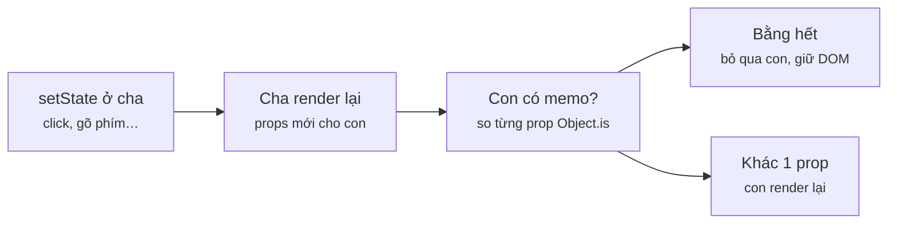
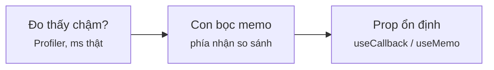
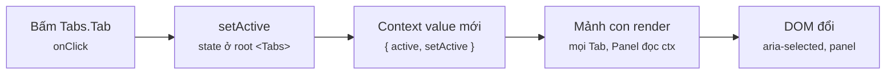
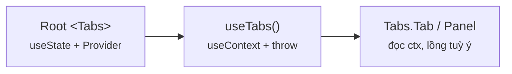

# Module 7 · Performance & Design Patterns

_memo / useMemo / useCallback / batching · Compound Components & Render Props_

**Đã chạy với:** Node 22.22.0 · TypeScript 7.0.2 · React 19.3.1 · react-dom 19.3.1 · jsdom 29.1.1 · tsx 4.23.15

React chạy thật trong Node + jsdom, render **không** bọc `act()` (giống trình duyệt), **không** bật StrictMode (StrictMode ở dev cố ý render 2 lần → đếm sẽ gấp đôi). "Số lần render" = số lần **hàm component được gọi**, đếm bằng biến đếm đặt trong thân hàm. Số **ms** là đo thật bằng `performance.now()` — chạy lại sẽ lệch vài ms, tỉ lệ thì không đổi.

Vị trí: Đã học Module 6 · Styling (Tailwind, CSS Modules, animation) · **Đang học Module 7** · Sắp tới Module 8 · TypeScript với React

## Bài 7.1 · memo · useMemo · useCallback · batching — dùng đúng chỗ

_Nguồn roadmap: [Academind] Avoiding Component Function Executions with memo() → Understanding the useCallback() Hook → Understanding the useMemo() Hook → State Scheduling & Batching · [BigReact] Memoization → Batching State Updates → How the useMemo Hook Works → How the useCallback Hook Works_

### 1 · Một câu & nằm ở đâu
Cha render lại → **mọi con render lại**, kể cả khi props không đổi. `memo(Con)` chặn việc đó bằng cách so **từng prop** với lần trước (`Object.is` — so tham chiếu). Mà mỗi lần render, `() => …`, `[…]`, `{…}` viết inline đều là **tham chiếu mới** → `useCallback` / `useMemo` tồn tại để giữ tham chiếu đó, **chỉ có ích khi phía nhận có so sánh** (con `memo`, deps của effect) hoặc khi phép tính thật sự đắt. Thiếu 1 trong 2 vế là tối ưu vô ích.

User thao tác → **[setState]** → **[Render component]** → **[memo so props]** → **[Commit DOM]** → Màn hình đổi

<details><summary>m7/dom.ts — DOM giả dùng cho mọi ví dụ</summary>

`m7/dom.ts`

```tsx
// DOM giả (jsdom) để React chạy thật trong Node: render, click, gõ phím như trình duyệt
import { JSDOM } from "jsdom";

const dom = new JSDOM('<!doctype html><div id="root"></div>', { pretendToBeVisual: true });
const w = dom.window;
Object.assign(globalThis, {
  window: w, document: w.document, Element: w.Element, HTMLElement: w.HTMLElement, SVGElement: w.SVGElement,
  getComputedStyle: w.getComputedStyle.bind(w),
  requestAnimationFrame: w.requestAnimationFrame, cancelAnimationFrame: w.cancelAnimationFrame,
  IS_REACT_ACT_ENVIRONMENT: false,                   // render như trình duyệt, không gom bằng act()
});

export const root = w.document.getElementById("root")!;
export const wait = (ms: number) => new Promise((r) => setTimeout(r, ms));
let t0 = Date.now();
export const resetClock = () => { t0 = Date.now(); };
export const until = (ms: number) => wait(Math.max(0, ms - (Date.now() - t0)));   // chờ tới mốc ms
export const ms = () => `${String(Date.now() - t0).padStart(3)}ms`;
export const $ = <T extends Element = HTMLElement>(sel: string) => root.querySelector(sel) as T;
export const click = (sel: string) => $(sel).click();
export function type(el: HTMLInputElement, value: string) {      // gõ như user
  w.Object.getOwnPropertyDescriptor(w.HTMLInputElement.prototype, "value")!.set!.call(el, value);
  el.dispatchEvent(new w.Event("input", { bubbles: true }));
}
```

</details>

### 2 · Concept
| Công cụ | Làm gì | Có ích khi | Bên C# |
|---|---|---|---|
| `memo(Comp)` | Bỏ qua render nếu **mọi** prop `Object.is` bằng lần trước | Con render đắt / nhiều, cha render thường xuyên | Kiểm `Equals` trước khi vẽ lại |
| `useMemo(() => x, deps)` | Nhớ **giá trị**, tính lại khi deps đổi | Phép tính đắt; hoặc giữ tham chiếu mảng/object truyền vào con `memo` | `Lazy<T>` có invalidate |
| `useCallback(fn, deps)` | Nhớ **hàm** (= `useMemo(() => fn, deps)`) | Hàm truyền vào con `memo`, hoặc nằm trong deps của effect | Cache 1 delegate instance |
| Batching | Nhiều `setState` trong cùng 1 nhịp → **1** render (React 18+: cả sau `await`, `setTimeout`) | Mặc định, không cần làm gì; `flushSync` để ép render ngay (hiếm) | Gom thay đổi rồi `SaveChanges()` 1 lần |
| React Compiler (1.0, 10/2025) | Plugin build tự chèn memo cho từng component | Dự án bật được compiler → gần như không viết tay 3 hook trên nữa | — |

### 3 · Flow / lifecycle
**Cha render lại thì con có render lại không?**



Đọc sơ đồ: Trái → phải: setState ở cha → React gọi lại hàm cha, JSX tạo ra props MỚI cho con. Con thường: luôn render. Con bọc memo: React so từng prop bằng Object.is — tất cả bằng thì bỏ qua (giữ nguyên kết quả cũ), chỉ cần 1 prop khác tham chiếu (hàm/mảng inline) là render lại.

### 4 · Ví dụ thực tế
**Ví dụ 1.** Cùng 1 danh sách, 1 bản thường, 1 bản bọc `memo`. Bấm nút ở cha 3 lần (state của cha đổi, danh sách không đổi) và đếm.

`m7/l71-memo.tsx`

```tsx
import { root, wait, click } from "./dom";
import { memo, useState } from "react";
import { createRoot } from "react-dom/client";

const renders = { MenuPlain: 0, MenuMemo: 0 };                 // đếm số lần hàm component chạy
type P = { items: string[] };
function MenuPlain({ items }: P) {
  renders.MenuPlain++;
  return <ul>{items.map((i) => <li key={i}>{i}</li>)}</ul>;
}
const MenuMemo = memo(function MenuMemo({ items }: P) {          // so props cũ/mới bằng Object.is
  renders.MenuMemo++;
  return <ul>{items.map((i) => <li key={i}>{i}</li>)}</ul>;
});

const ITEMS = ["Latte", "Mocha", "Cold Brew"];                  // cùng 1 mảng qua mọi lần render
function OrderPage() {
  const [cups, setCups] = useState(0);
  return <>
    <button onClick={() => setCups(cups + 1)}>Thêm ly ({cups})</button>
    <MenuPlain items={ITEMS} />
    <MenuMemo items={ITEMS} />
  </>;
}

createRoot(root).render(<OrderPage />); await wait(10);
console.log("sau mount     :", renders);
for (let i = 0; i < 3; i++) { click("button"); await wait(10); }
console.log("sau 3 lần bấm :", renders, "| nút:", root.querySelector("button")!.textContent);
```

```console
❯ npx tsx m7/l71-memo.tsx
sau mount     : { MenuPlain: 1, MenuMemo: 1 }
sau 3 lần bấm : { MenuPlain: 4, MenuMemo: 1 } | nút: Thêm ly (3)
```

`MenuPlain` chạy 4 lần dù `items` không đổi — đó là hành vi **mặc định** và thường không sao (render ≠ đụng DOM; React vẫn diff rồi thấy không có gì để commit). `MenuMemo` chỉ chạy 1 lần vì `ITEMS` là **cùng 1 mảng** (khai báo ngoài component).

**Ví dụ 2.** Con `memo` nhận `items` (lọc từ 200 000 món) và `onPick`. Gõ ghi chú 4 lần — ghi chú không liên quan danh sách. Bản `Plain` viết inline, bản `Opt` dùng `useMemo` + `useCallback`.

`m7/l71-callback-memo.tsx`

```tsx
import { root, wait, type, $ } from "./dom";
import { memo, useCallback, useMemo, useState, type FC } from "react";
import { createRoot } from "react-dom/client";

const MENU = Array.from({ length: 200_000 }, (_, i) => `Món ${i}${i % 1000 === 0 ? " latte" : ""}`);
const s = { filterRuns: 0, filterMs: 0, resultRenders: 0 };
function filterMenu(q: string) {                                 // việc "đắt": lọc 200k dòng
  const t = performance.now(); s.filterRuns++; const r = MENU.filter((m) => m.includes(q));
  s.filterMs += performance.now() - t; return r;
}
const Results = memo(function Results({ items, onPick }: { items: string[]; onPick: (x: string) => void }) {
  s.resultRenders++; return <ul>{items.slice(0, 3).map((x) => <li key={x} onClick={() => onPick(x)}>{x}</li>)}</ul>;
});
function SearchPlain({ q }: { q: string }) {                    // ❌ mỗi render: lọc lại + tạo hàm mới
  const [note, setNote] = useState("");
  const items = filterMenu(q);
  return <><input value={note} onChange={(e) => setNote(e.target.value)} /><Results items={items} onPick={(x) => setNote(x)} /></>;
}
function SearchOpt({ q }: { q: string }) {                      // ✅ nhớ kết quả + nhớ hàm
  const [note, setNote] = useState("");
  const items = useMemo(() => filterMenu(q), [q]);              // chỉ lọc lại khi q đổi
  const onPick = useCallback((x: string) => setNote(x), []);    // cùng 1 hàm qua mọi render
  return <><input value={note} onChange={(e) => setNote(e.target.value)} /><Results items={items} onPick={onPick} /></>;
}
for (const [name, Search] of [["Plain", SearchPlain], ["Opt  ", SearchOpt]] as [string, FC<{ q: string }>][]) {
  Object.assign(s, { filterRuns: 0, filterMs: 0, resultRenders: 0 });
  const app = createRoot(root); app.render(<Search q="latte" />); await wait(50);
  for (const t of ["í", "ít", "ít đá", "ít đá, ít đường"]) { type($<HTMLInputElement>("input"), t); await wait(10); }
  console.log(`${name}: gõ ghi chú 4 lần → lọc ${s.filterRuns} lần (${s.filterMs.toFixed(1)}ms) · Results render ${s.resultRenders} lần`); app.unmount();
}
```

```console
❯ npx tsx m7/l71-callback-memo.tsx
Plain: gõ ghi chú 4 lần → lọc 5 lần (25.9ms) · Results render 5 lần
Opt  : gõ ghi chú 4 lần → lọc 1 lần (4.6ms) · Results render 1 lần
```

Plain: mỗi phím gõ lọc lại 200k dòng **và** `Results` render lại (mảng mới + hàm mới → `memo` thua). Opt: lọc 1 lần, `Results` render 1 lần. Hai hook ở đây có tác dụng vì **phía nhận có so sánh** (`memo`) và phép lọc **đắt thật** (đo được ms). Đo trước, tối ưu sau.

**Ví dụ 3.** Batching: 3 `setState` liên tiếp → mấy lần render? Thử trong handler, sau `await`, và với `flushSync`.

`m7/l71-batching.tsx`

```tsx
import { root, wait, click } from "./dom";
import { useState } from "react";
import { flushSync } from "react-dom";
import { createRoot } from "react-dom/client";

let renders = 0;
function Cart() {
  renders++;
  const [cups, setCups] = useState(0);
  const [total, setTotal] = useState(0);
  const [msg, setMsg] = useState("");
  function addLatte() {                                          // 3 setState trong 1 handler
    setCups((c) => c + 1); setTotal((t) => t + 45000); setMsg("Đã thêm Latte");
  }
  async function addLater() {                                    // 3 setState sau await / setTimeout
    await new Promise((r) => setTimeout(r, 5));
    setCups((c) => c + 1); setTotal((t) => t + 45000); setMsg("Đã thêm (sau await)");
  }
  function addForced() {                                         // flushSync: ép render NGAY từng lần
    flushSync(() => setCups((c) => c + 1)); flushSync(() => setTotal((t) => t + 45000)); setMsg("flushSync");
  }
  return <p>{cups} ly · {total}đ · {msg}<button id="a" onClick={addLatte} /><button id="b" onClick={addLater} /><button id="c" onClick={addForced} /></p>;
}

createRoot(root).render(<Cart />); await wait(10);
for (const [id, label] of [["a", "handler"], ["b", "sau await"], ["c", "flushSync"]]) {
  const before = renders; click(`#${id}`); await wait(30);
  console.log(`${label.padEnd(10)} 3 lần setState → ${renders - before} lần render | ${root.textContent}`);
}
```

```console
❯ npx tsx m7/l71-batching.tsx
handler    3 lần setState → 1 lần render | 1 ly · 45000đ · Đã thêm Latte
sau await  3 lần setState → 1 lần render | 2 ly · 90000đ · Đã thêm (sau await)
flushSync  3 lần setState → 3 lần render | 3 ly · 135000đ · flushSync
```

React 18+ gom **mọi** setState trong cùng 1 nhịp thành 1 render — kể cả sau `await`/`setTimeout` (React 17 chỉ gom trong event handler). Nên đừng ngại tách nhiều `useState`; và `setState` không cập nhật biến ngay — đọc lại `cups` ngay sau `setCups` vẫn ra giá trị cũ. `flushSync` ép render từng lần, chỉ dùng khi cần đo DOM ngay (scroll, focus).

### 5 · Thử thật / bẫy
**Bẫy 1.** **Tối ưu nửa vời.** A: `useCallback` nhưng con **không** `memo` (không ai so). B: con `memo` nhưng truyền mảng literal `items={["Latte", "Mocha"]}`.

`m7/l71-trap-useless.tsx`

```tsx
import { root, wait, click } from "./dom";
import { memo, useCallback, useState } from "react";
import { createRoot } from "react-dom/client";

const renders = { A_callbackNoMemo: 0, B_memoNewArray: 0, C_memoStable: 0 };
function RowA({ onPick }: { onPick: () => void }) { renders.A_callbackNoMemo++; return <i onClick={onPick} />; }  // ❌ không memo
const RowB = memo(function RowB({ items }: { items: string[] }) { renders.B_memoNewArray++; return <i>{items.length}</i>; });
const RowC = memo(function RowC({ items }: { items: string[] }) { renders.C_memoStable++; return <i>{items.length}</i>; });
const ITEMS = ["Latte", "Mocha"];

function Page() {
  const [n, setN] = useState(0);
  const onPick = useCallback(() => console.log("pick"), []);    // giữ nguyên hàm… nhưng RowA không so props
  return <>
    <button onClick={() => setN(n + 1)}>{n}</button>
    <RowA onPick={onPick} />
    <RowB items={["Latte", "Mocha"]} />                         {/* ❌ mảng mới mỗi render → memo thua */}
    <RowC items={ITEMS} />                                      {/* ✅ cùng tham chiếu */}
  </>;
}
createRoot(root).render(<Page />); await wait(10);
for (let i = 0; i < 3; i++) { click("button"); await wait(10); }
console.log("sau 3 lần bấm:", renders);
```

```console
❯ npx tsx m7/l71-trap-useless.tsx
sau 3 lần bấm: { A_callbackNoMemo: 4, B_memoNewArray: 4, C_memoStable: 1 }
```

A và B đều render 4/4 lần — có hook, có memo, mà **không tiết kiệm được gì**, chỉ thêm code. Chỉ C (memo + tham chiếu ổn định) là có tác dụng. Đây là dòng "`useCallback`/`useMemo` bọc bừa" trong bảng review code AI (roadmap 13.2).

**Bẫy 2.** **Stale closure (biến bị "đóng băng")**: `useCallback(() => setCups(cups + 1), [])` — deps rỗng nên hàm nhớ mãi `cups = 0` của lần render đầu.

`m7/l71-trap-stale.tsx`

```tsx
import { root, wait, click } from "./dom";
import { useCallback, useState } from "react";
import { createRoot } from "react-dom/client";

function CounterBad() {
  const [cups, setCups] = useState(0);
  const add = useCallback(() => setCups(cups + 1), []);          // ❌ deps rỗng → mãi thấy cups = 0
  return <button onClick={add}>{cups}</button>;
}
function CounterGood() {
  const [cups, setCups] = useState(0);
  const add = useCallback(() => setCups((c) => c + 1), []);      // ✅ functional update: không cần đọc cups
  return <button onClick={add}>{cups}</button>;
}

for (const [name, C] of [["Bad ", CounterBad], ["Good", CounterGood]] as const) {
  const app = createRoot(root); app.render(<C />); await wait(10);
  for (let i = 0; i < 3; i++) { click("button"); await wait(10); }
  console.log(`${name}: bấm 3 lần → ${root.textContent} ly`); app.unmount();
}
```

```console
❯ npx tsx m7/l71-trap-stale.tsx
Bad : bấm 3 lần → 1 ly
Good: bấm 3 lần → 3 ly
```

Bấm 3 lần vẫn 1 ly. Hai cách sửa: thêm `cups` vào deps (hàm đổi mỗi lần cups đổi), hoặc **functional update** `setCups((c) => c + 1)` — không đọc biến ngoài nên deps rỗng vẫn đúng. Plugin ESLint `react-hooks/exhaustive-deps` bắt lỗi này; đừng tắt nó.

### 6 · Tóm tắt bằng hình
**(a) Cây thư mục sau bài này**

```text
sandbox/
├─ tsconfig.json  [SỬA]  ← include m7/**
└─ m7/
   ├─ dom.ts  [MỚI]  ← DOM giả: root, click, type, đồng hồ ms
   ├─ l71-memo.tsx  [MỚI]  ← con thường vs con memo
   ├─ l71-callback-memo.tsx  [MỚI]  ← useMemo + useCallback, đo ms
   ├─ l71-batching.tsx  [MỚI]  ← 3 setState → 1 render; flushSync
   ├─ l71-trap-useless.tsx  [MỚI]  ← hook không có phía so sánh
   └─ l71-trap-stale.tsx  [MỚI]  ← deps rỗng → giá trị cũ
```

**(b) Đọc trong 10 giây**

**Có nên thêm memo / useMemo / useCallback?**



Đọc sơ đồ: Chỉ thêm khi đo thấy chậm, và luôn đi theo cặp: phía cho (giữ tham chiếu) + phía nhận (có so sánh).

### 7 · Làm ngay (≤ 10 phút)
**Mục tiêu:** `m7/ex/ex71-start.tsx`: `Row` đã bọc `memo` nhưng gõ ghi chú 3 lần vẫn làm cả 3 dòng render lại. Sửa `onToggle` để memo có tác dụng — và bấm ♥ 2 món thì **cả 2** vẫn được đánh dấu.

File khởi đầu:

`m7/ex/ex71-start.tsx`

```tsx
import { root, wait, click, type, $ } from "../dom";
import { memo, useState } from "react";
import { createRoot } from "react-dom/client";

let rowRenders = 0;
type RowP = { name: string; fav: boolean; onToggle: (n: string) => void };
const Row = memo(function Row({ name, fav, onToggle }: RowP) {
  rowRenders++;
  return <li><button data-n={name} onClick={() => onToggle(name)}>{fav ? "♥" : "♡"}</button>{name}</li>;
});
const MENU = ["Latte", "Mocha", "Cold Brew"];

function Menu() {
  const [note, setNote] = useState("");
  const [favs, setFavs] = useState<string[]>([]);
  // TODO: hàm MỚI mỗi lần render → memo(Row) vô dụng khi gõ ghi chú
  const onToggle = (n: string) => setFavs(favs.includes(n) ? favs.filter((x) => x !== n) : [...favs, n]);
  return <><input value={note} onChange={(e) => setNote(e.target.value)} />
    <ul>{MENU.map((n) => <Row key={n} name={n} fav={favs.includes(n)} onToggle={onToggle} />)}</ul></>;
}

createRoot(root).render(<Menu />); await wait(10);
for (const t of ["í", "ít", "ít đá"]) { type($<HTMLInputElement>("input"), t); await wait(10); }
console.log(`gõ ghi chú 3 lần → Row render ${rowRenders} lần`);
click('[data-n="Mocha"]'); await wait(10); click('[data-n="Latte"]'); await wait(10);
const list = [...root.querySelectorAll("li")].map((li) => li.textContent).join(" · ");
console.log(`bấm ♥ Mocha, Latte → Row render ${rowRenders} lần | ${list}`);
```

Chạy file khởi đầu (đang đỏ):

```console
❯ npx tsx m7/ex/ex71-start.tsx
gõ ghi chú 3 lần → Row render 12 lần
bấm ♥ Mocha, Latte → Row render 18 lần | ♥Latte · ♥Mocha · ♡Cold Brew
```

Tiêu chí nghiệm thu:

- [ ] Dòng 1 ra `Row render 3 lần` (chỉ lần mount)
- [ ] Dòng 2 ra `Row render 5 lần` (mỗi lần bấm chỉ dòng đó render)
- [ ] Danh sách ra `♥Latte · ♥Mocha · ♡Cold Brew`
- [ ] `npx tsc -p .` không báo lỗi

Lệnh nghiệm thu:

```bash
npx tsx m7/ex/ex71-start.tsx && npx tsc -p .
```

Lời giải tham chiếu chạy ra (output cần đạt):

```console
❯ npx tsx m7/ex/ex71-solution.tsx
gõ ghi chú 3 lần → Row render 3 lần
bấm ♥ Mocha, Latte → Row render 5 lần | ♥Latte · ♥Mocha · ♡Cold Brew
```

<details><summary>Gợi ý nếu bị đỏ</summary>

| Triệu chứng | Nguyên nhân | Sửa |
|---|---|---|
| Vẫn 12 lần | `onToggle` vẫn là hàm inline tạo mới mỗi render | Bọc `useCallback(…, [])` |
| Ra `♥Latte · ♡Mocha` | Stale closure: deps rỗng nhưng hàm đọc `favs` của lần render đầu (bẫy 2) | Functional update: `setFavs((f) => …f…)` |
| Dòng 2 ra 6 thay vì 5 | Thêm `favs` vào deps → bấm ♥ làm hàm đổi → cả 3 dòng render | Deps rỗng + functional update |

`m7/ex/ex71-start.tsx` (diff)

```diff
 import { root, wait, click, type, $ } from "../dom";
-import { memo, useState } from "react";
+import { memo, useCallback, useState } from "react";
 import { createRoot } from "react-dom/client";
 
   const [note, setNote] = useState("");
   const [favs, setFavs] = useState<string[]>([]);
-  // TODO: hàm MỚI mỗi lần render → memo(Row) vô dụng khi gõ ghi chú
-  const onToggle = (n: string) => setFavs(favs.includes(n) ? favs.filter((x) => x !== n) : [...favs, n]);
+  const onToggle = useCallback((n: string) =>                   // ✅ 1 hàm duy nhất + đọc state mới nhất qua f
+    setFavs((f) => (f.includes(n) ? f.filter((x) => x !== n) : [...f, n])), []);
   return <><input value={note} onChange={(e) => setNote(e.target.value)} />
     <ul>{MENU.map((n) => <Row key={n} name={n} fav={favs.includes(n)} onToggle={onToggle} />)}</ul></>;
```

</details>

### 8 · 3 câu hỏi nhanh
1. Component cha render lại thì con có **chắc chắn** bị cập nhật DOM không?

   <details><summary>Đáp án</summary>

   **Không.** Con bị **gọi lại hàm** (render), React diff kết quả với lần trước, chỉ commit phần khác. Render thừa tốn CPU (chạy hàm + diff), không tốn DOM. Vì vậy memo chỉ đáng khi render đó đắt hoặc lặp rất nhiều.

   </details>

2. Review code AI: mọi hàm trong component đều bọc `useCallback`, mọi biến đều `useMemo`, không có con nào `memo`. Góp ý?

   <details><summary>Đáp án</summary>

   Phần lớn là dư (bẫy 1): không có phía nào so tham chiếu nên giữ tham chiếu không đổi gì cả, lại thêm deps phải bảo trì (dễ stale closure). Giữ lại chỉ chỗ: phép tính đắt đo được, hàm/giá trị nằm trong deps của effect, hoặc truyền vào con `memo`. Nếu dự án bật React Compiler thì bỏ gần hết.

   </details>

3. Trong handler: `setCups(cups + 1); setCups(cups + 1);` — tăng mấy? Vì sao?

   <details><summary>Đáp án</summary>

   Tăng **1**. Cả 2 lệnh đọc cùng `cups` của lần render hiện tại (closure), và được gom (batch) thành 1 render. Muốn tăng 2: `setCups((c) => c + 1)` hai lần — React xếp hàng các hàm cập nhật và chạy lần lượt trên giá trị mới nhất.

   </details>


---

## Bài 7.2 · Compound Components & Render Props

_Nguồn roadmap: [Academind] Introducing Compound Components → Managing Multi-Component State with the Context API → Grouping Compound Components → Introducing & Using Render Props_

### 1 · Một câu & nằm ở đâu
Hai pattern để làm component **dùng lại được mà không nhồi 20 prop**. **Compound components**: 1 root giữ state (`<Tabs>`), các mảnh con (`<Tabs.Tab>`, `<Tabs.Panel>`) đọc chung qua **Context** → người dùng tự xếp layout. **Render props**: component giữ **logic**, người gọi truyền **hàm trả JSX** (`renderItem={(x) => …}`) để quyết định UI. Gặp hằng ngày trong thư viện UI (Radix, shadcn/ui, Headless UI, react-window).

**[User thao tác]** → **[setState]** → **[Render component]** → memo so props → **[Commit DOM]** → Màn hình đổi

### 2 · Concept
| Pattern | Hình dạng | Dùng khi | Bên C# |
|---|---|---|---|
| Compound components | `<Tabs><Tabs.Tab/><Tabs.Panel/></Tabs>`: root giữ state, mảnh con đọc qua Context | Nhóm phải phối hợp (tabs, accordion, select, menu) mà layout do người dùng quyết | Blazor `<CascadingValue>`; `TabControl/TabItem` XAML |
| Hook chốt chặn `useTabs()` | `useContext` + `throw` nếu `null` | **Luôn** đi kèm compound | Guard clause |
| `Children.map` + `cloneElement` | Root "bơm" props vào **con trực tiếp** — kiểu cũ | Chỉ để đọc code cũ; vỡ khi con bị bọc | — |
| Render prop `renderItem={(x) => …}` | Component giữ logic, người gọi truyền hàm trả JSX | List/table/virtual list, select | Blazor `RenderFragment<T>` |
| Children-as-function | `<Toggle>{(on, flip) => …}</Toggle>` | Đưa state ra ngoài; nay phần lớn thay bằng **custom hook** | — |

### 3 · Flow / lifecycle
**Bấm <Tabs.Tab> thì ai cập nhật cái gì?**



Đọc sơ đồ: Trái → phải: user bấm 1 Tab. Tab gọi setActive lấy từ context — state nằm ở root `<Tabs>`. Root render lại với value mới cho context. Mọi mảnh con đang đọc context (Tab nào, Panel nào, lồng sâu cỡ nào) đều render lại. DOM đổi aria-selected và panel hiển thị.

### 4 · Ví dụ thực tế
**Ví dụ 1.** Bên trong: 1 Context, 1 hook chốt chặn, root giữ state, gắn mảnh con thành `Tabs.Tab` / `Tabs.Panel`. HTML nó render ra:

`m7/Tabs.tsx`

```tsx
// Compound component: 1 root giữ state, các mảnh con đọc chung qua Context
import { createContext, useContext, useState, type ReactNode } from "react";

type Ctx = { active: string; setActive: (v: string) => void };
const TabsCtx = createContext<Ctx | null>(null);

function useTabs(part: string): Ctx {                            // chốt chặn: dùng sai chỗ → lỗi rõ ràng
  const ctx = useContext(TabsCtx);
  if (!ctx) throw new Error(`<Tabs.${part}> phải nằm bên trong <Tabs>`);
  return ctx;
}

export function Tabs({ defaultValue, children }: { defaultValue: string; children: ReactNode }) {
  const [active, setActive] = useState(defaultValue);            // state DUY NHẤT của cả cụm
  return <TabsCtx value={{ active, setActive }}>{children}</TabsCtx>;
}
function Tab({ value, children }: { value: string; children: ReactNode }) {
  const { active, setActive } = useTabs("Tab");
  return <button role="tab" aria-selected={active === value} onClick={() => setActive(value)}>{children}</button>;
}
function Panel({ value, children }: { value: string; children: ReactNode }) {
  const { active } = useTabs("Panel");
  return active === value ? <section role="tabpanel">{children}</section> : null;
}
Tabs.Tab = Tab;                                                  // gom thành 1 "họ": Tabs.Tab, Tabs.Panel
Tabs.Panel = Panel;
```

```console
❯ npx tsx m7/l72-tabs.tsx
── HTML sau mount ──
<nav><button role="tab" aria-selected="true">Cà phê</button><button role="tab" aria-selected="false">Trà</button></nav>
<h2>Menu hôm nay</h2>
<section role="tabpanel">Latte · Mocha · Cold Brew</section>
```

(… còn 4 dòng — đã trích dòng 1–4 / 8 của `npx tsx m7/l72-tabs.tsx`)

Root chỉ render `{children}` — **không** biết con nằm đâu. Tab và Panel không nhận prop `active`; tự lấy từ context. `<TabsCtx value={…}>` là cú pháp React 19 (trước đó: `<TabsCtx.Provider value={…}>`).

**Ví dụ 2.** Bên ngoài: người dùng xếp layout tuỳ ý — Tab lồng trong `<nav>`, chèn `<h2>` giữa — rồi bấm thử. Cùng lần chạy trên, phần sau:

`m7/l72-tabs.tsx`

```tsx
import { root, wait, click } from "./dom";
import { Tabs } from "./Tabs";
import { createRoot } from "react-dom/client";

function MenuTabs() {                                            // người dùng tự xếp layout, tự lồng thẻ
  return (
    <Tabs defaultValue="coffee">
      <nav>
        <Tabs.Tab value="coffee">Cà phê</Tabs.Tab>
        <Tabs.Tab value="tea">Trà</Tabs.Tab>
      </nav>
      <h2>Menu hôm nay</h2>
      <Tabs.Panel value="coffee">Latte · Mocha · Cold Brew</Tabs.Panel>
      <Tabs.Panel value="tea">Trà đào · Trà vải</Tabs.Panel>
    </Tabs>
  );
}

createRoot(root).render(<MenuTabs />); await wait(10);
console.log("── HTML sau mount ──\n" + root.innerHTML.replace(/<(nav|h2|section)/g, "\n<$1").trim());
console.log("── Bấm thử ──");
const view = () => [...root.querySelectorAll("[role=tab]")].map((b) => (b.getAttribute("aria-selected") === "true" ? `[${b.textContent}]` : b.textContent)).join(" ") + " | " + root.querySelector("section")!.textContent;
console.log(`mount         → ${view()}`);
click("[role=tab]:nth-child(2)"); await wait(10); console.log(`bấm "Trà"     → ${view()}`);
click("[role=tab]:nth-child(1)"); await wait(10); console.log(`bấm "Cà phê"  → ${view()}`);
```

```console
❯ npx tsx m7/l72-tabs.tsx
── Bấm thử ──
mount         → [Cà phê] Trà | Latte · Mocha · Cold Brew
bấm "Trà"     → Cà phê [Trà] | Trà đào · Trà vải
bấm "Cà phê"  → [Cà phê] Trà | Latte · Mocha · Cold Brew
```

(… còn 4 dòng — đã trích dòng 5–8 / 8 của `npx tsx m7/l72-tabs.tsx`)

Không 1 prop nào truyền tay từ `<Tabs>` xuống `<Tabs.Tab>`, kể cả qua `<nav>`. Đây là lý do compound + context thắng kiểu "1 component 20 prop" (`<Tabs items={…} renderTab={…} tabClassName={…}`): thêm layout mới không phải sửa component.

**Ví dụ 3.** Render props: `DataList` lo **lọc + trạng thái rỗng**, người gọi chỉ quyết định **mỗi dòng trông thế nào**. Thêm `Toggle` kiểu children-as-function.

`m7/l72-render-props.tsx`

```tsx
import { root, wait, click } from "./dom";
import { useState, type ReactNode } from "react";
import { createRoot } from "react-dom/client";

type Item = { name: string; price: number };
// Render prop: component giữ LOGIC (lọc, rỗng/không rỗng), người gọi truyền HÀM quyết định UI
function DataList<T>({ items, filter, renderItem, empty }: {
  items: T[]; filter?: (x: T) => boolean; renderItem: (x: T, i: number) => ReactNode; empty: () => ReactNode;
}) {
  const shown = filter ? items.filter(filter) : items;
  return shown.length ? <ul>{shown.map((x, i) => <li key={i}>{renderItem(x, i)}</li>)}</ul> : <p>{empty()}</p>;
}
// Children-as-function: component giữ STATE, đưa ra ngoài qua tham số của hàm con
function Toggle({ children }: { children: (on: boolean, flip: () => void) => ReactNode }) {
  const [on, setOn] = useState(false);
  return <>{children(on, () => setOn(!on))}</>;
}

const MENU: Item[] = [{ name: "Latte", price: 45000 }, { name: "Mocha", price: 50000 }];
const app = createRoot(root);
const show = async (label: string, el: ReactNode) => { app.render(el); await wait(10); console.log(label.padEnd(12), root.innerHTML); };
await show("thẻ:", <DataList items={MENU} renderItem={(m) => <b>{m.name} — {m.price / 1000}k</b>} empty={() => "Hết món"} />);
await show("gọn:", <DataList items={MENU} renderItem={(m, i) => `${i + 1}. ${m.name}`} empty={() => "Hết món"} />);
await show("rỗng:", <DataList items={MENU} filter={(m) => m.price > 99000} renderItem={(m) => m.name} empty={() => "Không có món > 99k"} />);
await show("toggle:", <Toggle>{(on, flip) => <button onClick={flip}>{on ? "Ẩn" : "Hiện"} topping</button>}</Toggle>);
click("button"); await wait(10); console.log("toggle bấm:".padEnd(12), root.innerHTML);
```

```console
❯ npx tsx m7/l72-render-props.tsx
thẻ:         <ul><li><b>Latte — 45k</b></li><li><b>Mocha — 50k</b></li></ul>
gọn:         <ul><li>1. Latte</li><li>2. Mocha</li></ul>
rỗng:        <p>Không có món &gt; 99k</p>
toggle:      <button>Hiện topping</button>
toggle bấm:  <button>Ẩn topping</button>
```

Cùng 1 `DataList`, 3 giao diện khác nhau — logic viết 1 lần. Generic `<T>` làm `renderItem` biết kiểu `m.price` (TS suy ra từ `items`). `Toggle` kiểu này giờ hiếm — viết `useToggle()` (custom hook, Module 2) gọn hơn; nhưng `renderItem` / `render={…}` vẫn rất phổ biến ở list ảo, table, form lib.

### 5 · Thử thật / bẫy
**Bẫy 1.** **Dùng mảnh con bên ngoài root** (quên bọc `<Tabs>`, hoặc move component sang chỗ khác). Context trả `null`.

`m7/l72-trap-outside.tsx`

```tsx
import { wait } from "./dom";
import { Tabs } from "./Tabs";
import { createContext, useContext } from "react";
import { createRoot } from "react-dom/client";

const NaiveCtx = createContext<{ active: string } | null>(null);
function NaiveTab() {                                             // ❌ không có chốt chặn
  const { active } = useContext(NaiveCtx)!;
  return <button>{active}</button>;
}

for (const [name, el] of [["Không chốt chặn", <NaiveTab />], ["Có useTabs()   ", <Tabs.Tab value="tea">Trà</Tabs.Tab>]] as const) {
  const app = createRoot(document.createElement("div"), { onUncaughtError: (e) => console.log(`${name} → ${(e as Error).message}`) });
  app.render(el); await wait(10);                                 // render 1 mảnh mà quên bọc cha
}
```

```console
❯ npx tsx m7/l72-trap-outside.tsx
Không chốt chặn → Cannot destructure property 'active' of 'useContext(...)' as it is null.
Có useTabs()    → <Tabs.Tab> phải nằm bên trong <Tabs>
```

Không có chốt chặn: lỗi `TypeError` khó hiểu, trỏ vào ruột thư viện. Có `useTabs()`: lỗi nói đúng chỗ sai. 3 dòng code, nên **luôn** có — và đừng cho context giá trị mặc định giả kiểu `createContext({ active: "" })` vì nó nuốt luôn lỗi.

**Bẫy 2.** **Compound kiểu cũ `cloneElement`**: root duyệt `children` và "bơm" `active` / `onPick` vào từng con. Bọc tab trong `<nav>` là vỡ.

`m7/l72-trap-clone.tsx`

```tsx
import { root, wait, click } from "./dom";
import { Children, cloneElement, isValidElement, useState, type ReactElement, type ReactNode } from "react";
import { createRoot } from "react-dom/client";

type TabP = { active?: boolean; onPick?: () => void; children: ReactNode };
function CTab({ active, onPick, children }: TabP) {
  return <button onClick={onPick}>{active ? `[${children}]` : children}</button>;
}
function TabsClone({ children }: { children: ReactNode }) {       // ❌ "bơm" props vào con TRỰC TIẾP
  const [active, setActive] = useState(0);
  return <>{Children.map(children, (child, i) => isValidElement(child)
    ? cloneElement(child as ReactElement<TabP>, { active: active === i, onPick: () => setActive(i) }) : child)}</>;
}

const cases: [string, ReactNode][] = [
  ["con trực tiếp", <TabsClone><CTab>Cà phê</CTab><CTab>Trà</CTab></TabsClone>],
  ["bọc trong <nav>", <TabsClone><nav><CTab>Cà phê</CTab><CTab>Trà</CTab></nav></TabsClone>],
];
for (const [name, el] of cases) {
  const app = createRoot(root); app.render(el); await wait(10);
  const before = root.textContent; click("button:nth-of-type(2)"); await wait(10);
  console.log(`${name.padEnd(15)}: mount "${before}" → bấm Trà "${root.textContent}"`); app.unmount();
}
```

```console
❯ npx tsx m7/l72-trap-clone.tsx
con trực tiếp  : mount "[Cà phê]Trà" → bấm Trà "Cà phê[Trà]"
Received `true` for a non-boolean attribute `active`.

If you want to write it to the DOM, pass a string instead: active="true" or active={value.toString()}.
Unknown event handler property `onPick`. It will be ignored.
bọc trong <nav>: mount "Cà phêTrà" → bấm Trà "Cà phêTrà"
```

`cloneElement` chỉ thấy con **trực tiếp**: props bị bơm vào `<nav>` (React cảnh báo thuộc tính lạ), tab thật không nhận được gì → không tab nào active, bấm không ăn. Bản Context ở ví dụ 2 lồng `<nav>` vẫn chạy. Gặp `cloneElement` trong code AI/code cũ → đề xuất chuyển sang Context.

### 6 · Tóm tắt bằng hình
**(a) Cây thư mục sau bài này**

```text
sandbox/m7/
├─ Tabs.tsx  [MỚI]  ← Context + useTabs() + Tabs.Tab / Tabs.Panel
├─ l72-tabs.tsx  [MỚI]  ← dùng Tabs với layout tự do
├─ l72-render-props.tsx  [MỚI]  ← DataList renderItem + Toggle
├─ l72-trap-outside.tsx  [MỚI]  ← mảnh con ngoài root → lỗi
└─ l72-trap-clone.tsx  [MỚI]  ← cloneElement vỡ khi bọc thẻ
```

**(b) Đọc trong 10 giây**

**Compound component gồm mấy mảnh?**



Đọc sơ đồ: Root giữ state và cấp context; hook chốt chặn; mảnh con đọc context — người dùng tự xếp layout.

### 7 · Làm ngay (≤ 10 phút)
**Mục tiêu:** `m7/ex/ex72-start.tsx`: FAQ dạng accordion đang mở được **nhiều mục cùng lúc** vì mỗi `Item` tự giữ state. Sửa để chỉ 1 mục mở; bấm lại mục đang mở thì đóng. Context + hook chốt chặn đã viết sẵn.

File khởi đầu:

`m7/ex/ex72-start.tsx`

```tsx
import { root, wait, click } from "../dom";
import { createContext, useContext, useState, type ReactNode } from "react";
import { createRoot } from "react-dom/client";

// TODO: mỗi Item tự giữ state → mở được nhiều mục cùng lúc.
// Yêu cầu: chỉ 1 mục mở → chuyển state lên Accordion, Item đọc qua context (giống Tabs).
type Ctx = { open: string | null; toggle: (id: string) => void };
const AccCtx = createContext<Ctx | null>(null);
function useAcc(): Ctx {
  const ctx = useContext(AccCtx);
  if (!ctx) throw new Error("<Accordion.Item> phải nằm bên trong <Accordion>");
  return ctx;
}

export function Accordion({ children }: { children: ReactNode }) {
  return <div>{children}</div>;
}
function Item({ id, title, children }: { id: string; title: string; children: ReactNode }) {
  const [isOpen, setOpen] = useState(false);
  return <div><button data-id={id} onClick={() => setOpen(!isOpen)}>{isOpen ? "▾" : "▸"} {title}</button>{isOpen && <p>{children}</p>}</div>;
}
Accordion.Item = Item;

const faq = <Accordion>
  <Accordion.Item id="hours" title="Giờ mở cửa">7h – 22h</Accordion.Item>
  <Accordion.Item id="wifi" title="Wifi">pass: caphe123</Accordion.Item>
  <Accordion.Item id="park" title="Gửi xe">Miễn phí</Accordion.Item>
</Accordion>;
createRoot(root).render(faq); await wait(10);
const view = () => [...root.querySelectorAll("button")].map((b) => b.textContent!.slice(0, 1) + (b.nextElementSibling ? `(${b.nextElementSibling.textContent})` : "")).join(" ");
click('[data-id="hours"]'); await wait(10); console.log(`mở Giờ mở cửa  → ${view()}`);
click('[data-id="wifi"]');  await wait(10); console.log(`mở Wifi        → ${view()}`);
click('[data-id="wifi"]');  await wait(10); console.log(`bấm Wifi lần 2 → ${view()}`);
```

Chạy file khởi đầu (đang đỏ):

```console
❯ npx tsx m7/ex/ex72-start.tsx
mở Giờ mở cửa  → ▾(7h – 22h) ▸ ▸
mở Wifi        → ▾(7h – 22h) ▾(pass: caphe123) ▸
bấm Wifi lần 2 → ▾(7h – 22h) ▸ ▸
```

Tiêu chí nghiệm thu:

- [ ] `mở Wifi` ra `▸ ▾(pass: caphe123) ▸` (Giờ mở cửa tự đóng)
- [ ] `bấm Wifi lần 2` ra `▸ ▸ ▸`
- [ ] `Item` không còn `useState` riêng
- [ ] `npx tsc -p .` không báo lỗi

Lệnh nghiệm thu:

```bash
npx tsx m7/ex/ex72-start.tsx && npx tsc -p .
```

Lời giải tham chiếu chạy ra (output cần đạt):

```console
❯ npx tsx m7/ex/ex72-solution.tsx
mở Giờ mở cửa  → ▾(7h – 22h) ▸ ▸
mở Wifi        → ▸ ▾(pass: caphe123) ▸
bấm Wifi lần 2 → ▸ ▸ ▸
```

<details><summary>Gợi ý nếu bị đỏ</summary>

| Triệu chứng | Nguyên nhân | Sửa |
|---|---|---|
| Lỗi `<Accordion.Item> phải nằm bên trong <Accordion>` | Item đã gọi `useAcc()` nhưng root chưa bọc Provider | Root: `return <AccCtx value={{ open, toggle }}>…</AccCtx>` |
| Bấm lần 2 không đóng | `toggle` luôn set `id` | `setOpen((cur) => (cur === id ? null : id))` |
| TS: `Type 'string' is not assignable to 'null'` | `useState(null)` suy ra kiểu `null` | `useState<string | null>(null)` |

`m7/ex/ex72-start.tsx` (diff)

```diff
 import { createRoot } from "react-dom/client";
 
-// TODO: mỗi Item tự giữ state → mở được nhiều mục cùng lúc.
-// Yêu cầu: chỉ 1 mục mở → chuyển state lên Accordion, Item đọc qua context (giống Tabs).
 type Ctx = { open: string | null; toggle: (id: string) => void };
 const AccCtx = createContext<Ctx | null>(null);
 
 export function Accordion({ children }: { children: ReactNode }) {
-  return <div>{children}</div>;
+  const [open, setOpen] = useState<string | null>(null);          // ✅ 1 state chung cho cả cụm
+  const toggle = (id: string) => setOpen((cur) => (cur === id ? null : id));
+  return <AccCtx value={{ open, toggle }}><div>{children}</div></AccCtx>;
 }
 function Item({ id, title, children }: { id: string; title: string; children: ReactNode }) {
-  const [isOpen, setOpen] = useState(false);
-  return <div><button data-id={id} onClick={() => setOpen(!isOpen)}>{isOpen ? "▾" : "▸"} {title}</button>{isOpen && <p>{children}</p>}</div>;
+  const { open, toggle } = useAcc();
+  const isOpen = open === id;
+  return <div><button data-id={id} onClick={() => toggle(id)}>{isOpen ? "▾" : "▸"} {title}</button>{isOpen && <p>{children}</p>}</div>;
 }
 Accordion.Item = Item;
```

</details>

### 8 · 3 câu hỏi nhanh
1. Vì sao compound component dùng Context mà không truyền prop `active` từ `<Tabs>` xuống?

   <details><summary>Đáp án</summary>

   Root không biết con nằm đâu: người dùng có thể lồng `<Tabs.Tab>` trong `<nav>`, trong component khác, sâu nhiều tầng. Context tới được mọi tầng; truyền prop / `cloneElement` chỉ tới con trực tiếp (bẫy 2).

   </details>

2. Render prop và custom hook đều "chia sẻ logic". Khi nào chọn render prop?

   <details><summary>Đáp án</summary>

   Khi logic cần **quyết định chỗ đặt JSX** (dòng nào, khi nào render, trạng thái rỗng) — ví dụ list ảo chỉ gọi `renderItem` cho dòng đang hiện. Nếu chỉ chia sẻ **dữ liệu/state** (`on`, `flip`) thì custom hook gọn hơn, không thêm tầng JSX.

   </details>

3. Context value đổi thì ai render lại? Có vấn đề gì với Tabs có 50 mảnh?

   <details><summary>Đáp án</summary>

   **Mọi** component đang `useContext` nó (Module 3.1). Với Tabs vài chục mảnh thì không đáng kể. Nếu nặng: tách 2 context (giá trị hay đổi / hàm không đổi), hoặc `useMemo` cho object value — đúng chỗ dùng memo hợp lý của bài 7.1.

   </details>

