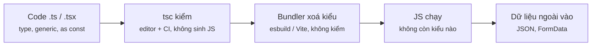
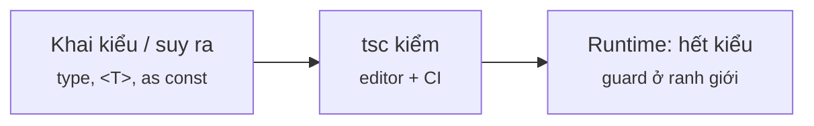
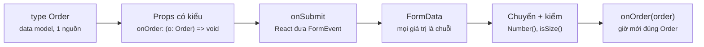
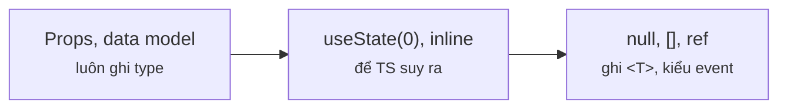

# Module 8 · TypeScript với React

_inference · type vs interface · generics · unknown ở ranh giới · props, event, form, ref, context có kiểu_

**Đã chạy với:** Node 22.22.0 · TypeScript 7.0.2 · React 19.3.1 · react-dom 19.3.1 · @types/react 19.3.0 · jsdom 29.1.1 · tsx 4.23.15

React chạy thật trong Node + jsdom (không StrictMode). `tsx` chạy code bằng esbuild — **xoá kiểu, không kiểm kiểu**, y như Vite lúc dev/build — nên mọi file còn được kiểm riêng bằng `npx tsc -p .` (strict, không `any` ngầm). Code cố tình đỏ lúc compile nằm trong `m8/tsfail/`, kiểm bằng `tsconfig.fail.json`.

Vị trí: Đã học Module 7 · Performance & Design Patterns (memo, compound components) · **Đang học Module 8** · Sắp tới Module 9 · Testing (Testing Library, mock, async)

## Bài 8.1 · TS cốt lõi cho dân C#: inference, type, generics, ranh giới runtime

_Nguồn roadmap: [Academind] What & Why? → Installing & Using TypeScript → Understanding Type Inference → Understanding Type Aliases → Diving Into Generics · [Modern] Introduction To Types (TypeScript)_

### 1 · Một câu & nằm ở đâu
Cú pháp gần C#, nhưng 3 thứ **khác hẳn**: (1) **structural typing** — khớp theo hình dạng, không cần `implements`; (2) **literal & union** là kiểu thật (`"S" | "M" | "L"`), và TS hay **nới** literal ra `string` nếu bạn để `let` / field object; (3) **kiểu bị xoá lúc chạy** — `as` không kiểm gì, JSON từ API là `unknown` cho tới khi chính bạn kiểm. Generics thì như C#, ràng buộc viết `<T extends …>` thay cho `where T : …`.

Gõ .tsx → **[Editor gạch đỏ]** → **[tsc --noEmit (CI)]** → **[Build xoá kiểu]** → JS chạy → **[Dữ liệu ngoài vào]**

### 2 · Concept
| Khái niệm | TS | Khác C# ở đâu | Bên C# |
|---|---|---|---|
| Inference | `const x = "M"` → kiểu `"M"`; `let x = "M"` → `string` | Có kiểu **literal**; `let`/field object/mảng bị nới ra | `var` |
| Structural typing | Có đủ field `price: number` là khớp `{ price: number }` | Không cần khai báo quan hệ | Nominal: phải `: IPriced` |
| `type` vs `interface` | `type` cho mọi thứ (union, `Omit<…>`); `interface` cho object + `extends` | Union literal không có tương đương | `record` / `interface` |
| Generics + utility type | `<T extends { id: string }>`, `Omit`, `Partial`, `Pick`, `T[K]` | Biến đổi **kiểu** từ kiểu có sẵn (`keyof`, mapped type) | `where T : …` |
| `unknown` / `any` / `as` | Kiểu chỉ có lúc compile; `as` = "tin tôi đi", **không** kiểm | Cast sai không ném lỗi, chạy tiếp với dữ liệu sai | Cast sai ném `InvalidCastException` |

### 3 · Flow / lifecycle
**Kiểu TS sống tới đâu trên đường code chạy?**



Đọc sơ đồ: Trái → phải: kiểu chỉ tồn tại ở bước 1–2 (editor và `tsc`). Bundler (esbuild / Vite) **xoá** kiểu mà không kiểm, nên từ bước 4 chỉ còn JS thuần. Dữ liệu ngoài vào ở bước 5 (JSON, FormData, localStorage) không ai kiểm — trừ code guard bạn tự viết.

### 4 · Ví dụ thực tế
**Ví dụ 1.** Không ghi 1 kiểu nào, để `tsc` tự suy ra. Xuất file khai báo `.d.ts` = đúng thứ editor hiện khi bạn hover.

`m8/l81-infer.ts`

```tsx
// Không chú thích kiểu nào — để xem tsc tự SUY RA gì (giống hover trong editor)
export const shop = "Cafe Go";                          // const → kiểu literal
export let cups = 2;                                     // let → nới ra number
export const sizes = ["S", "M", "L"];                    // mảng thường → string[]
export const SIZES = ["S", "M", "L"] as const;           // as const → tuple readonly, giữ literal
export type Size = (typeof SIZES)[number];               // lấy union từ chính giá trị

export const latte = { name: "Latte", price: 45000, size: "M" };   // field object cũng bị nới
export const priceOf = (s: Size) => ({ S: 39000, M: 45000, L: 52000 })[s];
export async function loadMenu() { return [latte]; }

// Structural typing: khớp theo HÌNH DẠNG, không cần "implements"
type Priced = { price: number };
const total = (xs: Priced[]) => xs.reduce((sum, x) => sum + x.price, 0);
const extraShot = { price: 10000, note: "thêm shot" };   // không hề khai báo là Priced
export const bill = total([latte, extraShot]);
```

```console
❯ npx tsc m8/l81-infer.ts --ignoreConfig --declaration --emitDeclarationOnly --outDir /tmp/d81 && cat /tmp/d81/l81-infer.d.ts
export declare const shop = "Cafe Go";
export declare let cups: number;
export declare const sizes: string[];
export declare const SIZES: readonly ["S", "M", "L"];
export type Size = (typeof SIZES)[number];
export declare const latte: {
    name: string;
    price: number;
    size: string;
};
export declare const priceOf: (s: Size) => number;
export declare function loadMenu(): Promise<{
    name: string;
    price: number;
    size: string;
}[]>;
export declare const bill: number;
```

`const` giữ literal `"Cafe Go"`; `let`, mảng thường và field object (`size: string`) bị **nới** — vì JS cho gán lại. `as const` chặn việc nới, và `(typeof SIZES)[number]` rút union `"S" | "M" | "L"` ra từ chính giá trị (1 nguồn sự thật, không cần `enum`). `bill` compile được dù `extraShot` chưa từng khai là `Priced` — structural typing.

**Ví dụ 2.** 1 data model, các biến thể (form tạo mới, PATCH) suy ra bằng utility type; 1 hàm generic dùng cho mọi thứ có `id`.

`m8/l81-generics.ts`

```tsx
// 1 data model → các biến thể bằng utility type; 1 hàm generic dùng cho mọi kiểu có id
type MenuItem = { id: string; name: string; price: number; size: "S" | "M" | "L" };
type Topping = { id: string; name: string; extra: number };

type NewItem = Omit<MenuItem, "id">;                          // form tạo mới: chưa có id
type ItemPatch = Partial<Pick<MenuItem, "price" | "size">>;   // PATCH: vài field, đều optional

function byId<T extends { id: string }>(items: T[], id: string): T | undefined {
  return items.find((x) => x.id === id);                      // T = "bất cứ gì có id"
}
function create(input: NewItem, items: MenuItem[]): MenuItem {
  return { ...input, id: `m${items.length + 1}` };
}
function patch(item: MenuItem, p: ItemPatch): MenuItem {
  return { ...item, ...p };
}

const menu: MenuItem[] = [{ id: "m1", name: "Latte", price: 45000, size: "M" }];
const toppings: Topping[] = [{ id: "t1", name: "Trân châu", extra: 8000 }];

console.log("create →", create({ name: "Mocha", price: 50000, size: "L" }, menu));
console.log("patch  →", patch(menu[0], { price: 47000 }));
const t = byId(toppings, "t1");                               // T suy ra = Topping
console.log("byId   →", t?.name, "+", t?.extra);              // có thể undefined → bắt buộc ?.
console.log("byId   →", byId(menu, "m9")?.name ?? "(không có m9)");
```

```console
❯ npx tsx m8/l81-generics.ts
create → { name: 'Mocha', price: 50000, size: 'L', id: 'm2' }
patch  → { id: 'm1', name: 'Latte', price: 47000, size: 'M' }
byId   → Trân châu + 8000
byId   → (không có m9)
```

`Omit` / `Partial` / `Pick` tính kiểu **từ** `MenuItem`: thêm field vào model là mọi biến thể tự cập nhật — khác C# phải viết thêm DTO. `byId` trả `T | undefined` nên TS **bắt** dùng `?.` / `??` — tương đương nullable reference type, nhưng luôn bật trong strict.

**Ví dụ 3.** Ranh giới runtime: 2 phiên bản API, bản v2 trả `price` là **chuỗi**. Nhận vào `unknown`, kiểm bằng **type guard** (hàm trả `x is MenuItem`) rồi mới dùng.

`m8/l81-unknown.ts`

```tsx
// Ranh giới runtime: JSON từ API là unknown → kiểm rồi mới tin
type MenuItem = { id: string; name: string; price: number };

function isMenuItem(x: unknown): x is MenuItem {               // type guard: true → TS coi x là MenuItem
  if (typeof x !== "object" || x === null) return false;
  const o = x as Record<string, unknown>;
  return typeof o.id === "string" && typeof o.name === "string" && typeof o.price === "number";
}
function parseMenu(raw: unknown): MenuItem[] {
  if (!Array.isArray(raw)) throw new Error("menu phải là mảng");
  const items: MenuItem[] = [];
  for (const [i, x] of (raw as unknown[]).entries()) {
    if (!isMenuItem(x)) throw new Error(`món #${i} sai dạng: ${JSON.stringify(x)}`);
    items.push(x);                                              // x đã được thu hẹp về MenuItem
  }
  return items;
}

const bodies = {                                                // body thật mà 2 bản API trả về
  v1: '[{"id":"m1","name":"Latte","price":45000},{"id":"m2","name":"Mocha","price":50000}]',
  v2: '[{"id":"m1","name":"Latte","price":"45000"},{"id":"m2","name":"Mocha","price":50000}]',
};
for (const [ver, body] of Object.entries(bodies)) {
  try {
    const menu = parseMenu(JSON.parse(body));                   // JSON.parse trả any → đưa vào unknown
    console.log(`${ver}: OK, tổng = ${menu.reduce((s, m) => s + m.price, 0)}đ`);
  } catch (e) {
    console.log(`${ver}: chặn ở ranh giới → ${(e as Error).message}`);
  }
}
```

```console
❯ npx tsx m8/l81-unknown.ts
v1: OK, tổng = 95000đ
v2: chặn ở ranh giới → món #0 sai dạng: {"id":"m1","name":"Latte","price":"45000"}
```

Lỗi bị chặn **ngay chỗ dữ liệu vào**, với thông báo chỉ đúng món sai — thay vì ra số tiền sai ở màn hình nào đó. Bên trong app, mọi chỗ khác tin kiểu `MenuItem[]` được. Viết guard tay cho vài model là đủ; nhiều model thì dùng thư viện schema (Zod, Valibot) — cùng ý tưởng.

### 5 · Thử thật / bẫy
**Bẫy 1.** **`as` nói dối.** Cùng body v2, nhưng code (thường thấy trong code AI) `JSON.parse(body) as MenuItem[]`. `tsc` không báo gì.

`m8/l81-trap-as.ts`

```tsx
// Cùng body v2 ở ví dụ 3 (backend đổi price thành chuỗi), nhưng "ép kiểu" bằng as
type MenuItem = { id: string; name: string; price: number };

const body = '[{"id":"m1","name":"Latte","price":"45000"},{"id":"m2","name":"Mocha","price":50000}]';
const menu = JSON.parse(body) as MenuItem[];          // ❌ as KHÔNG kiểm gì lúc chạy

const total = menu.reduce((s, m) => s + m.price, 0);  // tsc: number + number = number. Thật ra…
console.log("tsc nghĩ total là number, runtime:", typeof total, "→", total);
console.log("hiển thị:", `${(total / 1000).toFixed(0)}k`);
```

```console
❯ npx tsx m8/l81-trap-as.ts
tsc nghĩ total là number, runtime: string → 04500050000
hiển thị: 4500050k
```

`0 + "45000"` thành chuỗi `"045000"`, cộng tiếp ra `"04500050000"` — hoá đơn 4,5 tỉ. C# deserialize sai kiểu thì ném lỗi; TS thì im lặng chạy tiếp. Review: thấy `as` ngay sau `JSON.parse` / `res.json()` → đòi guard.

**Bẫy 2.** **Literal bị nới.** Truyền `let size = "M"` hoặc `order.size` vào hàm nhận `Size`. Gặp hằng ngày khi truyền prop union cho component.

`m8/tsfail/l81-trap-widen.ts`

```tsx
type Size = "S" | "M" | "L";
const priceOf = (s: Size) => ({ S: 39000, M: 45000, L: 52000 })[s];

let size = "M";                                       // ❌ let → string
console.log("let       :", priceOf(size));
const order = { item: "Latte", size: "M" };           // ❌ field object → string
console.log("object    :", priceOf(order.size));

const ok1 = "M";                                      // ✅ const → "M"
const ok2 = { item: "Latte", size: "M" } as const;    // ✅ as const giữ literal
let ok3: Size = "M";                                  // ✅ ghi kiểu rõ
console.log("đã sửa    :", priceOf(ok1), priceOf(ok2.size), priceOf(ok3));
```

```console
❯ npx tsc -p tsconfig.fail.json | grep l81
m8/tsfail/l81-trap-widen.ts(5,36): error TS2345: Argument of type 'string' is not assignable to parameter of type 'Size'.
m8/tsfail/l81-trap-widen.ts(7,36): error TS2345: Argument of type 'string' is not assignable to parameter of type 'Size'.

❯ npx tsx m8/tsfail/l81-trap-widen.ts
let       : 45000
object    : 45000
đã sửa    : 45000 45000 45000
```

`tsc` đỏ 2 chỗ, nhưng `tsx` (esbuild) **vẫn chạy** — bundler xoá kiểu, không kiểm. Nên CI phải có bước `tsc --noEmit`, đừng tin "build qua là đúng kiểu". Sửa: `const`, `as const`, hoặc ghi kiểu `let size: Size`. Trong React: `useState("M")` cũng ra `string` → viết `useState<Size>("M")`.

### 6 · Tóm tắt bằng hình
**(a) Cây thư mục sau bài này**

```text
sandbox/
├─ tsconfig.json  [SỬA]  ← include m8, moduleDetection force, loại m8/tsfail
├─ tsconfig.fail.json  [MỚI]  ← chỉ kiểm m8/tsfail (cố tình đỏ)
└─ m8/
   ├─ l81-infer.ts  [MỚI]  ← xem tsc suy ra gì (.d.ts)
   ├─ l81-generics.ts  [MỚI]  ← Omit / Partial / Pick + byId<T>
   ├─ l81-unknown.ts  [MỚI]  ← unknown + type guard ở ranh giới
   ├─ l81-trap-as.ts  [MỚI]  ← as không kiểm → cộng chuỗi
   └─ tsfail/l81-trap-widen.ts  [MỚI]  ← literal bị nới → tsc đỏ
```

**(b) Đọc trong 10 giây**

**Kiểu TS bảo vệ bạn tới đâu?**



Đọc sơ đồ: Bạn khai và để TS suy ra; tsc kiểm lúc code và trong CI; lúc chạy kiểu đã mất — dữ liệu ngoài phải qua guard.

### 7 · Làm ngay (≤ 10 phút)
**Mục tiêu:** `m8/ex/ex81-start.ts`: `pluck` dùng `any` nên gõ sai tên cột `"prcie"` vẫn compile, chạy ra `null` và `NaN`. Viết lại `pluck` bằng generic để tên cột sai là `tsc` báo đỏ — rồi sửa luôn lỗi nó bắt được.

File khởi đầu:

`m8/ex/ex81-start.ts`

```tsx
// Đơn hàng đã parse từ API. Cần: lấy cột giá rồi tính tổng tiền.
type Order = { id: string; item: string; price: number; qty: number };
const orders: Order[] = [
  { id: "o1", item: "Latte", price: 45000, qty: 2 },
  { id: "o2", item: "Mocha", price: 50000, qty: 1 },
  { id: "o3", item: "Cold Brew", price: 55000, qty: 3 },
];

// TODO: bỏ any — viết generic để gõ sai tên cột là tsc báo đỏ ngay
function pluck(items: any[], key: string): any[] {
  return items.map((x) => x[key]);
}

const prices = pluck(orders, "prcie");
const qtys = pluck(orders, "qty");
console.log("giá :", JSON.stringify(prices));
console.log("tổng:", prices.reduce((s, p, i) => s + p * qtys[i], 0));
```

Chạy file khởi đầu (đang đỏ):

```console
❯ npx tsx m8/ex/ex81-start.ts
giá : [null,null,null]
tổng: NaN
```

Tiêu chí nghiệm thu:

- [ ] `giá :` ra `[45000,50000,55000]`
- [ ] `tổng:` ra `305000`
- [ ] File không còn `any`
- [ ] Gõ lại `"prcie"` → `tsc` báo `not assignable to parameter of type 'keyof Order'`
- [ ] `npx tsc -p .` không báo lỗi

Lệnh nghiệm thu:

```bash
npx tsx m8/ex/ex81-start.ts && npx tsc -p .
```

Lời giải tham chiếu chạy ra (output cần đạt):

```console
❯ npx tsx m8/ex/ex81-solution.ts
giá : [45000,50000,55000]
tổng: 305000
```

<details><summary>Gợi ý nếu bị đỏ</summary>

| Triệu chứng | Nguyên nhân | Sửa |
|---|---|---|
| `Argument of type '"prcie"' is not assignable to parameter of type 'keyof Order'` | Generic đã đúng — nó vừa bắt lỗi gõ sai tên cột | Sửa thành `"price"` |
| `Type 'K' cannot be used to index type 'T'` | Thiếu ràng buộc: K có thể là chuỗi bất kỳ | `function pluck<T, K extends keyof T>(…)` |
| `'s' is of type 'unknown'` ở dòng `reduce` | Kiểu trả về không mang theo kiểu field | Trả về `T[K][]` |

`m8/ex/ex81-start.ts` (diff)

```diff
 ];
 
-// TODO: bỏ any — viết generic để gõ sai tên cột là tsc báo đỏ ngay
-function pluck(items: any[], key: string): any[] {
+// ✅ K chỉ được là tên field có thật của T; kết quả là mảng đúng kiểu field đó
+function pluck<T, K extends keyof T>(items: T[], key: K): T[K][] {
   return items.map((x) => x[key]);
 }
 
-const prices = pluck(orders, "prcie");
+const prices = pluck(orders, "price");
 const qtys = pluck(orders, "qty");
 console.log("giá :", JSON.stringify(prices));
```

</details>

### 8 · 3 câu hỏi nhanh
1. Props / data model nên dùng `type` hay `interface`?

   <details><summary>Đáp án</summary>

   Với object thường thì cả hai như nhau. `type` **bắt buộc** khi cần union, literal, `Omit<…>`, `T[K]`; `interface` hữu ích khi cần `extends` nhiều tầng hoặc mở rộng kiểu của thư viện (declaration merging). Codebase React hiện nay đa số dùng `type`; quan trọng là cả team theo 1 quy ước.

   </details>

2. Backend C# đã trả DTO đúng kiểu, vì sao frontend vẫn cần kiểm ở ranh giới?

   <details><summary>Đáp án</summary>

   Vì kiểu TS bị xoá lúc chạy: `res.json()` trả `any`, `as` không kiểm. Hợp đồng có thể lệch (đổi version, `decimal` serialize thành chuỗi như v2, field null). Kiểm **1 lần** ở chỗ dữ liệu vào (guard / schema), phía trong tin kiểu — lỗi hiện đúng chỗ thay vì ra số sai ở UI.

   </details>

3. Review code AI thấy `(data: any)` và `as any` rải khắp. Đề xuất?

   <details><summary>Đáp án</summary>

   `any` **tắt** kiểm tra và lây sang mọi biến dính tới nó (ví dụ task: typo thành `NaN`). Dữ liệu ngoài → `unknown` + guard; hàm tiện ích → generic (`<T, K extends keyof T>`); `as any` để "cho qua lỗi" → tìm lỗi thật mà nó che.

   </details>


---

## Bài 8.2 · React + TS: props, event, form, ref, context có kiểu

_Nguồn roadmap: [Academind] Creating a React + TypeScript Project → Working with Props & TypeScript → Adding a Data Model → Form Submissions In TypeScript Projects → Working with refs & useRef → The Context API & TypeScript_

### 1 · Một câu & nằm ở đâu
Quy tắc gọn: **luôn ghi kiểu cho props và data model**; còn lại để TS suy ra, **chỉ** ghi khi giá trị đầu không đủ thông tin — `useState<T | null>(null)`, `useState<Line[]>([])`, `useRef<HTMLInputElement>(null)`, handler tách khỏi JSX (`ChangeEvent<…>`, `FormEvent<…>`). Bọc thẻ HTML thì dùng `ComponentProps<"button">` + `...rest` thay vì khai lại từng thuộc tính. FormData / `e.currentTarget.value` luôn là **chuỗi** — ranh giới runtime như JSON ở bài 8.1.

**[Gõ .tsx]** → **[Editor gạch đỏ]** → **[tsc --noEmit (CI)]** → Build xoá kiểu → **[JS chạy]** → Dữ liệu ngoài vào

<details><summary>m8/dom.ts — DOM giả dùng cho mọi ví dụ</summary>

`m8/dom.ts`

```tsx
// DOM giả (jsdom) để React chạy thật trong Node: render, click, gõ phím, submit như trình duyệt
import { JSDOM } from "jsdom";

const dom = new JSDOM('<!doctype html><div id="root"></div>', { pretendToBeVisual: true });
const w = dom.window;
Object.assign(globalThis, {
  window: w, document: w.document, Element: w.Element, HTMLElement: w.HTMLElement, SVGElement: w.SVGElement,
  FormData: w.FormData, getComputedStyle: w.getComputedStyle.bind(w),
  requestAnimationFrame: w.requestAnimationFrame, cancelAnimationFrame: w.cancelAnimationFrame,
  IS_REACT_ACT_ENVIRONMENT: false,                   // render như trình duyệt, không gom bằng act()
});

export const root = w.document.getElementById("root")!;
export const wait = (ms: number) => new Promise((r) => setTimeout(r, ms));
export const $ = <T extends Element = HTMLElement>(sel: string) => root.querySelector(sel) as T;
export const click = (sel: string) => $(sel).click();
export const submit = (sel = "form") => $<HTMLFormElement>(sel).requestSubmit();
export function type(el: HTMLInputElement, value: string) {      // gõ như user
  w.Object.getOwnPropertyDescriptor(w.HTMLInputElement.prototype, "value")!.set!.call(el, value);
  el.dispatchEvent(new w.Event("input", { bubbles: true }));
}
```

</details>

### 2 · Concept
| Việc | Viết | Ghi chú | Bên C# (Blazor) |
|---|---|---|---|
| Props | `type Props = { item: Item; onAdd: (id: string) => void }` | Callback là prop có kiểu; prop tuỳ chọn `?` + default khi destructure | `[Parameter]`, `EventCallback<T>` |
| Nội dung con | `children: ReactNode` | Nhận chuỗi, số, JSX, `null`, mảng | `RenderFragment` |
| Bọc thẻ gốc | `ComponentProps<"button"> & { variant?: … }` + `...rest` | Có sẵn `disabled`, `type`, `aria-*`, `onClick`, cả `ref` (React 19) | `CaptureUnmatchedValues` |
| Event | `ChangeEvent<HTMLInputElement>`, `FormEvent<HTMLFormElement>` | Viết inline trong JSX thì TS tự suy ra; đọc `e.currentTarget` | `ChangeEventArgs` |
| State / ref / context | `useState<string | null>(null)`, `useRef<HTMLInputElement>(null)`, `createContext<T | null>(null)` | Ghi `<T>` khi giá trị đầu là `null` / `[]`; context đi kèm hook chốt chặn (7.2) | `CascadingValue` |

### 3 · Flow / lifecycle
**Kiểu đi từ đâu tới đâu khi user gửi 1 form?**



Đọc sơ đồ: Trái → phải: model `Order` quyết định kiểu prop `onOrder`. React gọi `onSubmit` với `FormEvent<HTMLFormElement>`. `FormData` là ranh giới: mọi giá trị là chuỗi. Bạn chuyển (`Number()`) và kiểm (`isSize()`) — tới đó object mới thật sự khớp `Order` để gọi `onOrder`.

### 4 · Ví dụ thực tế
**Ví dụ 1.** `Button` nhận **mọi** thuộc tính gốc của `<button>` + `variant` riêng; `MenuRow` nhận model và callback có kiểu.

`m8/l82-props.tsx`

```tsx
import { root, wait, click } from "./dom";
import type { ComponentProps, ReactNode } from "react";
import { createRoot } from "react-dom/client";

// Props = MỌI thuộc tính gốc của <button> + vài prop riêng
type ButtonProps = ComponentProps<"button"> & {
  variant?: "primary" | "ghost";                       // union literal: gõ "primay" là đỏ
  icon?: ReactNode;                                    // chuỗi, số, JSX, null… đều được
};
function Button({ variant = "primary", icon, children, ...rest }: ButtonProps) {
  return <button className={`btn btn-${variant}`} {...rest}>{icon}{children}</button>;
}

type Item = { id: string; name: string; price: number };
type RowProps = { item: Item; onAdd: (id: string) => void };   // callback cũng là 1 prop có kiểu
function MenuRow({ item, onAdd }: RowProps) {
  return <li>{item.name} — {item.price / 1000}k <Button variant="ghost" icon="+"
    aria-label={`Thêm ${item.name}`} onClick={() => onAdd(item.id)}>Thêm</Button></li>;
}

const added: string[] = [];
createRoot(root).render(<ul>
  <MenuRow item={{ id: "m1", name: "Latte", price: 45000 }} onAdd={(id) => added.push(id)} />
  <li><Button type="submit" disabled>Đặt món</Button></li>
</ul>);
await wait(10);
console.log(root.innerHTML.replace(/<li>/g, "\n<li>"));
click(".btn-ghost"); await wait(10);
console.log("bấm Thêm → added =", added);
```

```console
❯ npx tsx m8/l82-props.tsx
<ul>
<li>Latte — 45k <button class="btn btn-ghost" aria-label="Thêm Latte">+Thêm</button></li>
<li><button class="btn btn-primary" type="submit" disabled="">Đặt món</button></li></ul>
bấm Thêm → added = [ 'm1' ]
```

`type="submit"`, `disabled`, `aria-label`, `onClick` đi thẳng xuống `<button>` qua `...rest` mà `ButtonProps` không khai dòng nào. Gõ `variant="primay"` hay `onAdd={(id: number) => …}` là `tsc` đỏ ngay chỗ gọi. React 19: `ref` cũng nằm trong `ComponentProps<"button">` và đi qua `...rest` — không cần `forwardRef` nữa.

**Ví dụ 2.** Form đặt món: input có state, `select` / số ly đọc bằng `FormData`, lỗi thì focus lại ô tên qua `ref`. Gửi rỗng 1 lần, rồi gõ tên và gửi lại.

`m8/l82-form.tsx`

```tsx
import { root, wait, type, submit, $ } from "./dom";
import { useRef, useState, type ChangeEvent, type FormEvent } from "react";
import { createRoot } from "react-dom/client";

type Size = "S" | "M" | "L";
type Order = { name: string; size: Size; qty: number };
const isSize = (v: string): v is Size => v === "S" || v === "M" || v === "L";

function OrderForm({ onOrder }: { onOrder: (o: Order) => void }) {
  const [name, setName] = useState("");                         // suy ra string — không cần <>
  const [error, setError] = useState<string | null>(null);      // null ban đầu → phải ghi union
  const nameRef = useRef<HTMLInputElement>(null);               // ref DOM: kiểu phần tử + null
  const onName = (e: ChangeEvent<HTMLInputElement>) => setName(e.currentTarget.value);
  function onSubmit(e: FormEvent<HTMLFormElement>) {
    e.preventDefault();
    const fd = new FormData(e.currentTarget);                   // currentTarget = chính <form>
    const size = String(fd.get("size")), qty = Number(fd.get("qty"));   // FormData luôn ra chuỗi
    if (!name.trim()) { setError("Thiếu tên"); nameRef.current?.focus(); return; }
    if (!isSize(size) || qty < 1) { setError("Size / số ly sai"); return; }
    setError(null); onOrder({ name, size, qty });               // size đã thu hẹp về Size
  }
  return <form onSubmit={onSubmit}><input ref={nameRef} value={name} onChange={onName} />
    <select name="size" defaultValue="M"><option>S</option><option>M</option><option>L</option></select>
    <input name="qty" type="number" defaultValue={2} />{error && <p>{error}</p>}</form>;
}

createRoot(root).render(<OrderForm onOrder={(o) => console.log("onOrder  :", o)} />); await wait(10);
submit(); await wait(10);
console.log("gửi rỗng :", $("p").textContent, "| focus vào ô tên?", document.activeElement === $("input"));
type($<HTMLInputElement>("input"), "Latte"); await wait(10); submit(); await wait(10);
```

```console
❯ npx tsx m8/l82-form.tsx
gửi rỗng : Thiếu tên | focus vào ô tên? true
onOrder  : { name: 'Latte', size: 'M', qty: 2 }
```

3 chỗ phải ghi kiểu: `useState<string | null>(null)` (giá trị đầu `null`), `useRef<HTMLInputElement>(null)`, và 2 handler tách khỏi JSX. `useState("")` thì để suy ra. `fd.get()` trả `FormDataEntryValue | null` → `String()` / `Number()` rồi `isSize()` thu hẹp `string` về `Size` — `qty: 2` ra **số**, không phải `"2"`.

**Ví dụ 3.** Context giỏ hàng có kiểu: `createContext<CartCtx | null>(null)` + hook `useCart()` trả kiểu không `null`.

`m8/l82-context.tsx`

```tsx
import { root, wait, click, $ } from "./dom";
import { createContext, useContext, useState, type ReactNode } from "react";
import { createRoot } from "react-dom/client";

type Line = { id: string; name: string; qty: number };
type CartCtx = { lines: Line[]; count: number; add: (item: Omit<Line, "qty">) => void };
const Cart = createContext<CartCtx | null>(null);              // null = "chưa có Provider"

function useCart(): CartCtx {                                   // trả kiểu KHÔNG null cho mọi chỗ dùng
  const ctx = useContext(Cart);
  if (!ctx) throw new Error("useCart() phải nằm trong <CartProvider>");
  return ctx;
}
function CartProvider({ children }: { children: ReactNode }) {
  const [lines, setLines] = useState<Line[]>([]);               // [] rỗng → phải ghi kiểu (bẫy 1)
  const add: CartCtx["add"] = (item) => setLines((ls) =>        // lấy kiểu từ CartCtx, khỏi viết lại
    ls.some((l) => l.id === item.id)
      ? ls.map((l) => (l.id === item.id ? { ...l, qty: l.qty + 1 } : l))
      : [...ls, { ...item, qty: 1 }]);
  const count = lines.reduce((s, l) => s + l.qty, 0);           // giá trị suy ra, không cần state
  return <Cart value={{ lines, count, add }}>{children}</Cart>;
}
function AddButton({ id, name }: Omit<Line, "qty">) {
  const { add } = useCart();
  return <button data-id={id} onClick={() => add({ id, name })}>+ {name}</button>;
}
function Badge() { const { count, lines } = useCart(); return <p>{count} ly · {lines.map((l) => `${l.name}×${l.qty}`).join(", ")}</p>; }
createRoot(root).render(<CartProvider><AddButton id="m1" name="Latte" /><AddButton id="m2" name="Mocha" /><Badge /></CartProvider>);
for (const id of ["m1", "m2", "m1"]) { await wait(10); click(`[data-id="${id}"]`); }
await wait(10); console.log("bấm Latte, Mocha, Latte →", $("p").textContent);
```

```console
❯ npx tsx m8/l82-context.tsx
bấm Latte, Mocha, Latte → 3 ly · Latte×2, Mocha×1
```

Mọi component gọi `useCart()` nhận `CartCtx` sạch — không `?.`, không `!` rải khắp. `CartCtx["add"]` lấy kiểu hàm từ chính định nghĩa context (indexed access type), sửa 1 chỗ là đồng bộ. Pattern chốt chặn đã giải thích ở Module 7.2; ở đây chỉ thêm phần kiểu.

### 5 · Thử thật / bẫy
**Bẫy 1.** **2 lỗi đầu tiên khi chuyển code JS sang TS:** `useState([])` và `ref.current.focus()`.

`m8/tsfail/l82-trap-state.tsx`

```tsx
import { useRef, useState } from "react";

export function Favs() {
  const [favs, setFavs] = useState([]);                  // ❌ [] rỗng → TS suy ra never[]
  const inputRef = useRef<HTMLInputElement>(null);
  function addLatte() {
    setFavs([...favs, "Latte"]);                         // lỗi 1: không gì gán được vào never
    inputRef.current.focus();                            // lỗi 2: lúc chưa mount, current là null
  }
  return <><input ref={inputRef} /><button onClick={addLatte}>{favs.length}</button></>;
}
```

```console
❯ npx tsc -p tsconfig.fail.json | grep l82-trap-state
m8/tsfail/l82-trap-state.tsx(7,14): error TS2322: Type 'string' is not assignable to type 'never'.
m8/tsfail/l82-trap-state.tsx(7,23): error TS2322: Type 'string' is not assignable to type 'never'.
m8/tsfail/l82-trap-state.tsx(8,5): error TS18047: 'inputRef.current' is possibly 'null'.
```

`[]` rỗng không cho TS biết phần tử là gì → `never[]`, không gán được gì vào. Sửa `useState<string[]>([])`. `ref.current` là `null` cho tới khi mount → `inputRef.current?.focus()`; chỉ dùng `!` khi chắc chắn đã mount (trong effect).

**Bẫy 2.** **Handler tách khỏi JSX mất kiểu, và `e.target` không phải `<form>`.**

`m8/tsfail/l82-trap-target.tsx`

```tsx
import type { FormEvent } from "react";

function handleQty(e) {                                  // ❌ copy từ code JS: e không có kiểu
  console.log(e.target.value);
}
export function OrderForm() {
  function handleSubmit(e: FormEvent<HTMLFormElement>) {
    e.preventDefault();
    const fd = new FormData(e.target);                   // ❌ target = phần tử phát sinh sự kiện
    console.log(fd.get("qty"));
  }
  return <form onSubmit={handleSubmit}><input name="qty" onChange={handleQty} /></form>;
}
```

```console
❯ npx tsc -p tsconfig.fail.json | grep l82-trap-target
m8/tsfail/l82-trap-target.tsx(3,20): error TS7006: Parameter 'e' implicitly has an 'any' type.
m8/tsfail/l82-trap-target.tsx(9,29): error TS2740: Type 'EventTarget' is missing the following properties from type 'HTMLFormElement': acceptCharset, action, autocomplete, elements, and 334 more.
```

Viết inline `onChange={(e) => …}` thì TS tự biết kiểu; tách ra hàm riêng thì phải ghi (mẹo: hover vào `onChange` trong JSX để copy kiểu). `e.target` là `EventTarget` vì sự kiện có thể phát từ phần tử **con** (bấm vào `<span>` trong `<button>`); `e.currentTarget` là phần tử gắn handler, nên có đúng kiểu `HTMLFormElement`.

**Bẫy 3.** **`as unknown as` che lỗi.** `Object.fromEntries(new FormData(form)) as Order` bị `tsc` từ chối ("may be a mistake… convert to unknown first") — thế là thêm `as unknown`.

`m8/l82-trap-fromentries.tsx`

```tsx
import { root, wait, submit } from "./dom";
import type { FormEvent } from "react";
import { createRoot } from "react-dom/client";

type Order = { item: string; qty: number };
const show = (tag: string, o: Order) => console.log(`${tag} qty=${JSON.stringify(o.qty)} · thêm 1 ly → ${o.qty + 1} ly`);

function readBad(form: HTMLFormElement): Order {
  return Object.fromEntries(new FormData(form)) as unknown as Order;   // ❌ ép kiểu, không đổi gì
}
function readGood(form: HTMLFormElement): Order {
  const fd = new FormData(form);
  return { item: String(fd.get("item")), qty: Number(fd.get("qty")) }; // ✅ chuyển kiểu thật
}

function Form() {
  const onSubmit = (e: FormEvent<HTMLFormElement>) => {
    e.preventDefault();
    show("Bad :", readBad(e.currentTarget));
    show("Good:", readGood(e.currentTarget));
  };
  return <form onSubmit={onSubmit}><input name="item" defaultValue="Latte" /><input name="qty" type="number" defaultValue={2} /></form>;
}
createRoot(root).render(<Form />); await wait(10); submit(); await wait(10);
```

```console
❯ npx tsx m8/l82-trap-fromentries.tsx
Bad : qty="2" · thêm 1 ly → 21 ly
Good: qty=2 · thêm 1 ly → 3 ly
```

`qty` là chuỗi `"2"`, cộng 1 ra `"21"` — compile sạch, sai lúc chạy. `tsc` đã cảnh báo đúng; `as unknown as` là tắt cảnh báo chứ không sửa. Trong review: thấy `as unknown as` → gần như chắc chắn đang che 1 ranh giới chưa kiểm.

### 6 · Tóm tắt bằng hình
**(a) Cây thư mục sau bài này**

```text
sandbox/m8/
├─ dom.ts  [MỚI]  ← DOM giả + submit() cho form
├─ l82-props.tsx  [MỚI]  ← ComponentProps + ...rest, ReactNode
├─ l82-form.tsx  [MỚI]  ← ChangeEvent, FormEvent, useRef, FormData
├─ l82-context.tsx  [MỚI]  ← createContext<T | null> + useCart()
├─ l82-trap-fromentries.tsx  [MỚI]  ← as unknown as → "2" + 1
└─ tsfail/
   ├─ l82-trap-state.tsx  [MỚI]  ← never[] + current có thể null
   └─ l82-trap-target.tsx  [MỚI]  ← any ngầm + e.target
```

**(b) Đọc trong 10 giây**

**Chỗ nào trong component phải tự ghi kiểu?**



Đọc sơ đồ: Props và model: luôn ghi. Giá trị đầu đủ thông tin, handler inline: để TS suy ra. null, [], ref, handler tách rời: ghi <T> / kiểu event.

### 7 · Làm ngay (≤ 10 phút)
**Mục tiêu:** `m8/ex/ex82-start.tsx`: `Field(props: any)` làm label "Tên món" biến mất (gõ sai `lable`) mà `tsc` không nói gì. Định kiểu `Field` để nó nhận `label` + **mọi** thuộc tính gốc của `<input>`, rồi sửa lỗi mà `tsc` bắt được.

File khởi đầu:

`m8/ex/ex82-start.tsx`

```tsx
import { root, wait } from "../dom";
import { createRoot } from "react-dom/client";

// TODO: bỏ any. Field nhận label + MỌI thuộc tính gốc của <input> (name, type, min, required…)
function Field(props: any) {
  const { label, ...rest } = props;
  return <label>{label} <input {...rest} /></label>;
}

function OrderForm() {
  return <form>
    <Field lable="Tên món" name="item" required />
    <Field label="Số ly" name="qty" type="number" min={1} defaultValue={1} />
  </form>;
}

createRoot(root).render(<OrderForm />); await wait(10);
for (const l of root.querySelectorAll("label")) console.log(l.outerHTML);
```

Chạy file khởi đầu (đang đỏ):

```console
❯ npx tsx m8/ex/ex82-start.tsx
<label> <input lable="Tên món" required="" name="item"></label>
<label>Số ly <input min="1" type="number" value="1" name="qty"></label>
```

Tiêu chí nghiệm thu:

- [ ] Dòng 1 ra `<label>Tên món <input required="" name="item"></label>`
- [ ] Dòng 2 vẫn có `min="1"` và `type="number"`
- [ ] Không còn `any`; `FieldProps` không khai tay `name`, `type`, `min`…
- [ ] Gõ lại `lable` → `tsc` báo `Did you mean 'label'?`
- [ ] `npx tsc -p .` không báo lỗi

Lệnh nghiệm thu:

```bash
npx tsx m8/ex/ex82-start.tsx && npx tsc -p .
```

Lời giải tham chiếu chạy ra (output cần đạt):

```console
❯ npx tsx m8/ex/ex82-solution.tsx
<label>Tên món <input required="" name="item"></label>
<label>Số ly <input min="1" type="number" value="1" name="qty"></label>
```

<details><summary>Gợi ý nếu bị đỏ</summary>

| Triệu chứng | Nguyên nhân | Sửa |
|---|---|---|
| `Property 'lable' does not exist … Did you mean 'label'?` | Kiểu đã đúng — nó bắt lỗi gõ sai ở chỗ gọi | Sửa `lable` → `label` |
| `Property 'name' does not exist on type 'IntrinsicAttributes & FieldProps'` | Props mới có `{ label: string }`, chưa gộp thuộc tính gốc | `ComponentProps<"input"> & { label: string }` |
| Label hiện nhưng `name` / `min` mất khỏi `<input>` | Quên `...rest` hoặc không spread vào `<input>` | `({ label, ...rest }: FieldProps)` + `<input {...rest} />` |

`m8/ex/ex82-start.tsx` (diff)

```diff
 import { root, wait } from "../dom";
+import type { ComponentProps } from "react";
 import { createRoot } from "react-dom/client";
 
-// TODO: bỏ any. Field nhận label + MỌI thuộc tính gốc của <input> (name, type, min, required…)
-function Field(props: any) {
-  const { label, ...rest } = props;
+// ✅ thuộc tính gốc của <input> + label bắt buộc
+type FieldProps = ComponentProps<"input"> & { label: string };
+function Field({ label, ...rest }: FieldProps) {
   return <label>{label} <input {...rest} /></label>;
 }
 function OrderForm() {
   return <form>
-    <Field lable="Tên món" name="item" required />
+    <Field label="Tên món" name="item" required />
     <Field label="Số ly" name="qty" type="number" min={1} defaultValue={1} />
   </form>;
```

</details>

### 8 · 3 câu hỏi nhanh
1. Khi nào phải ghi `useState<T>(…)`, khi nào không?

   <details><summary>Đáp án</summary>

   Không cần khi giá trị đầu nói đủ: `useState(0)`, `useState("")`. **Phải** ghi khi giá trị đầu là `null` (`<User | null>`), `[]` (`<Line[]>`, kẻo ra `never[]`), object rỗng, hoặc khi muốn union hẹp hơn chuỗi (`useState<Size>("M")`, bẫy 2 bài 8.1).

   </details>

2. Code cũ viết `const Row: React.FC<Props> = …`, code mới viết `function Row(props: Props)`. Khác gì?

   <details><summary>Đáp án</summary>

   Chạy như nhau. Cách mới được ưa hơn: viết được component **generic** (`function List<T>(…)`), kiểu trả về tự suy ra. `React.FC` từng ngầm thêm `children` vào mọi props (đã bỏ từ `@types/react` 18). Gặp `FC` trong code cũ thì không cần sửa gấp.

   </details>

3. Review code AI: `onChange={(e: any) => setQty(e.target.value)}` với `const [qty, setQty] = useState(1)`. Lỗi gì?

   <details><summary>Đáp án</summary>

   `any` tắt kiểm tra nên chuỗi `"2"` lọt vào state kiểu `number` — sau đó `qty + 1` ra `"21"` (bẫy 3). Bỏ `: any` để TS suy ra `ChangeEvent<HTMLInputElement>` — `tsc` sẽ báo `string` không gán được cho `number`; sửa bằng `Number(e.currentTarget.value)` hoặc `e.currentTarget.valueAsNumber`.

   </details>

