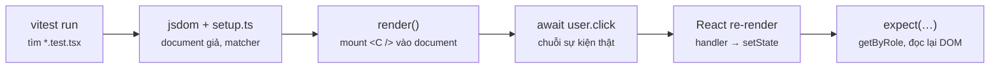
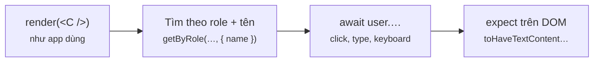
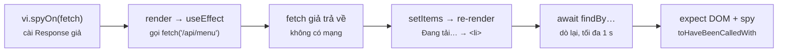
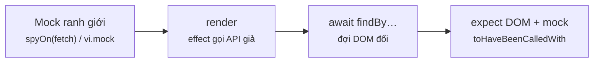

# Module 9 · Testing

_Vitest · Testing Library · user-event · findBy · vi.fn / vi.spyOn / vi.mock_

**Đã chạy với:** Node 22.22.0 · TypeScript 7.0.2 · React 19.3.1 · Vitest 5.0.5 · @testing-library/react 16.3.3 · @testing-library/user-event 14.6.8 · @testing-library/jest-dom 7.0.1 · jsdom 29.1.1

Test chạy bằng `npx vitest run` trong DOM giả **jsdom** (cấu hình ở `vitest.config.ts`, mở được ở mục 1 bài 9.1). Mọi file còn được kiểm riêng bằng `npx tsc -p .` (strict, không `any`). Thời gian (ms) trong log là số đo thật của lần build này. Test có dấu ❌ là bẫy cố tình đỏ — output đỏ cũng là thật.

Vị trí: Đã học Module 8 · TypeScript với React (props, event, form, ref, context có kiểu) · **Đang học Module 9** · Sắp tới Module 10 · Deployment & Build (build production, server-side routing, Vercel)

## Bài 9.1 · Test đầu tiên: Vitest, Testing Library, test theo cách user dùng

_Nguồn roadmap: [Academind] Understanding Different Kinds Of Tests → What To Test & How To Test → Running a First Test → Writing Our First Test → Testing User Interaction & State → Testing Connected Components_

### 1 · Một câu & nằm ở đâu
**Vitest** = test runner (≈ xUnit + `dotnet test`). **Testing Library** = render component rồi **tìm phần tử như user** (theo vai trò + tên hiển thị). **user-event** = giả lập thao tác thật (click, gõ phím). Quy tắc vàng: test **hành vi user thấy**, không test state hay markup bên trong — refactor không đổi hành vi thì test không được đỏ. Mỗi test theo AAA: `render` → `await user.click(…)` → `expect(…)` trên DOM.

**[Máy bạn: vitest watch]** → Commit → **[PR / CI: vitest run]** → E2E (Playwright) → Staging → Prod

<details><summary>vitest.config.ts — cấu hình: jsdom, setup, restoreMocks</summary>

`vitest.config.ts`

```tsx
// Vitest: chạy test trong DOM giả (jsdom), nạp matcher của jest-dom cho mọi file test
import { defineConfig } from "vitest/config";
import react from "@vitejs/plugin-react";

export default defineConfig({
  plugins: [react()],
  test: {
    environment: "jsdom",            // có document, window như trình duyệt
    setupFiles: ["./m9/setup.ts"],   // chạy trước mỗi file test
    restoreMocks: true,              // trả mọi vi.spyOn về bản gốc sau mỗi test
    env: { COLORS: "false" },        // DOM in ra khi lỗi không kèm mã màu (dễ đọc trong log CI)
  },
});
```

</details>

<details><summary>m9/setup.ts — nạp matcher jest-dom, dọn DOM sau mỗi test</summary>

`m9/setup.ts`

```tsx
// Thêm matcher cho DOM: toBeInTheDocument, toHaveTextContent, toBeDisabled…
import "@testing-library/jest-dom/vitest";
import { cleanup } from "@testing-library/react";
import { afterEach } from "vitest";

afterEach(() => cleanup());          // gỡ component đã render sau mỗi test
```

</details>

<details><summary>m9/cart.ts — logic thuần dùng ở ví dụ 1</summary>

`m9/cart.ts`

```tsx
// Logic thuần (không React): tính tiền giỏ hàng — thứ dễ test nhất
export type Line = { name: string; price: number; qty: number };

export function cartTotal(lines: Line[], voucherPct = 0): number {
  if (voucherPct < 0 || voucherPct > 50) throw new RangeError("voucher phải từ 0–50%");
  const sum = lines.reduce((s, l) => s + l.price * l.qty, 0);
  return Math.round((sum * (100 - voucherPct)) / 100 / 1000) * 1000;   // làm tròn nghìn đồng
}

export const vnd = (n: number) => n.toLocaleString("vi-VN") + "đ";
```

</details>

<details><summary>m9/QtyStepper.tsx — component của ví dụ 2</summary>

`m9/QtyStepper.tsx`

```tsx
// Chọn số ly 1–10: nút −/+ bị khoá ở 2 đầu
import { useState } from "react";

export function QtyStepper({ max = 10 }: { max?: number }) {
  const [qty, setQty] = useState(1);
  return (
    <div>
      <button aria-label="Bớt 1 ly" disabled={qty <= 1} onClick={() => setQty(qty - 1)}>−</button>
      <output aria-label="Số ly">{qty}</output>
      <button aria-label="Thêm 1 ly" disabled={qty >= max} onClick={() => setQty(qty + 1)}>+</button>
    </div>
  );
}
```

</details>

<details><summary>m9/OrderPanel.tsx — 3 component nối nhau, ví dụ 3</summary>

`m9/OrderPanel.tsx`

```tsx
// 3 component nối nhau: state ở OrderPanel, MenuRow báo lên, CartSummary hiện ra
import { useState } from "react";
import { cartTotal, vnd, type Line } from "./cart";

const MENU = [{ name: "Latte", price: 45000 }, { name: "Mocha", price: 50000 }];

function MenuRow({ name, price, onAdd }: { name: string; price: number; onAdd: () => void }) {
  return <li>{name} · {vnd(price)} <button onClick={onAdd}>Thêm {name}</button></li>;
}
function CartSummary({ lines }: { lines: Line[] }) {
  const cups = lines.reduce((s, l) => s + l.qty, 0);
  if (cups === 0) return <p>Giỏ trống</p>;
  return <p role="status">{cups} ly · {vnd(cartTotal(lines))}</p>;
}
export function OrderPanel() {
  const [lines, setLines] = useState<Line[]>([]);
  const add = (name: string, price: number) => setLines((ls) =>
    ls.some((l) => l.name === name)
      ? ls.map((l) => (l.name === name ? { ...l, qty: l.qty + 1 } : l))
      : [...ls, { name, price, qty: 1 }]);
  return (
    <section>
      <ul>{MENU.map((m) => <MenuRow key={m.name} {...m} onAdd={() => add(m.name, m.price)} />)}</ul>
      <CartSummary lines={lines} />
    </section>
  );
}
```

</details>

<details><summary>m9/ex/SizePicker.tsx — component cho mục 7</summary>

`m9/ex/SizePicker.tsx`

```tsx
// Chọn size cho 1 ly Latte, giá đổi theo size
import { useState } from "react";
import { vnd } from "../cart";

const PRICE = { S: 39000, M: 45000, L: 52000 } as const;
type Size = keyof typeof PRICE;

export function SizePicker() {
  const [size, setSize] = useState<Size>("M");
  return (
    <fieldset>
      <legend>Size</legend>
      {(Object.keys(PRICE) as Size[]).map((s) => (
        <label key={s}>
          <input type="radio" name="size" checked={size === s} onChange={() => setSize(s)} /> {s}
        </label>
      ))}
      <p role="status">Latte size {size} · {vnd(PRICE[size])}</p>
    </fieldset>
  );
}
```

</details>

### 2 · Concept
| Khái niệm | Trong React | Ghi chú | Bên C# |
|---|---|---|---|
| Unit test | Hàm thuần (`cartTotal`): `describe` / `test` / `expect`, `test.each` | Nhanh nhất (vài ms), không cần DOM | xUnit `[Fact]`, `[Theory]` + `[InlineData]` |
| Component test (integration) | `render(<OrderPanel />)` trong jsdom, thao tác bằng `user-event`, con chạy thật | **Viết nhiều nhất**: đủ nhanh, đủ thật | bUnit (Blazor) |
| E2E | Trình duyệt thật + backend thật (Playwright, Cypress) | Ít, chỉ cho luồng sống còn (đăng nhập, thanh toán) | Playwright .NET, Selenium |
| Tìm phần tử | `getByRole("button", { name })` > `getByLabelText` > `getByText`; tránh `querySelector`, class | `getBy` ném lỗi · `queryBy` trả `null` · `findBy` đợi (bài 9.2) | — |
| Khẳng định | `toBeInTheDocument`, `toHaveTextContent`, `toBeDisabled`, `toBeChecked` (jest-dom) | Đọc như câu, lỗi in rõ expected / received | FluentAssertions |

### 3 · Flow / lifecycle
**Chuyện gì xảy ra khi chạy 1 test component?**



Đọc sơ đồ: Trái → phải: Vitest tìm file `*.test.tsx`, dựng jsdom và chạy `setup.ts`. Test `render()` component vào `document` giả; `user.click()` phát cả chuỗi sự kiện như trình duyệt (pointer → mouse → click); React chạy handler và re-render; `expect` đọc lại DOM. Không có trình duyệt thật, không có CSS layout.

### 4 · Ví dụ thực tế
**Ví dụ 1.** Bắt đầu từ chỗ rẻ nhất: logic thuần, không dính React. `test.each` thay cho `[Theory]` + `[InlineData]`, `$pct` chèn tham số vào tên test.

`m9/l91-cart.test.ts`

```tsx
import { describe, test, expect } from "vitest";
import { cartTotal, type Line } from "./cart";

const lines: Line[] = [
  { name: "Latte", price: 45000, qty: 2 },
  { name: "Mocha", price: 50000, qty: 1 },
];

describe("cartTotal", () => {
  test("cộng giá × số ly", () => {
    expect(cartTotal(lines)).toBe(140000);           // Arrange ở trên, Act + Assert 1 dòng
  });

  test.each([
    { pct: 10, want: 126000 },
    { pct: 7, want: 130000 },                         // 130.200 → làm tròn nghìn
    { pct: 0, want: 140000 },
  ])("voucher $pct% → $want", ({ pct, want }) => {
    expect(cartTotal(lines, pct)).toBe(want);
  });

  test("voucher ngoài 0–50% thì ném lỗi", () => {
    expect(() => cartTotal(lines, 80)).toThrow(RangeError);
  });

  test("giỏ rỗng = 0", () => expect(cartTotal([])).toBe(0));
});
```

```console
❯ npx vitest run m9/l91-cart.test.ts --reporter=verbose

 RUN  v5.0.5 /home/claude/sandbox

 ✓ m9/l91-cart.test.ts > cartTotal > cộng giá × số ly 4ms
 ✓ m9/l91-cart.test.ts > cartTotal > voucher 10% → 126000 1ms
 ✓ m9/l91-cart.test.ts > cartTotal > voucher 7% → 130000 0ms
 ✓ m9/l91-cart.test.ts > cartTotal > voucher 0% → 140000 1ms
 ✓ m9/l91-cart.test.ts > cartTotal > voucher ngoài 0–50% thì ném lỗi 1ms
 ✓ m9/l91-cart.test.ts > cartTotal > giỏ rỗng = 0 0ms

 Test Files  1 passed (1)
      Tests  6 passed (6)
   Start at  14:46:32
   Duration  1.39s (environment 82%, setup 14%, transform 3%, import 1%, tests 1%)
```

6 test, mỗi test chỉ vài ms (xem log), không cần DOM. Kéo được logic tính toán ra hàm thuần (như `cartTotal`) là cách rẻ nhất để có test chắc — component chỉ còn việc hiển thị. `toBe` so `===`; object / mảng thì dùng `toEqual` (so theo giá trị, như `BeEquivalentTo`).

**Ví dụ 2.** Component có state: render, bấm như user, kiểm kết quả trên DOM. Phần tử được tìm theo **role + tên** (`aria-label` hoặc chữ trên nút) — đúng thứ screen reader đọc.

`m9/l91-stepper.test.tsx`

```tsx
import { render, screen } from "@testing-library/react";
import userEvent from "@testing-library/user-event";
import { test, expect } from "vitest";
import { QtyStepper } from "./QtyStepper";

test("bắt đầu 1 ly, nút Bớt bị khoá", () => {
  render(<QtyStepper />);
  expect(screen.getByRole("status", { name: "Số ly" })).toHaveTextContent("1");
  expect(screen.getByRole("button", { name: "Bớt 1 ly" })).toBeDisabled();
});

test("bấm Thêm 2 lần → 3 ly, Bớt mở lại", async () => {
  const user = userEvent.setup();                     // giả lập user thật: pointer, focus, keyboard
  render(<QtyStepper />);
  const plus = screen.getByRole("button", { name: "Thêm 1 ly" });
  await user.click(plus);
  await user.click(plus);
  expect(screen.getByRole("status", { name: "Số ly" })).toHaveTextContent("3");
  expect(screen.getByRole("button", { name: "Bớt 1 ly" })).toBeEnabled();
});

test("chạm max thì Thêm bị khoá", async () => {
  const user = userEvent.setup();
  render(<QtyStepper max={2} />);
  await user.click(screen.getByRole("button", { name: "Thêm 1 ly" }));
  expect(screen.getByRole("button", { name: "Thêm 1 ly" })).toBeDisabled();
});
```

```console
❯ npx vitest run m9/l91-stepper.test.tsx --reporter=verbose

 RUN  v5.0.5 /home/claude/sandbox

 ✓ m9/l91-stepper.test.tsx > bắt đầu 1 ly, nút Bớt bị khoá 222ms
 ✓ m9/l91-stepper.test.tsx > bấm Thêm 2 lần → 3 ly, Bớt mở lại 86ms
 ✓ m9/l91-stepper.test.tsx > chạm max thì Thêm bị khoá 46ms

 Test Files  1 passed (1)
      Tests  3 passed (3)
   Start at  14:46:35
   Duration  1.72s (environment 62%, tests 23%, setup 9%, import 3%, transform 1%)
```

Test không biết `qty` hay `useState` tồn tại — chỉ biết "có nút Thêm 1 ly, có ô Số ly". Thẻ `<output>` sẵn có role `status`. Gọi `userEvent.setup()` đầu mỗi test rồi `await` **mọi** thao tác: user-event chạy bất đồng bộ (pointer → focus → click) để giống trình duyệt.

**Ví dụ 3.** Connected components: render **cha** (`OrderPanel`) và để con thật chạy — không mock `MenuRow` hay `CartSummary`. Đây là "integration test" theo nghĩa của Testing Library.

`m9/l91-order.test.tsx`

```tsx
import { render, screen } from "@testing-library/react";
import userEvent from "@testing-library/user-event";
import { test, expect } from "vitest";
import { OrderPanel } from "./OrderPanel";

// Test cả cụm OrderPanel → MenuRow → CartSummary như user thấy, không mock component con
test("giỏ trống lúc đầu", () => {
  render(<OrderPanel />);
  expect(screen.getByText("Giỏ trống")).toBeInTheDocument();
  expect(screen.queryByRole("status")).not.toBeInTheDocument();   // query* trả null thay vì ném lỗi
});

test("thêm Latte 2 lần + Mocha 1 lần → 3 ly · 140.000đ", async () => {
  const user = userEvent.setup();
  render(<OrderPanel />);
  await user.click(screen.getByRole("button", { name: "Thêm Latte" }));
  await user.click(screen.getByRole("button", { name: "Thêm Latte" }));
  await user.click(screen.getByRole("button", { name: "Thêm Mocha" }));
  expect(screen.getByRole("status")).toHaveTextContent("3 ly · 140.000đ");
  expect(screen.getAllByRole("listitem")).toHaveLength(2);
});
```

```console
❯ npx vitest run m9/l91-order.test.tsx --reporter=verbose

 RUN  v5.0.5 /home/claude/sandbox

 ✓ m9/l91-order.test.tsx > giỏ trống lúc đầu 106ms
 ✓ m9/l91-order.test.tsx > thêm Latte 2 lần + Mocha 1 lần → 3 ly · 140.000đ 295ms

 Test Files  1 passed (1)
      Tests  2 passed (2)
   Start at  14:46:38
   Duration  2.23s (environment 63%, tests 20%, setup 11%, import 4%, transform 2%)
```

Test đi qua cả chuỗi: nút ở `MenuRow` → callback `onAdd` → state ở cha → props xuống `CartSummary` → `cartTotal`. Đổi cách chia component (gộp, tách, chuyển state sang Context) mà hành vi giữ nguyên thì test vẫn xanh. `queryBy…` trả `null` nên dùng để khẳng định **không có**; `getBy…` ném lỗi ngay.

### 5 · Thử thật / bẫy
**Bẫy 1.** **Quên `await` trước `user.click`.** Không lỗi compile, không cảnh báo — chỉ là `expect` chạy trước khi click xong.

`m9/l91-trap-await.test.tsx`

```tsx
import { render, screen } from "@testing-library/react";
import userEvent from "@testing-library/user-event";
import { test, expect } from "vitest";
import { QtyStepper } from "./QtyStepper";

test("quên await user.click", () => {
  const user = userEvent.setup();
  render(<QtyStepper />);
  user.click(screen.getByRole("button", { name: "Thêm 1 ly" }));      // ❌ trả Promise, không đợi
  expect(screen.getByRole("status", { name: "Số ly" })).toHaveTextContent("2");
});
```

```console
❯ npx vitest run m9/l91-trap-await.test.tsx --reporter=verbose
 × m9/l91-trap-await.test.tsx > quên await user.click 275ms
   → expect(element).toHaveTextContent()

Expected element to have text content:
  2
Received:
  1
```

(… còn 28 dòng — đã trích dòng 4–10 / 35 của `npx vitest run m9/l91-trap-await.test.tsx --reporter=verbose`)

`user.click` trả Promise; không `await` thì `expect` đọc DOM khi số ly vẫn là 1. Tệ hơn: nếu assertion tình cờ đúng ở trạng thái cũ, test **xanh giả**. Rule ESLint `@typescript-eslint/no-floating-promises` bắt được lỗi này — nên bật trong CI.

**Bẫy 2.** **Tên không khớp.** `name` so **cả chuỗi** tên truy cập được: nút "Thêm Latte" không khớp `"Thêm"`.

`m9/l91-trap-name.test.tsx`

```tsx
import { render, screen } from "@testing-library/react";
import { test } from "vitest";
import { OrderPanel } from "./OrderPanel";

test("tìm nút bằng tên sai", () => {
  render(<OrderPanel />);
  screen.getByRole("button", { name: "Thêm" });         // ❌ tên đầy đủ là "Thêm Latte"
});
```

```console
❯ npx vitest run m9/l91-trap-name.test.tsx --reporter=verbose
 × m9/l91-trap-name.test.tsx > tìm nút bằng tên sai 383ms
   → Unable to find an accessible element with the role "button" and name "Thêm"

Here are the accessible roles:

  list:

  Name "":
  <ul />

  --------------------------------------------------
  listitem:

  Name "":
  <li />

  Name "":
  <li />

  --------------------------------------------------
  button:

  Name "Thêm Latte":
  <button />

  Name "Thêm Mocha":
  <button />

```

(… còn 133 dòng — đã trích dòng 4–31 / 161 của `npx vitest run m9/l91-trap-name.test.tsx --reporter=verbose`)

Đọc lỗi này như bản đồ: Testing Library liệt kê **mọi role + tên** đang có trên trang. Sửa: `{ name: "Thêm Latte" }` hoặc regex `{ name: /thêm latte/i }`. Nếu danh sách không có role bạn cần (`<div onClick>` thay vì `<button>`) thì đó là lỗi a11y của component, không phải của test.

**Bẫy 3.** **Test bám markup.** `QtyStepperV2` là refactor giữ nguyên hành vi (đổi thứ tự nút, `<span role="status">` thay `<output>`). Chạy cùng 2 test cho cả 2 phiên bản.

`m9/l91-trap-impl.test.tsx`

```tsx
import { render, screen } from "@testing-library/react";
import userEvent from "@testing-library/user-event";
import { describe, test, expect } from "vitest";
import { QtyStepper as V1 } from "./QtyStepper";
import { QtyStepper as V2 } from "./QtyStepperV2";

describe.each([["V1", V1], ["V2 (refactor)", V2]])("%s", (_, Stepper) => {
  test("❌ bám markup: nút thứ 2, thẻ <output>", async () => {
    const { container } = render(<Stepper />);
    await userEvent.setup().click(container.querySelectorAll("button")[1]);
    expect(container.querySelector("output")).toHaveTextContent("2");
  });

  test("✅ bám hành vi: role + tên", async () => {
    render(<Stepper />);
    await userEvent.setup().click(screen.getByRole("button", { name: "Thêm 1 ly" }));
    expect(screen.getByRole("status", { name: "Số ly" })).toHaveTextContent("2");
  });
});
```

```console
❯ npx vitest run m9/l91-trap-impl.test.tsx --reporter=verbose
 ✓ m9/l91-trap-impl.test.tsx > V1 > ❌ bám markup: nút thứ 2, thẻ <output> 252ms
 ✓ m9/l91-trap-impl.test.tsx > V1 > ✅ bám hành vi: role + tên 56ms
 × m9/l91-trap-impl.test.tsx > V2 (refactor) > ❌ bám markup: nút thứ 2, thẻ <output> 28ms
   → expect(received).toHaveTextContent()

received value must be a Node.
Received has type:  Null
Received has value: null
 ✓ m9/l91-trap-impl.test.tsx > V2 (refactor) > ✅ bám hành vi: role + tên 42ms

```

(… còn 26 dòng — đã trích dòng 4–13 / 36 của `npx vitest run m9/l91-trap-impl.test.tsx --reporter=verbose`)

Test bám `querySelectorAll("button")[1]` và thẻ `output` đỏ ở V2 dù user không thấy khác gì — kiểu đỏ giả này làm team mất niềm tin vào test. Test bám role + tên xanh cả 2. Code AI hay sinh `container.querySelector(".class")` hoặc `data-testid` khắp nơi; `testid` chỉ dùng khi không có role / label / text nào hợp lý.

### 6 · Tóm tắt bằng hình
**(a) Cây thư mục sau bài này**

```text
sandbox/
├─ package.json  [SỬA]  ← "test": "vitest" (watch), "test:run": "vitest run" (CI)
├─ tsconfig.json  [SỬA]  ← include m9 + vitest.config.ts
├─ vitest.config.ts  [MỚI]  ← jsdom, setupFiles, restoreMocks
└─ m9/
   ├─ setup.ts  [MỚI]  ← jest-dom matchers + cleanup
   ├─ cart.ts  [MỚI]  ← logic thuần
   ├─ l91-cart.test.ts  [MỚI]  ← unit test + test.each
   ├─ QtyStepper.tsx  [MỚI]  ← component có state
   ├─ l91-stepper.test.tsx  [MỚI]  ← user-event + getByRole
   ├─ OrderPanel.tsx  [MỚI]  ← cha + 2 con
   ├─ l91-order.test.tsx  [MỚI]  ← test cả cụm, không mock con
   ├─ QtyStepperV2.tsx  [MỚI]  ← refactor cho bẫy 3
   ├─ l91-trap-*.test.tsx  [MỚI]  ← 3 bẫy (cố tình đỏ)
   └─ ex/SizePicker.tsx, ex91-*.test.tsx  [MỚI]  ← bài Làm ngay
```

**(b) Đọc trong 10 giây**

**Viết 1 test component theo thứ tự nào?**



Đọc sơ đồ: Render như app dùng, tìm phần tử như user thấy, thao tác có await, khẳng định trên DOM — không chạm vào state bên trong.

### 7 · Làm ngay (≤ 10 phút)
**Mục tiêu:** `SizePicker` (mở ở mục 1) đổi giá theo size. File test khởi đầu có 1 test đỏ và 1 test còn thiếu. Làm cả file xanh, rồi **chứng minh test có răng**: phá component thì test phải đỏ.

File khởi đầu:

`m9/ex/ex91-start.test.tsx`

```tsx
import { render, screen } from "@testing-library/react";
import userEvent from "@testing-library/user-event";
import { test, expect } from "vitest";
import { SizePicker } from "./SizePicker";

test("mặc định size M · 45.000đ", () => {
  render(<SizePicker />);
  expect(screen.getByRole("radio", { name: "M" })).toBeChecked();
  expect(screen.getByRole("status")).toHaveTextContent("45.000đ");
});

test("chọn L → 52.000đ", () => {
  const user = userEvent.setup();
  render(<SizePicker />);
  user.click(screen.getByRole("radio", { name: "L" }));
  expect(screen.getByRole("status")).toHaveTextContent("52.000đ");
});

// TODO: test "chọn S → 39.000đ, radio M không còn được chọn"
```

Chạy file khởi đầu (đang đỏ):

```console
❯ npx vitest run m9/ex/ex91-start.test.tsx --reporter=verbose
 ✓ m9/ex/ex91-start.test.tsx > mặc định size M · 45.000đ 275ms
 × m9/ex/ex91-start.test.tsx > chọn L → 52.000đ 64ms
   → expect(element).toHaveTextContent()

Expected element to have text content:
  52.000đ
Received:
  Latte size M · 45.000đ
```

(… còn 28 dòng — đã trích dòng 4–11 / 36 của `npx vitest run m9/ex/ex91-start.test.tsx --reporter=verbose`)

Tiêu chí nghiệm thu:

- [ ] Test `chọn L → 52.000đ` xanh
- [ ] Có thêm test `chọn S → 39.000đ, radio M không còn được chọn` (dùng `not.toBeChecked()`)
- [ ] Không dùng `container.querySelector` hay `data-testid`; mọi thao tác user đều `await`
- [ ] Đổi giá `L` trong `SizePicker.tsx` thành `50000` → test L đỏ; đổi lại → xanh
- [ ] `npx tsc -p .` không báo lỗi

Lệnh nghiệm thu:

```bash
npx vitest run m9/ex/ex91-start.test.tsx --reporter=verbose && npx tsc -p .
```

Lời giải tham chiếu chạy ra (output cần đạt):

```console
❯ npx vitest run m9/ex/ex91-solution.test.tsx --reporter=verbose

 RUN  v5.0.5 /home/claude/sandbox

 ✓ m9/ex/ex91-solution.test.tsx > mặc định size M · 45.000đ 315ms
 ✓ m9/ex/ex91-solution.test.tsx > chọn L → 52.000đ 65ms
 ✓ m9/ex/ex91-solution.test.tsx > chọn S → 39.000đ, radio M không còn được chọn 83ms

 Test Files  1 passed (1)
      Tests  3 passed (3)
   Start at  14:46:54
   Duration  1.94s (environment 59%, tests 27%, setup 9%, import 3%, transform 2%)
```

<details><summary>Gợi ý nếu bị đỏ</summary>

| Triệu chứng | Nguyên nhân | Sửa |
|---|---|---|
| Expected `52.000đ`, Received `Latte size M · 45.000đ` | `user.click` chưa xong khi `expect` chạy | `async () =>` + `await user.click(…)` |
| `Found multiple elements with the role "radio"` | Gọi `getByRole("radio")` mà không có `name` | Thêm `{ name: "S" }` |
| Đổi giá L mà test vẫn xanh | Assertion quá lỏng (chỉ kiểm `toBeChecked`) hoặc đang chạy nhầm file | Khẳng định trên giá hiển thị: `toHaveTextContent("52.000đ")` |

`m9/ex/ex91-start.test.tsx` (diff)

```diff
 });
 
-test("chọn L → 52.000đ", () => {
+test("chọn L → 52.000đ", async () => {
   const user = userEvent.setup();
   render(<SizePicker />);
-  user.click(screen.getByRole("radio", { name: "L" }));
+  await user.click(screen.getByRole("radio", { name: "L" }));
   expect(screen.getByRole("status")).toHaveTextContent("52.000đ");
 });
 
-// TODO: test "chọn S → 39.000đ, radio M không còn được chọn"
+test("chọn S → 39.000đ, radio M không còn được chọn", async () => {
+  const user = userEvent.setup();
+  render(<SizePicker />);
+  await user.click(screen.getByRole("radio", { name: "S" }));
+  expect(screen.getByRole("status")).toHaveTextContent("39.000đ");
+  expect(screen.getByRole("radio", { name: "M" })).not.toBeChecked();
+});
```

</details>

### 8 · 3 câu hỏi nhanh
1. Phỏng vấn: "Unit, integration, E2E khác nhau thế nào trong React? Bạn viết loại nào nhiều nhất?"

   <details><summary>Đáp án</summary>

   Unit: hàm thuần / logic, nhanh nhất. Integration (component test): render 1 cụm component thật trong jsdom, thao tác như user — **viết nhiều nhất** vì cân bằng tốc độ và độ tin cậy ("testing trophy" của Kent C. Dodds). E2E: trình duyệt thật + backend (Playwright, Cypress), số lượng ít, phủ các luồng sống còn. Map sang .NET: xUnit ↔ bUnit ↔ Playwright.

   </details>

2. `getByRole` hay `getByTestId` — chọn cái nào, vì sao?

   <details><summary>Đáp án</summary>

   `getByRole(…, { name })` trước: tìm đúng như user và screen reader thấy, nên vừa test hành vi vừa kiểm luôn a11y (nút là `<button>` thật, có tên). `data-testid` là lối thoát cuối khi không có role / label / text hợp lý — nó bắt markup giữ thuộc tính chỉ để phục vụ test, và không nói gì về trải nghiệm user.

   </details>

3. Review code AI: test spy vào `React.useState` để kiểm `setQty(2)` được gọi, và dùng `fireEvent.click`. Góp ý?

   <details><summary>Đáp án</summary>

   Đang test **cách viết** thay vì **kết quả**: đổi sang `useReducer` hay Zustand là test đỏ dù UI đúng (bẫy 3), còn UI hiển thị sai thì test vẫn xanh. Thay bằng render → `await user.click` → `expect(getByRole("status")).toHaveTextContent("2")`. `fireEvent` phát đúng 1 sự kiện; `user-event` phát cả chuỗi như trình duyệt (pointer, focus, gõ từng phím) — mặc định dùng user-event.

   </details>


---

## Bài 9.2 · Test async & mock: findBy, vi.fn, vi.spyOn(fetch), vi.mock

_Nguồn roadmap: [Academind] Testing Asynchronous Code → Working With Mocks_

### 1 · Một câu & nằm ở đâu
Component fetch dữ liệu thì DOM đổi **sau** render → dùng `await findBy…` (đợi, mặc định tối đa 1000 ms) thay `getBy…`. Test **không gọi backend thật**: thay `fetch` bằng `vi.spyOn(globalThis, "fetch")`, hoặc thay cả module API bằng `vi.mock("./api")`. `vi.fn()` ghi lại mọi lời gọi để `expect(…).toHaveBeenCalledWith(…)` — như `Mock<T>` + `Verify` của Moq. Chỉ mock ở **ranh giới** (mạng, thời gian), không mock component của chính bạn.

**[Máy bạn: vitest watch]** → Commit → **[PR / CI: vitest run]** → E2E (Playwright) → Staging → Prod

<details><summary>m9/api.ts — lớp gọi API: fetchMenu, postOrder</summary>

`m9/api.ts`

```tsx
// Lớp gọi API: component không gọi fetch trực tiếp → dễ mock ở 2 tầng (fetch hoặc module)
export type MenuItem = { id: string; name: string; price: number };

export async function fetchMenu(signal?: AbortSignal): Promise<MenuItem[]> {
  const res = await fetch("/api/menu", { signal });
  if (!res.ok) throw new Error(`HTTP ${res.status}`);
  return (await res.json()) as MenuItem[];        // thực tế: guard như bài 8.1
}

export async function postOrder(itemId: string, qty: number): Promise<{ orderId: string }> {
  const res = await fetch("/api/orders", {
    method: "POST",
    headers: { "Content-Type": "application/json" },
    body: JSON.stringify({ itemId, qty }),
  });
  if (!res.ok) throw new Error(`HTTP ${res.status}`);
  return (await res.json()) as { orderId: string };
}
```

</details>

<details><summary>m9/MenuList.tsx — tải menu: loading / lỗi + Thử lại / danh sách</summary>

`m9/MenuList.tsx`

```tsx
// Tải menu khi mount: 3 trạng thái loading / lỗi (có nút thử lại) / danh sách
import { useEffect, useState } from "react";
import { fetchMenu, type MenuItem } from "./api";
import { vnd } from "./cart";

export function MenuList() {
  const [items, setItems] = useState<MenuItem[] | null>(null);
  const [error, setError] = useState<string | null>(null);
  const [attempt, setAttempt] = useState(0);
  useEffect(() => {
    const ctrl = new AbortController();
    setError(null);
    fetchMenu(ctrl.signal).then(setItems, (e: Error) => {
      if (!ctrl.signal.aborted) setError(e.message);
    });
    return () => ctrl.abort();                       // cleanup: huỷ request cũ (Module 2)
  }, [attempt]);
  if (error) return <div role="alert">Không tải được menu ({error})
    <button onClick={() => setAttempt((a) => a + 1)}>Thử lại</button></div>;
  if (!items) return <p>Đang tải…</p>;
  return <ul>{items.map((m) => <li key={m.id}>{m.name} · {vnd(m.price)}</li>)}</ul>;
}
```

</details>

<details><summary>m9/OrderButton.tsx — gửi đơn, báo mã đơn qua onDone</summary>

`m9/OrderButton.tsx`

```tsx
// Gửi đơn: khoá nút khi đang gửi, xong thì báo mã đơn lên cha qua onDone
import { useState } from "react";
import { postOrder } from "./api";

type Props = { itemId: string; qty: number; onDone: (orderId: string) => void };

export function OrderButton({ itemId, qty, onDone }: Props) {
  const [sending, setSending] = useState(false);
  async function send() {
    setSending(true);
    try {
      const { orderId } = await postOrder(itemId, qty);
      onDone(orderId);
    } finally {
      setSending(false);
    }
  }
  return <button disabled={sending} onClick={send}>{sending ? "Đang gửi…" : `Đặt ${qty} ly`}</button>;
}
```

</details>

### 2 · Concept
| Khái niệm | Viết | Ghi chú | Bên C# |
|---|---|---|---|
| `findBy…` | `await screen.findByRole("alert")` | = `getBy` + đợi: dò lại khi DOM đổi và mỗi 50 ms, tối đa 1000 ms | Polling / `await` Task |
| `vi.fn()` | `const onDone = vi.fn()` → `toHaveBeenCalledWith("A12")` | Hàm giả ghi lại tham số và số lần gọi | Moq `Mock<T>` + `Verify` |
| `vi.spyOn(globalThis, "fetch")` | `.mockResolvedValueOnce(Response.json(…))` | Câu trả lời xếp hàng theo thứ tự gọi; `restoreMocks: true` trả `fetch` thật sau mỗi test | `HttpMessageHandler` giả |
| `vi.mock("./api")` | Mọi export thành `vi.fn()`; `vi.mocked(postOrder)` để có kiểu | Được đưa lên đầu file, trước mọi `import` | Đăng ký fake service vào DI |
| Mock ở tầng nào | module < `fetch` < mạng (MSW) | Càng gần mạng, càng nhiều code thật được test | `WebApplicationFactory` + handler giả |

### 3 · Flow / lifecycle
**Test async chạy theo thứ tự nào khi fetch đã bị thay?**



Đọc sơ đồ: Trái → phải: test cài `fetch` giả **trước** khi render. Effect gọi `fetch` → nhận `Response` giả ngay, không có mạng → `setItems` → re-render. Trong lúc đó `findBy…` dò DOM mỗi khi DOM đổi và mỗi 50 ms, tối đa 1000 ms: thấy thì trả phần tử, hết giờ thì ném lỗi kèm DOM hiện tại.

### 4 · Ví dụ thực tế
**Ví dụ 1.** Menu tải khi mount. Cài `fetch` giả trả 2 món, render, khẳng định "Đang tải…" **ngay**, rồi `await findAllByRole` đợi danh sách.

`m9/l92-find.test.tsx`

```tsx
import { render, screen } from "@testing-library/react";
import { test, expect, vi } from "vitest";
import { MenuList } from "./MenuList";

test("hiện Đang tải… rồi ra danh sách", async () => {
  const fetchSpy = vi.spyOn(globalThis, "fetch").mockResolvedValue(Response.json([
    { id: "m1", name: "Latte", price: 45000 },
    { id: "m2", name: "Mocha", price: 50000 },
  ]));
  render(<MenuList />);
  expect(screen.getByText("Đang tải…")).toBeInTheDocument();     // ngay sau render: chưa có data

  const rows = await screen.findAllByRole("listitem");            // find* = đợi tới khi xuất hiện
  expect(rows.map((r) => r.textContent)).toEqual(["Latte · 45.000đ", "Mocha · 50.000đ"]);
  expect(screen.queryByText("Đang tải…")).not.toBeInTheDocument();
  expect(fetchSpy).toHaveBeenCalledTimes(1);
  expect(fetchSpy).toHaveBeenCalledWith("/api/menu", expect.objectContaining({ signal: expect.any(AbortSignal) }));
});
```

```console
❯ npx vitest run m9/l92-find.test.tsx --reporter=verbose

 RUN  v5.0.5 /home/claude/sandbox

 ✓ m9/l92-find.test.tsx > hiện Đang tải… rồi ra danh sách 252ms

 Test Files  1 passed (1)
      Tests  1 passed (1)
   Start at  14:46:58
   Duration  1.88s (environment 67%, tests 16%, setup 12%, transform 3%, import 1%, worker 1%)
```

Đọc thứ tự: `getByText("Đang tải…")` pass vì lúc đó fetch chưa trả; `findAllByRole` đợi tới khi có `<li>`. `expect.objectContaining` / `expect.any(AbortSignal)` so khớp một phần — như `It.Is<T>(…)` trong Moq. Không server, không mạng: test luôn ra cùng kết quả.

**Ví dụ 2.** Luồng lỗi — thứ code AI hay quên test. `mockResolvedValueOnce` xếp hàng câu trả lời theo thứ tự gọi: lần 1 `503`, lần 2 OK.

`m9/l92-error.test.tsx`

```tsx
import { render, screen } from "@testing-library/react";
import userEvent from "@testing-library/user-event";
import { test, expect, vi } from "vitest";
import { MenuList } from "./MenuList";

test("API 503 → báo lỗi, bấm Thử lại → ra menu", async () => {
  const fetchSpy = vi.spyOn(globalThis, "fetch")
    .mockResolvedValueOnce(Response.json({ error: "busy" }, { status: 503 }))   // lần 1: lỗi
    .mockResolvedValueOnce(Response.json([{ id: "m1", name: "Latte", price: 45000 }])); // lần 2: OK
  const user = userEvent.setup();
  render(<MenuList />);

  const alert = await screen.findByRole("alert");
  expect(alert).toHaveTextContent("Không tải được menu (HTTP 503)");

  await user.click(screen.getByRole("button", { name: "Thử lại" }));
  expect(await screen.findByRole("listitem")).toHaveTextContent("Latte · 45.000đ");
  expect(screen.queryByRole("alert")).not.toBeInTheDocument();
  expect(fetchSpy).toHaveBeenCalledTimes(2);
});
```

```console
❯ npx vitest run m9/l92-error.test.tsx --reporter=verbose

 RUN  v5.0.5 /home/claude/sandbox

 ✓ m9/l92-error.test.tsx > API 503 → báo lỗi, bấm Thử lại → ra menu 342ms

 Test Files  1 passed (1)
      Tests  1 passed (1)
   Start at  14:47:01
   Duration  2.14s (environment 66%, tests 18%, setup 9%, import 4%, transform 3%)
```

Test đi hết vòng: lỗi hiện trong `role="alert"` → bấm Thử lại → effect chạy lại (`attempt` đổi) → danh sách ra, alert biến mất, `fetch` đúng 2 lần. `restoreMocks: true` trong config trả `fetch` thật lại sau mỗi test — các test không dính mock của nhau.

**Ví dụ 3.** Mock ở tầng **module**: `vi.mock("./api")` biến mọi export thành `vi.fn()`. Tự giữ hàm `resolve` của Promise để "dừng hình" ở trạng thái đang gửi.

`m9/l92-mock-module.test.tsx`

```tsx
import { render, screen } from "@testing-library/react";
import userEvent from "@testing-library/user-event";
import { test, expect, vi } from "vitest";
import { postOrder } from "./api";
import { OrderButton } from "./OrderButton";

vi.mock("./api");                       // thay CẢ module bằng hàm giả (vi.fn), được hoist lên đầu file

test("bấm Đặt → gọi postOrder đúng tham số, khoá nút, báo mã đơn", async () => {
  let finish!: (v: { orderId: string }) => void;              // tự quyết lúc nào API "trả về"
  vi.mocked(postOrder).mockReturnValue(new Promise((r) => { finish = r; }));
  const onDone = vi.fn();
  const user = userEvent.setup();
  render(<OrderButton itemId="m1" qty={2} onDone={onDone} />);

  await user.click(screen.getByRole("button", { name: "Đặt 2 ly" }));
  expect(postOrder).toHaveBeenCalledWith("m1", 2);
  expect(screen.getByRole("button", { name: "Đang gửi…" })).toBeDisabled();
  expect(onDone).not.toHaveBeenCalled();

  finish({ orderId: "A12" });                                   // API trả lời
  expect(await screen.findByRole("button", { name: "Đặt 2 ly" })).toBeEnabled();
  expect(onDone).toHaveBeenCalledExactlyOnceWith("A12");
});
```

```console
❯ npx vitest run m9/l92-mock-module.test.tsx --reporter=verbose

 RUN  v5.0.5 /home/claude/sandbox

 ✓ m9/l92-mock-module.test.tsx > bấm Đặt → gọi postOrder đúng tham số, khoá nút, báo mã đơn 309ms

 Test Files  1 passed (1)
      Tests  1 passed (1)
   Start at  14:47:04
   Duration  1.89s (environment 65%, tests 19%, setup 10%, import 4%, transform 2%)
```

`vi.mock` được Vitest **đưa lên đầu file** trước mọi `import`, nên `OrderButton` nhận bản giả. `vi.mocked(postOrder)` chỉ để TS biết đây là mock (có `.mockReturnValue`). `onDone = vi.fn()` kiểm hợp đồng giữa component và cha: gọi đúng 1 lần, đúng mã đơn, và **không** gọi trước khi API trả lời.

### 5 · Thử thật / bẫy
**Bẫy 1.** **`getBy` cho dữ liệu đến sau.** Component đúng, nhưng test đọc DOM ngay sau render.

`m9/l92-trap-getby.test.tsx`

```tsx
import { render, screen } from "@testing-library/react";
import { test, expect, vi } from "vitest";
import { MenuList } from "./MenuList";

test("dùng getBy cho dữ liệu đến sau", () => {
  vi.spyOn(globalThis, "fetch").mockResolvedValue(Response.json([{ id: "m1", name: "Latte", price: 45000 }]));
  render(<MenuList />);
  expect(screen.getByRole("listitem")).toHaveTextContent("Latte");   // ❌ getBy chỉ nhìn DOM lúc này
});
```

```console
❯ npx vitest run m9/l92-trap-getby.test.tsx --reporter=verbose
 × m9/l92-trap-getby.test.tsx > dùng getBy cho dữ liệu đến sau 265ms
   → Unable to find an accessible element with the role "listitem"

Here are the accessible roles:

  paragraph:

  Name "":
  <p />

  --------------------------------------------------

Ignored nodes: comments, script, style
<body>
  <div>
    <p>
      Đang tải…
    </p>
  </div>
</body>
```

(… còn 45 dòng — đã trích dòng 4–23 / 65 của `npx vitest run m9/l92-trap-getby.test.tsx --reporter=verbose`)

Lỗi in luôn DOM lúc đó: chỉ có "Đang tải…". Dữ liệu async → `await findBy…`. Ngược lại, đừng rải `findBy` cho thứ có sẵn: nó che lỗi bằng cách đợi vô ích tới 1 giây.

**Bẫy 2.** **Quên mock `fetch`.** Test chạy `fetch` thật của Node.

`m9/l92-trap-nomock.test.tsx`

```tsx
import { render, screen } from "@testing-library/react";
import { test, expect } from "vitest";
import { MenuList } from "./MenuList";

test("quên mock fetch", async () => {
  render(<MenuList />);                                             // ❌ fetch thật chạy trong Node
  expect(await screen.findByRole("listitem")).toBeInTheDocument();
});
```

```console
❯ npx vitest run m9/l92-trap-nomock.test.tsx --reporter=verbose
 × m9/l92-trap-nomock.test.tsx > quên mock fetch 1030ms
   → Unable to find role="listitem"

Ignored nodes: comments, script, style
<body>
  <div>
    <div
      role="alert"
    >
      Không tải được menu (
      Failed to parse URL from /api/menu
      )
      <button>
        Thử lại
      </button>
    </div>
  </div>
</body>
```

(… còn 73 dòng — đã trích dòng 4–21 / 91 của `npx vitest run m9/l92-trap-nomock.test.tsx --reporter=verbose`)

Trong trình duyệt `/api/menu` là URL tương đối hợp lệ; trong Node không có origin nên `fetch` ném "Failed to parse URL" — component rơi vào nhánh lỗi, test đợi đủ 1 giây rồi đỏ. Nếu URL tuyệt đối thì tệ hơn: test gọi server thật, chậm và lúc xanh lúc đỏ. Chặn từ gốc: dùng MSW (mock ở tầng mạng) và cấu hình báo lỗi khi có request chưa khai báo.

**Bẫy 3.** **1 `Response` cho mọi lần gọi.** Test xanh ở chế độ thường nhưng đỏ khi bọc `<StrictMode>` (dev chạy effect 2 lần — Module 2).

`m9/l92-trap-body.test.tsx`

```tsx
import { render, screen } from "@testing-library/react";
import { StrictMode } from "react";
import { test, expect, vi } from "vitest";
import { MenuList } from "./MenuList";

const menu = [{ id: "m1", name: "Latte", price: 45000 }];

test("❌ mockResolvedValue: 1 Response dùng cho mọi lần gọi", async () => {
  vi.spyOn(globalThis, "fetch").mockResolvedValue(Response.json(menu));
  render(<StrictMode><MenuList /></StrictMode>);                     // dev: effect chạy 2 lần
  expect(await screen.findByRole("listitem")).toHaveTextContent("Latte");
});

test("✅ mockImplementation: mỗi lần gọi 1 Response mới", async () => {
  vi.spyOn(globalThis, "fetch").mockImplementation(async () => Response.json(menu));
  render(<StrictMode><MenuList /></StrictMode>);
  expect(await screen.findByRole("listitem")).toHaveTextContent("Latte");
});
```

```console
❯ npx vitest run m9/l92-trap-body.test.tsx --reporter=verbose -t mockResolvedValue
 × m9/l92-trap-body.test.tsx > ❌ mockResolvedValue: 1 Response dùng cho mọi lần gọi 1037ms
   → Unable to find role="listitem"

Ignored nodes: comments, script, style
<body>
  <div>
    <div
      role="alert"
    >
      Không tải được menu (
      Body is unusable: Body has already been read
      )
      <button>
        Thử lại
      </button>
    </div>
  </div>
</body>

❯ npx vitest run m9/l92-trap-body.test.tsx --reporter=verbose -t mockImplementation
 ↓ m9/l92-trap-body.test.tsx > ❌ mockResolvedValue: 1 Response dùng cho mọi lần gọi
 ✓ m9/l92-trap-body.test.tsx > ✅ mockImplementation: mỗi lần gọi 1 Response mới 252ms
```

(… còn 74 dòng — đã trích dòng 4–21 / 92 của `npx vitest run m9/l92-trap-body.test.tsx --reporter=verbose -t mockResolvedValue`)

(… còn 8 dòng — đã trích dòng 4–5 / 10 của `npx vitest run m9/l92-trap-body.test.tsx --reporter=verbose -t mockImplementation`)

Body của `Response` là stream, đọc 1 lần là hết. `mockResolvedValue(x)` trả **cùng** object `x` cho mọi lần gọi: lần đầu `.json()` đọc mất, lần 2 nổ "Body is unusable". `mockImplementation(async () => Response.json(…))` tạo Response mới mỗi lần. Cùng lỗi khi 2 component gọi chung 1 API, hoặc có retry.

### 6 · Tóm tắt bằng hình
**(a) Cây thư mục sau bài này**

```text
sandbox/m9/
├─ api.ts  [MỚI]  ← fetchMenu, postOrder — ranh giới để mock
├─ MenuList.tsx  [MỚI]  ← loading / lỗi + Thử lại / danh sách
├─ OrderButton.tsx  [MỚI]  ← khoá nút khi gửi, gọi onDone
├─ l92-find.test.tsx  [MỚI]  ← spyOn(fetch) + findAllByRole
├─ l92-error.test.tsx  [MỚI]  ← mockResolvedValueOnce + Thử lại
├─ l92-mock-module.test.tsx  [MỚI]  ← vi.mock + vi.fn + Promise tự resolve
├─ l92-trap-*.test.tsx  [MỚI]  ← 3 bẫy (cố tình đỏ)
└─ ex/
   ├─ OrderButton.tsx  [MỚI]  ← bản copy để sửa ở mục 7
   ├─ OrderButton.fixed.tsx  [MỚI]  ← lời giải tham chiếu
   └─ ex92-*.test.tsx  [MỚI]  ← test luồng API lỗi
```

**(b) Đọc trong 10 giây**

**Mock ở đâu và đợi thế nào?**



Đọc sơ đồ: Thay ranh giới (fetch hoặc module API) trước khi render; dữ liệu đến sau thì await findBy; cuối cùng kiểm cả DOM lẫn lời gọi.

### 7 · Làm ngay (≤ 10 phút)
**Mục tiêu:** Test luồng **API lỗi** của `OrderButton` đã viết sẵn và đang đỏ — vì component có bug: không bắt lỗi. **Sửa component** `m9/ex/OrderButton.tsx` (không sửa test) cho tới khi xanh. Đây đúng là dòng "thiếu error state khi mutation fail" trong checklist review code AI ở roadmap.

File khởi đầu:

`m9/ex/ex92-start.test.tsx`

```tsx
import { render, screen } from "@testing-library/react";
import userEvent from "@testing-library/user-event";
import { test, expect, vi } from "vitest";
import { postOrder } from "../api";
import { OrderButton } from "./OrderButton";

vi.mock("../api");

test("API lỗi → báo lỗi, nút mở lại, không gọi onDone", async () => {
  vi.mocked(postOrder).mockRejectedValue(new Error("HTTP 500"));
  const onDone = vi.fn();
  const user = userEvent.setup();
  render(<OrderButton itemId="m1" qty={1} onDone={onDone} />);

  await user.click(screen.getByRole("button", { name: "Đặt 1 ly" }));
  expect(await screen.findByRole("alert")).toHaveTextContent("Đặt món lỗi: HTTP 500");
  expect(screen.getByRole("button", { name: "Đặt 1 ly" })).toBeEnabled();
  expect(onDone).not.toHaveBeenCalled();
});
```

Chạy file khởi đầu (đang đỏ):

```console
❯ npx vitest run m9/ex/ex92-start.test.tsx
 ❯ m9/ex/ex92-start.test.tsx (1 test | 1 failed) 1256ms
   × API lỗi → báo lỗi, nút mở lại, không gọi onDone 1254ms

⎯⎯⎯⎯⎯⎯⎯ Failed Tests 1 ⎯⎯⎯⎯⎯⎯⎯

 FAIL  m9/ex/ex92-start.test.tsx > API lỗi → báo lỗi, nút mở lại, không gọi onDone
TestingLibraryElementError: Unable to find role="alert"

Ignored nodes: comments, script, style
<body>
  <div>
    <button>
      Đặt 1 ly
    </button>
  </div>
</body>
⎯⎯⎯⎯⎯⎯ Unhandled Errors ⎯⎯⎯⎯⎯⎯

Vitest caught 1 unhandled error during the test run.
This might cause false positive tests. Resolve unhandled errors to make sure your tests are not affected.

⎯⎯⎯⎯ Unhandled Rejection ⎯⎯⎯⎯⎯
Error: HTTP 500
```

(… còn 51 dòng — đã trích dòng 4–19, 41–47 / 74 của `npx vitest run m9/ex/ex92-start.test.tsx`)

Tiêu chí nghiệm thu:

- [ ] Test xanh và output **không còn** mục `Unhandled Rejection`
- [ ] Lỗi hiện trong `role="alert"`: `Đặt món lỗi: HTTP 500`
- [ ] Nút mở lại sau lỗi; `onDone` không bị gọi
- [ ] Bấm gửi lần nữa thì lỗi cũ bị xoá trước khi gửi
- [ ] Không sửa file test; `npx tsc -p .` không báo lỗi

Lệnh nghiệm thu:

```bash
npx vitest run m9/ex/ex92-start.test.tsx && npx tsc -p .
```

Lời giải tham chiếu chạy ra (output cần đạt):

```console
❯ npx vitest run m9/ex/ex92-solution.test.tsx --reporter=verbose

 RUN  v5.0.5 /home/claude/sandbox

 ✓ m9/ex/ex92-solution.test.tsx > API lỗi → báo lỗi, nút mở lại, không gọi onDone 333ms

 Test Files  1 passed (1)
      Tests  1 passed (1)
   Start at  14:47:26
   Duration  1.86s (environment 64%, tests 21%, setup 9%, import 4%, transform 3%)
```

<details><summary>Gợi ý nếu bị đỏ</summary>

| Triệu chứng | Nguyên nhân | Sửa |
|---|---|---|
| `Unhandled Rejection ` Error: HTTP 500› | `await postOrder` ném lỗi trong handler `onClick` — không ai bắt | Thêm `catch (e) { setError((e as Error).message); }` vào khối `try` |
| `Unable to find role="alert"` dù đã có `catch` | Bắt lỗi nhưng không hiển thị gì | `{error && <p role="alert">Đặt món lỗi: {error}</p>}` |
| Received `Đặt món lỗi: Error: HTTP 500` | Hiển thị `String(e)` thay vì `message` | `(e as Error).message` |

`m9/ex/OrderButton.tsx` (diff)

```diff
 export function OrderButton({ itemId, qty, onDone }: Props) {
   const [sending, setSending] = useState(false);
+  const [error, setError] = useState<string | null>(null);
   async function send() {
     setSending(true);
+    setError(null);
     try {
       const { orderId } = await postOrder(itemId, qty);
       onDone(orderId);
+    } catch (e) {
+      setError((e as Error).message);
     } finally {
       setSending(false);
     }
   }
-  return <button disabled={sending} onClick={send}>{sending ? "Đang gửi…" : `Đặt ${qty} ly`}</button>;
+  return <>
+    <button disabled={sending} onClick={send}>{sending ? "Đang gửi…" : `Đặt ${qty} ly`}</button>
+    {error && <p role="alert">Đặt món lỗi: {error}</p>}
+  </>;
 }
```

</details>

### 8 · 3 câu hỏi nhanh
1. `getBy` / `queryBy` / `findBy` — dùng cái nào khi nào?

   <details><summary>Đáp án</summary>

   `getBy`: phần tử **phải có ngay** (không có thì ném lỗi kèm DOM). `queryBy`: khẳng định **không có** (trả `null`, đi với `.not.toBeInTheDocument()`). `findBy`: phần tử **sẽ xuất hiện** sau việc async (trả Promise, đợi tối đa 1000 ms) — luôn `await`. Bản `…All…` trả mảng.

   </details>

2. Mock `fetch`, mock module `./api`, hay MSW — chọn thế nào?

   <details><summary>Đáp án</summary>

   Càng mock gần mạng, càng nhiều code thật được test. `vi.mock("./api")`: gọn khi chỉ quan tâm component gọi đúng hàm (ví dụ 3), nhưng bỏ qua code trong `api.ts`. `vi.spyOn(fetch)`: phủ cả `api.ts` (status, parse JSON). MSW: chặn ở tầng mạng theo URL + method, handler dùng chung cho test và môi trường dev — lựa chọn phổ biến khi app có nhiều API. Quy tắc chung: không mock component của chính mình.

   </details>

3. Review code AI: test có `await new Promise((r) => setTimeout(r, 2000))` trước `expect`, và config không có `restoreMocks`. Rủi ro?

   <details><summary>Đáp án</summary>

   `setTimeout` cố định: chậm (2 s mỗi test) mà vẫn có thể đỏ trên CI chậm → thay bằng `await findBy…` hoặc `waitFor` (đợi đúng điều kiện, có là đi tiếp). Không restore: `fetch` giả của test trước sống sang test sau trong cùng file → kết quả phụ thuộc thứ tự chạy, chạy riêng 1 test thì đỏ. Bật `restoreMocks: true` (như sandbox này).

   </details>

